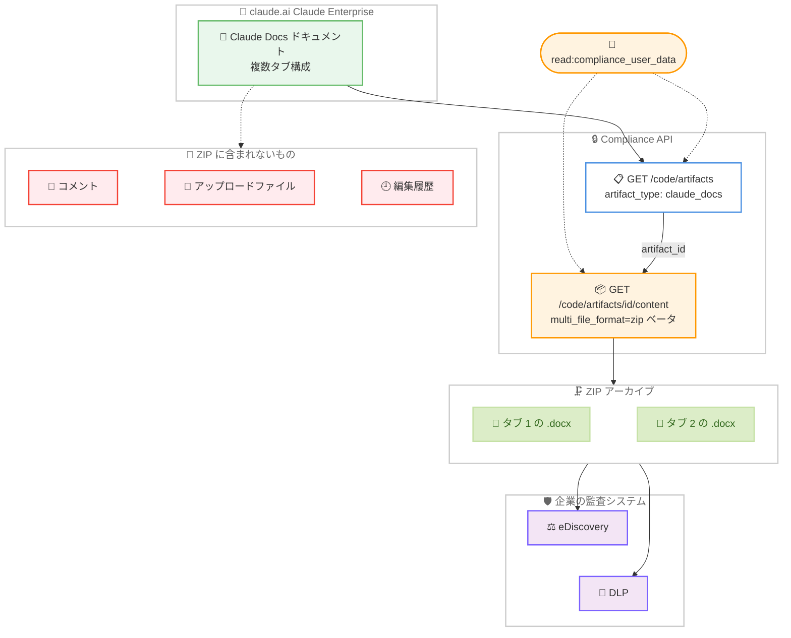

# Compliance API が Claude Docs ドキュメントの Word ファイルダウンロードに対応 (ベータ)

## メタデータ

| 項目 | 内容 |
|------|------|
| 発表日 | 2026-10-08 |
| ソース | Claude Developer Platform Release Notes |
| カテゴリ | Compliance API / エンタープライズ / コンプライアンス |
| 公式リンク | https://platform.claude.com/docs/en/release-notes/overview |

## 概要

Anthropic は 2026 年 10 月 8 日、Claude Developer Platform のリリースノートで、Compliance API が Claude Docs ドキュメントを Word ファイルとしてダウンロードできるようになったことを発表した。リリースノートの原文は次のとおりで、ベータ提供であることが明記されている。

> The Compliance API can now download Claude Docs documents as Word files, in beta. See Retrieve files and artifacts.

公式ドキュメントによると、Claude Docs ドキュメントは List code artifacts エンドポイントに `artifact_type` が `claude_docs` のアーティファクトとして一覧され、コンテンツエンドポイントを `multi_file_format=zip` 付きで呼び出すと、テキストを持つタブごとに 1 つの Word (.docx) ファイルを含む ZIP アーカイブが返る。コメント、アップロードされたファイル、編集履歴は含まれない。本ページのエンドポイントは Claude Enterprise 組織のみが利用できる。

なお、同日のリリースノートには、Compliance API のチャットエンドポイントが統合 Claude 体験のチャットに対応した変更も含まれるが、これは別レポート ([Compliance API のチャットエンドポイントが統合 Claude 体験のチャットに対応](2026-10-08-compliance-api-chat-endpoint.md)) で扱う。

## 詳細

### 背景

Compliance API は、Claude Enterprise 組織のコンプライアンス担当者向けに、eDiscovery (電子証拠開示) エクスポート、DLP (データ損失防止) 連携、アカウント削除対応のためのデータアクセスを提供する API である。チャット、ファイル、プロジェクトを扱うエンドポイント群では、ファイルやアーティファクトを ID 指定でダウンロードできる。

公式ドキュメント ([Retrieve and delete chats, files, and projects](https://platform.claude.com/docs/en/manage-claude/compliance-content-data)) によると、ファイルとアーティファクトは原則として独立に一覧されず、チャットメッセージエンドポイントの `files` / `generated_files` / `artifacts` 配列、またはプロジェクト添付エンドポイントから得た ID でダウンロードする。今回の対応により、Claude Docs ドキュメントだけはこの原則の例外として、専用の一覧経路とダウンロード経路を持つことが明記された。

> Files and artifacts are downloaded by ID. Except for Claude Docs documents (see the end of this section), they aren't listed independently.

Compliance API のカバレッジは 2026 年を通じて段階的に拡大しており、直近の経緯は以下の関連レポートを参照。

- [Compliance API: Microsoft 365 ローカルセッションが GA、Activity Feed がファイル名・タイトルを非返却に (2026-09-24)](2026-09-24-compliance-api-m365-activity-feed.md)
- [Compliance API のチャットエンドポイントが統合 Claude 体験のチャットに対応 (2026-10-08)](2026-10-08-compliance-api-chat-endpoint.md)

### 主な変更点

#### Claude Docs ドキュメントのダウンロード (ベータ)

公式ドキュメントは次のように記述している。

> Claude Docs documents are listed separately, by List code artifacts, with `artifact_type` set to `claude_docs`. A document's `versions` list is empty and its `published_version_id` is `null`. To download a document's current text, call `GET /v1/compliance/apps/code/artifacts/{artifact_id}/content?multi_file_format=zip`. It returns a ZIP archive with one Word (.docx) file for each tab that holds text. Comments, uploaded files, and edit history aren't included. Downloading Claude Docs through the Compliance API is in beta.

ポイントは以下の 5 点である。

1. **一覧は List code artifacts で行う**: Claude Docs ドキュメントは `GET /v1/compliance/apps/code/artifacts` で、`artifact_type` が `claude_docs` のエントリとして返る
2. **バージョンは公開されない**: Claude Docs ドキュメントの `versions` リストは空で、`published_version_id` は `null` である。取得できるのは現在のテキストのみ
3. **ダウンロードは ZIP 形式**: `GET /v1/compliance/apps/code/artifacts/{artifact_id}/content?multi_file_format=zip` が、テキストを持つタブごとに 1 つの Word (.docx) ファイルを含む ZIP アーカイブを返す
4. **含まれない内容がある**: コメント、アップロードされたファイル、編集履歴は ZIP に含まれない
5. **ベータ提供**: Compliance API 経由の Claude Docs ダウンロードはベータであり、仕様が変わる可能性がある

#### 対象と認証

- 本機能を含むページのエンドポイントは **Claude Enterprise 組織のみ**が利用できる
- 取得には claude.ai で作成した Compliance Access Key (`sk-ant-api01-...`) の `read:compliance_user_data` スコープが必要である
- チャット、ファイル、プロジェクト系のエンドポイントは Admin API キー (`sk-ant-admin01-...`) では利用できず、403 Forbidden が返る

### 技術的な詳細

#### List code artifacts エンドポイント

API リファレンス ([List Code Artifacts](https://platform.claude.com/docs/en/api/compliance/code/artifacts/list)) によると、`GET /v1/compliance/apps/code/artifacts` は親組織配下の組織が所有するアーティファクトを一覧する。主なパラメータとレスポンスフィールドは以下のとおり。

| 項目 | 内容 |
|------|------|
| `limit` | 最大件数 (デフォルト 20、最大 100) |
| `organization_ids` | 組織 ID フィルター (最大 500 件) |
| `user_ids` | 所有者ユーザー ID フィルター (最大 200 件) |
| `updated_at.gt/gte/lt/lte` | 更新日時フィルター (RFC 3339 形式) |
| `page` | 前のレスポンスの `next_page` トークンによるページネーション |

レスポンスの `artifact_type` は `claude_docs` のほか、`claude_slides` (Slides)、`claude_design` (Design)、`claude_design_systems` (デザインシステム)、`claude_motion` (Motion)、`code` (Claude Code から公開されたサイト)、`other` を取り得る。各エントリには所有者情報 (`owner_user_id`、`user`)、公開範囲 (`read_mode`: `owner` / `users` / `org` / `public`)、更新日時 (`updated_at`) が含まれる。

結果はアーティファクト ID 順にソートされ、ページネーションは `next_page` トークン方式である。`has_more` が true でも次ページが空の場合があるため、`next_page` が無くなるまで続ける必要がある。また、`updated_at` の時間フィルターは結果整合性のあるインデックスに対して照合されるため、コンプライアンス上完全な列挙には時間フィルターを省略すること、増分エクスポートではウィンドウ間に十分な重なりを設けて `id` で重複排除することが推奨されている。

#### Claude Docs ドキュメントと他のアーティファクトの違い

| 項目 | 一般のコードアーティファクト | Claude Docs ドキュメント |
|------|---------------------------|------------------------|
| `artifact_type` | `code` など | `claude_docs` |
| `versions` | 直近約 20 バージョンのメタデータ | 空 |
| `published_version_id` | 公開バージョンの ID | `null` |
| コンテンツ取得 | バージョン単位でダウンロード | `content?multi_file_format=zip` で現在のテキストを取得 |
| 取得形式 | バージョンのコンテンツ | タブごとの Word (.docx) を含む ZIP |

一般のアーティファクトは `GET /v1/compliance/apps/code/artifacts/{artifact_id}/versions/{version_id}` でバージョンのコンテンツをダウンロードするのに対し、Claude Docs ドキュメントは現在のテキストのみを ZIP で取得する。

**確認が必要な点**: コンテンツエンドポイント (`.../content`) 単体の API リファレンスページの URL は、今回の調査では特定できなかった。エンドポイントの仕様は [Retrieve files and artifacts](https://platform.claude.com/docs/en/manage-claude/compliance-content-data#retrieve-files-and-artifacts) セクションの記述に基づく。`multi_file_format` に `zip` 以外の値が指定できるかどうかも、ドキュメント上では確認できなかった。

## 開発者・組織への影響

### 対象

- **コンプライアンス / eDiscovery 担当者**: Claude Docs で作成されたドキュメントを証跡としてエクスポートする必要がある担当者
- **セキュリティチーム**: DLP で組織内ドキュメントの内容を検査する担当者
- **Compliance API のインテグレーション実装者**: アーティファクトのエクスポートパイプラインを保守する開発者
- **Claude Enterprise 管理者**: Claude Docs の組織展開に際して監査カバレッジを整理する管理者

### 必要なアクション

1. **エクスポート対象への追加**: アーティファクトのエクスポートを実装している場合、List code artifacts の結果から `artifact_type` が `claude_docs` のエントリを選別し、ZIP ダウンロード経路を追加する
2. **カバレッジの限界を把握する**: 取得できるのは現在のテキストのみで、コメント、アップロードされたファイル、編集履歴は含まれない。監査要件に対して何が証跡として残るかを関係者と確認する
3. **ZIP 展開処理の実装**: レスポンスは単一の Word ファイルではなく、テキストを持つタブごとに .docx を含む ZIP アーカイブである。展開とタブ単位の保存に対応する
4. **完全列挙の設計**: `updated_at` フィルターには結果整合性の注意点があるため、完全なエクスポートでは時間フィルターを省略し、増分エクスポートでは重なりを設けて `id` で重複排除する
5. **ベータであることの考慮**: 本番の監査要件に組み込む場合は、ベータ提供であり仕様が変わる可能性があるという前提を明示する

### 移行ガイド (該当する場合)

既存のインテグレーションへの破壊的変更はない。本機能は新しい取得経路の追加であり、既存のチャット、ファイル、プロジェクト系エンドポイントの仕様に変更はない。

## コード例

### Claude Docs ドキュメントの一覧

```bash
# コードアーティファクトを一覧し、artifact_type が claude_docs の
# エントリを抽出する。next_page が無くなるまでページングする
curl --fail-with-body -sS -G \
  "https://api.anthropic.com/v1/compliance/apps/code/artifacts" \
  --header "x-api-key: $ANTHROPIC_COMPLIANCE_ACCESS_KEY" \
  --header "anthropic-version: 2023-06-01" \
  --data-urlencode "limit=100" \
  | jq '[.data[] | select(.artifact_type == "claude_docs")]'
```

### Claude Docs ドキュメントの Word ダウンロード

```bash
# 現在のテキストを、テキストを持つタブごとに 1 つの Word (.docx)
# ファイルを含む ZIP アーカイブとしてダウンロードする (ベータ)。
# コメント、アップロードされたファイル、編集履歴は含まれない
artifact_id="cart_01Tu9VwXyZaBcDeFgHiJkLmN"

curl --fail-with-body -sS -G \
  "https://api.anthropic.com/v1/compliance/apps/code/artifacts/$artifact_id/content" \
  --header "x-api-key: $ANTHROPIC_COMPLIANCE_ACCESS_KEY" \
  --header "anthropic-version: 2023-06-01" \
  --data-urlencode "multi_file_format=zip" \
  --output "${artifact_id}.zip"
```

## アーキテクチャ図



## 関連リンク

- [Claude Developer Platform Release Notes](https://platform.claude.com/docs/en/release-notes/overview)
- [Compliance API](https://platform.claude.com/docs/en/manage-claude/compliance-api)
- [Retrieve and delete chats, files, and projects - Retrieve files and artifacts](https://platform.claude.com/docs/en/manage-claude/compliance-content-data#retrieve-files-and-artifacts)
- [List Code Artifacts (API リファレンス)](https://platform.claude.com/docs/en/api/compliance/code/artifacts/list)
- [Set up the Compliance API](https://platform.claude.com/docs/en/manage-claude/compliance-api-access)
- [関連レポート: Compliance API のチャットエンドポイントが統合 Claude 体験のチャットに対応 (2026-10-08)](2026-10-08-compliance-api-chat-endpoint.md)
- [関連レポート: Compliance API: Microsoft 365 ローカルセッションが GA、Activity Feed がファイル名・タイトルを非返却に (2026-09-24)](2026-09-24-compliance-api-m365-activity-feed.md)

## まとめ

2026 年 10 月 8 日の発表は、Compliance API のカバレッジを Claude Docs ドキュメントの実体取得に広げるものである。

- **Claude Docs ドキュメントを Word 形式で取得できるようになった**: List code artifacts で `artifact_type` が `claude_docs` のエントリを一覧し、コンテンツエンドポイントを `multi_file_format=zip` 付きで呼び出すと、テキストを持つタブごとに 1 つの .docx を含む ZIP が返る。Claude Enterprise 組織向けのベータ提供である
- **取得できるのは現在のテキストのみである**: `versions` は空、`published_version_id` は `null` で、コメント、アップロードされたファイル、編集履歴は ZIP に含まれない。監査要件に対するカバレッジの限界を把握しておく必要がある
- **既存インテグレーションへの破壊的変更はない**: 新しい取得経路の追加であり、既存の Compliance Access Key と `read:compliance_user_data` スコープで利用できる。エクスポートパイプラインに ZIP 展開とタブ単位の保存を追加すれば対応は完了する
