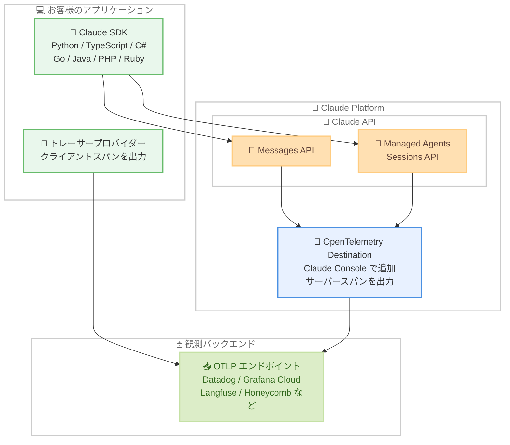

# OpenTelemetry エクスポート (ベータ) と Claude Managed Agents スケジュールデプロイメントの AWS 対応

## メタデータ

| 項目 | 内容 |
|------|------|
| 発表日 | 2026-10-14 |
| ソース | Claude Developer Platform Release Notes |
| カテゴリ | API / 観測性 / Managed Agents |
| 公式リンク | https://platform.claude.com/docs/en/release-notes/overview |

## 概要

Anthropic は 2026 年 10 月 14 日、Claude Developer Platform に関する 2 つのアップデートを発表しました。1 つ目は OpenTelemetry エクスポートのベータ版リリースです。Messages API リクエストと Claude Managed Agents セッションを、お客様が利用中の観測バックエンド (Datadog、Grafana Cloud、Langfuse など) でトレースできるようになりました。Claude SDK は Python、TypeScript、C#、Go、Java、PHP、Ruby の 7 言語でスパンを出力し、API 側のスパンは Claude Console で OpenTelemetry destination を追加することで取得できます。

2 つ目は、Claude Managed Agents のスケジュールデプロイメントが Claude Platform on AWS で利用可能になったことです。cron 式で指定したスケジュールに従い、エージェントが自律的にセッションを開始できます。

## 詳細

### 背景

OpenTelemetry はベンダー中立の観測性標準であり、多くの観測プラットフォームがサポートしています。トレースは 1 つのリクエストがシステムを通過する完全な記録、スパンはトレース内の 1 ステップ (モデルリクエストやツール使用など) を表します。これまで Claude API のリクエスト内部の挙動 (各モデル実行、サーバーツールの実行、エージェントのターンなど) を既存の観測基盤で可視化する公式な仕組みはありませんでしたが、今回のベータリリースにより、失敗したリクエストや遅いリクエストのデバッグ、トークン消費とレイテンシーの追跡、実トラフィックからの評価 (eval) 構築が可能になります。

API と SDK は [GenAI セマンティック規約](https://github.com/open-telemetry/semantic-conventions-genai) の属性を使用するため、同規約をサポートするプラットフォームは追加設定なしでスパンを認識できます。

### 主な変更点

**1. OpenTelemetry エクスポート (ベータ)**

- **SDK トレーシング**: Claude SDK (Python、TypeScript、C#、Go、Java、PHP、Ruby) がクライアント側のスパンを出力。コードでトレーサープロバイダーを登録して設定する
- **API トレーシング**: Claude Console で OpenTelemetry destination を追加すると、API 側 (サーバー側) のスパンを取得できる。設定には Admin 権限が必要
- **両方の併用**: SDK と API の両方を設定すると、1 つのリクエストの SDK スパンと API スパンを 1 つのトレースで確認できる。なお Claude Platform on AWS へのリクエストでは、API スパンは独立したトレースになる

SDK トレーシングと API トレーシングで取得できる情報は以下のとおりです。

| 取得できる情報 | SDK トレーシング | API トレーシング |
|---------------|-----------------|-----------------|
| Messages API リクエスト | ✅ | ✅ |
| Sessions API リクエスト | ✅ | ✅ |
| トークン使用量 | ✅ | ✅ |
| リクエスト内の各モデル実行 | — | ✅ |
| Managed Agents のターン | — | ✅ |
| API が実行するサーバーツール | — | ✅ |
| ツールランナーが実行するクライアントツール | ✅ | — |
| セルフホストサンドボックス内のツール | ✅ | — |
| その他の API リクエスト (ファイルアップロードなど) | ✅ | — |

OTLP を受け付ける任意の観測プラットフォームにトレースを送信でき、パートナーとして Arize AI、Braintrust、Databricks、Datadog、Grafana Cloud、Honeycomb、Langfuse、LangSmith、New Relic、PostHog、Sentry、Splunk が紹介されています。

**2. Claude Managed Agents のスケジュールデプロイメント (Claude Platform on AWS 対応)**

スケジュールデプロイメントは、エージェントが自律的にセッションを開始し、予測可能なサイクルでタスクを完了できるようにする機能です。Deployments API で作成・管理します。今回のアップデートで、この機能が Claude Platform on AWS でも利用可能になりました。

- **スケジュール定義**: 標準 POSIX cron 式 (`分 時 日 月 曜日`) と IANA タイムゾーン識別子で定義。粒度は分単位まで
- **AWS 固有の要件**: Claude Platform on AWS では、各実行はお客様の AWS アカウント内の IAM ロールとしてセッションを作成する。デプロイメント作成前に、エージェントの `execution_identity` に `aws_role` タイプと `role_arn` を設定する必要がある (未設定の場合は 400 エラー)
- **実行履歴**: 各実行は deployment run レコードとして記録され、成功時はセッション ID、失敗時はエラー種別 (`environment_archived_error`、`session_rate_limited_error` など) を確認できる
- **ライフサイクル管理**: pause / unpause / archive の操作が可能。ライフサイクル変更は Webhook イベントとして配信される
- **予算管理**: `budget` オブジェクトで実行ごとのコスト上限を設定可能 (累積ではなく各実行に個別に適用)
- **上限**: 組織あたり最大 1,000 件のスケジュールデプロイメント

### 技術的な詳細

**コンテンツモード**

OpenTelemetry エクスポートでは、スパンにモデルのプロンプトとレスポンスを含めるかどうかをコンテンツモードで制御します。

- **Metadata only** (デフォルト): 識別子、タイミング、ステータス、トークン数と、エージェントやツールの名前・説明などお客様が選択したテキストのみを含む
- **Full content**: 上記に加えてモデルのプロンプトとレスポンスを含む。失敗や遅延の原因分析、会話全文の確認、実トレースからの評価構築に利用できる

Full content では各スパンのコンテンツはデフォルトで最大 0.75 MB です。上限を超えると SDK または API がコンテンツを短縮し、`anthropic.content.truncated` を `true` に設定します。HIPAA、FERPA、K-12 のデータ取り扱い制限がある組織では、destination はコンテンツモードに関係なくメタデータのみをエクスポートします (SDK スパンは影響を受けません)。

**トークンのカウント**

トークンを重複なくカウントするには、リクエストごとに 1 つのソースのスパンだけを合計します。Messages API リクエストに SDK スパンと API スパンの両方がある場合は API スパンを合計します。両者は同じ `anthropic.messages.create` という名前のため、kind (SDK 側は `CLIENT`、API 側は `SERVER`) で区別します。なお、エクスポートされたスパンの配信はベストエフォートであり、API 使用量の完全な記録が保証されるわけではありません。使用量の正確な追跡には Usage API を使用します。

**スケジュールデプロイメントの DST (夏時間) の扱い**

cron スケジュールはウォールクロック (現地時刻の文字どおりの一致) で動作します。春の時間送りで存在しない時刻はトリガーされず、秋の時間戻しで 2 回発生する時刻は 2 回実行されます。実行の欠落や重複が許容できない場合は、現地時間 1 時から 3 時の時間帯を避けるか、UTC を使用します。また、負荷分散のため、実際の実行には実行間隔の最大 15% (最小 5 秒、最大 9 分) のジッターが適用されます。

## 開発者への影響

### 対象

- Claude API (Messages API) を本番環境で運用し、観測性を強化したい開発者・SRE チーム
- Claude Managed Agents のセッションをデバッグ・監視したいお客様
- AWS 環境で Claude Managed Agents を定期実行したいお客様

### 必要なアクション

**OpenTelemetry エクスポートを利用する場合**。

1. SDK トレーシング: アプリケーションでトレーサープロバイダーを登録する (権限は不要)
2. API トレーシング: Claude Console で OpenTelemetry destination を追加する (Admin 権限が必要)
3. コンテンツモード (Metadata only / Full content) を要件に合わせて選択する。観測プラットフォーム側のアクセス制御と保持設定が組織の要件を満たすか確認する

**スケジュールデプロイメントを Claude Platform on AWS で利用する場合**。

1. IAM ロールを用意する。信頼ポリシーで `aws-external-anthropic.amazonaws.com` サービスプリンシパルに `sts:AssumeRole` と `sts:SetSourceIdentity` を許可する
2. ロールに `aws-external-anthropic:CreateSession`、`sts:GetWebIdentityToken`、`sts:TagGetWebIdentityToken` の権限を付与する
3. エージェントの `execution_identity` に `{"type": "aws_role", "role_arn": "..."}` を設定する (設定する IAM プリンシパルには対象ロールへの `iam:PassRole` が必要)
4. Deployments API または `ant apply` でデプロイメントを作成する

### 移行ガイド (該当する場合)

既存機能の破壊的変更はありません。いずれも追加機能のため、移行作業は不要です。OpenTelemetry エクスポートはベータ版であり、Anthropic との契約の Beta Services 条項の下で提供される点に注意してください。スケジュールデプロイメントの利用にはベータヘッダー `managed-agents-2026-04-01` が必要です。

## コード例

スケジュールデプロイメントの作成例 (Python)。毎週金曜日の 20 時 (America/New_York) にコンプライアンススキャンを実行します。

```python
deployment = client.beta.deployments.create(
    name="Weekly compliance scan",
    agent=agent.id,
    environment_id=environment.id,
    initial_events=[
        {
            "type": "user.message",
            "content": [{"type": "text", "text": "Run the weekly compliance scan."}],
        },
    ],
    schedule={
        "type": "cron",
        "expression": "0 20 * * 5",
        "timezone": "America/New_York",
    },
)
```

レスポンスには `schedule.upcoming_runs_at` に次回以降の実行予定時刻が含まれ、スケジュールが正しく設定されたことを確認できます。

```json
{
  "id": "depl_01xyz",
  "status": "active",
  "paused_reason": null,
  "schedule": {
    "type": "cron",
    "expression": "0 20 * * 5",
    "timezone": "America/New_York",
    "last_run_at": null,
    "upcoming_runs_at": [
      "2026-05-09T00:00:00Z",
      "2026-05-16T00:00:00Z",
      "2026-05-23T00:00:00Z"
    ]
  }
}
```

## アーキテクチャ図

OpenTelemetry トレースの流れを示します。SDK トレーシングはクライアント側のスパンを、API トレーシングはサーバー側のスパンを観測バックエンドに送信します。



## 関連リンク

- [Claude Developer Platform Release Notes](https://platform.claude.com/docs/en/release-notes/overview)
- [OpenTelemetry for the Claude API](https://platform.claude.com/docs/en/manage-claude/opentelemetry)
- [API トレーシングの設定 (destination の追加)](https://platform.claude.com/docs/en/manage-claude/opentelemetry/api#add-a-destination)
- [SDK トレーシングの設定](https://platform.claude.com/docs/en/manage-claude/opentelemetry/sdk)
- [OpenTelemetry スパンリファレンス](https://platform.claude.com/docs/en/api/opentelemetry/spans)
- [Scheduled deployments](https://platform.claude.com/docs/en/managed-agents/scheduled-deployments)
- [Claude Platform on AWS](https://platform.claude.com/docs/en/build-with-claude/claude-platform-on-aws#claude-managed-agents)

## まとめ

今回のアップデートは、Claude API を本番運用する組織にとって運用面の強化が中心です。OpenTelemetry エクスポート (ベータ) により、既存の観測基盤 (Datadog、Grafana Cloud、Langfuse など) で Messages API リクエストと Managed Agents セッションを他のアプリケーショントレースと同じ場所で可視化でき、デバッグ、コスト追跡、評価構築のワークフローが大きく改善されます。7 言語の SDK がスパン出力に対応し、GenAI セマンティック規約に準拠している点も、既存ツールとの統合を容易にします。

また、スケジュールデプロイメントの Claude Platform on AWS 対応により、AWS 環境のお客様も IAM ロールベースのアクセス制御を維持したまま、エージェントの定期実行 (週次スキャン、定期レポート作成など) を構築できるようになりました。両機能ともベータ段階のため、本番導入時はベータ条項とデータ保持要件の確認を推奨します。
