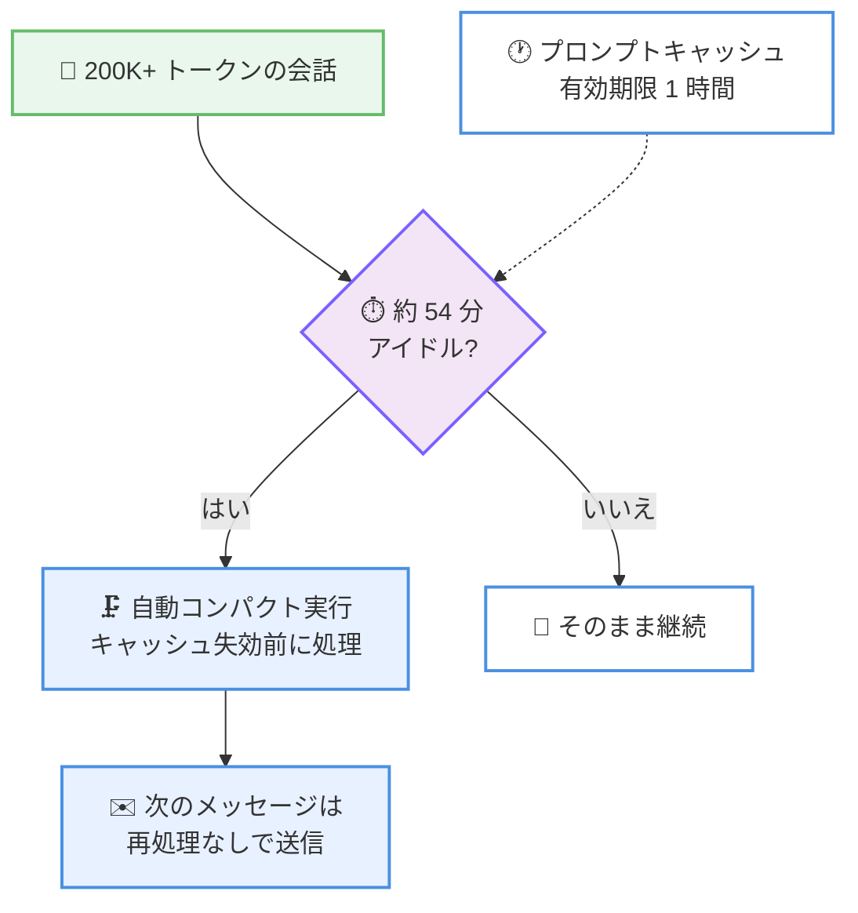

# Claude Code v2.1.299: アイドルコンパクション、`CLAUDE_CODE_DISABLE_FILE_MENTIONS`、Mod API 拡張、セキュリティ修正を含む 190 件の大型リリース

## メタデータ

| 項目 | 内容 |
|------|------|
| 発表日 | 2026-10-14 (npm registry の公開日時 00:23 UTC で確認) |
| ソース | Claude Code Changelog |
| カテゴリ | Claude Code / CLI アップデート |
| 公式リンク | https://github.com/anthropics/claude-code/blob/main/CHANGELOG.md |

## 概要

Claude Code v2.1.299 がリリースされた。前バージョン v2.1.296 (2026-10-09 公開) 以降の v2.1.297 / v2.1.298 は npm に公開されなかったため、本リリースは **5 日分の変更をまとめた大型リリース**となり、全 190 件 (追加 33 件、変更・改善 36 件、修正 121 件) の変更を含む。

追加面の目玉は**アイドルコンパクション**である。200K トークンを超える会話を約 54 分放置すると、1 時間のプロンプトキャッシュが失効する前に自動でコンパクトされ、次のメッセージで会話全体を再処理せずに済む。また、`@` ファイルメンションでファイルの内容ではなくパスのみを渡す **`CLAUDE_CODE_DISABLE_FILE_MENTIONS`** 環境変数や、Mod / プラグイン向けの **`$.prompt.media`**、**`$.session.identity()`**、Text / Box のスタイル拡張が加わった。修正面では、サンドボックスから `--plugin-dir` への書き込み防止、サードパーティゲートウェイへの API キー漏洩の修正、`__proto__` キーによる `tool.check` ガード回避の修正といったセキュリティ修正に加え、メモリリーク、MCP 接続、Remote Control / クラウドセッションの安定性修正が多数含まれる。

## 詳細

### 背景

v2.1.296 のリリースから 5 日が経過し、その間の v2.1.297 / v2.1.298 は npm に公開されないまま、変更が v2.1.299 に集約された。結果として修正が 121 件と全体の 6 割以上を占め、長時間セッションの安定性 (メモリ、クラウドセッション、Remote Control)、サンドボックスと権限まわりのセキュリティ、Mod / プラグインエコシステムの成熟が主なテーマとなっている。追加面では、プロンプトキャッシュのコスト効率を自動で高めるアイドルコンパクションが、長い会話を扱うすべてのユーザーに影響する機能である。

### 主な変更点

#### 1. アイドルコンパクション: キャッシュ失効前の自動コンパクト

ターミナルでの会話にアイドルコンパクションが追加された。

- **200K トークン以上**の会話を**約 54 分**放置すると、自動でコンパクト (コンテキスト圧縮) が実行される
- プロンプトキャッシュの有効期限 (1 時間) が切れる**前**に処理されるため、次のメッセージ送信時に会話全体を再処理するコストを回避できる
- **`CLAUDE_CODE_IDLE_COMPACT_MIN_TOKENS`**: 発動の最小トークン数 (デフォルト 200K) を変更できる
- settings.json に `"idleCompaction": false` を設定すると無効化できる
- いずれも v2.1.290 以降が必要

長い会話を開いたまま離席するような使い方で、復帰後の最初のメッセージにかかる時間とコストが改善される。

#### 2. `CLAUDE_CODE_DISABLE_FILE_MENTIONS` 環境変数

`@` によるファイルメンション時に、ファイルの**内容**ではなく**パスのみ**を Claude に渡す環境変数が追加された。Claude は必要に応じてファイルツールで読み込むため、大きなファイルをメンションしてもコンテキストを一括消費しなくなる。メンション直後のコンテキスト消費を抑えたいユーザーや、ファイルの一部だけを読めば足りるワークフローで有効である。

#### 3. Mod / プラグイン機能の強化

Mod (プラグインの hooks モジュール) 向けの API が大きく拡張された。

- **`$.prompt.media`**: managed settings でインストールされた Mod の `prompt.submit` hook が、プロンプトに添付された画像やドキュメントの**バイト列を読み取れる**ようになった
- **`$.session.identity()`**: managed settings でインストールされた Mod が、セッションのサインイン方法と、managed の `forceLoginOrgUUID` に組織が含まれる場合は組織とメールアドレスを取得できる
- **Text / Box のスタイル拡張**: `Text` に `size`、`weight`、`mono`、`tabular` が、`Box` に名前付きスペーシング (`xs`〜`xl`) が追加された。`bold` は `weight` を推奨する形で非推奨となった
- `skill.prompt` hook がスキルのフロントマター、ソース、プラグイン名、ファイルパスを受け取れるようになった
- `session.append` hook に `queue` ドアが追加され、トランスクリプトのキュー記録を送信プロンプトと変えられるようになった
- `agent.spawn` hook が、完了済みサブエージェントや停止されたチームメイトの再開時にも実行されるようになった (イベントに `resume` が含まれ、Mod は拒否もできる)
- `turn.start` hook がサブエージェントとチームメイトのターンも受け取るようになった (`e.agentId` で区別。メインループでは存在しない)

#### 4. セキュリティ関連の修正

本バージョンには重要なセキュリティ修正が複数含まれる。

- **サンドボックスから `--plugin-dir` への書き込み防止**: サンドボックス化されたシェルコマンドが `--plugin-dir` フォルダーに書き込めていた問題を修正。このフォルダーのコードは Claude Code がサンドボックス外でリロード・実行するため、サンドボックス突破につながる経路だった
- **サードパーティゲートウェイへの API キー漏洩の修正**: feature flag、起動、fast mode、プロファイル、フィードバックの各リクエストが、`ANTHROPIC_BASE_URL` に設定したサードパーティゲートウェイ用の API キーを Anthropic へのリクエストに付けて送っていた問題を修正 (Anthropic の API キーは引き続き送信される)。managed settings ファイルが `ANTHROPIC_BASE_URL` を設定している場合の server-managed settings リクエストについても同様に修正された
- **`__proto__` キーによる `tool.check` ガード回避の修正**: Mod の hook に渡される値から `__proto__` キーが黙って除去されており、別の Mod が行うツール呼び出しに対する `tool.check` ガードを回避できる可能性があった問題を修正
- **macOS サンドボックスのシンボリックリンク対応**: 拒否パスがシンボリックリンクを経由する場合に実体パスで読み書きできていた問題や、グロブルールの起点ディレクトリがシンボリックリンクに置き換えられた際の再チェック漏れを修正
- **プランモードの書き込み防止**: `PreToolUse` hook や Mod の `tool.check` hook が許可した書き込み (MCP ツール、ファイル、シェルコマンド) をプランモードが実行してしまう問題を修正
- **資格情報の露出防止**: 説明なしで開始されたエージェントチームメイトが、プロンプト内の資格情報の一部をタスク説明に表示していた問題を修正

#### 5. 安定性の修正: メモリ、MCP、Remote Control / クラウドセッション

修正 121 件のうち、長時間セッションの安定性に関わるものが目立つ。

- **メモリリーク**: 大量のデバッグログ (`--debug`、`--debug-file`) 使用時のメモリ増加と、書き込み不能なディスク上のログによる終了時のハング、stderr の読み手がいない場合の無制限なメモリ増加、多数のサブエージェントを実行したクラウド / Remote Control セッション再開後の高メモリ使用、既存出力ファイルの一括再送によるクラウドセッションのメモリスパイクとクラッシュを修正
- **MCP 接続**: 通知への応答ボディを終了しないサーバーで HTTP 接続が 30 秒ハングして失敗する問題、OAuth のサインイン / トークン更新 / サインアウトで設定済みの `headers` / `headersHelper` が送られず認証プロキシ背後のサーバーが使えなかった問題、バックグラウンド再接続中の MCP ツール呼び出しが失敗または二重実行される問題、`constructor` / `prototype` という名前の MCP サーバーが接続されない問題を修正
- **Remote Control / クラウドセッション**: 30〜35 MiB のファイルが届かない問題、写真のローカル保存失敗時に Claude に届かなかった問題、低速回線でのイベント一括アップロード失敗による claude.ai 表示のフリーズ、ワーカー交代直後の未応答・二重応答、v2.1.296 のリグレッションである承認済みツール呼び出しの二重実行などを修正
- **ファイルエンコーディング**: BOM 付き UTF-16LE ファイルを Read が文字化けさせる問題と、Write が BOM を落としたり Windows-1252 / Shift-JIS / GBK / UTF-16BE のファイルを黙って UTF-8 に変換したりする問題を修正 (現在は拒否される)
- **Windows**: プロセス生存チェックが孤児 PowerShell プロセスを残しメモリを使い果たす問題、シェル未指定の `PreToolUse` / `PermissionRequest` hook が Git for Windows 不在時にフェイルオープンしていた問題 (失敗したガードは呼び出しをブロックするようになった) を修正

#### 6. その他の追加機能 (抜粋)

- **`--shutdown-drain-sec`**: `claude self-hosted-runner orchestrator` が SIGTERM 受信時にポーリングを停止し、進行中のポーリングと実行中の spawn hook に指定秒数まで猶予を与える
- **エージェントビューの `/effort` と `/fast`**: 新規セッションの開始設定を変更できる。引数なしの `/model` / `/effort` / `/fast` はピッカーを開く
- **`claude plugin eval` の `--disallow-tools`** と `disallowed_tools` ケースフィールド: Agent などの組み込みツールを eval 実行から除外できる
- **帰属ブロック (attribution block) の制御**: Claude apps gateway の `code` ポリシーの `env` に `CLAUDE_CODE_ATTRIBUTION_HEADER=0` を設定すると、Claude Desktop の Code タブやゲートウェイ配下のセッションで帰属ブロックを無効化できる
- **`/usage` の警告**: max effort、ワークフロー、常時オンのコンテキスト、大きなツール結果についての警告が追加された

#### 7. 動作変更 (Changed、抜粋)

- **MCP の allow ルールの厳格化**: `mcp__a` が `a__b` や `a_` という名前のサーバーまで許可しなくなった。名前に `__` を含むサーバーは `mcp__<正規化された完全な名前>__*` と書く必要がある。エージェントの `tools:` リストも同様に、名前を指定したサーバーのツールのみを対象とする
- **`UserPromptSubmit` hook の実行タイミング**: スキルやカスタムスラッシュコマンドの展開**前**に実行されるようになり、プロンプトをブロックする hook が埋め込みシェルコマンドの実行も止められるようになった
- **プラグイン hook の失敗時の扱い**: ブロック可能なアクションは、hook に値を渡せない / 答えを受け取れない場合に通過ではなく**拒否**されるようになった。実行済みのツールは結果が差し止められる
- **HTTP リダイレクトの制限**: claude.ai のコネクタプロキシと Anthropic ホストの MCP サーバーへのリクエスト、およびクラウド / セルフホストランナーセッションの MCP プロキシからのリダイレクトに追従しなくなった
- **終了時の resume コマンド**: セッション名ではなく ID で表示されるようになり、セッション名に含まれる文字列が貼り付け時に実行されるリスクがなくなった
- **スキル / コマンドの読み込み**: ファイル名やフォルダー名に不可視文字、書字方向を変える文字、`<` / `>` を含むものは、リネームされるまで提供されなくなった
- **ファイルメンションされた PDF**: バイト列をセッショントランスクリプトに保持しなくなり、メモリとディスク使用量が改善された

#### 8. VSCode・Cloud sessions・Remote Control・Claude Tag・Code Review

- **[VSCode] (5 件)**: 未送信プロンプトと添付がセッション切り替えで失われる問題、空チャットがバックグラウンドプロセスを残す問題を修正。Python 拡張の読み込みと並行して起動することで起動時間を改善
- **[Cloud sessions] (6 件)**: 編集したルーティンが別の環境に黙って移動する問題、セルフホスト環境の管理画面でセッション ID 検索が機能しない問題などを修正。セルフホスト環境の削除時にルーティンを即座に無効化するよう変更
- **[Remote Control] (1 件)**: 到達不能なコンピューターへのメッセージが送信されたように見える問題を修正。再接続まで本文は入力欄に残り、送信ボタンが無効になる
- **[Claude Tag] (7 件)**: Claude in Slack が自分の作成したキャンバスを依頼に応じて削除できるようになった。誤った返信の訂正は取り消し線ではなくメッセージの直接編集と「Edited」注記に変更。100 人超のチャンネルには挨拶なしで静かに参加するようになった
- **[Code Review] (1 件)**: 月次支出上限のコメントとチェックランカードが、上限を設定する Usage ページにリンクするようになった

### 技術的な詳細

#### アイドルコンパクションの動作

プロンプトキャッシュの有効期限は 1 時間であり、失効後に長い会話へメッセージを送ると会話全体の再処理が発生する。アイドルコンパクションは、失効前の約 54 分時点でコンパクトを済ませておくことで、このコストを回避する。



#### MCP allow ルールのスコープ変更

従来、`mcp__a` という allow ルールは `a__b` や `a_` という名前のサーバーにも一致していた。本バージョンからルールは名前を指定したサーバーのみに届く。正規化された名前に `__` を含むサーバーを許可するには、`mcp__<サーバーの完全な正規化名>__*` の形式で記述する。deny / ask ルールについても、正規化名に二重アンダースコアを含むサーバーに適用されない問題が修正されており、ルールの意味が全体として厳密になった。

## 開発者への影響

### 対象

- 200K トークンを超える長い会話をターミナルで扱うすべてのユーザー (アイドルコンパクション)
- `@` ファイルメンションのコンテキスト消費を抑えたいユーザー (`CLAUDE_CODE_DISABLE_FILE_MENTIONS`)
- Mod / プラグインの開発者 (`$.prompt.media`、`$.session.identity()`、Text / Box スタイル拡張、hook の挙動変更)
- `ANTHROPIC_BASE_URL` でサードパーティゲートウェイを利用する組織 (API キー漏洩の修正)
- サンドボックスや managed settings でセキュリティ境界を運用するチーム (`--plugin-dir` 書き込み防止、`__proto__` ガード回避修正、プランモードの書き込み防止)
- 名前に `__` を含む MCP サーバーの allow / deny ルールを設定しているチーム (ルールのスコープ変更)
- Remote Control、クラウドセッション、セルフホストランナー、Windows、VSCode 拡張、Claude in Slack (Claude Tag)、Code Review の利用者

### 必要なアクション

- **MCP ルールの管理者**: `mcp__a` 形式のルールが `a__b` のような名前のサーバーに一致しなくなった。正規化名に `__` を含むサーバーを許可している場合は、`mcp__<完全な正規化名>__*` へ書き換える。エージェントの `tools:` リストも同様に確認する
- **Mod 開発者**: `bold` は非推奨となったため `weight` へ移行する。`turn.start` がサブエージェントのターンも受け取るようになったため、メインループのみを対象とする hook は `e.agentId` の有無で分岐する。`claude plugin test` の `ui.render` ツリーに `part: { plugin }` が加わったため、厳密なツリーアサーションは更新が必要
- **アイドルコンパクションを調整したいユーザー**: 最小トークン数は `CLAUDE_CODE_IDLE_COMPACT_MIN_TOKENS` で変更し、無効化は settings.json の `"idleCompaction": false` で行う
- **`UserPromptSubmit` hook の利用者**: hook がスキル / カスタムコマンドの展開前に実行されるようになったため、展開後の内容を前提とした hook は動作を確認する
- **サードパーティゲートウェイの利用組織**: API キー漏洩が修正されたため、v2.1.299 への更新を推奨する。過去のバージョンで漏洩の懸念がある場合はキーのローテーションを検討する

### 移行ガイド (該当する場合)

破壊的変更に近い挙動変更として、以下に注意が必要である。

- `mcp__<server>` 形式のルールとエージェントの `tools:` リストが、名前を指定したサーバーのみに適用されるようになった
- プラグイン hook がブロック可能なアクションを処理できない場合、通過ではなく拒否されるようになった
- Write が非 UTF-8 ファイル (Windows-1252、Shift-JIS、GBK、UTF-16BE) の黙った UTF-8 変換を行わず、拒否するようになった
- ファイル名に不可視文字などを含むスキル / コマンドは、リネームするまで利用できなくなった
- 終了時の resume コマンドがセッション名ではなく ID で表示されるようになった

## コード例

アイドルコンパクションの調整例。最小トークン数を変更する場合は環境変数を、無効化する場合は settings.json を使う。

```bash
# アイドルコンパクションの発動を 150K トークンからに変更
export CLAUDE_CODE_IDLE_COMPACT_MIN_TOKENS=150000

# @ ファイルメンションでパスのみを渡す
export CLAUDE_CODE_DISABLE_FILE_MENTIONS=1
```

```json
{
  "idleCompaction": false
}
```

Mod の `Text` で新しいスタイルプロパティを使う例 (`bold` は非推奨となり `weight` を使う)。

```jsx
<Box gap="md">
  <Text size="lg" weight="bold">合計</Text>
  <Text mono tabular>1,526,987</Text>
</Box>
```

## 関連リンク

- [Claude Code Changelog (v2.1.299)](https://github.com/anthropics/claude-code/blob/main/CHANGELOG.md)
- [npm: @anthropic-ai/claude-code](https://www.npmjs.com/package/@anthropic-ai/claude-code)
- [Claude Code v2.1.296 のレポート](./2026-10-09-claude-code-v2-1-296.md)
- [Claude Code 公式ドキュメント](https://code.claude.com/docs)
- [Claude Code の設定](https://code.claude.com/docs/en/settings)

## まとめ

Claude Code v2.1.299 は、未公開に終わった v2.1.297 / v2.1.298 を含む 5 日分の変更を集約した全 190 件の大型リリースである。追加面では、プロンプトキャッシュ失効前に長い会話を自動処理するアイドルコンパクション、ファイルメンションのコンテキスト消費を抑える `CLAUDE_CODE_DISABLE_FILE_MENTIONS`、`$.prompt.media` や `$.session.identity()` をはじめとする Mod API の大幅な拡張が柱となる。

修正面では、サンドボックスから `--plugin-dir` への書き込みという権限昇格経路の遮断、サードパーティゲートウェイへの API キー漏洩の修正、`__proto__` キーによる `tool.check` ガード回避の修正といったセキュリティ修正が重要である。あわせて、メモリリーク、MCP 接続、Remote Control / クラウドセッションの安定性修正が多数含まれ、長時間・大規模なセッションの信頼性が向上した。MCP ルールのスコープ厳格化などの挙動変更には設定の見直しが必要だが、セキュリティ修正の内容を踏まえると、すべての利用者に更新を推奨できるリリースである。
