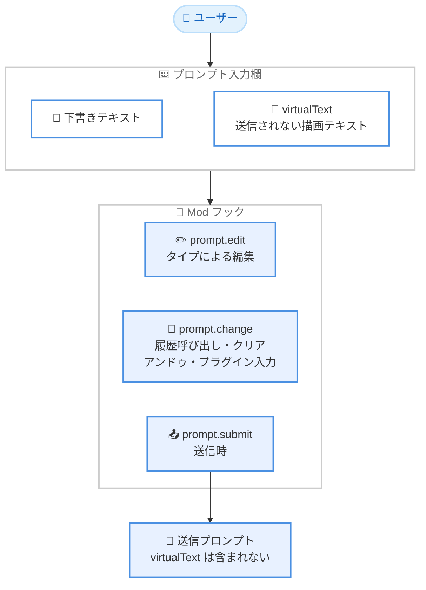

# Claude Code v2.1.300: Mod 向け `virtualText` と `prompt.change` フック、OpenTelemetry GenAI 属性、AWS 向け `/advisor` を含む 88 件のアップデート

## メタデータ

| 項目 | 内容 |
|------|------|
| 発表日 | 2026-10-14 (GitHub Releases の published_at 18:24 UTC で確認) |
| ソース | Claude Code Changelog |
| カテゴリ | Claude Code / CLI アップデート |
| 公式リンク | https://github.com/anthropics/claude-code/blob/main/CHANGELOG.md |

## 概要

Claude Code v2.1.300 がリリースされた。同日未明に公開された大型リリース v2.1.299 に続く同日 2 本目のリリースで、全 88 件 (追加 12 件、修正 59 件、改善 4 件、変更 12 件、削除 1 件) の変更を含む。

追加面の中心は **Mod (プラグインの hooks モジュール) 向け API の拡張**である。プロンプト入力欄に下書きにも送信内容にも含まれないテキストを描画する `virtualText`、タイプ以外の要因でプロンプト欄のテキストが変わったことを検知する `prompt.change` フック、エージェントのトランスクリプトをメインビューに表示する `$.ui.view({ agentId })`、右から左へ書く言語向けの `Text` の `dir` プロパティが加わった。また、**OpenTelemetry の強化**として、`api_request` イベントでのキャッシュ書き込みの有効期間別分割 (`cache_creation_5m_tokens` / `cache_creation_1h_tokens`) と、トレーススパンへの GenAI セマンティック規約属性の追加が行われた。Claude Platform on AWS では **`/advisor`** が利用可能になった。

修正面では、SessionEnd フックが実行されないことがある問題、`/tasks` からサブエージェントが消える問題、git の reftable リポジトリ対応、OpenTelemetry イベントの正確性など、広範囲の安定性修正が含まれる。

## 詳細

### 背景

v2.1.300 は、5 日分の変更をまとめた大型リリース v2.1.299 (2026-10-14 00:23 UTC 公開) の同日中に公開されたフォローアップリリースである。v2.1.299 で大きく拡張された Mod API をさらに充実させる追加が目立つほか、OpenTelemetry による可観測性の強化、git の reftable ref ストレージを使うリポジトリへの対応強化、クラウドセッションや `--worktree` まわりの修正が主なテーマとなっている。

### 主な変更点

#### 1. Mod API の拡張: `virtualText`、`prompt.change`、`$.ui.view`、`dir`

Mod 開発者向けに 4 つの新機能が追加された。

- **プロンプトデコレーションの `virtualText`**: プロンプト入力欄の中に描画されるテキストで、下書き (draft) にも送信されるプロンプトにも**一切含まれない**。入力欄内にヒントや注釈を表示する用途に使える
- **`prompt.change` フック**: プロンプト欄のテキストが**タイプ以外の操作**で変わったときに発生する。履歴の呼び出し、クリア、アンドゥ、プラグインによる入力が対象となる。従来の `prompt.edit` (タイプによる編集) を補完するフックである
- **`$.ui.view({ agentId })`**: 依頼に応じてエージェントのトランスクリプトをメインビューに表示できる。`$.ui.view({})` で元のビューに戻る
- **`Text` の `dir` プロパティ**: 右から左へ書く言語向けのプロパティで、Windows と VS Code のターミナルでは行がその方向に読まれ、右端に揃えられる

また、`agent.spawn` フックは、これまでワークフローエージェントに対して**拒否しかできなかった**が、本バージョンから `prompt` と `model` の**書き換え**に対応した。

#### 2. OpenTelemetry の強化: キャッシュトークンの有効期間別分割と GenAI セマンティック規約

可観測性に関する 2 つの追加が行われた。

- **`api_request` イベントの `cache_creation_5m_tokens` / `cache_creation_1h_tokens`**: プロンプトキャッシュの書き込みトークンを**有効期間 (5 分 / 1 時間) 別に分割**して記録する。キャッシュ戦略ごとのコスト分析が可能になる
- **トレーススパンへの GenAI セマンティック規約属性**: `gen_ai.provider.name`、`gen_ai.conversation.id`、`gen_ai.tool.name`、`error.type` などの OpenTelemetry GenAI セマンティック規約に沿った属性がトレーススパンに追加された。標準規約に対応した APM / 可観測性ツールとの統合が容易になる

あわせて、OpenTelemetry 関連の修正も複数含まれる。

- Mod の `prompt.submit` フックが書き換えまたは破棄したプロンプトが、`user_prompt` イベントとインタラクションスパン、セッションタイトルのリクエストに、タイプされたままの内容で記録されていた問題を修正
- reftable ref ストレージを使うリポジトリで `git commit -q` の後に `tool_result` イベントの `git_commit_id` が欠落する問題を修正

#### 3. Claude Platform on AWS の `/advisor`

Claude Platform on AWS で `/advisor` が追加された。

- `/advisor`、`advisorModel` 設定、または `--advisor` フラグで選択するまで、アドバイザーは動作しない
- `CLAUDE_CODE_DISABLE_ADVISOR_TOOL=1` で機能を無効化できる

#### 4. 修正: フック、/tasks、エージェントビュー

セッション管理とエージェント操作に関する修正が多数含まれる。

- **SessionEnd フック**: バックグラウンドコマンドの実行中に終了すると SessionEnd フックが実行されないことがある問題を修正
- **`/tasks`**: メッセージを送ったサブエージェントが完了直後に `/tasks` から消え、会話に戻る手段がなくなる問題を修正
- **エージェントビュー**: 入力がまとめて届いたときに "up" や "escape" といったタイプした単語がキー操作として解釈され、返信中にピークが動いたり下書きが消えたりする問題を修正。完了した親エージェントが閲覧中にパンくずから消える問題も修正
- **エージェントフックの `model`**: `haiku` のようなエイリアスが解決されるようになり、サブエージェントのモデルによる上書きがなくなり、利用できないモデルは (アクションを許可するのではなく) 呼び出し元のモデルにフォールバックするようになった

#### 5. 修正: reftable リポジトリと `--worktree`

git の reftable ref ストレージを使うリポジトリへの対応が強化された。

- ブランチが ".invalid" と表示され、`--worktree` でワークツリーを再度開けない問題を修正
- Claude Desktop と Remote Control セッションの diff ビューが、コンフリクトした cherry-pick や revert を検知しない問題を修正
- `--worktree` セッションが、コミット ID のような名前のタグやブランチがあると誤ったコミットから開始することがある問題を修正
- ベアリポジトリのワークツリーで origin のデフォルトブランチを取得できない場合に `--worktree` が失敗する問題を修正 (フォールバックのベースが現在のチェックアウトの HEAD になった)

#### 6. 修正: クラウドセッションと MCP

- **クラウドセッション**: 組織ポリシーを読み取れないときにターンごとに 5 分間ハングする問題 (即座に終了し理由を表示するようになった)、長い返信の途中でセッションが再起動した際に回答済みメッセージを再実行することがある問題、セッション自身のネットワーク設定によるブロックを組織ポリシーによるものと Claude に伝えていた問題を修正
- **Cowork クラウドセッション**: Write / Edit / NotebookEdit がローカルコンピューター上のパスに対して (ファイルが届いていないのに) 成功を報告する問題を修正
- **MCP**: API が MCP ツールの入力スキーマを拒否すると会話が毎ターン 400 エラーで失敗する問題を修正 (以降はそのツールをパラメータなしで送信する)。コンパクション後に接続が完了した MCP サーバーのツールと指示が次のツール呼び出しまで Claude に伝わらない問題も修正
- **ヘッドレス / Agent SDK**: 出力トークン上限で切れた返信や、リトライされた返信に続くコンパクションの後、セッション再開時にコンパクションが保持したメッセージや要約が失われる問題を修正

#### 7. 動作変更 (Changed、抜粋)

- **gzip 圧縮**: api.anthropic.com への大きなリクエストは、テレメトリが無効でも gzip 圧縮を使うようになった。`CLAUDE_CODE_GZIP_REQUEST_BODIES=0` で無効化できる
- **ローカルトランスクリプト**: 各 API リクエストのシステムプロンプト、ツール、パラメータも記録するようになり、共有したトランスクリプトからリクエストを正確に再現できるようになった
- **終了時の動作**: 終了要求から 1.5 秒経っても実行中のバックグラウンドコマンドは強制終了されるようになった (従来はフルスクリーンモードで残ることがあった)
- **フックの `updatedInput` の検証**: PreToolUse / PermissionRequest フックの `updatedInput` が Claude 自身の入力と同様に検証されるようになった。未知のキーは除去され、ツールが拒否する入力は呼び出し自体が拒否される
- **`claude remote-control` の `--sandbox` / `--no-sandbox` フラグの削除**: 効果がなかったため削除され、指定するとエラーで終了する。サンドボックス化は settings の `sandbox.enabled` で設定する

#### 8. VSCode・Cloud sessions・Claude Tag・Code Review

- **[VSCode] (12 件)**: エディターで選択したテキストがメッセージに追加されるのを止める `claudeCode.attachSelection` 設定を追加。利用クレジット切れ後も fast mode が有効なままリクエストが拒否と再送を繰り返す問題、常時思考モデルで Thinking トグルが Off に切り替わる問題、Windows での Shift+ドラッグによるファイルパス挿入の問題などを修正
- **[Cloud sessions] (2 件)**: 組織が "Always allow" を無効にしているコネクタツールで Cowork の承認プロンプトから "Allow for this task" が消えていた問題 (v2.1.292 のリグレッション) などを修正
- **[Remote Control] (1 件)**: claude.ai とデスクトップアプリの diff ビューが削除・リネームされたファイルを変更として表示する問題を修正 (手元のマシンに v2.1.296 以降が必要)
- **[Claude Tag] (5 件)**: Slack Connect チャンネルのサポート (Owner または管理者が有効化、デフォルトは無効)、承認が必要なコネクタアクションに対するスレッド内の非公開 Allow once / Deny カード、Slack ボイスクリップの文字起こし読み取りを追加
- **[Code Review] (2 件)**: GitHub の組織メンバーシップが非公開の書き込み権限保持者による `@claude review` コメントが無視される問題などを修正

### 技術的な詳細

#### プロンプト入力欄まわりの Mod フックの整理

本バージョンの `prompt.change` と `virtualText` の追加により、Mod はプロンプト入力欄に対して「タイプによる編集」「タイプ以外の変化」「送信」のそれぞれに反応し、入力欄内に送信されない表示を加えられるようになった。



#### キャッシュ書き込みトークンの有効期間別分割

Claude API のプロンプトキャッシュには 5 分と 1 時間の 2 種類の有効期間があり、書き込みコストが異なる。従来の OpenTelemetry `api_request` イベントではキャッシュ書き込みが一括で記録されていたが、本バージョンから `cache_creation_5m_tokens` と `cache_creation_1h_tokens` に分割され、どちらの有効期間の書き込みがどれだけ発生しているかをメトリクスとして追跡できるようになった。1 時間キャッシュを活用する長時間セッションのコスト分析に有用である。

## 開発者への影響

### 対象

- Mod / プラグインの開発者 (`virtualText`、`prompt.change` フック、`$.ui.view({ agentId })`、`Text` の `dir`、`agent.spawn` でのワークフローエージェントの書き換え)
- OpenTelemetry で Claude Code の利用状況を監視・分析しているチーム (キャッシュトークンの分割、GenAI セマンティック規約属性、`user_prompt` イベントの正確性修正)
- Claude Platform on AWS の利用者 (`/advisor`)
- git の reftable ref ストレージを使うリポジトリでの利用者 (`--worktree`、diff ビュー、`git_commit_id` の修正)
- SessionEnd フックや `/tasks`、エージェントビューを利用するユーザー
- クラウドセッション、Cowork、ヘッドレス / Agent SDK、VSCode 拡張、Claude in Slack (Claude Tag)、Code Review の利用者

### 必要なアクション

- **Mod 開発者**: タイプ以外のプロンプト変化 (履歴呼び出し、クリア、アンドゥ、プラグインによる入力) に反応する必要がある Mod は、新しい `prompt.change` フックの利用を検討する。ワークフローエージェントの `prompt` / `model` を調整したい場合は `agent.spawn` フックで書き換えられるようになった
- **OpenTelemetry の利用チーム**: キャッシュ書き込みトークンが `cache_creation_5m_tokens` / `cache_creation_1h_tokens` に分割されたため、キャッシュコストを集計しているダッシュボードやアラートがあれば両フィールドを反映する。トレーススパンの GenAI 属性 (`gen_ai.provider.name` など) を活用した標準ベースの分析も可能になった
- **Claude Platform on AWS の利用者**: アドバイザーを使う場合は `/advisor`、`advisorModel` または `--advisor` で選択する。組織として無効化したい場合は `CLAUDE_CODE_DISABLE_ADVISOR_TOOL=1` を設定する
- **`claude remote-control` の利用者**: `--sandbox` / `--no-sandbox` フラグは削除され、指定するとエラーになる。サンドボックス化は settings の `sandbox.enabled` へ移行する
- **PreToolUse / PermissionRequest フックの利用者**: `updatedInput` の検証が厳格化され、未知のキーは除去、ツールが拒否する入力は呼び出し拒否となるため、フックが返す入力の内容を確認する
- **gzip 圧縮を避けたい環境**: api.anthropic.com への大きなリクエストがテレメトリ無効時でも gzip 圧縮されるようになった。プロキシなどで問題がある場合は `CLAUDE_CODE_GZIP_REQUEST_BODIES=0` で無効化する

### 移行ガイド (該当する場合)

- `claude remote-control` の `--sandbox` / `--no-sandbox` フラグは削除された。settings の `sandbox.enabled` に移行する
- フックの `updatedInput` が検証されるようになったため、未知のキーを返していたフックは動作確認が必要
- ローカルトランスクリプトが各 API リクエストのシステムプロンプト、ツール、パラメータも記録するようになったため、トランスクリプトを共有する際は含まれる情報が増えている点に留意する

## コード例

Mod からエージェントのトランスクリプトをメインビューに表示する例と、関連する環境変数の設定例。

```javascript
// エージェントのトランスクリプトをメインビューに表示
$.ui.view({ agentId });

// 元のビューに戻る
$.ui.view({});
```

```bash
# Claude Platform on AWS のアドバイザー機能を無効化
export CLAUDE_CODE_DISABLE_ADVISOR_TOOL=1

# api.anthropic.com への大きなリクエストの gzip 圧縮を無効化
export CLAUDE_CODE_GZIP_REQUEST_BODIES=0
```

## 関連リンク

- [Claude Code Changelog (v2.1.300)](https://github.com/anthropics/claude-code/blob/main/CHANGELOG.md)
- [GitHub Releases: Claude Code](https://github.com/anthropics/claude-code/releases)
- [npm: @anthropic-ai/claude-code](https://www.npmjs.com/package/@anthropic-ai/claude-code)
- [Claude Code v2.1.299 のレポート](./2026-10-14-claude-code-v2-1-299.md)
- [Claude Code 公式ドキュメント](https://code.claude.com/docs)

## まとめ

Claude Code v2.1.300 は、同日公開の大型リリース v2.1.299 に続くフォローアップで、全 88 件の変更を含む。追加面では、プロンプト入力欄に送信されないテキストを描画する `virtualText`、タイプ以外のプロンプト変化を検知する `prompt.change` フック、エージェントのトランスクリプト表示を切り替える `$.ui.view({ agentId })` といった Mod API の拡張が中心で、v2.1.299 から続く Mod エコシステム強化の流れを引き継いでいる。

可観測性の面では、OpenTelemetry の `api_request` イベントでキャッシュ書き込みトークンが有効期間別 (5 分 / 1 時間) に分割され、トレーススパンに GenAI セマンティック規約属性が追加されたことで、標準的なツールによるコスト分析と監視がしやすくなった。修正面では、SessionEnd フック、`/tasks`、reftable リポジトリ、クラウドセッション、MCP、ヘッドレス / Agent SDK の再開処理など広範囲の安定性向上が図られており、該当機能の利用者には更新を推奨できるリリースである。
