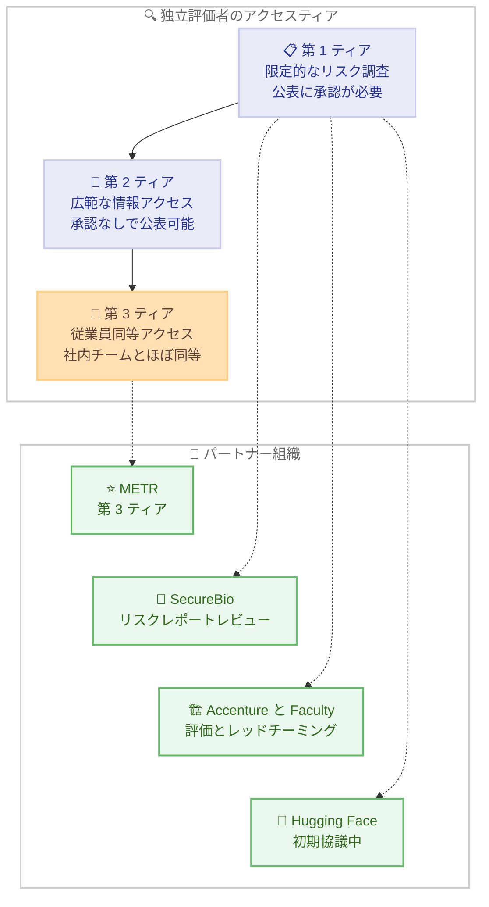

# 独立評価者に関するアップデート: METR に従業員同等アクセスを付与開始

## メタデータ

| 項目 | 内容 |
|------|------|
| 発表日 | 2026-10-15 |
| ソース | Anthropic News |
| カテゴリ | 発表 (Announcements) / AI 安全性 |
| 公式リンク | https://www.anthropic.com/news/an-update-on-independent-evaluators |

## 概要

Anthropic は、モデルと安全対策に対する第三者評価の強化に向けた進捗を発表した。非営利の評価団体 METR のチームに対して「従業員同等のアクセス (employee-like access)」の付与を開始し、METR の従業員 6 名のオンボーディングを実施した。METR は Anthropic の社内リスク評価チームとほぼ同等のアクセス権を持ち、リスクレベル、インシデント、慣行に関する分析を Anthropic の承認なしで公表できる。

本発表は、「White House Accord on Super Intelligence」(超知能に関するホワイトハウス合意) への署名に基づく、独立した外部監査者・評価者との連携の誓約を具体化するものである。METR のほか、SecureBio、Accenture (Faculty を含む)、Hugging Face などとのパートナーシップも進行中である。

## 詳細

### 背景

モデルの高性能化に伴い、より強固な安全策と、より難しいリスク評価が必要になっている。Anthropic は意思決定について公的な説明責任を果たしたい一方で、悪意ある行為者に悪用され得る情報や、計算資源・訓練情報などの商業的機密は公開できないというジレンマを抱えている。

そこで、第三者評価者に深いアクセスを与え、リスクに関する証拠と結論を社会に共有してもらうことで、評価者の理解と企業自身の理解との間のギャップを埋めるアプローチを採用した。記事では、大手銀行に常駐検査官を置く銀行監督の仕組みと同様のロジックであると説明されている (ただし完全な類似ではないと注記)。

### 評価者に求められる 4 つの要件

Anthropic は、効果的な独立評価者には以下の 4 要件が必要だとしている。

1. **専門性**: フロンティアモデルの能力評価の専門知識。「alignment faking」など評価が失敗するパターンの理解を含む
2. **独立性**: 評価対象企業の株式を保有せず、財務的・運営的に依存しないこと
3. **アクセス**: 最新モデルに加え、訓練方法やセーフガードの機能などへの可視性
4. **公表の自由**: モデルやプロセスに関する観察・評価を公表できること

### METR への「従業員同等アクセス」の内容

- METR の従業員 6 名をオンボーディングし、会社のハードウェア、オフィススペース、社内ツール・システムへのアクセスを提供 (社内リスク評価チームとほぼ同等)
- 除外されるのは、顧客データ、弁護士・依頼者間秘匿特権情報、モデルアーキテクチャ情報など、少数の明確に定義されたカテゴリのみ
- METR はリスクレベル・インシデント・慣行の分析を公表でき、**Anthropic は公表を拒否できない**。ただし、定義済みカテゴリに該当する情報の墨消し (redaction) は要求できる
- METR は墨消し内容そのものを明かさない限り、墨消しが正当だったかどうかの見解を公表できる
- METR の関与チームは少人数で強制力のある契約下で運営され、他の METR 従業員 (他プロジェクトで協働する研究者を含む) はこのチームの作業から隔離される
- 過去 1 年間、METR とは「Risk Reports」の複数のレビューで協働してきた実績がある

### 評価者アクセスの 3 段階ティア制

Anthropic は評価者のアクセスと公表権を 3 段階のティアで整理している。

| ティア | アクセス範囲 | 公表権 |
|--------|------------|--------|
| 第 1 ティア | 範囲を限定したリスク調査。アクセス範囲は Anthropic が決定 | 公表には Anthropic の承認が必要 |
| 第 2 ティア | より多くの情報にアクセス可能 | 承認なしで公表可能。特定カテゴリの墨消しは要求できるが、評価者は墨消しの正当性について見解を公表できる |
| 第 3 ティア | 従業員同等アクセス (METR との取り決め) | 第 2 ティアと同様の公表権 |

### 他のパートナーシップの進捗

- **SecureBio**: 前回のリスクレポートのパイロットレビューを完了し、結果を公表済み。現在は 2026 年 8 月のリスクレポートの化学・生物兵器の章をレビュー中。完了後にアクセス拡大を検討する
- **Accenture (Faculty を含む)**: モデルの評価とレッドチーミング、アラインメント評価、セーフガードのテスト、組織横断的な能力構築を含む野心的なパートナーシップに向けて作業中
- **Hugging Face**: 他の複数組織とともに初期段階の協議中

## 開発者への影響

### 対象

- Anthropic のモデルを利用するすべての開発者・企業 (直接的な API 変更はない)
- AI の安全性・ガバナンスに関心を持つ研究者、政策立案者
- フロンティア AI モデルのリスク評価に関わる組織

### 必要なアクション

API や SDK の変更ではないため、開発者側で必要な技術的対応はない。ただし、以下の点を把握しておくとよい。

- METR が今後公表するリスク分析は、Claude モデルの安全性に関する独立した情報源となる
- Anthropic のリスクレポートに対する第三者レビュー結果が、モデル採用時のリスク評価の参考資料として利用できる
- 本取り組みは自発的なものであり、Anthropic はすべてのフロンティア AI 企業が同様の取り組みを行うべきだと主張している

## 関連リンク

- [An update on independent evaluators (公式発表)](https://www.anthropic.com/news/an-update-on-independent-evaluators)
- [Anthropic News](https://www.anthropic.com/news)
- [METR 公式サイト](https://metr.org/)
- [SecureBio 公式サイト](https://securebio.org/)
- [Anthropic の Responsible Scaling Policy](https://www.anthropic.com/news/anthropics-responsible-scaling-policy)

## まとめ

Anthropic は、独立評価者による安全監督の枠組みを 3 段階のティア制として整理し、最上位の第 3 ティアとして METR に従業員同等のアクセスを付与開始した。METR は社内リスク評価チームとほぼ同等のアクセス権を持ち、Anthropic の承認なしで分析を公表できる点が特徴である。SecureBio、Accenture、Hugging Face などとのパートナーシップも段階的に拡大中であり、将来的には第 3 ティアに複数の評価者を置き、各チームが独自の分析を公表する体制を目指す。フロンティア AI 企業の「堅牢な安全監督 (robust safety oversight)」に向けた具体的な一歩として注目される。
