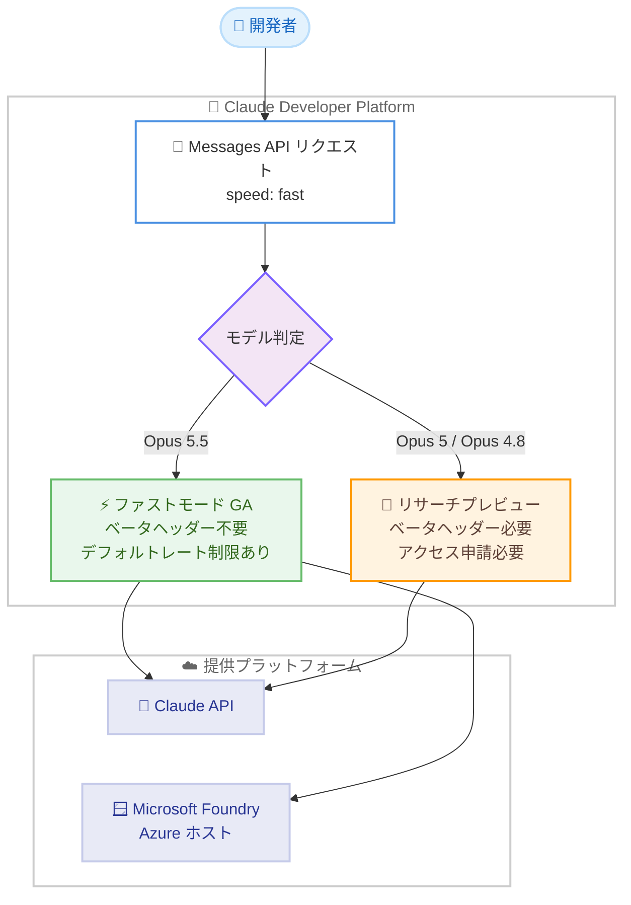

# Claude Opus 5.5 ファストモードがリサーチプレビュー終了、Compliance API にユーザー設定取得機能を追加

## メタデータ

| 項目 | 内容 |
|------|------|
| 発表日 | 2026-10-15 |
| ソース | Claude Developer Platform Release Notes |
| カテゴリ | API アップデート / エンタープライズ管理 |
| 公式リンク | https://platform.claude.com/docs/en/release-notes/overview |

## 概要

2026 年 10 月 15 日、Claude Developer Platform に 3 つのアップデートが発表された。最大のトピックは、Claude Opus 5.5 のファストモードがリサーチプレビューを終了し、アクセス申請なしで利用可能になったことである。`fast-mode-2026-02-01` ベータヘッダーが不要になり、Start、Build、Scale の各使用ティアにデフォルトのファストモードレート制限が設定された。あわせて、Azure でホストされるデプロイメント向けに Claude in Microsoft Foundry でも Opus 5.5 のファストモードが利用可能になった。

また、Compliance API に新しいエンドポイントが追加され、組織メンバーが claude.ai で保存した「Instructions for Claude」および Cowork の「Global instructions」のテキストを取得できるようになった (Claude Enterprise 組織向けベータ)。

## 詳細

### 背景

ファストモードは、同一のモデルをより高速な推論構成で実行する機能であり、標準速度と比較して最大 2.5 倍の出力トークン毎秒 (OTPS) を実現する。モデルの重みや動作は変わらず、知能や機能に変化はない。2026 年 2 月のリサーチプレビュー開始以降、利用にはアクセス申請と `fast-mode-2026-02-01` ベータヘッダーの送信が必要だった。

Compliance API は、Claude Enterprise 組織のコンプライアンス担当者が組織内のデータを監査するための API であり、これまでにチャットデータ取得などのエンドポイントが提供されてきた。

### 主な変更点

**1. Claude Opus 5.5 のファストモードがリサーチプレビューを終了**

- アクセス申請が不要になった
- Claude Opus 5.5 へのリクエストで `fast-mode-2026-02-01` ベータヘッダーが不要になった (送信し続けても動作は継続する)
- Start、Build、Scale の各使用ティアにデフォルトのファストモードレート制限が設定された
- Evaluation ティアの組織は、Start、Build、Scale ティアに移行するとファストモードを利用できる
- Claude Opus 5 と Claude Opus 4.8 のファストモードは引き続きリサーチプレビューであり、これらのモデルにはベータヘッダーの送信を継続する必要がある

**2. Claude in Microsoft Foundry でのファストモード提供**

- Azure でホストされるデプロイメント向けに、Claude in Microsoft Foundry で Claude Opus 5.5 のファストモードが利用可能になった
- Anthropic でホストされる Microsoft Foundry デプロイメントでは利用できない

**3. Compliance API にユーザー設定取得エンドポイントを追加 (ベータ)**

- 各組織メンバーが claude.ai で保存した「Instructions for Claude」および Cowork の「Global instructions」のテキストを返す
- Claude Enterprise 組織向けのベータ機能
- エンドポイント: `GET /v1/compliance/organizations/{org_uuid}/user_preferences`
- 既存の Compliance Access Key と `read:compliance_user_data` スコープで呼び出す

### 技術的な詳細

**ファストモードの利用方法**

リクエストに `speed: "fast"` を設定するだけで有効化できる。レスポンスの `usage.speed` フィールドで、実際に使用された速度 (`"fast"` または `"standard"`) を確認できる。

ファストモード対応モデルとプラットフォームは以下のとおり。

| モデル | 対応プラットフォーム | ステータス |
|--------|---------------------|-----------|
| Claude Opus 5.5 (claude-opus-5-5) | Claude API (Managed Agents 含む)、Claude in Microsoft Foundry (Azure ホスト) | 一般提供 |
| Claude Opus 5 (claude-opus-5) | Claude API (Managed Agents 含む) | リサーチプレビュー |
| Claude Opus 4.8 (claude-opus-4-8) | Claude API (Managed Agents 含む) | リサーチプレビュー |

**ファストモードの料金**

ファストモードは標準料金に対するプレミアム価格で提供され、200K 入力トークンを超えるリクエストを含むフルコンテキストウィンドウに適用される。

| モデル | 入力 | 出力 |
|--------|------|------|
| Claude Opus 5.5 | $8 USD / MTok | $40 USD / MTok |
| Claude Opus 5 / Claude Opus 4.8 | $10 USD / MTok | $50 USD / MTok |

プロンプトキャッシュやデータレジデンシーの料金乗数は、ファストモード料金の上に重ねて適用される。

**ファストモードのレート制限**

ファストモードには標準の Opus レート制限とは別の専用レート制限がある。制限を超えると API は `retry-after` ヘッダー付きの `429` エラーを返す。レスポンスヘッダー (`anthropic-fast-input-tokens-limit` など) でファストモードのレート制限状況を確認できる。

**ファストモードの制約事項**

ドキュメントによると、以下の制約がある。

- ファストモードと標準速度を切り替えるとプロンプトキャッシュが無効になる (異なる速度のリクエストはキャッシュされたプレフィックスを共有しない)
- 速度向上は出力トークン毎秒 (OTPS) に焦点があり、最初のトークンまでの時間 (TTFT) は対象外
- Batch API では利用できない
- Priority Tier コミットメントでは利用できない
- Claude Platform on AWS では現在利用できない

## 開発者への影響

### 対象

- Claude Opus 5.5 を利用する API 開発者 (特に Start、Build、Scale ティアの組織)
- Azure 上で Claude in Microsoft Foundry を利用する開発者
- Claude Enterprise 組織のコンプライアンス担当者および監査ツール開発者

### 必要なアクション

- **Opus 5.5 でファストモードを使う開発者**: アクセス申請は不要。リクエストに `speed: "fast"` を設定するだけで利用できる。`fast-mode-2026-02-01` ベータヘッダーは削除してよい (残しても動作する)
- **Opus 5 / Opus 4.8 でファストモードを使う開発者**: 引き続きリサーチプレビューのため、ベータヘッダーの送信とアクセス申請が必要
- **Compliance API 利用者**: 既存の Compliance Access Key に `read:compliance_user_data` スコープを付与し、新エンドポイントを呼び出す

### 移行ガイド (該当する場合)

Opus 5.5 向けのファストモードリクエストからベータヘッダーを削除できる。ただし削除は必須ではなく、ヘッダーを送信し続けてもリクエストは正常に動作する。旧モデルでファストモードを利用していた場合は、ファストモード対応モデルへの移行が推奨されている。

## コード例

Claude Opus 5.5 でファストモードを利用する例 (ベータヘッダー不要)。

```python
import anthropic

client = anthropic.Anthropic()

response = client.messages.create(
    model="claude-opus-5-5",
    max_tokens=4096,
    speed="fast",  # ファストモードを有効化
    messages=[
        {"role": "user", "content": "Refactor this module to use dependency injection"}
    ],
)

# 実際に使用された速度を確認
print(response.usage.speed)  # "fast" または "standard"
```

Compliance API でユーザー設定を取得する例。

```bash
curl "https://api.anthropic.com/v1/compliance/organizations/{org_uuid}/user_preferences" \
  -H "x-api-key: $COMPLIANCE_ACCESS_KEY" \
  -H "anthropic-version: 2023-06-01"
```

## アーキテクチャ図 (該当する場合)



## 関連リンク

- [Claude Developer Platform Release Notes](https://platform.claude.com/docs/en/release-notes/overview)
- [Fast mode ドキュメント](https://platform.claude.com/docs/en/build-with-claude/fast-mode)
- [Compliance API](https://platform.claude.com/docs/en/manage-claude/compliance-api)
- [List user preferences](https://platform.claude.com/docs/en/manage-claude/compliance-org-data#list-user-preferences)
- [Claude in Microsoft Foundry](https://platform.claude.com/docs/en/build-with-claude/claude-in-microsoft-foundry)
- [料金 (Fast mode pricing)](https://platform.claude.com/docs/en/about-claude/pricing#fast-mode-pricing)
- [レート制限](https://platform.claude.com/docs/en/api/rate-limits)

## まとめ

Claude Opus 5.5 のファストモードがリサーチプレビューを終了し、アクセス申請やベータヘッダーなしで `speed: "fast"` を指定するだけで最大 2.5 倍の出力速度を利用できるようになった。Start、Build、Scale ティアにはデフォルトレート制限が設定され、Azure ホストの Microsoft Foundry にも提供範囲が拡大した。一方、Opus 5 と Opus 4.8 のファストモードは引き続きリサーチプレビューである点に注意が必要である。あわせて Compliance API にユーザー設定取得エンドポイントが追加され、Claude Enterprise 組織の監査機能が強化された。
