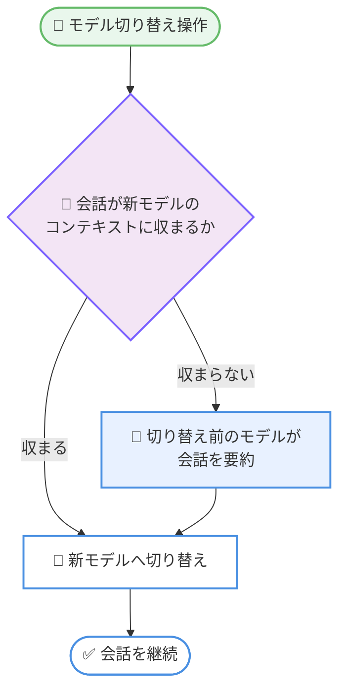

# Claude Code v2.1.301 リリース: リトライ制御の新環境変数、vim モード強化、OpenTelemetry イベント拡充

## メタデータ

| 項目 | 内容 |
|------|------|
| 発表日 | 2026-10-16 (changelog 公開確認日) |
| ソース | Claude Code Changelog |
| カテゴリ | Claude Code / CLI アップデート |
| 公式リンク | https://github.com/anthropics/claude-code/blob/main/CHANGELOG.md |

## 概要

Claude Code v2.1.301 がリリースされた。本バージョンは新機能 6 件、修正 35 件、改善 4 件、変更 2 件、VS Code 拡張関連 6 件を含む大規模なメンテナンスリリースである。主なハイライトは以下のとおり。

- **新環境変数 `CLAUDE_CODE_RETRY_WATCHDOG_MAX_USAGE_LIMIT_WAIT_MS`**: 無人リトライモードで、使用量制限のリセットが遠すぎる場合に待機せずリクエストを終了できるようになった
- **vim モードの強化**: 対応する括弧へジャンプする `%` モーションの追加に加え、Escape 後に INSERT モードに留まる問題や AskUserQuestion の回答が破棄される問題を修正
- **OpenTelemetry イベントの拡充**: `tool_decision` イベントに `classifier_verdict`、`permission_mode`、`classifier_category` が追加され、auto モードの分類器判断と権限ルールを区別可能になった
- **モデルエイリアスのフォールバック**: `fable` および `best` エイリアスが、最新の Fable モデルを利用できない組織でもエラーにならず、前世代の Fable モデルで 1 回リトライするようになった
- **コンテキストウィンドウ縮小時の挙動改善**: 小さいコンテキストウィンドウのモデルへ切り替える際、長すぎる会話は切り替え前のモデルが先に要約するようになった

## 詳細

### 背景

Claude Code は活発に開発が続いており、CLI 本体、mods (拡張機構)、ワークフロー、セルフホストランナー、VS Code 拡張など複数のコンポーネントが同時に更新されている。v2.1.301 は、無人運用 (CI やリトライウォッチドッグ) や可観測性 (OpenTelemetry) を重視する組織向けの機能追加と、ターミナル互換性やモデル切り替えまわりの安定性修正が中心となっている。

### 主な変更点

#### 新機能 (Added)

| 項目 | 内容 |
|------|------|
| リトライ待機の上限設定 | `CLAUDE_CODE_RETRY_WATCHDOG_MAX_USAGE_LIMIT_WAIT_MS` を追加。無人リトライモード (`CLAUDE_CODE_RETRY_WATCHDOG`) で、リセットが遠すぎる使用量制限に当たった場合、待機せずリクエストを終了する |
| OpenTelemetry トレーシングガイド | `claude-api` スキルに OpenTelemetry トレーシングのガイダンスを追加。`ant` CLI によるトレース送信先の設定方法を含む |
| vim モードの `%` モーション | 対応する括弧へのジャンプが可能に。単独でも d/c/y との組み合わせでも使用できる |
| mod の複数行入力 | mod の `Input` に `rows` を追加。ターミナル上で複数行のテキストフィールドを表示でき、Enter で送信、Shift+Enter または Enter 前のバックスラッシュで改行する |
| `tool_decision` イベントの属性追加 1 | `classifier_verdict` と `permission_mode` を追加。auto モードの分類器による判断と権限ルールによる判断を区別できる |
| `tool_decision` イベントの属性追加 2 | `OTEL_LOG_TOOL_DETAILS=1` のとき、分類器ブロックが一致した組み込みルール名を示す `classifier_category` を追加 |

#### 修正 (Fixed)

**モデル・API まわり**

- `fable` (および `best`) モデルエイリアスが、組織で最新の Fable モデルを利用できない場合に Anthropic API 上でエラーになる問題を修正。前世代の Fable モデルで 1 回リトライする
- 小さいコンテキストウィンドウのモデルへ切り替えた際、確認なしに前のモデルによる要約で使用量クレジットを消費することがあるケースを修正
- 要求したモデルと異なるモデル名を応答に含める LLM ゲートウェイ配下で、選択していないモデル上で会話が繰り返しコンパクトされる問題を修正
- モデル名に `application-inference-profile` を含むモデルへの切り替え時、プロバイダーが Bedrock でないのに `awsAuthRefresh` コマンドが実行され、モデル切り替えフックが遅延する問題を修正

**ツール・権限まわり**

- Grep と Glob が、検索プログラムが結果を返す前に予期せず失敗した場合に「一致なし」と報告していた問題を修正。検索が失敗したというエラーを返すようになった
- Read ツールが .xlsm、.parquet、.epub、.heic などのバイナリファイルをテキストとして読み込んでいた問題を修正
- ターン中に送信されたメッセージによって権限チェック中に中断されたツール呼び出しが、ユーザーによる拒否としてモデルに報告されていた問題を修正
- PreToolUse フックが Edit や Write を対象とする環境でアーティファクトの更新が拒否される問題を修正。ファイルを編集してから再公開する動作に変更
- プラグインまたはスキルのフックによる `ask` 判断の権限プロンプトに、フックの提供元が表示されない問題を修正

**認証・セッションまわり**

- ディスクフルによりログイン情報を更新できない際の誤解を招く「Please run /login」エラーを修正。該当ディスクを明示し、ファイル削除を案内するようになった
- `claude auth status` や `claude plugin list` などの短いコマンドがトークン更新の途中で終了した後に発生する、サインイン更新のタイムアウトや予期しないサインアウトを修正
- 未プッシュのコミットを保持している可能性がある `WorktreeCreate` フック作成のワークツリーを、終了時に確認なしで削除していた問題を修正

**スキル・ワークフロー・mods まわり**

- 引数名が非常に多い、または非常に長いスキルやコマンドの起動時に数秒間停止する問題を修正。先頭 64 個、各 64 文字までの引数名のみ埋め込むようになった
- スキル、コマンド、フックの引数が多数のプレースホルダーを埋める際に大量のメモリを使用する問題を修正
- `/rewind` 使用後にスキルがモデルに提示されなくなる問題を修正
- ワークフローエージェントがステップをスキップしても実行が成功と報告されることがある問題を修正
- 同一セッションで Bash の `cd` 実行後、ワークフロースクリプトの読み取り・編集・再実行が権限を求められたり拒否されたりする問題を修正
- mod の `$.model.fork` が、新しい Claude Code プロセスの最初の応答完了前に呼ばれると `nothing-to-fork` を返す問題を修正 (`claude -p` 実行やクラウドセッションで発生)
- `/claude-api` スキルが、Claude Platform on AWS で CMEK 外部キーエンドポイントが利用不可と誤って記載していた問題を修正

**ターミナル・UI まわり**

- VTE 0.53 より古いターミナル (RHEL 8 の MATE Terminal など) で、`>0q` などの文字がフォルダ信頼プロンプトを覆い、終了時にシェルプロンプトの前に `>4m` が表示される問題を修正
- 一部バージョンの iTerm2 で起動時にプロンプトに `GOK` という文字列が表示される問題を修正
- vim モードで、低速または高負荷のマシンで Escape 後も INSERT モードに留まることがある問題を修正
- vim モードで Esc が AskUserQuestion の入力済み回答を破棄する問題を修正。自由入力フィールドが vim の NORMAL モードに対応し、Esc は NORMAL モードからのみキャンセルする
- ヘッダー行のみの Markdown テーブルがターミナル幅を超えると何も描画されない問題を修正 (プラン承認カード上のプランを含む)
- 再開したセッションのコンパクト行が、読み込まれていない履歴に対して ctrl+o を案内していた問題を修正。以前のメッセージの保存場所を表示し、フルスクリーンでも表示されるようになった
- 応答を中断した直後に「new task? /clear to save tokens」のヒントが再表示される問題を修正
- ダーク ANSI テーマと 16 色ターミナルでの淡色テキスト表示を修正 (塗りつぶしボックス内で淡色化、選択・検索ハイライト下では淡色化しない、リスト説明文を他の補助テキストと同様に淡色化)
- reftable リポジトリで git チェックのタイムアウトや失敗時に、`/diff` がコンフリクト中の cherry-pick や revert を検知しない問題を修正
- フルスクリーンモードで `/compact` および自動コンパクト時に、表示中のトランスクリプト再構築で UI が一時的にフリーズする問題を修正

**セルフホストランナー・Windows**

- 管理設定で MCP サーバーが制限されている場合に、Slack から開始したセッションがリポジトリを見つけられない・アタッチできない問題を修正 (`deniedMcpServers` で該当ツールを無効化)
- 無関係なセットアップやセッション失敗が git の missing-ref 文言を含む場合に、ソースブランチ削除済みと報告されリトライされない問題を修正
- 終了中のセッションに対し、失敗または拒否されたセッションリリースのリトライをログが約束していた問題を修正。失敗の繰り返しは回数を表示するようになった
- Windows: 停止したバックグラウンド PowerShell コマンドの出力ファイルに、終了を示す `[killed]` 行が欠けていた問題を修正

#### 改善 (Improved)

- 小さいコンテキストウィンドウのモデルへの切り替えを改善。新モデルに対して長すぎる会話は、切り替え前のモデルが先に要約するようになった
- 長時間実行のサブエージェント動作中のレンダリング性能を改善。進捗トレイルが毎回全体を再処理せず、増分更新されるようになった
- アーティファクトを改善。Claude が作成するページがスティッキーヘッダー上部の帯域を塗りつぶすようになり、モバイルアプリでスクロールしたテキストが透けて見えなくなった
- mods を改善。VS Code およびデスクトップ・モバイルアプリでは、質問ダイアログ上部のツリーが Markdown と最大 48 行に対応 (ターミナルは従来どおりプレーンテキスト 12 行)

#### 変更 (Changed)

- mod フックの `.catch` ハンドラーは、フック自身が throw またはタイムアウトした場合のみ実行されるよう変更。フック自身の呼び出し配下で発生したイベントは、その `.catch` を呼ばずにフックをスキップする
- mod の `$.env.set` は、変数の設定または解除が完了すると `{}` で解決し、書き込みが行われない場合は理由を示す `{ deny }` で解決するよう変更

#### VS Code 拡張 (VSCode)

- Claude の応答で LaTeX 数式レンダリングに対応。`$$` と複数行の `\[ … \]` ブロック、インラインの `$…$` と `\(…\)` を含む
- Pro および Max プラン向けに、VS Code と JetBrains パネルの使用量制限バナーへ「Get more usage」リンクを追加
- パネルをクラッシュまたはフリーズさせる会話が、リロードのたびに再度開かれる問題を修正
- 長い思考 (thinking) 中にチャットパネルが遅くなる問題を修正。更新のたびに思考テキスト全体を再パースしないようになった
- 一部の言語サーバーで、診断結果がルールコード (例: MD013) の代わりに「[object Object]」と表示される問題を修正
- ディクテーションが提供されない環境 (claude.ai 以外のサインイン、リモートウィンドウ) で、マイク権限確認のためにネイティブディクテーション音声モジュールが読み込まれていた問題を修正

### 技術的な詳細

#### 無人リトライモードの待機制御

従来、`CLAUDE_CODE_RETRY_WATCHDOG` による無人リトライモードでは、使用量制限に達するとリセット時刻まで待機し続けていた。新しい環境変数により、待機時間の上限をミリ秒単位で指定できる。

```bash
# 使用量制限のリセットまで 30 分を超える場合はリクエストを終了する
export CLAUDE_CODE_RETRY_WATCHDOG=1
export CLAUDE_CODE_RETRY_WATCHDOG_MAX_USAGE_LIMIT_WAIT_MS=1800000
```

CI パイプラインなど時間制約のある環境で、ジョブが長時間ハングすることを防止できる。

#### OpenTelemetry `tool_decision` イベントの拡充

ツール実行の許可・拒否イベントに新しい属性が追加され、判断の由来を分析できるようになった。

| 属性 | 内容 | 条件 |
|------|------|------|
| `classifier_verdict` | auto モード分類器の判定結果 | 常時 |
| `permission_mode` | 判断時の権限モード | 常時 |
| `classifier_category` | 分類器ブロックが一致した組み込みルール名 | `OTEL_LOG_TOOL_DETAILS=1` |

これにより、権限ルールによるブロックと auto モード分類器によるブロックを監視基盤上で区別でき、組織のガバナンス運用やルールチューニングに活用できる。

#### モデル切り替え時のコンテキスト処理フロー

コンテキストウィンドウの小さいモデルへの切り替え時の挙動が改善された。



あわせて、確認なしに要約で使用量クレジットが消費されるケースも修正されており、意図しないコスト発生を防ぐ設計になっている。

## 開発者への影響

### 対象

- **CI / 無人運用で Claude Code を使用する開発者**: リトライウォッチドッグの待機上限設定が利用可能
- **OpenTelemetry で Claude Code を監視する組織**: `tool_decision` イベントの新属性により権限判断の分析が向上
- **vim モードのユーザー**: `%` モーション追加と INSERT モード残留・回答破棄の修正により操作性が向上
- **`fable` / `best` エイリアスのユーザー**: 最新モデルが組織で未提供でもフォールバックにより継続利用可能
- **mods / スキル / ワークフローの開発者**: `.catch` の挙動変更、`$.env.set` の戻り値変更、複数行 `Input` への対応が必要または利用可能
- **古いターミナル環境 (RHEL 8 など) や iTerm2 のユーザー**: 表示崩れの修正
- **VS Code / JetBrains 拡張のユーザー**: LaTeX レンダリング、パフォーマンス改善

### 必要なアクション

- 通常の利用では自動更新により適用されるため、特別な対応は不要。手動更新する場合は以下を実行する。

```bash
claude update
```

- 無人運用で使用量制限の長時間待機を避けたい場合は、`CLAUDE_CODE_RETRY_WATCHDOG_MAX_USAGE_LIMIT_WAIT_MS` を設定する
- OpenTelemetry で `classifier_category` を収集したい場合は、`OTEL_LOG_TOOL_DETAILS=1` を設定する
- mod 開発者は、フックの `.catch` ハンドラーがフック自身の throw / タイムアウト時のみ実行される新しい挙動と、`$.env.set` の戻り値 (`{}` または `{ deny }`) を前提にコードを確認する

### 移行ガイド (該当する場合)

破壊的変更は少ないが、mod 開発者は以下の 2 点に注意が必要である。

1. **`.catch` の実行条件の変更**: フックの呼び出し配下で発生したイベントでは `.catch` が呼ばれなくなった。配下イベントのエラー処理に `.catch` を利用していた場合は、処理の見直しが必要
2. **`$.env.set` の戻り値**: 設定・解除の完了時は `{}`、書き込みが行われない場合は理由付きの `{ deny }` で解決する。戻り値を参照している mod は新形式に対応する

## コード例

```bash
# 無人リトライモードで待機時間の上限を設定する例
export CLAUDE_CODE_RETRY_WATCHDOG=1
export CLAUDE_CODE_RETRY_WATCHDOG_MAX_USAGE_LIMIT_WAIT_MS=1800000

# OpenTelemetry で tool_decision イベントの詳細を収集する例
export OTEL_LOG_TOOL_DETAILS=1

claude -p "リポジトリのテストを実行して結果を報告してください"
```

## 関連リンク

- [Claude Code Changelog (公式)](https://github.com/anthropics/claude-code/blob/main/CHANGELOG.md)
- [Claude Code リポジトリ](https://github.com/anthropics/claude-code)
- [Claude Code ドキュメント](https://code.claude.com/docs)
- [Claude Code モニタリング (OpenTelemetry)](https://code.claude.com/docs/en/monitoring-usage)

## まとめ

Claude Code v2.1.301 は、無人運用の制御性 (リトライ待機上限)、可観測性 (OpenTelemetry イベント拡充)、操作性 (vim モード強化)、安定性 (モデルエイリアスのフォールバック、ターミナル互換性修正) を幅広く強化したリリースである。特に CI や監視基盤と組み合わせて Claude Code を運用する組織にとって有用な改善が多い。mod 開発者は `.catch` と `$.env.set` の挙動変更を確認のうえ、既存 mod の互換性を検証することが推奨される。
