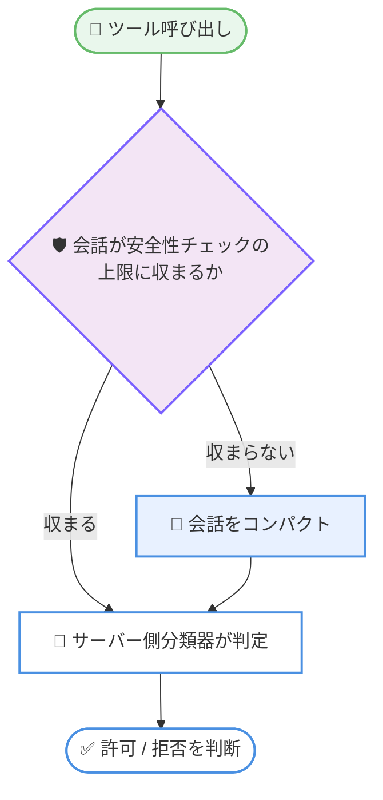

# Claude Code v2.1.302 リリース: auto モード分類器のモデル指定、Idle compaction 設定、Claude Design 終了告知

## メタデータ

| 項目 | 内容 |
|------|------|
| 発表日 | 2026-10-16 (npm registry で公開確認) |
| ソース | Claude Code Changelog |
| カテゴリ | Claude Code / CLI アップデート |
| 公式リンク | https://github.com/anthropics/claude-code/blob/main/CHANGELOG.md |

## 概要

Claude Code v2.1.302 がリリースされた。本バージョンは新機能 3 件、本体の修正 23 件、改善 3 件、変更 7 件に加え、VS Code 拡張 3 件、クラウドセッション 8 件、Remote Control 1 件、Claude Tag 14 件、Code Review 1 件と、周辺コンポーネントを幅広く更新する大規模なメンテナンスリリースである。主なハイライトは以下のとおり。

- **新環境変数 `CLAUDE_CODE_AUTO_MODE_MODEL`**: クライアント側 auto モード分類器が使用するモデルを選択できるようになった (サーバー側 auto モードのモデルは変更されない)
- **`/config` に Idle compaction 設定を追加**: アイドルコンパクションのオン / オフを切り替えられる行が追加され、アイドルコンパクション後の通知にも無効化方法が表示されるようになった
- **Claude Design の終了告知**: `/design-sync` と `/design-login` に、スタンドアロン版 Claude Design (claude.ai/design) が 2026 年 12 月 14 日に終了する旨の通知が追加された
- **プロンプトキャッシュミスの修正**: セッション途中で追加されたツールが ToolSearch 経由またはコンパクション後に再読み込みされた際のキャッシュミスを修正
- **MCP プロトコル 2026-07-28 対応の修正**: サーバーが同プロトコルバージョンをネゴシエートしつつ `resultType` などを省略した場合に、ツールが表示されない・全ツール呼び出しが失敗する問題を修正
- **Windows exFAT/FAT32 の修正**: exFAT または FAT32 ドライブ上のプロジェクトで、すべてのファイル書き込みが拒否または確認を求められる問題を修正

## 詳細

### 背景

Claude Code は CLI 本体に加え、デスクトップアプリ、VS Code 拡張、クラウドセッション、Slack 連携 (Claude Tag)、セルフホストランナーなど複数の実行環境で同時に開発が進んでいる。v2.1.302 は、auto モード (権限の自動判断) の制御性向上、プロンプトキャッシュ効率やプラグイン読み込みなどのパフォーマンス改善、各プラットフォームでの安定性修正が中心のリリースである。また、スタンドアロン版 Claude Design の終了日が明示された点は、同サービス利用者にとって重要な告知となる。

### 主な変更点

#### 新機能 (Added)

| 項目 | 内容 |
|------|------|
| `CLAUDE_CODE_AUTO_MODE_MODEL` | クライアント側 auto モード分類器が使用するモデルを選択する環境変数を追加。サーバー側 auto モードのモデルは変更しない |
| `/config` の Idle compaction 行 | アイドルコンパクションをオフまたはオンに戻す設定行を `/config` に追加。アイドルコンパクション後に表示される通知にも、無効化の方法が示されるようになった |
| Claude Design 終了の通知 | `/design-sync` と `/design-login` に、スタンドアロン版 Claude Design (claude.ai/design) が 2026 年 12 月 14 日までに終了する旨の通知を追加 |
| クラウドセッションのバナー | ルーチンのページに、前回の実行が開始されなかった理由 (組織のクラウドセッション同時実行数の上限到達など) を示すバナーを追加 |

#### 修正 (Fixed)

**モデル・API・キャッシュまわり**

- 会話のコンパクション中にターンを停止すると「Prompt is too long」エラーが発生する問題を修正
- セッション途中で Vertex または Bedrock に切り替えた後、リクエストが「diagnostics: Extra inputs are not permitted」で失敗する問題を修正
- セッション途中で追加されたツールが ToolSearch 経由またはコンパクション後に再読み込みされた際に、プロンプトキャッシュミスが発生する問題を修正
- ゲートウェイが Opus 4 や 4.1 をプレフィックス付きの名前 (`anthropic/claude-opus-4-1` など) で提供する場合に、`/autocompact` と `/effort` が誤ったモデルへ設定を保存する問題を修正
- プロンプト提案が、プランではクレジットでのみ支払われるモデルで使用量クレジットを消費していた問題を修正。クレジット課金された応答の後はスキップされるようになった

**ツール・MCP まわり**

- Read ツールが任意サイズの画像ファイルや、画像のような名前のパイプ・デバイスを丸ごとメモリに読み込んでいた問題を修正。128 MB を超える画像ソースは拒否されるようになった
- MCP サーバーがプロトコルバージョン 2026-07-28 をネゴシエートしつつ `resultType`、`ttlMs`、`cacheScope` を省略した場合に、ツールが 1 つも表示されない、またはすべてのツール呼び出しが失敗する問題を修正
- PowerShell ツールがプラグインの `bin/` フォルダー内のコマンドを見つけられない問題と、何も見つからなかった検索 (rg、grep、findstr、git grep) を `Select-Object` などの整形コマンドレットにパイプするとエラーを報告する問題を修正
- デスクトップアプリの Claude が、MCP サーバーの認可・再接続のために利用できない claude.ai 設定や `/mcp` を案内していた問題を修正

**プラグイン・CLI まわり**

- `claude plugin` などのサブコマンドが、キューに入った settings や config の書き込み完了前に終了することがあり、変更が失われたり `.tmp` ファイルが残ったりする問題を修正
- git のデフォルトが reftable 形式の場合に、プラグインマーケットプレイスがリフレッシュのたびに再クローンされ、新規インストールした git プラグインのバージョンが「unknown」と表示される問題を修正
- `claude plugin details <name>@builtin` が、対象プラグインが見つからない場合に組み込みプラグインを表示しない `claude plugin list` を提案していた問題を修正。`/plugin` を案内するようになった
- `claude remote-control --help` が、未サインイン時に使用方法を表示せず終了する問題を修正

**UI・表示まわり**

- アーティファクトの公開が、Claude が空の編集リストを送信した際に失敗することがある問題と、新しいバージョンのアーティファクトに拒否された後のリトライ方法が誤っていた問題を修正
- OpenTelemetry の `tool_decision` イベントで、auto モード分類器による大半のブロックに `classifier_category` が欠けていた問題と、`OTEL_LOGRECORD_ATTRIBUTE_COUNT_LIMIT` が低い場合に新属性が `tool_use_id`、`tool_source`、`tool_parameters` を押し出す問題を修正
- エージェントビューで、長いリストを下に移動したりセクションを折りたたんだりした後に行が空白のままになる問題を修正
- バッククォートで書かれた URL が折り返されると最初の行しかクリックできない問題を修正。ハイパーリンク対応ターミナルでは URL 全体が 1 つのリンクになった
- リンクの内側から始まる絵文字が 1 桁広く折り返され、質問プレビューで隠れたりテーブルがリストに変わったりする問題を修正
- クラウドセッションで `/design consent` と `/design revoke` が失敗した際に、利用できない `/design-login` を提案していた問題を修正。claude.ai/design/settings を案内するようになった

**セッション・環境まわり**

- git 2.56 以降で、存在しないディレクトリを指す迷子の `.git` ファイルがあると、ワークツリー分離がワークツリーの作成・再開を拒否する問題を修正
- クラウドセッションのコストと使用量が、新しいプロセスでセッションを再開した後にゼロから再カウントされる問題を修正
- セルフホストランナー: git の reftable 形式で保存されたチェックアウトを再利用するセッションで、git フェッチが「bad object refs/heads」で失敗する問題を修正
- Windows: exFAT または FAT32 ドライブ上のプロジェクトで、`--plugin-dir` 付きで開始したセッションを含め、すべてのファイル書き込みが拒否または確認を求められる問題を修正

#### 改善 (Improved)

- 多数のプラグインを有効にした場合の起動時間を改善。プラグインのコマンドファイルとエージェントファイルの読み込みに必要なファイルシステム呼び出しが大幅に削減され、特に Windows で効果が大きい
- サーバー側分類器を使う auto モードを改善。安全性チェックに対して長すぎる会話は、チェック対象のツール呼び出しがすべて拒否されるのではなく、コンパクトされるようになった
- 別のフォルダーから再開したバックグラウンドセッションに LLM ゲートウェイがない場合のメッセージを改善。「Not logged in」ではなく理由を表示するようになった

#### 変更 (Changed)

- サードパーティプロバイダー上でテレメトリーがオフまたは新規インストールの場合、権限モード未指定の `claude -p` と Agent SDK セッションは `default` モードで開始するよう変更。`--permission-mode auto` を指定すれば auto を維持できる
- フォークサブエージェント (`subagent_type: "fork"`) が、ターミナルと同様に `claude -p`、Agent SDK、デスクトップアプリ、VS Code でもデフォルトで有効に変更。`CLAUDE_CODE_FORK_SUBAGENT=0` で無効化でき、`claude mcp serve` では提供されない
- デスクトップアプリと VS Code で、メイン会話のサブエージェントは常にバックグラウンドで実行するよう変更 (従来はターミナルのみ)。また、サブエージェント自身の Agent 呼び出しは `claude -p`、Agent SDK、デスクトップアプリ、VS Code でデフォルトでフォアグラウンド実行となった
- `← for agents` のフッターヒントは、セッションを開いてから 10 秒後に非表示になるよう変更。応答待ちのエージェント数は引き続き表示される
- Claude in Chrome の指示をシステムプロンプト内で配置換えし、新しい会話が共有プロンプトキャッシュから読めるよう変更
- プロンプトフックとエージェントフックは、1 つのイベントにつき同時実行数を最大 12 に制限するよう変更。残りは順番を待つ
- 組織のポリシーで `/feedback` が無効な場合のメッセージを変更。組織管理者ではなく GitHub issues を案内するようになった

#### VS Code 拡張 (VSCode)

- リスト内の閉じられていないコードブロックの後のテキストが、応答のストリーミング中はプレーンテキストで表示され、その後コードに変わる問題を修正
- パネルからの MCP サーバーサインインで、サーバー URL にクエリ文字列が含まれると壊れた認可ページが開く問題を修正
- Claude 拡張機能を持つブラウザに到達できない場合でも `@browser` バナーが「Browser connected」と表示される問題を修正

#### クラウドセッション (Cloud sessions)

- ルーチンのページに、前回の実行が開始されなかった理由を示すバナーを追加 (前述)
- 「Rewind to here」が最新以外のすべてのメッセージで失敗する問題を修正 (セルフホストランナーは Claude Code v2.1.246 以降が必要)
- マージコンフリクトのあるプルリクエストを、GitHub の再チェック中にステータスバーが ready に戻してしまう問題を修正
- クラウドセッションが予期せず停止した後のルーチン実行が Completed と表示され、開始前にアーカイブされた場合に Cancelled と表示される問題を修正。failed と表示されるようになった
- セッションの GitHub リポジトリが名前変更または移動された後、diff ビューで変更が欠落したり読み込みに失敗したりする問題を修正
- 途中で失敗したスケジュールされたルーチン実行が、1 時間以上後に最初から再実行され、同じレポートを 2 回投稿するなど作業が重複することがある問題を修正
- 開いているクラウドセッションで、別のデバイスから送信されたメッセージがページの再読み込みまで表示されないことがある問題を修正
- クラウドセッションの起動失敗時のエラーを改善。「Something went wrong」ではなく「Connection lost」または「Server error」と表示されるようになった

#### Remote Control / Claude Tag / Code Review

- **Remote Control**: コンピューターがオフラインになった後、サブエージェントのペインが回り続ける問題を修正。Remote Control が切断されたと表示されるようになった
- **Claude Tag (Slack 連携)**: 修正・改善・変更あわせて 14 件。主な内容は以下のとおり。
  - 以前のメッセージを編集して回答した後も「is thinking…」が表示され続ける問題を修正
  - Slack 返信のコードブロック内 URL が山括弧で囲まれ、コピーしたコマンドが壊れる問題を修正
  - Slack に添付された HEIC、SVG、TIFF、BMP 画像が Claude に届かない問題を修正。他のファイル形式と同様に作業ファイルとして届くようになった
  - ロールで Claude Tag を制限する組織で、新しいチャンネルマネージャーが Slack の Claude へのアクセスを失う問題を修正
  - 単一の Slack ルックアップの遅延で DM が「DMs are temporarily unavailable」と応答され破棄される問題を修正。先にリトライするようになった
  - 管理設定のリポジトリ検索が最大 100 の接続済み GitHub アカウントに対応し、GitHub App インストールの最初の 5,000 件を超えるプライベートリポジトリも検索可能になった
  - 管理設定を Bundles、Connectors、Skills and plugins、Channels の 4 タブ構成に変更
- **Code Review**: GitHub 接続のために離脱した後、Code Review のセットアップが再開されない問題を修正。管理設定に戻るとリポジトリピッカーから再開されるようになった

### 技術的な詳細

#### auto モード分類器のモデル指定

auto モード (権限の自動判断) では、クライアント側の分類器がツール呼び出しの安全性を判定する。新しい環境変数により、この分類器が使用するモデルを選択できるようになった。

```bash
# クライアント側 auto モード分類器のモデルを指定する例
export CLAUDE_CODE_AUTO_MODE_MODEL=claude-haiku-4-5
```

changelog に明記されているとおり、この設定はサーバー側 auto モードのモデルには影響しない。

#### サーバー側 auto モードと長い会話の処理

サーバー側分類器を使う auto モードでは、従来、会話が安全性チェックの上限を超えると、チェック対象のツール呼び出しがすべて拒否されていた。v2.1.302 では、長すぎる会話を先にコンパクトする動作に改善された。



#### プロンプトキャッシュの効率化

本バージョンでは、プロンプトキャッシュに関する修正と変更が 2 点含まれる。

1. **ツール再読み込み時のキャッシュミス修正**: セッション途中で追加されたツールが ToolSearch 経由またはコンパクション後に再読み込みされた際のプロンプトキャッシュミスを修正
2. **Claude in Chrome 指示の配置換え**: システムプロンプト内の配置を変更し、新しい会話が共有プロンプトキャッシュから読めるようになった

いずれもキャッシュヒット率の向上につながる変更であり、レイテンシーとコストの両面でメリットがある。

#### Claude Design の終了スケジュール

`/design-sync` と `/design-login` に追加された通知によると、スタンドアロン版 Claude Design (claude.ai/design) は 2026 年 12 月 14 日に終了する。同サービスを利用中の場合は、終了日までに移行の検討が必要となる。

## 開発者への影響

### 対象

- **auto モードを使用する開発者**: `CLAUDE_CODE_AUTO_MODE_MODEL` によるクライアント側分類器のモデル選択と、長い会話での全拒否からコンパクションへの挙動改善
- **Claude Design (claude.ai/design) のユーザー**: 2026 年 12 月 14 日のサービス終了に向けた対応が必要
- **`claude -p` / Agent SDK をサードパーティプロバイダーで使用する開発者**: 権限モード未指定時のデフォルトが `default` モードに変更された (テレメトリーオフまたは新規インストール時)。auto を維持するには `--permission-mode auto` の明示が必要
- **デスクトップアプリ / VS Code のユーザー**: フォークサブエージェントのデフォルト有効化と、メイン会話のサブエージェントの常時バックグラウンド実行
- **Vertex / Bedrock や LLM ゲートウェイのユーザー**: プロバイダー切り替え時のエラー修正、プレフィックス付きモデル名での設定保存先の修正
- **Windows ユーザー**: exFAT/FAT32 ドライブでのファイル書き込み修正と、プラグイン読み込みの高速化
- **MCP サーバーの開発者・利用者**: プロトコルバージョン 2026-07-28 で一部フィールドを省略するサーバーとの互換性修正
- **Slack で Claude Tag を使用する組織**: 画像形式対応、DM の安定性、管理設定の 4 タブ化など多数の改善

### 必要なアクション

- 通常の利用では自動更新により適用されるため、特別な対応は不要。手動更新する場合は以下を実行する。

```bash
claude update
```

- Claude Design を利用している場合は、2026 年 12 月 14 日の終了までに移行を計画する
- サードパーティプロバイダー上の `claude -p` / Agent SDK で auto モードを前提にしている場合は、`--permission-mode auto` を明示的に指定する
- フォークサブエージェントを無効にしたい場合は、`CLAUDE_CODE_FORK_SUBAGENT=0` を設定する
- アイドルコンパクションを無効化したい場合は、`/config` の Idle compaction 行から設定する

### 移行ガイド (該当する場合)

破壊的変更ではないが、デフォルト挙動の変更が 3 点あるため、自動化パイプラインや SDK 利用コードでは以下を確認することが推奨される。

1. **権限モードのデフォルト変更**: サードパーティプロバイダーでテレメトリーオフまたは新規インストールの場合、権限モード未指定の `claude -p` と Agent SDK セッションは `default` モードで開始する
2. **フォークサブエージェントのデフォルト有効化**: `claude -p`、Agent SDK、デスクトップアプリ、VS Code で有効になった
3. **サブエージェントの実行方式**: デスクトップアプリと VS Code ではメイン会話のサブエージェントが常にバックグラウンド実行となり、サブエージェント自身の Agent 呼び出しはフォアグラウンドがデフォルトになった

## コード例

```bash
# クライアント側 auto モード分類器のモデルを指定する例
export CLAUDE_CODE_AUTO_MODE_MODEL=claude-haiku-4-5

# フォークサブエージェントを無効化する例
export CLAUDE_CODE_FORK_SUBAGENT=0

# サードパーティプロバイダーで auto モードを維持する例
claude -p --permission-mode auto "リポジトリのテストを実行して結果を報告してください"
```

## 関連リンク

- [Claude Code Changelog (公式)](https://github.com/anthropics/claude-code/blob/main/CHANGELOG.md)
- [Claude Code リポジトリ](https://github.com/anthropics/claude-code)
- [Claude Code ドキュメント](https://code.claude.com/docs)
- [Claude Design](https://claude.ai/design)

## まとめ

Claude Code v2.1.302 は、auto モードの制御性 (分類器モデルの指定、長い会話のコンパクション)、設定の柔軟性 (Idle compaction のオン / オフ)、パフォーマンス (プロンプトキャッシュ効率化、プラグイン読み込み高速化)、プラットフォーム互換性 (MCP プロトコル 2026-07-28、Windows exFAT/FAT32、reftable 形式の git) を幅広く強化したリリースである。また、スタンドアロン版 Claude Design の 2026 年 12 月 14 日終了が告知されており、該当ユーザーは移行計画の検討が必要となる。`claude -p` や Agent SDK を自動化に組み込んでいる場合は、権限モードとサブエージェントのデフォルト挙動の変更を確認することが推奨される。
