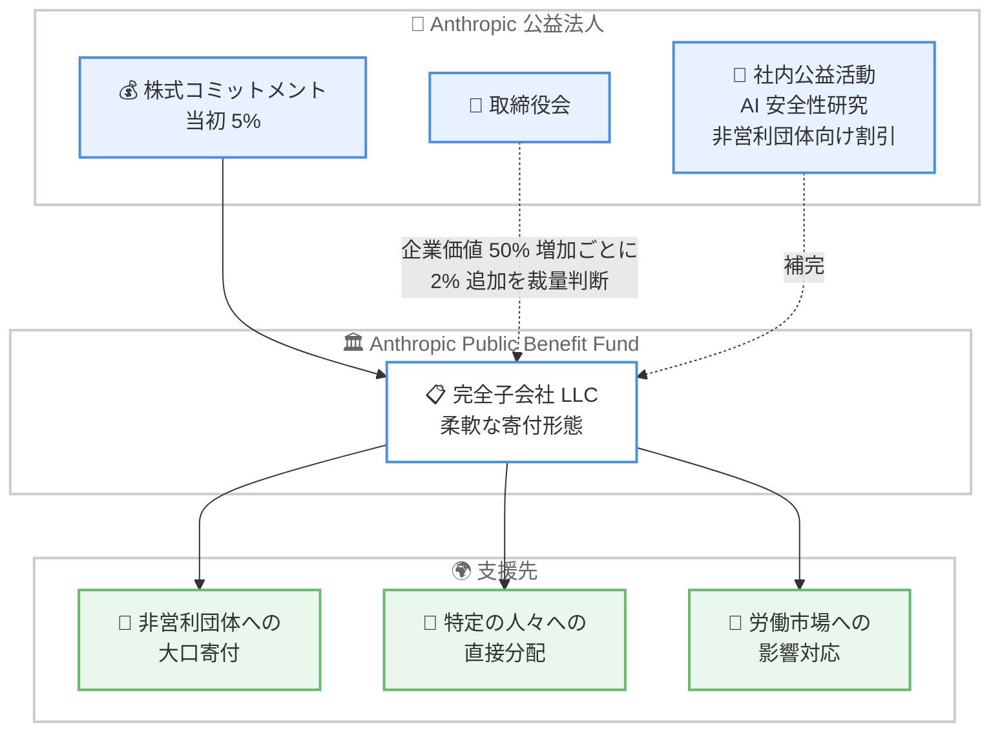

# Anthropic、公益基金「Anthropic Public Benefit Fund」を発表 - 株式の 5% をコミット

## メタデータ

| 項目 | 内容 |
|------|------|
| 発表日 | 2026-10-18 |
| ソース | Anthropic News |
| カテゴリ | 企業発表 / 公益活動 |
| 公式リンク | https://www.anthropic.com/news/public-benefit-fund |

## 概要

Anthropic は 2026 年 10 月 18 日、公益活動を推進するための基金「Anthropic Public Benefit Fund」の設立を発表した。株主承認を条件に Anthropic 株式の 5% を基金にコミットし、設定された基準値から企業価値が 50% 増加するごとに、取締役会の裁量で 2% を追加できる仕組みとなっている。

本基金は、AI 安全性研究や非営利団体向け Claude 割引といった社内の公益活動を補完し、公益法人 (Public Benefit Corporation) としてのミッションをより柔軟かつ大規模に追求することを目的としている。今回の発表により、既存のコミットメントと合わせて Anthropic 株式の約 20% が公益目的に充てられることになる。

## 詳細

### 背景

Anthropic は公益法人として設立されており、これまでも以下のような公益活動を実施してきた。

- **AI 安全性・解釈可能性研究**: AI の安全性と内部動作の理解に関する研究
- **応用生物医学研究**: AI を活用した生物医学分野への貢献
- **Claude 割引**: 非営利団体・科学機関向けの割引提供
- **創業時の誓約**: 共同創業者らによる保有株式の 80% を寄付する誓約
- **株式寄付マッチングプログラム**: 従業員が株式を寄付誓約すると Anthropic がマッチングする制度で、従業員の約半数が参加

テック企業では経営幹部に段階的な報酬を与えるのが一般的である中、Anthropic はその株式を公益に向けると説明している。

### 主な発表内容

- **基金の名称**: Anthropic Public Benefit Fund
- **形態**: Anthropic の完全子会社の LLC として設立。501(c)(3) などの形式ではなく、寄付形態の柔軟性を確保するためこの形態を選択
- **株式コミットメント**: 株主承認を条件に Anthropic 株式の 5% をコミット。設定された基準値から企業価値が 50% 増加するごとに、取締役会の裁量で 2% を追加可能
- **想定される活用例**: 従来型の非営利団体への大口寄付、特定の人々への直接分配
- **制約事項**: LLC が保有する Anthropic 株式は、米国内外を問わずロビー活動や政治献金には一切使用しない

### 労働市場への対応

基金の活用例の一つとして、AI の労働市場への影響が挙げられている。AI が経済的価値を生む一方で労働者に不安定さをもたらす可能性に対応するため、Anthropic は既にこの課題の研究・対応に 2 億ドルをコミット済みである。しかし、AI の進歩の速さを踏まえ、「より大胆なアプローチが必要になる可能性がある」としている。

### 基金の構造

### 今後の計画

- 今後数か月以内に、基金の構造・ガバナンス (持分追加の評価額マイルストーンを含む) の詳細を公表予定
- 今後発行する公益報告書 (public benefit report) で、ミッションに対する進捗を報告予定

## 影響

### 対象

本発表は API や製品の技術的変更ではないため、開発者が直ちに対応すべき事項はない。以下の関係者に影響がある。

- **非営利団体・科学機関**: 大口寄付や支援プログラムの対象となる可能性
- **Anthropic の株主・従業員**: 株式コミットメントは株主承認を条件とする。従業員は株式寄付マッチングプログラムに引き続き参加可能
- **AI 業界の関係者**: AI 企業の利益還元モデルの一例として参考になる

### 必要なアクション

- 現時点で必要なアクションはない
- 支援を受けたい団体は、今後数か月以内に公表される基金の構造・ガバナンスの詳細を確認することが推奨される

## 関連リンク

- [Investing in the public benefit (公式発表)](https://www.anthropic.com/news/public-benefit-fund)
- [Anthropic News](https://www.anthropic.com/news)

## まとめ

Anthropic は、株式の 5% をコミットする公益基金「Anthropic Public Benefit Fund」を設立した。企業価値の成長に応じて最大で段階的に持分が追加される設計であり、既存の創業者誓約や従業員マッチングプログラムと合わせると、Anthropic 株式の約 20% が公益目的に充てられる。基金は完全子会社の LLC として運営され、ロビー活動や政治献金には使用されない。労働市場への影響対応を含む幅広い公益活動への活用が想定されており、詳細なガバナンス構造は今後数か月以内に公表される予定である。
