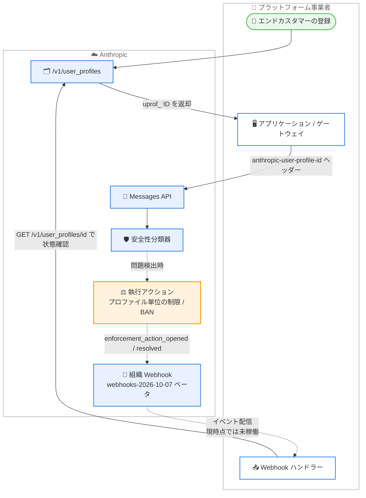

# Claude API 更新: Inference Hooks が GA、ユーザープロファイルでエンドカスタマー単位の安全対策、Admin API に組織 Webhook がベータ追加

## メタデータ

| 項目 | 内容 |
|------|------|
| 発表日 | 2026-10-20 |
| ソース | Claude API リリースノート |
| カテゴリ | Claude API / エンタープライズ / Admin API |
| 公式リンク | https://platform.claude.com/docs/en/release-notes/overview |

## 概要

2026 年 10 月 20 日、Claude Developer Platform リリースノートで、エンタープライズ管理と安全対策に関する 3 つの更新が発表されました。

1. **Inference hooks の GA 化**: Claude Enterprise 組織向けの Inference hooks がベータを終了しました
2. **ユーザープロファイルの提供開始**: 各 API リクエストがどのエンドカスタマー向けかを Anthropic に伝達できるようになりました。プラットフォームやゲートウェイの運営者、API アクセスの再販事業者では、安全対策の執行 (safety enforcement) を組織全体ではなく特定のエンドカスタマーに限定できます。SDK と `ant` CLI が新しい `/v1/user_profiles` エンドポイントに対応しています
3. **Admin API に組織 Webhook をベータ追加**: `webhooks-2026-10-07` ベータヘッダーで利用します。`/v1/organizations/webhooks` エンドポイントで Webhook エンドポイントを登録でき、ユーザープロファイルへの制限/BAN の開始と終了の 2 種のイベントに対応します。アクセスには Anthropic アカウントチームへの連絡が必要です

3 つの更新はいずれも「組織単位ではなく、より細かい粒度でガバナンスと安全対策を適用する」という方向性でつながっています。

## 詳細

### 背景

Anthropic は API トラフィックに対して自動化された安全性分類器を実行しています。従来は、プラットフォームやゲートウェイ経由のリクエストはすべて運営者の組織名義で届くため、1 つのエンドカスタマーの問題行動が組織全体への執行アクションにつながるリスクがありました。今回のユーザープロファイルは、この問題を解決するための仕組みです。組織 Webhook は、そのプロファイルに対する執行アクションの開始・終了を通知として受け取るための補完機能です。また、Claude Enterprise 組織向けの Inference hooks が GA となり、推論前のインライン制御が正式機能になりました。

### 主な変更点

#### 1. Inference hooks がベータ終了 (Claude Enterprise 組織向け)

[Inference hooks](https://platform.claude.com/docs/en/manage-claude/inference-hooks) が、Claude Enterprise 組織向けにベータを終了しました。

公式ドキュメントによると、Inference hooks は以下の仕組みです。

- **目的**: 組織またはセキュリティベンダーが運用する AI セキュリティサーバー (HTTPS サービス) に、ガバナンス対象のプロンプトを推論実行前にルーティングし、allow/deny の判定を受けます。deny されたリクエストはモデルに到達しません
- **フックイベント**: `prompt` (推論開始前に 1 回) と `tool_call` (ツール呼び出し実行前、**Validate tool calls** 有効時) の 2 種類
- **適用範囲**: フックは Anthropic のサーバー上で動作するため、claude.ai、Cowork、Claude Code、Claude for Microsoft 365 など、組織内のすべての Claude 製品のガバナンス対象リクエストに一律に適用されます。ユーザーデバイスへのインストールは不要です
- **署名**: 各リクエストは [Standard Webhooks](https://www.standardwebhooks.com/) 仕様に従って署名されます
- **段階的展開**: シャドウモード (ブロックせず判定のみ観測)、ロールアウト率の指定、ロールによる除外設定に対応します
- **対象外**: Platform 組織 (Claude Platform 経由の API アクセス) は対象外です。Amazon Bedrock と Google Cloud でも利用できません

設定には claude.ai の `organization:manage` 権限 (Owner および Primary owner ロールのみ) が必要です。

#### 2. ユーザープロファイル: エンドカスタマー単位のリクエスト帰属

[ユーザープロファイル](https://platform.claude.com/docs/en/manage-claude/user-profiles)が提供開始されました。各 API リクエストがどのエンドカスタマー向けかを Anthropic に伝達する仕組みで、安全対策の執行アクション (保留やブロックなど) を組織全体ではなく 1 つのエンドカスタマーに限定できます。該当エンドカスタマー以外のトラフィックは影響を受けません。

利用の流れは以下のとおりです。

- **プロファイル登録**: エンドカスタマーごとに `POST /v1/user_profiles` で 1 回登録し、返される `uprof_` プレフィックスの ID を保存します
- **リクエストへの付与**: そのエンドカスタマーに代わって送信するすべてのリクエストに、`anthropic-user-profile-id` ヘッダーで ID を送信します
- **SDK/CLI 対応**: SDK と `ant` CLI には、ヘッダーを送信する引数 `user_profile_id` (CLI は `--user-profile-id`) があります
- **対応リクエスト**: Messages API のほか、トークンカウント、Message Batches、OpenAI SDK 互換リクエストでも同様に機能します。バッチでは中のすべてのリクエストに適用されます
- **課金**: プロファイルは課金対象ではなく、料金に影響しません

プロファイルの `access_type` フィールドで、プロファイルが表す対象を区別します。

| トラフィックの主体 | プロファイル | `access_type` |
|------------------|------------|---------------|
| 自社プロダクトのサインアップ済みユーザー | ユーザーごとに 1 つ | `application` (デフォルト) |
| API アクセスを再販する相手企業 (ゲートウェイなど) | 企業ごとに 1 つ | `passthrough` (明示指定が必要) |
| 自組織自身の利用 | 不要 (プロファイルなしは自組織の利用と見なされる) | 該当なし |

そのほか、公式ドキュメントに記載されている注意点は以下のとおりです。

- プロファイルには送信した情報と Anthropic が設定するプログラムステータスのみが含まれ、会話内容は含まれません。Anthropic は送信された詳細を検証しません
- `POST /v1/user_profiles` は冪等ではないため、呼び出すたびに新しいプロファイルが作成されます。作成はカスタマーオンボーディング時に 1 回だけ行います
- エンドカスタマー向けトラフィックの組織と自社内部利用の組織は分離することが推奨されています。プロファイルはワークスペースではなく組織に属します
- ID が不正、または送信元組織のものでない場合、API は `400` `invalid_request_error` を返します
- Amazon Bedrock と Google Cloud には `/v1/user_profiles` エンドポイントがないため、Claude API または Claude Platform on AWS の組織でプロファイルを作成します。Claude in Amazon Bedrock ではリクエストボディのトップレベルの `user_profile_id` フィールドで ID を送信します
- `passthrough` プロファイルは企業を識別するもので、リクエストが特定の個人からのものである場合は、Messages リクエストの `metadata.user_id` フィールドで個人識別子も送信します

#### 3. Admin API に組織 Webhook (ベータ)

[組織 Webhook](https://platform.claude.com/docs/en/manage-claude/organization-webhooks) が [Admin API](https://platform.claude.com/docs/en/manage-claude/admin-api) にベータとして追加されました。`webhooks-2026-10-07` ベータヘッダーを付けて利用します。アクセスのリクエストには Anthropic アカウントチームへの連絡が必要です。

対応するイベントタイプは以下の 2 種です。

| イベント | トリガー |
|---------|---------|
| `user_profile.enforcement_action_opened` | Anthropic がユーザープロファイルに執行アクション (制限または BAN) を開始したとき |
| `user_profile.enforcement_action_resolved` | 執行アクションが終了したとき。Anthropic が解除するか、`expires_at` の時刻を過ぎたとき |

**重要な注意点**: 公式ドキュメントによると、現時点ではイベント配信は稼働していません (Anthropic はまだこの 2 種のイベントを送信していません)。エンドポイントの登録と、ドキュメントに記載されたイベント形式に基づくハンドラーの構築は可能です。

仕組みの詳細は以下のとおりです。

- **エンドポイント管理**: `/v1/organizations/webhooks` 配下のエンドポイントで、一覧・作成・取得・更新・削除・署名シークレットの再生成を行います。作成・変更・削除には admin、owner、primary owner のいずれかのロールが必要です
- **配信仕様**: 配信は Standard Webhooks 仕様に従い、`webhook-id`、`webhook-timestamp`、`webhook-signature` ヘッダーが付与されます。エンドポイント作成時に発行される `whsec_` プレフィックスの署名シークレットで検証します
- **応答要件**: 5 秒以内に `2xx` ステータスを返す必要があります。重複配信があり得るため、イベント `id` で重複排除します
- **再試行と自動無効化**: 配信失敗時は数分間にわたり数回再試行され、すべて失敗するとイベントは破棄されます。リダイレクト応答、非パブリック IP への解決、継続的な配信失敗があると、Anthropic はエンドポイントを無効化します
- **上限**: 1 組織あたり最大 32 エンドポイント (無効化されたものも数に含まれます)
- **イベントの内容**: イベントには ID のみが含まれます (`data.id` がプロファイル ID、`data.enforcement_action_id` が `enac_` プレフィックスのアクション ID)。変更内容は `GET /v1/user_profiles/{id}` でプロファイルを取得して確認します
- **利用条件**: 組織 Webhook が有効化されており、HIPAA readiness が無効な Claude API 組織で利用できます

### 技術的な詳細

3 つの更新を組み合わせると、「エンドカスタマー単位の帰属 → プロファイル単位の執行 → Webhook による通知 → プロファイル取得による状態確認」という一連のフローが構成されます。



ポイントは、プロファイルを付与していないリクエストは「自組織の利用」として扱われることです。プロファイルなしのリクエストが執行アクションのトリガーになった場合、アクションは組織全体に適用されます。エンドカスタマーのトラフィックには漏れなくプロファイル ID を付与することが重要です。

## 開発者への影響

### 対象

- Claude Enterprise 組織でインライン制御を検討しているセキュリティ・コンプライアンスチーム (Inference hooks)
- プラットフォームやゲートウェイを運営し、または API アクセスを再販し、エンドカスタマーのトラフィックを自組織名義で送信しているすべての開発者 (ユーザープロファイル)
- エンドカスタマーへの執行アクションをシステムで検知したい組織管理者 (組織 Webhook)

### 必要なアクション

1. **Inference hooks**: Claude Enterprise 組織でベータ利用を見送っていた場合、GA 化を機に導入を再検討できます。シャドウモードから始めることで、ブロックなしで判定の観測が可能です
2. **ユーザープロファイル (推奨)**: エンドカスタマーのトラフィックを扱う場合、以下を実施してください
   - カスタマーオンボーディングフローに `POST /v1/user_profiles` によるプロファイル作成を組み込み、返された `uprof_` ID を顧客レコードに保存する
   - すべてのリクエストに `anthropic-user-profile-id` ヘッダー (SDK では `user_profile_id` 引数) で ID を付与する
   - 再販の場合は `access_type` を `passthrough` に設定する
   - 既存顧客基盤を一括登録する前に、Anthropic アカウントチームに連絡する (プロファイル作成はレート制限あり)
3. **組織 Webhook**: 利用にはアカウントチームへのアクセス申請が必要です。イベント配信は現時点で未稼働のため、まずはエンドポイント登録とハンドラー実装の準備段階として利用します。署名シークレットは作成時の応答にのみ含まれるため、安全に保管してください

### 移行ガイド (該当する場合)

ユーザープロファイルと組織 Webhook は新機能のため、既存コードへの破壊的変更はありません。ただし、組織 Webhook のドキュメントによると、`anthropic-beta` ヘッダーに `user-profiles-2026-09-04` 以前の値を指定しているリクエストでは、プロファイルの `enforcement_status` と `enforcement_actions` フィールドが応答に含まれず、`enforcement_status[]` によるリストフィルタが `400` を返します。これらのフィールドを利用するには、該当のベータ値をリクエストから削除してください。

## コード例

ユーザープロファイルの作成と、Messages API リクエストへの付与の例です (公式ドキュメントのサンプルを抜粋)。

```python
import anthropic

client = anthropic.Anthropic()

# 1. エンドカスタマーのオンボーディング時にプロファイルを 1 回作成
# 再販先企業の場合は access_type="passthrough" を指定
profile = client.user_profiles.create(
    name="Acme Analytics, Inc.",
    access_type="passthrough",
    external_user_details={"reference_id": "cust-8f2a1c", "country": "US"},
)
print(profile.id)  # uprof_... を顧客レコードに保存する

# 2. そのエンドカスタマーに代わるすべてのリクエストに ID を付与
message = client.messages.create(
    model="claude-opus-5-5",
    max_tokens=1024,
    messages=[{"role": "user", "content": "Hello, Claude"}],
    user_profile_id=profile.id,
)
print(message)
```

組織 Webhook エンドポイントの登録例です (Admin API キーと `webhooks-2026-10-07` ベータヘッダーが必要)。

```bash
curl "https://api.anthropic.com/v1/organizations/webhooks" \
  -H "x-api-key: $ANTHROPIC_API_KEY" \
  -H "anthropic-version: 2023-06-01" \
  -H "anthropic-beta: webhooks-2026-10-07" \
  -H "content-type: application/json" \
  -d '{
    "url": "https://example.com/anthropic-webhooks",
    "name": "Enforcement actions",
    "enabled_events": [
      "user_profile.enforcement_action_opened",
      "user_profile.enforcement_action_resolved"
    ]
  }'
```

## 関連リンク

- [Claude API リリースノート](https://platform.claude.com/docs/en/release-notes/overview)
- [Inference hooks](https://platform.claude.com/docs/en/manage-claude/inference-hooks)
- [User profiles for end-customer attribution](https://platform.claude.com/docs/en/manage-claude/user-profiles)
- [User profiles API リファレンス](https://platform.claude.com/docs/en/api/user_profiles)
- [Organization webhooks](https://platform.claude.com/docs/en/manage-claude/organization-webhooks)
- [Organization webhooks API リファレンス](https://platform.claude.com/docs/en/api/beta/organization/webhooks)
- [Admin API](https://platform.claude.com/docs/en/manage-claude/admin-api)

## まとめ

2026 年 10 月 20 日の更新は、エンタープライズ組織のガバナンス (Inference hooks の GA 化)、プラットフォーム事業者の安全対策の粒度向上 (ユーザープロファイル)、執行アクションの可観測性 (組織 Webhook) という 3 つの柱で構成されています。特にユーザープロファイルは、プラットフォーム・ゲートウェイ・再販事業者にとって「1 ユーザーの問題で組織全体が影響を受ける」リスクを軽減する実用的な仕組みであり、追加コストなしで導入できます。組織 Webhook はベータ機能であり、現時点ではイベント配信が未稼働である点に注意してください。最新情報は公式ドキュメントを参照してください。
