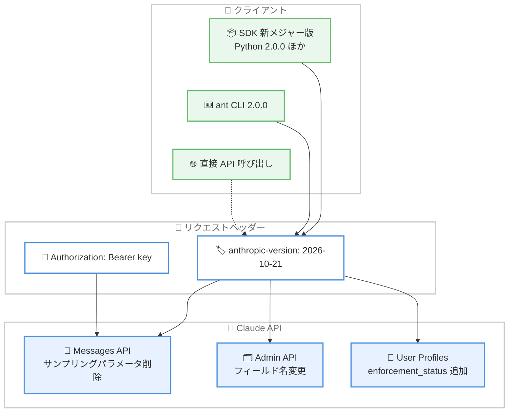

# API version 2026-10-21 リリースと SDK/CLI メジャーバージョン公開

## メタデータ

| 項目 | 内容 |
|------|------|
| 発表日 | 2026-10-21 |
| ソース | Claude API Release Notes |
| カテゴリ | API 更新 |
| 公式リンク | https://platform.claude.com/docs/en/release-notes/overview |

## 概要

Anthropic は 2026 年 10 月 21 日、新しい API バージョン `2026-10-21` をリリースした。あわせて、この新バージョンをデフォルトで送信するクライアント SDK (Python 2.0.0、TypeScript 1.0.0、C# 13.0.0、Go 2.0.0、Java 3.0.0、PHP 1.0.0、Ruby 2.0.0) と `ant` CLI 2.0.0 を公開した。新しい SDK/CLI には API バージョンに依存しない破壊的変更も含まれ、ライセンスが MIT License から Apache 2.0 に変更された。

さらに、ユーザープロファイルに `enforcement_status` と `enforcement_actions` フィールドが追加され、Anthropic がエンドカスタマーを制限または BAN したかどうかを確認できるようになった。

## 詳細

### 背景

従来の SDK と CLI は、すべてのリクエストで `anthropic-version: 2023-06-01` ヘッダーを送信していた。今回のメジャーバージョンアップにより、各言語の SDK と `ant` CLI は Amazon Bedrock および Google Cloud クライアントを含め、デフォルトで `2026-10-21` を送信するようになる。公式の移行ガイド「[Migrating to API version 2026-10-21](https://platform.claude.com/docs/en/api/migration-2026-10-21)」でアップグレード手順が案内されている。

### 主な変更点

#### 1. API バージョン 2026-10-21 の破壊的変更

移行ガイドによると、Messages API (トークンカウント、Message Batches 内の各リクエストを含む) では以下の変更が適用される。

- **assistant メッセージ内の document ブロックがエラーに**: `assistant` メッセージに直接 `document` ブロックを配置したリクエストは 400 エラーを返す。ドキュメントは `user` メッセージで送信する必要がある。Web フェッチツール結果など、別のブロック内にネストされたドキュメントは引き続き受け付けられる
- **user メッセージ内の citations がエラーに**: `user` メッセージ内の `text` ブロックに空でない `citations` 配列を送信すると 400 エラーを返す。`assistant` メッセージ内の citations や、ドキュメント・検索結果に対する `"citations": {"enabled": true}` 設定は引き続き有効
- **サンプリングパラメータの削除**: `temperature`、`top_p`、`top_k` を送信すると、デフォルト値であっても 400 エラーを返す。これらを省略した場合はデフォルト値 (`temperature` は 1.0) でサンプリングされる。非デフォルト値に依存するリクエストは、パラメータの送信を止めるか、`2023-06-01` に留まる必要がある

Admin API と Claude Enterprise Analytics API では、リネームされたフィールドの旧名称がレスポンスから削除される。

| API | 旧名称 | 新名称 |
|-----|--------|--------|
| RBAC groups | `roles` | `role_ids` |
| RBAC group members | `group_id` | `rbac_group_id` |
| RBAC roles | `name` | `display_name` |
| レート制限 | `group_type` | `group.type` |
| API キー | `workspace_id` | `scope` (値の形式も変更) |
| ユーザー別 usage/cost レポート | `actor.email` | `actor.email_address` |
| Activity summaries | `summaries` | `data` |

#### 2. SDK/CLI のメジャーバージョンリリース

新 API バージョンをデフォルト送信する以下のバージョンが公開された。

| コンポーネント | 新バージョン |
|---------------|-------------|
| Python SDK | 2.0.0 |
| TypeScript SDK | 1.0.0 |
| C# SDK | 13.0.0 |
| Go SDK | 2.0.0 |
| Java SDK | 3.0.0 |
| PHP SDK | 1.0.0 |
| Ruby SDK | 2.0.0 |
| `ant` CLI | 2.0.0 |

#### 3. API バージョン非依存の SDK/CLI 破壊的変更

移行ガイドの「SDK and CLI changes」セクションによると、以下の変更が含まれる。

- **MessageParam のロール別分割**: 従来は全ロール共通だった `MessageParam` 型が、`UserMessageParam`、`AssistantMessageParam`、`SystemMessageParam` に分割された。`BetaMessageParam` も同様に分割。送信される JSON のフィールドと値は従来と同じ
- **単一値 enum の定数化**: C#、Go、Java、PHP、Ruby SDK において、1 つの値しか取れない必須フィールドが enum 型から定数に変更された
- **ツールランナーのクライアント側コンパクション削除**: TypeScript と Ruby SDK で、クライアント側コンパクションが削除され、API 内部で会話を要約するサーバー側コンパクションに置き換えられた
- **Text Completions API の削除**: レガシーの Text Completions API が TypeScript、Go、Java、Ruby SDK と CLI から削除された。Messages API を使用する
- **非ベータ Models メソッドから betas を削除**: ベータヘッダーを送信するには `client.beta.models` 側のメソッド、または CLI の `ant beta:models` を使用する
- **API キーを Authorization: Bearer ヘッダーで送信**: SDK/CLI は API キーを `X-Api-Key` ヘッダーではなく `Authorization: Bearer <key>` で送信するようになった。`X-Api-Key` を読み取る、または設定するプロキシやゲートウェイは `Authorization` を使用するよう変更が必要。Claude API 自体はどちらのヘッダーのキーも受け付ける
- **クライアントは 1 つの資格情報のみ保持**: API キーと認証トークンがヘッダーを共有するため、SDK クライアントは 1 つの資格情報のみを保持する。複数を渡すとエラーになる
- **CLI の --api-key / --auth-token フラグ削除**: コマンドラインの値はシェル履歴やプロセス一覧に表示されるため削除された。代わりに環境変数 `ANTHROPIC_API_KEY`/`ANTHROPIC_AUTH_TOKEN`、`--api-key-stdin`/`--auth-token-stdin`、または `ant auth login` を使用する
- **CLI の Go モジュールパス変更**: `go install` の場合、モジュールパスが `github.com/anthropics/anthropic-cli/v2` になった

#### 4. ライセンス変更

新バージョン以降、SDK と CLI のライセンスは MIT License から Apache License, Version 2.0 に変更された。旧バージョンは引き続き MIT License のまま。コード変更は不要だが、依存関係のライセンスを追跡している場合はエントリの更新が必要。TypeScript のプラットフォームパッケージ (`@anthropic-ai/bedrock-sdk` など) と C# の関連パッケージ (`Anthropic.Bedrock` など) はそれぞれの 1.0.0 リリースでライセンスが変更される。

#### 5. ユーザープロファイルの enforcement フィールド追加

ユーザープロファイルに `enforcement_status` と `enforcement_actions` フィールドが追加され、Anthropic がエンドカスタマーを制限または BAN したかどうかを確認できるようになった。制限または BAN が有効なプロファイルを探すには、プロファイル一覧 API で新しい `enforcement_status[]` フィルタを使用する。

### 技術的な詳細

SDK を使用している場合、リクエストにはその SDK のメジャーバージョンがリリースされた時点の API バージョンが使用される。SDK を使わずに API を直接呼び出す場合は、`anthropic-version` ヘッダーに `2026-10-21` を設定する。

```bash
curl https://api.anthropic.com/v1/messages \
  -H "x-api-key: $ANTHROPIC_API_KEY" \
  -H "anthropic-version: 2026-10-21" \
  -H "content-type: application/json" \
  -d '{
    "model": "claude-opus-5-5",
    "max_tokens": 1024,
    "messages": [{"role": "user", "content": "Hello, Claude"}]
  }'
```

## 開発者への影響

### 対象

- Claude API を SDK (Python、TypeScript、C#、Go、Java、PHP、Ruby) または `ant` CLI 経由で利用しているすべての開発者
- `temperature`、`top_p`、`top_k` などのサンプリングパラメータを使用しているアプリケーション
- `X-Api-Key` ヘッダーを読み取る、または設定するプロキシ・ゲートウェイの運用者
- Admin API や Claude Enterprise Analytics API のレスポンスフィールドを読み取るコード
- 依存関係のライセンスを管理している組織

### 必要なアクション

以下の対応を推奨する。

1. **移行ガイドの確認**: [Migrating to API version 2026-10-21](https://platform.claude.com/docs/en/api/migration-2026-10-21) で自分のコードに影響する破壊的変更を確認する
2. **サンプリングパラメータの削除**: リクエストから `temperature`、`top_p`、`top_k` を削除する。非デフォルト値に依存する場合は影響を評価する
3. **SDK/CLI のアップグレード**: 各言語の新メジャーバージョンにアップグレードし、型変更 (`MessageParam` の分割など) に対応する
4. **プロキシ・ゲートウェイの更新**: `X-Api-Key` ではなく `Authorization: Bearer` ヘッダーを処理するよう変更する
5. **ライセンス情報の更新**: 依存関係のライセンス管理をしている場合、MIT から Apache 2.0 への変更を反映する

### 移行ガイド

公式の移行ガイドが提供されている。

- **アップグレード手順**: https://platform.claude.com/docs/en/api/migration-2026-10-21#upgrade
- **SDK and CLI changes**: https://platform.claude.com/docs/en/api/migration-2026-10-21#sdk-changes

## コード例

CLI の認証フラグは削除されたため、環境変数または標準入力を使用する。

```bash
# Before (v1 まで)
ant --api-key "$KEY" models list

# After: 環境変数から
export ANTHROPIC_API_KEY="$KEY"
ant models list

# After: シークレットマネージャーから
op read op://vault/anthropic/api-key | ant --api-key-stdin models list
```

Go で CLI をインストールする場合はモジュールパスに `/v2` を追加する。

```bash
# Before
go install 'github.com/anthropics/anthropic-cli/cmd/ant@latest'

# After
go install 'github.com/anthropics/anthropic-cli/v2/cmd/ant@latest'
```

## アーキテクチャ図



## 関連リンク

- [Claude API Release Notes](https://platform.claude.com/docs/en/release-notes/overview)
- [Migrating to API version 2026-10-21](https://platform.claude.com/docs/en/api/migration-2026-10-21)
- [Client SDKs 概要](https://platform.claude.com/docs/en/cli-sdks-libraries/overview)
- [ant CLI クイックスタート](https://platform.claude.com/docs/en/cli-sdks-libraries/cli/quickstart)
- [User profiles](https://platform.claude.com/docs/en/manage-claude/user-profiles)
- [プロファイル一覧 API](https://platform.claude.com/docs/en/api/user_profiles/list)

## まとめ

API version `2026-10-21` のリリースと全 SDK/CLI のメジャーバージョンアップは、Claude API の大規模な節目となる更新である。サンプリングパラメータの削除、認証ヘッダーの `Authorization: Bearer` への統一、Admin API のフィールド名整理など、複数の破壊的変更が含まれるため、開発者は移行ガイドに沿った計画的なアップグレードが必要となる。ライセンスの Apache 2.0 への変更はコード変更を伴わないが、ライセンス管理をしている組織は更新が求められる。また、ユーザープロファイルの `enforcement_status` フィールドにより、エンドカスタマーに対する Anthropic の制限・BAN 状態をプログラムから確認できるようになり、プラットフォーム運用者の安全管理が強化された。
