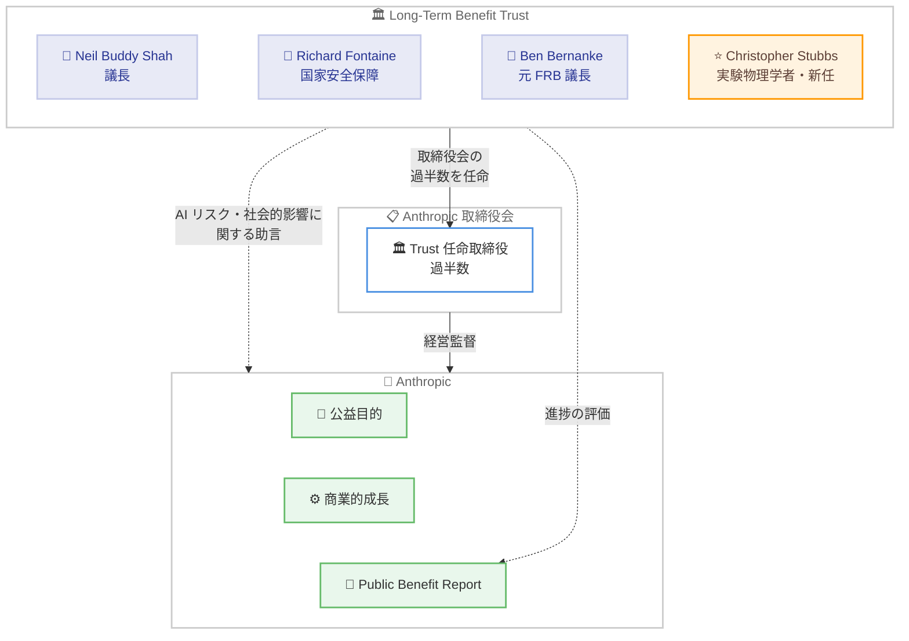

# 物理学者 Christopher Stubbs 氏が Anthropic の Long-Term Benefit Trust に参加

## メタデータ

| 項目 | 内容 |
|------|------|
| 発表日 | 2026-10-21 |
| ソース | [Anthropic News](https://www.anthropic.com/news) |
| カテゴリ | Announcements / 会社・組織ニュース |
| 公式リンク | [Physicist Christopher Stubbs joins Anthropic's Long-Term Benefit Trust](https://www.anthropic.com/news/christopher-stubbs-joins-long-term-benefit-trust) |

## 概要

Anthropic は、実験物理学者で元ハーバード大学理学部長の Christopher Stubbs 博士が、同社の独立ガバナンス機構である Long-Term Benefit Trust (LTBT) にトラスティーとして参加したことを発表した。Stubbs 氏は LTBT 初の物理学者であり、宇宙の加速膨張の発見に貢献した科学的実績と、学界・政府をまたぐ大規模プロジェクトのリーダーシップ経験を Trust にもたらす。

LTBT は、公益法人 (Public Benefit Corporation) である Anthropic が商業的成長と公益目的のバランスを長期的に維持するために設置した独立機関であり、取締役会の過半数を任命する権限を持つ。今回の就任は、同週に公開された初の Public Benefit Report (公益報告書) など、Anthropic のガバナンス強化の動きと並行して発表された。

## 詳細

### 背景

Anthropic は公益法人として、商業的成長と公益目的のバランスを取る企業構造を採用している。LTBT はこのバランスを長期的に担保するために存在し、以下の特徴を持つ。

- **取締役任命権**: Anthropic 取締役会の過半数を任命する権限を持つ
- **助言機能**: トラスティーは、AI のリスクと社会的影響に関わる重要な決定について、取締役会と経営陣に助言する
- **独立性**: トラスティーは会社の経営陣および投資家から独立している

### Christopher Stubbs 氏の経歴

Stubbs 氏は、科学・政策の両面で豊富な実績を持つ実験物理学者である。

- **現職**: ハーバード大学 Samuel C. Moncher 記念物理学・天文学教授
- **元ハーバード大学理学部長**: 2018 年から 2024 年まで Dean of Science を務めた
- **宇宙の加速膨張の発見**: 1998 年、High-Z 超新星探索チームの一員として宇宙の加速膨張を発見。この業績によりチームは後に基礎物理学ブレイクスルー賞を受賞した
- **Vera C. Rubin 天文台**: 初代プロジェクトサイエンティストを務めた。同天文台は 2026 年 6 月に南天の 10 年間サーベイを開始しており、その目的の一つは同氏が発見に貢献した加速膨張の研究である
- **JASON メンバー**: 1960 年から米国政府に国防・技術について助言してきた独立科学者グループ「JASON」のメンバーとして、国家安全保障や軍備管理について米国政府に助言してきた
- **AI と科学の再現性**: 最近では、AI モデルが同じ質問に異なる回答を返しうる状況において、AI 支援研究の再現性を保つ方法について執筆している

### 各者のコメント

**Christopher Stubbs 氏**: 公益ミッションの実現を支援できることを光栄に思うと述べた。研究で日々 AI ツールを使いその可能性を実感する一方、教育者として AI が提起する難問にも向き合ってきたと語り、「祖父として、AI が人類の長期的利益のために開発・展開されるよう支援したい」とコメントした。

**Daniela Amodei 氏 (共同創業者・社長)**: Stubbs 氏が宇宙の予想外の膨張速度の証拠を発見した際、分野の通説に反してもデータに従ったことを挙げ、AI が科学のあり方を変革しつつある今、同氏の知的誠実さ、厳密さ、真実への献身こそがこの技術の未来を形作るべき価値観だと述べた。

**Neil Buddy Shah 氏 (LTBT 議長)**: 強力な AI を安全に構築し人々の生活を実質的に改善するには、科学への深い理解と誠実なリーダーシップが不可欠だと指摘。Stubbs 氏は科学の最難問に取り組んだだけでなく、学界・政府・国立研究所にまたがる大規模で複雑な共同科学プロジェクトを高い誠実さで率いてきたとし、それが Trust にとって大きな価値になると述べた。

### 現在の LTBT トラスティー

Stubbs 氏は Trust 初の物理学者であり、以下のメンバーに加わる。

| 名前 | 専門・経歴 |
|------|-----------|
| Neil Buddy Shah | LTBT 議長 |
| Richard Fontaine | 国家安全保障の専門家 |
| Ben Bernanke | 元連邦準備制度理事会 (FRB) 議長 |
| Christopher Stubbs | 実験物理学者、元ハーバード大学理学部長 (今回就任) |

### 関連するガバナンス強化の動き

今回の発表と同じ週に、Anthropic はガバナンスに関する以下の取り組みも公表している。

- **初の Public Benefit Report の公開**: 憲章に向けた取り組みと不足点を公に報告するもの。トラスティーは報告書が評価基準とする憲章の 5 つの柱の策定に協力し、報告書の最後には進捗に対するトラスティーの評価が掲載されている
- **Anthropic Public Benefit Fund の設立約束**: 株主の承認を条件に、Anthropic の株式の一部を新組織「Anthropic Public Benefit Fund」に割り当てることを約束。この組織は会社の成長とともに持ち分が増える構造を持つ

## 社会・業界への影響

### 対象

- **AI 業界全体**: AI 企業のガバナンスにおける独立監督機関の運用事例として
- **科学コミュニティ**: AI 支援研究の再現性など、科学と AI の接点に関する知見が Trust の意思決定に反映される
- **政策立案者**: 国家安全保障の助言経験を持つ科学者がガバナンスに参画する枠組みの参考事例として

### 意義

今回の就任には以下の意義がある。

1. **科学的視点の追加**: LTBT 初の物理学者として、AI が科学研究に与える影響 (再現性の課題など) を直接理解する人材が加わった
2. **データ重視の姿勢**: 通説に反してもデータに従うという Stubbs 氏の研究姿勢は、AI のリスク評価においても重要な資質となる
3. **安全保障の知見強化**: JASON メンバーとしての国防・軍備管理の助言経験は、国家安全保障の専門家 Richard Fontaine 氏と並び、AI の安全保障面での監督機能を補強する

## アーキテクチャ図

## 関連リンク

- [Physicist Christopher Stubbs joins Anthropic's Long-Term Benefit Trust - Anthropic](https://www.anthropic.com/news/christopher-stubbs-joins-long-term-benefit-trust)
- [The Long-Term Benefit Trust - Anthropic](https://www.anthropic.com/news/the-long-term-benefit-trust)
- [Anthropic News](https://www.anthropic.com/news)

## まとめ

Christopher Stubbs 氏の LTBT 参加は、Anthropic のガバナンス機構に科学的厳密性という新たな視点を加えるものである。宇宙の加速膨張の発見という第一級の科学的実績、大規模共同プロジェクトのリーダーシップ、JASON を通じた国家安全保障への助言経験という 3 つの側面は、AI のリスクと社会的影響を監督する Trust の役割に直接資する。

また、同週の Public Benefit Report 公開や Anthropic Public Benefit Fund の設立約束と合わせて見ると、今回の就任は Anthropic が公益法人としての説明責任を強化する一連の動きの一環と位置付けられる。AI が科学研究のあり方を変えつつある中で、「通説よりもデータに従う」姿勢を体現する科学者がガバナンスに参画することは、AI 企業の長期的な公益性を担保する試みとして注目される。
