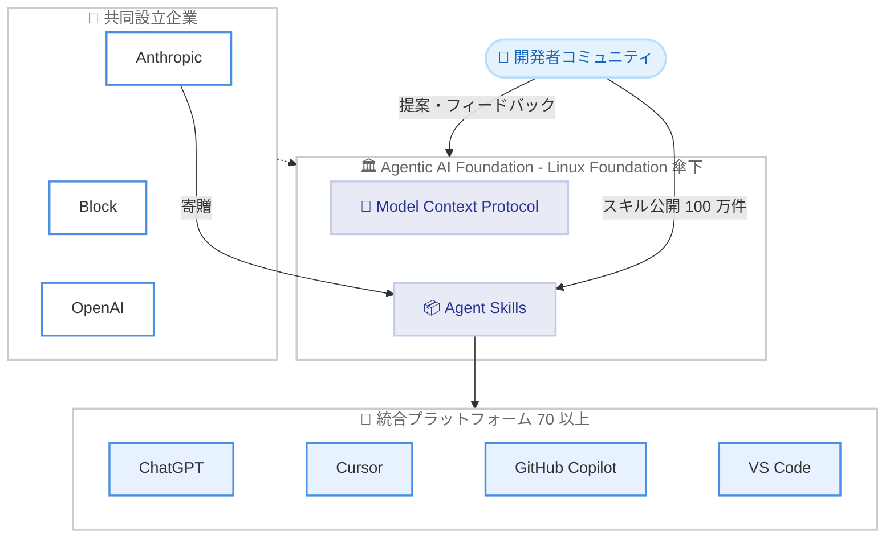

# Agent Skills を Agentic AI Foundation に寄贈 — オープン標準としての中立的な運営へ

## メタデータ

| 項目 | 内容 |
|------|------|
| 発表日 | 2026-10-22 |
| ソース | Anthropic News |
| カテゴリ | Product / オープン標準 |
| 公式リンク | https://www.anthropic.com/news/donating-agent-skills-to-the-agentic-ai-foundation |

## 概要

Anthropic は、AI エージェントに専門知識とワークフローを与えるオープン標準「Agent Skills」を、Linux Foundation 傘下の Agentic AI Foundation (AAIF) に寄贈すると発表した。AAIF は Anthropic が Block、OpenAI と共同設立した団体であり、既に Model Context Protocol (MCP) も寄贈されている。

2025 年 12 月の標準公開以降、ChatGPT、Cursor、GitHub Copilot、VS Code を含む 70 以上のエージェントプラットフォームが Agent Skills を統合しており、これまでに 100 万件のスキルが公開、約 2 億 8,000 万件がインストールされている。今回の寄贈により、特定企業に依存しない中立的な運営体制のもとで、コミュニティ主導の標準化が進められる。

## 詳細

### 背景

Agent Skills は Claude Code の開発過程で生まれた仕組みである。AI エージェントは一般的な知識作業はこなせる一方、実際のビジネスタスクに必要な手続き的知識が不足していた。この課題を解決するため、タスクやドメイン固有の知識をエージェントに教える標準フォーマットとして Agent Skills が設計された。

スキルは「SKILL.md」ファイルを含むフォルダとして構成され、特定のタスクやドメインの知識をエージェントに提供する。必要に応じてスクリプトや参照資料も同梱できる。

### 主な変更点

**寄贈される資産**: 以下が AAIF に移管される。

- Agent Skills の名称とロゴ
- GitHub オーガニゼーション
- agentskills.io ドメイン

**運営体制**: Anthropic、Google、OpenAI などの企業のエンジニアが個人として標準を維持する。リードメンテナーは David Soria Parra 氏と Mahesh Murag 氏が務める。なお、AAIF に参加しなくても標準の利用や貢献は可能である。

**今後のロードマップ案**: 以下の項目が提案されている。

- バージョン管理されたリリース
- 正式な提案プロセス
- スキルの作成者とインストール者向けのセキュリティガイダンス
- MCP と同様の、コミュニティの意見と透明な意思決定の重視

### 技術的な詳細

Agent Skills の採用状況は以下のとおりである。

| 指標 | 数値 |
|------|------|
| 統合プラットフォーム数 | 70 以上 |
| 公開されたスキル数 | 100 万件 |
| スキルのインストール数 | 約 2 億 8,000 万件 |

2025 年 10 月のローンチから数週間で、開発者は数千のスキルを GitHub に公開し、Codex、Cursor、OpenCode 向けのローダーを作成した。主要な統合プラットフォームには ChatGPT、Cursor、GitHub Copilot、VS Code が含まれる。

## 開発者への影響

### 対象

- AI エージェントやエージェントプラットフォームを開発する開発者
- Agent Skills 形式でスキルを作成・公開している開発者
- MCP や Agent Skills などのオープン標準を採用する企業

### 必要なアクション

既存のスキルやツールへの即時の変更は不要である。標準自体は引き続き agentskills.io および GitHub 上で公開され、互換性は維持される。仕様変更への提案やフィードバックは、公式 Discord および GitHub リポジトリを通じて行える。

### 移行ガイド (該当する場合)

移行作業は発生しない。GitHub オーガニゼーションとドメインの管理主体が AAIF に移管されるのみで、スキルのフォーマットや利用方法に変更はない。

## スキルの構造例

```
my-skill/
├── SKILL.md          # スキル定義 (タスクやドメインの知識)
├── scripts/          # 必要に応じて同梱するスクリプト
│   └── helper.py
└── references/       # 参照資料
    └── guide.md
```

## アーキテクチャ図



## 関連リンク

- [公式発表 (Anthropic News)](https://www.anthropic.com/news/donating-agent-skills-to-the-agentic-ai-foundation)
- [Agent Skills 仕様](https://agentskills.io)
- [GitHub リポジトリ](https://github.com/agentskills/agentskills)
- [Agent Skills ドキュメント (Claude Docs)](https://platform.claude.com/docs/en/agents-and-tools/agent-skills/overview)
- [コミュニティ Discord](https://discord.gg/MKPE9g8aUy)

## まとめ

Agent Skills の AAIF への寄贈は、MCP に続く Anthropic のオープン標準戦略の一環である。70 以上のプラットフォームによる採用と 100 万件のスキル公開という実績を持つ標準が、特定企業に依存しない中立的な運営体制に移行することで、エコシステム全体の長期的な信頼性と持続可能性が高まる。開発者にとって即時の対応は不要だが、今後はバージョン管理されたリリースや正式な提案プロセス、セキュリティガイダンスの整備が進む見込みであり、標準の進化に注目したい。

---

**出典**: https://www.anthropic.com/news/donating-agent-skills-to-the-agentic-ai-foundation (2026-10-22)
