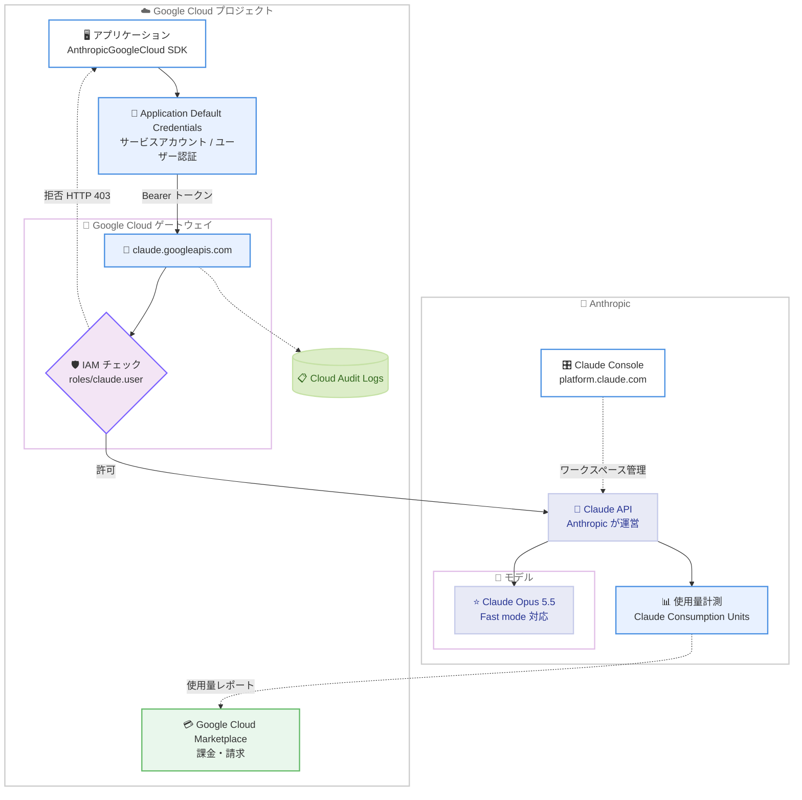

# Claude Models on Google Cloud (Anthropic managed) ローンチ

## メタデータ

| 項目 | 内容 |
|------|------|
| 発表日 | 2026-10-22 |
| ソース | Claude Developer Platform Release Notes |
| カテゴリ | プラットフォーム / クラウド統合 |
| 公式リンク | https://platform.claude.com/docs/en/build-with-claude/claude-models-on-google-cloud/anthropic-managed |

## 概要

Anthropic は 2026 年 10 月 22 日、**Claude Models on Google Cloud (Anthropic managed)** をローンチしました。これは Anthropic が運営する Claude API に、ユーザー自身の Google Cloud プロジェクト経由でアクセスできる新しい提供形態です。アクセス制御は Google Cloud IAM が担当し、課金は Google Cloud Marketplace を通じて行われるため、既存の Google Cloud の権限管理と請求フローに Claude API を統合できます。

また、同プラットフォーム上で Claude Opus 5.5 の [Fast mode](https://platform.claude.com/docs/en/build-with-claude/fast-mode) が利用可能であることも発表されました。

## 詳細

### 背景

これまで Google Cloud 経由で Claude を利用する方法は、Google が Agent Platform (旧 Vertex AI) の一部として Claude モデルを運営する形態 (現在の名称は Claude Models on Google Cloud (Google managed)) のみでした。この形態では Agent Platform 固有のエンドポイント (`:rawPredict` / `:streamRawPredict`) やリクエスト形式を使う必要があり、Claude API 本体との差分が存在していました。

今回ローンチされた Anthropic managed は、**Claude API そのものを Anthropic が運営したまま**、Google Cloud プロジェクトをアクセスと課金の入り口にする形態です。これにより、Claude API のエンドポイント・リクエスト形式・機能をそのまま使いながら、Google Cloud の IAM と Marketplace 課金を活用できます。

### 主な変更点

1. **Google Cloud プロジェクト経由で Claude API にアクセス可能**: ベース URL は `https://claude.googleapis.com/v1/projects/{project}/locations/global/workspaces/{workspace}/invoke` となり、この後ろに通常の Claude API パス (例: `/v1/messages`) を続けます。

2. **Google Cloud IAM によるアクセス制御**: 3 つの事前定義ロールが提供されます。

   | ロール | 表示名 | 許可される操作 |
   |--------|--------|---------------|
   | `roles/claude.viewer` | Claude Viewer | ワークスペースリソースの参照 (読み取り専用) |
   | `roles/claude.user` | Claude User | Viewer の権限に加え、メッセージ送信、トークンカウント、バッチ / ファイル / スキル / Claude Managed Agents リソースの管理 |
   | `roles/claude.admin` | Claude Admin | User の権限に加え、組織レベルの操作。Claude Console を開けるのはこのロールのみ |

3. **Google Cloud Marketplace による課金**: Anthropic が使用量を計測し、Claude Consumption Unit (1 ユニット = 0.01 米ドル) として Google Cloud に報告します。請求は Google Cloud の請求書に表示され、Anthropic からの個別請求はありません。Google Cloud の支出コミットメントにもカウントされます。

4. **Claude Opus 5.5 の Fast mode に対応**: Claude API と同様に、本プラットフォーム上でも Claude Opus 5.5 の Fast mode が利用できます。

### 技術的な詳細

**認証方式**: API キーは使用しません。各リクエストは `Authorization: Bearer` ヘッダーで Google OAuth 2.0 アクセストークン (`cloud-platform` スコープ) を送信します。SDK クライアントは Application Default Credentials (ADC) からトークンを取得するため、Compute Engine、GKE、Cloud Run 上ではワークロードにアタッチされたサービスアカウントが自動的に使われます。Workload Identity Federation やサービスアカウントの impersonation にも対応しています。

**Claude API との差分**: 以下の 3 点のみが異なり、その他 (`anthropic-version` / `anthropic-beta` ヘッダー、リクエストボディ、ストリーミング、レスポンス) は Claude API と同一です。

- **ベース URL**: `https://api.anthropic.com` の代わりにプロジェクトスコープの URL を使用
- **認証**: `x-api-key` ヘッダーの代わりに `Authorization: Bearer` ヘッダーを使用
- **ワークスペース**: `anthropic-workspace-id` ヘッダーの代わりに URL にワークスペース ID を含める

**SDK クライアント**: 新しいクライアント `AnthropicGoogleCloud` (ベータ) が各言語の SDK で提供されます (C#: `AnthropicGoogleCloudClient`、Go: `googlecloud.NewClient()`、Java: `GoogleCloudBackend`、PHP: `Anthropic\GoogleCloud\Client`、Ruby: `Anthropic::GoogleCloudClient`)。環境変数 `ANTHROPIC_GOOGLE_CLOUD_PROJECT` と `ANTHROPIC_GOOGLE_CLOUD_WORKSPACE_ID` からプロジェクト ID とワークスペース ID を自動解決します。`ant` CLI も対応しています。

**モデル ID**: Claude API と同じモデル ID (例: `claude-opus-5-5`) を使用します。Google managed で使われる `@` 区切りのスナップショット表記 (例: `claude-haiku-4-5@20251001`) は、Claude 4.6 より前のモデルではハイフン区切り (`claude-haiku-4-5-20251001`) に置き換えます。

**サポートされる機能**: Fast mode、ツール使用 (Web 検索、Web フェッチ、コード実行、メモリツール、MCP コネクタなど)、Agent Skills、Files API、プロンプトキャッシュ、拡張思考、ストリーミング、構造化出力、トークンカウント、Message Batches API、Claude Managed Agents、CMEK (Google Cloud KMS キー)、Compliance API が Claude API と同様に動作します。

**サポートされない機能**: 以下は利用できません。

- **API キー**: 認証は Google Cloud 認証情報のみ
- **MCP トンネル**
- **セルフホスト環境でのメモリストア**
- **事前構築されたセルフホストサンドボックスワーカー**: `ant` CLI や SDK のワーカーは非対応のため、Environments Work エンドポイントを直接呼び出す独自ワーカーの実装が必要

**Google managed との比較**:

| 観点 | Anthropic managed | Google managed |
|------|-------------------|----------------|
| API サーフェス | Claude API エンドポイント `/v1/{endpoint}` | Agent Platform の prediction エンドポイント |
| リクエスト形式 | Claude API と同一 (`model` はボディ、`anthropic-version` ヘッダー) | `model` は URL、`anthropic_version` はボディ |
| ストリーミング | ボディの `"stream": true` | 別エンドポイント `:streamRawPredict` |
| ロケーション | `global` のみ (US 推論は `inference_geo: "us"` で指定) | global / マルチリージョン / リージョナル |
| Anthropic 組織 | プロジェクトごとに新規作成 | なし |
| 課金 | Google Cloud Marketplace | Agent Platform 使用量として Google Cloud |
| レート制限 | Anthropic が管理 | Google Cloud が管理 |

**監査ログ**: Cloud Audit Logs が `claude.googleapis.com` サービスとして API アクティビティを記録します。Data Access ログ (メッセージ、バッチ、ファイルなど大半のルート) はデフォルトで無効のため、リクエスト記録が必要な場合はプロジェクトの監査ログ設定で有効化が必要です。Admin Activity ログ (暗号化キー、認証情報ボールトなど) は常に有効です。

**データ保持**: Anthropic がデータ処理者となり、Claude API と同じデータ保持ポリシーに従います。Zero Data Retention (ZDR) はリクエストベースで利用可能ですが、他の Anthropic 組織の ZDR 契約は引き継がれません。トラスト & セーフティなど一部の支援サービスは Google Cloud 外でデータを処理します。

## 開発者への影響

### 対象

- Google Cloud を標準基盤とする企業で、IAM による一元的なアクセス制御と Marketplace 経由の課金で Claude API を利用したい開発チーム
- 現在 Google managed (Agent Platform / Vertex AI 経由) で Claude を利用しており、Claude API のネイティブな機能セット (Files API、Agent Skills、Claude Managed Agents など) を使いたいチーム
- `api.anthropic.com` を API キーで直接利用しており、Google Cloud の請求・権限管理への統合を検討しているチーム

### 必要なアクション

1. **Marketplace でサブスクライブ**: Google Cloud Marketplace で「Claude Models on Google Cloud (Anthropic managed)」のリスティングを購入
2. **サービスの有効化**: 利用する各プロジェクトで 2 つのサービスを有効化

   ```bash
   gcloud services enable claude.googleapis.com \
     anthropic-managed-claude.cloudpartnerservices.goog \
     --project=my-project-id
   ```

3. **Anthropic 組織のセットアップ**: Google Cloud コンソールの Claude ページから Activate し、組織情報を登録 (既存の Anthropic 組織とは別の新しい組織が作成される点に注意)
4. **IAM ロールの付与**: API を呼び出す ID に `roles/claude.user` を付与
5. **環境変数の設定**: `ANTHROPIC_GOOGLE_CLOUD_PROJECT` と `ANTHROPIC_GOOGLE_CLOUD_WORKSPACE_ID` を設定 (ワークスペース ID は Claude Console の Settings > Workspaces で確認)

### 移行ガイド (該当する場合)

**Google managed からの移行**: SDK クライアントを `AnthropicVertex` から `AnthropicGoogleCloud` に置き換えます。Messages API の呼び出し自体はほぼそのまま使えますが、Claude 4.6 より前のモデル ID は `@` をハイフンに変更する必要があります。

**既存の Anthropic 組織からの移行**: 既存組織を Anthropic managed の組織に変換することはできません。新組織を作成するカットオーバー方式となり、API キー、ワークスペース、Console 設定は引き継がれません。ファイル、スキル、バッチなどの保存リソースも既存組織に残ります。2 つの組織は並行稼働できるため、段階的な移行が可能です。既存の割引がある場合は、セットアップ前に Anthropic または Google Cloud の担当者への連絡が推奨されています。

## コード例

```python
# pip install -U "anthropic[google_cloud]"
# 事前に以下を設定:
#   export ANTHROPIC_GOOGLE_CLOUD_PROJECT="my-project-id"
#   export ANTHROPIC_GOOGLE_CLOUD_WORKSPACE_ID="wrkspc_01AbCdEf23GhIj"
#   gcloud auth application-default login

from anthropic import AnthropicGoogleCloud

client = AnthropicGoogleCloud()

message = client.messages.create(
    model="claude-opus-5-5",
    max_tokens=1024,
    messages=[{"role": "user", "content": "Hello, Claude"}],
)
print(message)
```

cURL での呼び出し例:

```bash
curl "https://claude.googleapis.com/v1/projects/$ANTHROPIC_GOOGLE_CLOUD_PROJECT/locations/global/workspaces/$ANTHROPIC_GOOGLE_CLOUD_WORKSPACE_ID/invoke/v1/messages" \
  -H "Authorization: Bearer $(gcloud auth application-default print-access-token)" \
  -H "content-type: application/json" \
  -H "anthropic-version: 2023-06-01" \
  -d '{
    "model": "claude-opus-5-5",
    "max_tokens": 1024,
    "messages": [{"role": "user", "content": "Hello, Claude"}]
  }'
```

## アーキテクチャ図



## 関連リンク

- [リリースノート (Claude Developer Platform Release Notes)](https://platform.claude.com/docs/en/release-notes/overview)
- [Claude Models on Google Cloud (Anthropic managed) 公式ドキュメント](https://platform.claude.com/docs/en/build-with-claude/claude-models-on-google-cloud/anthropic-managed)
- [Claude Models on Google Cloud 概要 (2 つの提供形態の比較)](https://platform.claude.com/docs/en/build-with-claude/claude-models-on-google-cloud/overview)
- [Fast mode ドキュメント](https://platform.claude.com/docs/en/build-with-claude/fast-mode)
- [IAM permissions for Claude Models on Google Cloud (Anthropic managed)](https://platform.claude.com/docs/en/api/claude-models-on-google-cloud-anthropic-managed-iam-permissions)
- [データレジデンシー (inference_geo)](https://platform.claude.com/docs/en/manage-claude/data-residency#inference-geo)

## まとめ

Claude Models on Google Cloud (Anthropic managed) のローンチにより、Google Cloud ユーザーは API キーの管理なしに、IAM ベースのアクセス制御と Marketplace 経由の一元的な課金で Claude API のフル機能を利用できるようになりました。Claude API とのリクエスト互換性が高く (差分はベース URL、認証ヘッダー、ワークスペース指定の 3 点のみ)、Fast mode、Claude Managed Agents、CMEK などの最新機能にも対応しています。Google managed (Agent Platform 経由) と比べて Claude API ネイティブな開発体験が得られる一方、既存の Anthropic 組織からの移行は新組織へのカットオーバーとなる点、API キーや MCP トンネルが使えない点には注意が必要です。なお、本サービスの料金単価 (Claude API 直接利用との価格差の有無) については公式ドキュメントに明記がなく、確認が必要です。

---

**出典**: [Claude Developer Platform Release Notes (2026-10-22)](https://platform.claude.com/docs/en/release-notes/overview)
