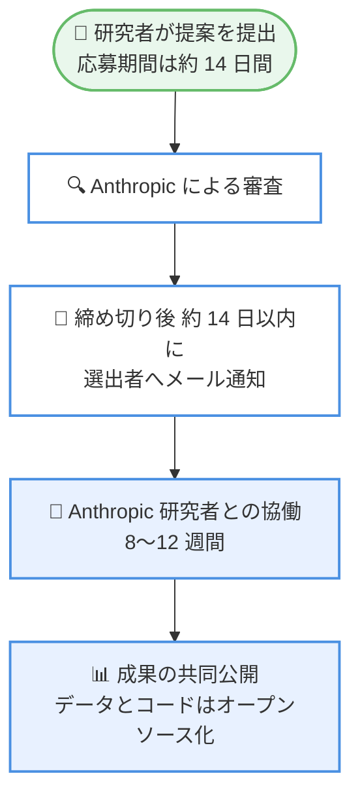

# ライフサイエンス分野のゲスト・インベスティゲーターを公募開始

## メタデータ

| 項目 | 内容 |
|------|------|
| 発表日 | 2026-10-22 |
| ソース | Anthropic News |
| カテゴリ | 発表 / ライフサイエンス |
| 公式リンク | https://www.anthropic.com/news/open-call-guest-investigators-life-sciences |

## 概要

Anthropic は、ライフサイエンス分野の研究コミュニティに対し、特別プロジェクトで協働する研究者 (ゲスト・インベスティゲーター) の公募を開始した。選出された研究者は 8〜12 週間にわたり Anthropic の研究者と直接協働し、研究に役立つ分析・成果物・ツールを作成する。モデルとハーネスの実行費用は Anthropic が無償で負担する。

本プログラムは、ライフサイエンスと科学研究コミュニティへの投資拡大に向けた複数の取り組みの一つであり、Life Sciences Verification Program や AI for Science initiative と並ぶ位置づけとなる。

## 詳細

### 背景

Anthropic は AI による科学的発見の加速に注力しており、2026 年 9 月には Claude が CRISPR 様リピートを持つ新規酵素システムを発見した研究成果を発表している。今回のプログラムは、外部の研究者と Anthropic の研究者が直接協働する枠組みを設けることで、ライフサイエンス分野での AI 活用をさらに推進することを目的としている。将来的にこの取り組みを拡大する可能性にも言及されている。

### 主な内容

**対象者**: 学術機関、非営利団体、政府系研究所に所属する主任研究者 (PI) とその研究グループ。

**対象研究分野**は以下のとおり。

- 因果的ヒト生物学
- 構造・計算分子生物学
- 医薬品化学
- 創薬
- 臨床科学

**プログラム期間**: 8〜12 週間 (一部プロジェクトには延長の可能性あり)。

**提供リソース**: Anthropic の研究者との直接協働に加え、モデルとハーネスの実行を Anthropic が無償で提供する。

### 成果物と権利関係

- 成果は共同で公開し、付随するデータとコードはオープンソース化する
- ゲスト研究者はプロジェクト全期間を通じてデータの権利を保持する
- 協働から生じる独立した後続研究の権利も研究者側に帰属する
- Anthropic は応募時・協働中ともにデータの提供を求めない
- 応募資料には公開情報のみを含めることが求められる

### 応募条件

応募にあたっては、以下を明確に示す必要がある。

- Anthropic 研究者との直接協働からどのような利益を得るかを具体的に説明できること
- 8〜12 週間以内に成果 (予備的発見、未解決問題への回答、オープンソースデータセット、公共リソースなど) を出せる合理的な根拠を示すこと

完全な検証には長期間かかることは理解されており、短期間で予備的エビデンスを示せる提案が求められる。

### 応募方法とスケジュール

| 項目 | 内容 |
|------|------|
| 応募方法 | 専用ページから提案を提出 |
| 応募期間 | 発表から約 14 日間 |
| 結果通知 | 応募締め切り後、約 14 日以内にメールで選出者に通知 |

## 応募フロー

## 研究者への影響

### 対象

- 学術機関、非営利団体、政府系研究所に所属するライフサイエンス分野の主任研究者 (PI) とその研究グループ
- 因果的ヒト生物学、構造・計算分子生物学、医薬品化学、創薬、臨床科学の研究者

### 必要なアクション

1. 専用ページ (https://www.anthropic.com/guest-investigator-program) から提案を提出する
2. 提案には公開情報のみを含める (データの提供は不要)
3. 協働による利益と、8〜12 週間での成果見込みを明確に記述する
4. 応募期間は約 14 日間のため、早めの準備を推奨

## 関連プログラム

- **Life Sciences Verification Program**: 生物学向けの最も高性能な公開モデルへの直接アクセスを提供
- **AI for Science initiative**: 科学的発見を加速するための Claude クレジットを研究者に提供

## 関連リンク

- [公式発表: Open call for guest investigators in the life sciences](https://www.anthropic.com/news/open-call-guest-investigators-life-sciences)
- [応募ページ: Guest Investigator Program](https://www.anthropic.com/guest-investigator-program)
- [関連研究: Claude が CRISPR 様リピートを持つ新規酵素システムを発見 (2026 年 9 月 23 日)](https://www.anthropic.com/news)

## まとめ

Anthropic はライフサイエンス分野の研究者を対象に、8〜12 週間の協働プログラム「ゲスト・インベスティゲーター」の公募を開始した。モデルとハーネスの無償提供、データ権利の研究者側への帰属、成果のオープンソース化という研究者に配慮した設計が特徴である。応募期間は約 14 日間と短いため、対象分野の研究者は早めの応募準備が必要となる。本プログラムは AI for Science initiative などと並ぶ、Anthropic の科学研究コミュニティへの投資拡大の一環である。

---

**出典**: https://www.anthropic.com/news/open-call-guest-investigators-life-sciences
