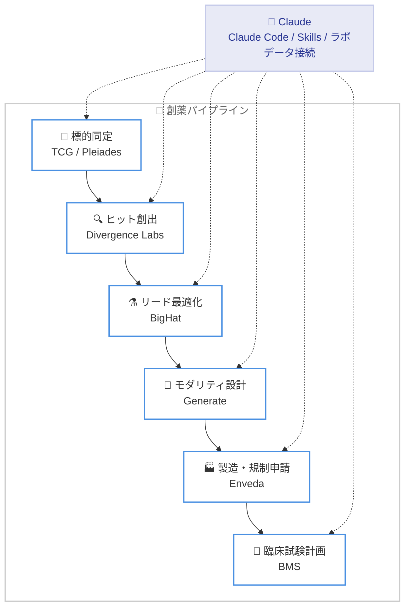

# Claude による創薬加速の初期成果 - 6 組織との研究パートナーシップを報告

## メタデータ

| 項目 | 内容 |
|------|------|
| 発表日 | 2026-10-27 |
| ソース | Anthropic Research |
| カテゴリ | 研究成果 / ライフサイエンス |
| 公式リンク | https://www.anthropic.com/research/early-progress-drug-development |

## 概要

Anthropic のライフサイエンスチームは、創薬の加速を目指して新薬を開発する 6 つの組織と研究パートナーシップを実施し、その初期成果を報告した。創薬のボトルネックは標的同定、分子設計、製造、規制申請、臨床試験設計などプロセス全体に分散しており、単一の課題解決では不十分だという戦略に基づき、各段階で Claude がどのように貢献できるかを検証している。

パートナーシップでは、抗体設計におけるヒット創出、リード最適化での結合力 10 倍超の改善、規制文書レビュー時間の 89% 削減など、具体的な成果が得られた。また、Anthropic 自身も 1 人企業 Mithril Medicine の買収を通じて創薬プログラムを開始している。

## 詳細

### 背景

新薬開発は長期間と巨額のコストを要し、そのボトルネックは創薬プロセスの特定の段階ではなく全体に分散している。Anthropic はこの課題に対し、創薬パイプラインの各段階をカバーする 6 つの組織と深い研究提携を結び、Claude の適用可能性を実証的に検証するアプローチを採用した。

### 主な成果

**1. Generate Biomedicines (モダリティエンジニアリング)**: CAR T 細胞療法を固形がんにも適用できるよう再設計する取り組み。6 名の科学者が Claude Code を使用し、遺伝子命令の一部を短縮する新設計を提案した。標準版より約 70% 短い設計が受容体を約 10 倍多く産生し、腫瘍細胞をより効率的に殺傷、免疫細胞の活性持続も向上した。

**2. Divergence Labs (ヒット創出)**: 食物アレルギー治療薬として、IgE を免疫細胞から引き離す「2 本のアーム」を持つ薬剤を設計。Claude がほぼ自律的に約 1 か月で約 35,000 の抗体設計を生成し、IgE 結合で 3 つ、引き離しで 20 のヒットを獲得した。うち 3 つは標準薬より多くの IgE を引き離した模様と報告されている。

**3. BigHat Biosciences (リード最適化)**: がん標的用と薬剤の体内持続用の 2 つの抗体フラグメントを改良。Claude を BigHat のラボデータシステム「Reccy」に接続して変更を提案し、約 10 週間で約 1,010 バリアントを作製・試験した。結合力は 10 倍超に向上し、がん標的リードは 18°C 高い温度まで溶液中で安定、凝集速度は 100 倍超遅くなった。途中で標準的な熱安定性・凝集指標の問題を Claude と研究者が生データから再分析し、新指標とプロトコル変更を提案した点も特筆される。

**4. Enveda (製造・規制申請)**: 製造化学者が業務時間の最大 75% を書類作業に費やしていた課題に対応。1,061 ページの製造文書テストで、人間が発見した 11 件すべてを検出し、人間が見逃した 7 件も発見した。レビュー時間は 25 時間超から 3 時間未満へと 89% 削減された。規制文書の初稿作成では、手作業で約 3 か月かかるものを 4 時間で作成した。

**5. The Column Group / TCG (会社創設)**: Claude で創薬の時間とコストを削減し、投資家がより野心的なアイデアを支援できるようにする試み。新会社 Pleiades を設立し、少人数チームで通常より多く複雑な創薬プログラムを運営する。創薬標的の評価を支援する初の Claude skill を 45 の標的 - 疾患ペアで評価済み。

**6. Bristol Myers Squibb (臨床試験計画)**: 最近開始されたパートナーシップで、早期段階の薬剤の臨床試験計画の評価と成功確率の推定に Claude を活用。単一のプロンプトから数日分の作業に相当する堅牢な初期分析を生成したと報告されており、2027 年に拡大予定。

### Anthropic 自社の創薬プログラム

Anthropic は、筋ジストロフィーの希少な小児型 2 種の治療法を開発する 1 人企業 Mithril Medicine を買収した。創業者 Cody Tranbarger 氏は Claude を使って契約、物流、11 の外部ラボとの実験を管理し、アイデアからマウスでの有望な結果まで 18 か月未満で到達した。候補薬が順調に進めば、2028 年後半にも臨床試験を開始する見込み。

### 創薬パイプラインと Claude の適用領域

## 影響

### 対象

- 製薬企業、バイオテクノロジー企業の研究者
- 創薬スタートアップおよびベンチャーキャピタル
- ライフサイエンス分野で AI 活用を検討する組織

### 今後の展開

現状の成果はほぼ前臨床段階のものであり、今後は臨床試験へと Claude の役割を拡大する方針。あわせて以下の取り組みが発表されている。

- **Claude Science**: 研究者向け AI ワークベンチの展開
- **Claude クレジット提供**: ライフサイエンス研究者向けの支援
- **Life Sciences Verification Program**: 信頼された組織に対し、より緩和されたセーフガードで最も高性能なモデルの利用を許可するプログラム
- **ゲスト研究者の公募**: 協業希望組織向けの問い合わせ窓口も設置

## 関連リンク

- [Early progress on accelerating drug development with Claude (公式記事)](https://www.anthropic.com/research/early-progress-drug-development)
- [Anthropic News](https://www.anthropic.com/news)
- [Anthropic Research](https://www.anthropic.com/research)

## まとめ

Anthropic は 6 つの創薬組織とのパートナーシップを通じて、標的同定から臨床試験計画まで創薬プロセスの各段階で Claude が実用的な成果を出せることを示した。抗体の結合力 10 倍超の改善、文書レビュー時間の 89% 削減、約 35,000 の抗体設計の自律生成など、定量的な初期成果が報告されている。自社買収による創薬プログラムや Life Sciences Verification Program の開始とあわせて、AI による創薬加速への本格的な取り組みを示す発表といえる。
