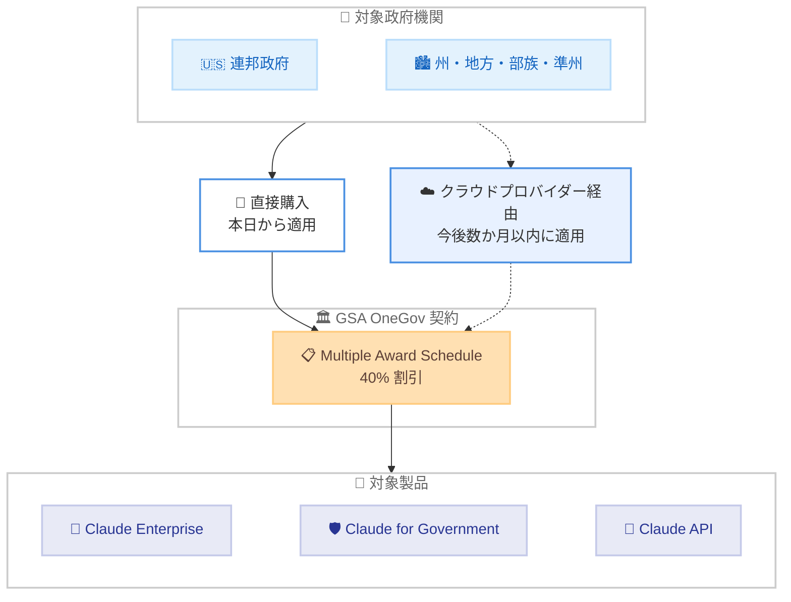

# GSA との提携拡大により Claude をあらゆるレベルの政府機関へ提供

## メタデータ

| 項目 | 内容 |
|------|------|
| 発表日 | 2026-10-27 |
| ソース | Anthropic News |
| カテゴリ | Partnerships |
| 公式リンク | https://www.anthropic.com/news/expanding-partnership-gsa |

## 概要

Anthropic は、GSA (米国一般調達局) との提携を拡大し、政府パートナーに Claude 製品を 40% 割引で提供する新契約を発表した。対象製品は Claude Enterprise、Claude for Government、Claude API で、Anthropic として初めてすべての製品に割引が適用される。GSA の Multiple Award Schedule を通じた「OneGov 割引」価格での購入が発表当日から可能となり、政府全体で 10 億ドルの節約が見込まれている。

割引は連邦政府に加え、州・地方・部族・準州 (SLTT) の政府にも適用される。最低支出額のコミットメントは不要で、使用した分だけ支払う方式が採用されている。

## 詳細

### 背景

記事によると、現在約 500 の米国連邦・州・地方政府組織が Claude を使用している。Claude for Government の週間アクティブユーザーは 2 月比で約 8 倍、連邦文民機関での使用は 1 年で約 20 倍に成長しており、政府部門での需要拡大が今回の提携拡大の背景にある。

### 主な変更点

今回の新契約の主なポイントは以下のとおり。

- **40% 割引**: Claude Enterprise、Claude for Government、Claude API のすべてに適用
- **購入方法**: GSA の Multiple Award Schedule を通じて OneGov 割引価格で購入可能 (発表当日から)
- **適用範囲の拡大**: 現在は直接購入が対象で、今後数か月以内にクラウドプロバイダー経由の購入にも適用予定
- **対象機関**: 連邦政府に加え、州・地方・部族・準州 (SLTT) の政府も対象
- **柔軟な支払い**: 最低支出額のコミットメント不要の従量課金方式
- **導入支援**: 民間顧客向けのベストプラクティスを公共部門に展開する専用プログラムを今後数週間以内に開始予定

### 技術的な詳細

政府のセキュリティ要件への対応状況は以下のとおり。

- **Claude for Government**: FedRAMP High 認証レベルで商用版とほぼ同等の機能を提供。2026 年 9 月 30 日に一般提供を開始
- **Amazon Bedrock 経由**: FedRAMP High 認証。一部モデルは AWS GovCloud で DoD IL4・IL5 ワークロードに対応
- **Google Cloud Vertex AI 経由**: FedRAMP High 認証
- **Claude Enterprise**: FedRAMP 20x プログラムを通じて FedRAMP Moderate 認証を申請中

#### 政府機関での活用実績

記事では以下の具体的な活用事例が紹介されている。

- **ユタ州**: 10 の州機関の開発者 34 名に Claude Code を提供。80% が 30 分以内に環境を構築し、71% が 4 週間で 20 時間以上の節約を報告
- **ある州の CIO**: 通常 2〜3 日かかるランサムウェア攻撃への対応を 8 分で完了
- **連邦セキュリティチーム**: 重要本番システムの乗っ取りにつながる脆弱性を約 2 日で検出・修正 (前月の人間によるペネトレーションテストでは見逃されていた)
- **ある州の IT 開発者**: 約 900 の API メソッドを 2 日で新フレームワークに移行 (当初の見積もりは 1 か月)
- **ある州の IT ディレクター**: レガシーコードリポジトリ 12 件を文書化し、467 のデータベーステーブルをマッピング、27 のリスクを特定

また、米国の州の半数以上、大規模自治体、重要インフラ事業者が SLTT サイバー防衛プログラムに参加している。

## 影響

### 対象

- 米国の連邦政府機関
- 州・地方・部族・準州 (SLTT) の政府機関
- 政府向けソリューションを提供するパートナー企業

### 必要なアクション

- GSA の Multiple Award Schedule を通じて OneGov 割引価格で Claude 製品を購入できる
- クラウドプロバイダー経由の購入への割引適用は今後数か月以内に開始されるため、該当する機関は続報を確認する
- 問い合わせは Anthropic の公共部門チームが対応する (https://claude.com/solutions/government)

## 提携の全体像

## 関連リンク

- [公式発表: Expanding our partnership with GSA to bring Claude to all levels of government](https://www.anthropic.com/news/expanding-partnership-gsa)
- [Claude for Government](https://claude.com/solutions/government)
- [GSA Multiple Award Schedule](https://www.gsa.gov/buy-through-us/purchasing-programs/gsa-multiple-award-schedule)

## まとめ

今回の GSA との提携拡大により、Claude Enterprise、Claude for Government、Claude API のすべてが 40% 割引で米国のあらゆるレベルの政府機関に提供される。FedRAMP High 認証や DoD IL4・IL5 対応などのセキュリティ要件への対応と、最低支出額不要の柔軟な契約条件により、政府機関における AI 導入の障壁が大きく下がることが期待される。クラウドプロバイダー経由の購入への割引適用と導入支援プログラムの開始が今後予定されており、続報に注目したい。
