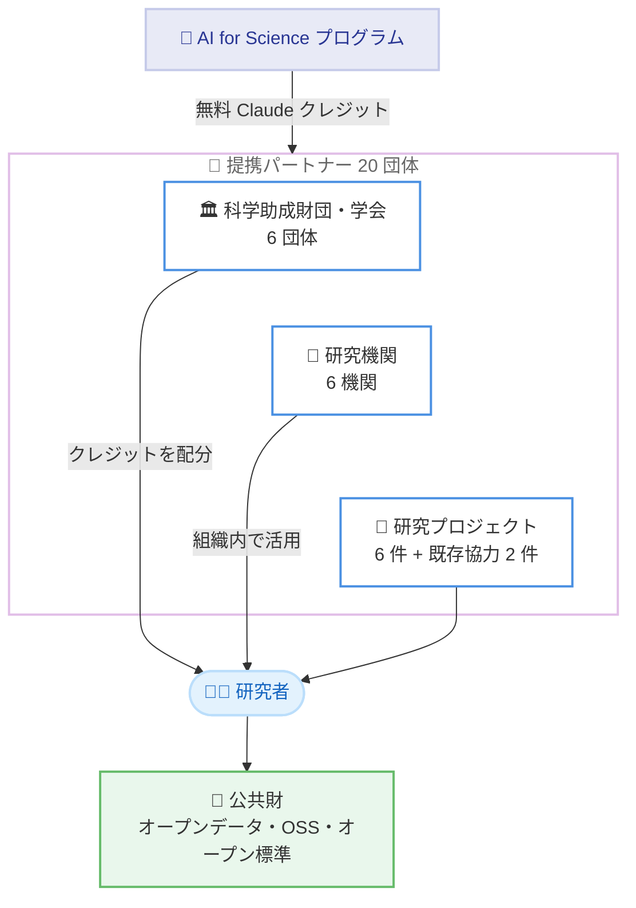

# AI for Science プログラムが世界 20 の科学財団・研究機関に拡大

## メタデータ

| 項目 | 内容 |
|------|------|
| 発表日 | 2026-10-28 |
| ソース | Anthropic News |
| カテゴリ | 公式発表 (Anthropic News) |
| 公式リンク | https://www.anthropic.com/news/ai-for-science-expands-foundations-research-institutions |

## 概要

Anthropic は、科学研究を支援する「AI for Science」プログラムの拡大として、世界中の 20 の科学財団・研究機関・研究プロジェクトとの提携を発表した。本プログラムは、高インパクトな科学プロジェクトに取り組む研究者に無料の Claude クレジットを提供するもので、2025 年 5 月の開始以来、生物学、医学、物理学、化学、気候科学、数学の分野で数百件のプロジェクトを支援してきた。

今回の提携先には、Alfred P. Sloan Foundation や Simons Foundation などの助成財団、Wellcome Sanger Institute や EMBL などの研究機関、FlyWire や gnomAD などの研究プロジェクトが含まれる。多くのプロジェクトは、オープンデータセット、オープンソースソフトウェア、オープン標準、共有ライブラリといった公共財を生み出す予定である。

## 詳細

### 背景

AI for Science プログラムは 2025 年 5 月に開始され、高インパクトな科学プロジェクトに取り組む研究者に無料の Claude クレジットを提供してきた。これまでに生物学、医学、物理学、化学、気候科学、数学の各分野で数百件のプロジェクトを支援している。今回の発表は、個別の研究者支援から、財団・研究機関・研究プロジェクトとの組織的な提携へとプログラムを拡大するものである。

### 提携先の全体像

### 科学助成財団・学会 (6 団体)

助成財団・学会は、受け取ったクレジットを各研究者に配分する役割を担う。

| 団体名 | 国 | 概要 |
|--------|-----|------|
| Alfred P. Sloan Foundation | 米国 | 1934 年設立の科学助成財団 |
| Simons Foundation | 米国 | Flatiron Institute を運営 |
| Schmidt Sciences | 米国 | 2024 年に Eric・Wendy Schmidt 夫妻が設立 |
| Open Source for Science Fund | - | Renaissance Philanthropy のプログラム |
| US National Science Foundation | 米国 | 1950 年に連邦議会が設立。90 億ドル規模の連邦機関で、米国の大学における基礎研究への連邦支援の約 25% を占める |
| CAS | 米国 | American Chemical Society の一部門。CAS Registry を管理 |

### 研究機関 (6 機関)

研究機関は、組織内でクレジットを活用する。

| 機関名 | 国 | 概要 |
|--------|-----|------|
| Space Telescope Science Institute | 米国 | NASA の Hubble、James Webb、Roman 宇宙望遠鏡の科学運用を担当 |
| Wellcome Sanger Institute | 英国 | ゲノミクス研究 |
| Francis Crick Institute | 英国 | ロンドン拠点。100 以上の研究グループを擁する |
| Imperial College London 生命科学部 | 英国 | 生命科学研究 |
| EMBL | 欧州 | 政府間生命科学研究所。欧州 6 拠点。EMBL-EBI が Ensembl、Protein Data Bank in Europe、Europe PMC を運営 |
| Gladstone Institutes | 米国 | サンフランシスコ拠点の生物医学研究機関 |

### 研究プロジェクト (6 件)

特定の研究プロジェクトにもクレジットを直接提供する。

| プロジェクト名 | 所属 | 分野 |
|---------------|------|------|
| FlyWire | Princeton University (米国) | 神経科学。成体ショウジョウバエ脳の初の完全配線マップ |
| LEAP | Columbia University (米国) | 地球システム。NSF センター |
| AstroPath | Johns Hopkins University (米国) | がん研究 |
| gnomAD | Broad Institute (米国) | ゲノミクス・希少疾患。80 万人超の DNA データを集約 |
| Tau Ceti | - | 数学。Lean による数学の自動形式化ライブラリ |
| Centre for Population Genomics | Garvan Institute・Murdoch Children's Research Institute (オーストラリア) | 集団ゲノミクス |

### 既存の協力先

記事では、既に進行中の協力事例として以下が紹介されている。

- **HHMI Janelia Research Campus (米国)**: Model Hardware Standard (MHS) を共同開発し、現在リサーチプレビュー中
- **Allen Institute (米国)**: AI エージェントチームによるデータ分析

### 支援内容

本プログラムで提供される支援は以下のとおり。

- 高インパクトな科学プロジェクトの研究者への無料 Claude クレジットの提供
- 助成財団・学会を通じた研究者へのクレジット配分
- 研究機関による組織内でのクレジット活用
- 特定の研究プロジェクトへのクレジット直接提供
- 科学者向け割引プラン「Team plan for scientists」の提供 (提供開始済み)

## 影響

### 対象

- 提携財団・学会から助成を受ける研究者
- 提携研究機関に所属する研究者
- オープンサイエンス (オープンデータ、オープンソースソフトウェア) に取り組む研究コミュニティ

### 研究コミュニティへの影響

- **研究の加速**: 無料の Claude クレジットにより、ゲノミクス、神経科学、気候科学、数学など幅広い分野で AI を活用した研究が加速する
- **公共財の創出**: 多くのプロジェクトがオープンデータセット、オープンソースソフトウェア、オープン標準、共有ライブラリを生み出す予定であり、成果が研究コミュニティ全体に還元される
- **国際展開**: 米国、英国、欧州、オーストラリアの機関が参加しており、Anthropic は今後も世界中のより多くのパートナーへの拡大を目指すとしている

### 今後の予定

多くの協業は初期段階にあり、今後成果や新しい研究手法が公開される予定である。具体的な応募方法や締め切りは記事に記載されていないため、詳細は AI for Science プログラムの公式ページを確認する必要がある。

## 関連リンク

- [公式発表: AI for Science expands to foundations and research institutions](https://www.anthropic.com/news/ai-for-science-expands-foundations-research-institutions)
- [Anthropic News](https://www.anthropic.com/news)

## まとめ

Anthropic は AI for Science プログラムを拡大し、世界 20 の科学財団・研究機関・研究プロジェクトとの提携を発表した。2025 年 5 月の開始以来、数百件のプロジェクトを支援してきた本プログラムは、助成財団によるクレジット配分、研究機関での組織的活用、研究プロジェクトへの直接支援という 3 つの経路で研究者に無料の Claude クレジットを届ける体制を整えた。多くのプロジェクトがオープンデータやオープンソースソフトウェアなどの公共財を生み出す予定であり、AI を活用した科学研究の裾野が国際的に広がることが期待される。
