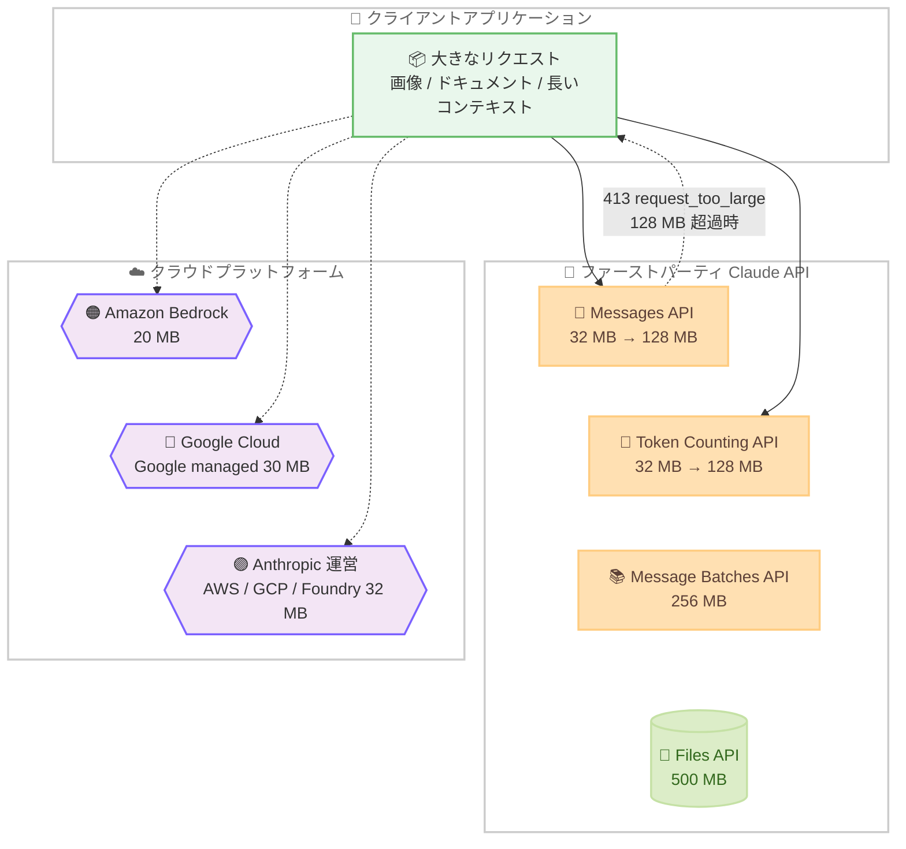

# Messages API と Token Counting API の最大リクエストサイズが 128 MB に拡大

## メタデータ

| 項目 | 内容 |
|------|------|
| 発表日 | 2026-10-28 |
| ソース | Claude Developer Platform Release Notes |
| カテゴリ | API アップデート |
| 公式リンク | https://platform.claude.com/docs/en/release-notes/overview |

## 概要

Anthropic は 2026 年 10 月 28 日、ファーストパーティ Claude API における Messages API と Token Counting API の最大リクエストサイズを、従来の 32 MB から 128 MB に引き上げたことを発表した。リリースノートの原文では "We've raised the maximum request size for the Messages API and the Token Counting API from 32 MB to 128 MB on the first-party Claude API." と記載されている。

この変更により、Base64 エンコードされた画像やドキュメントを多数含むリクエストや、大量のメッセージ履歴を含む長いコンテキストのリクエストを、従来の 4 倍のサイズまで単一の API 呼び出しで送信できるようになった。適用対象はファーストパーティ Claude API であり、パートナー運営のクラウドプラットフォームには異なる制限が適用される点に注意が必要である。

## 詳細

### 背景

Claude API では、エンドポイントごとに最大リクエストサイズが定められており、制限を超えたリクエストは 413 `request_too_large` エラーで拒否される。Messages API のリクエストに画像や PDF などのファイルを直接含める場合は Base64 エンコードが必要であり、エンコードによってデータサイズが元のバイナリより増加するため、マルチモーダルなリクエストではリクエストサイズが大きくなりやすい。

また、Token Counting API は Messages API と同じリクエスト形式を受け取ってトークン数を事前に計算する API であるため、両者の制限が揃っていることは、送信前のトークン数見積もりという本来のユースケースを維持するうえで重要である。今回の変更では両 API が同時に 128 MB へ引き上げられた。

### 主な変更点

- **Messages API**: 最大リクエストサイズが 32 MB から 128 MB に拡大 (4 倍)
- **Token Counting API**: 最大リクエストサイズが 32 MB から 128 MB に拡大 (4 倍)
- **適用範囲**: ファーストパーティ Claude API (`https://api.anthropic.com`) のみ

### 技術的な詳細

公式ドキュメントの API overview ([Request size limits](https://platform.claude.com/docs/en/api/overview#request-size-limits)) によると、変更後のファーストパーティ Claude API のリクエストサイズ制限は以下のとおりである。

| エンドポイント | 最大リクエストサイズ |
|---------------|-------------------|
| Messages API、Token Counting API | 128 MB |
| Message Batches API | 256 MB |
| Files API | 500 MB |
| Sessions、Agents、Environments | 32 MB |

制限を超えた場合は、HTTP ステータスコード 413 の `request_too_large` エラーが返される。

**クラウドプラットフォームでの制限**: ドキュメントには、パートナー運営プラットフォームには独自のリクエストサイズ制限があると明記されている。

| プラットフォーム | 最大リクエストサイズ |
|----------------|-------------------|
| ファーストパーティ Claude API | 128 MB |
| Claude Platform on AWS | 32 MB |
| Claude Models on Google Cloud (Anthropic managed) | 32 MB |
| Microsoft Foundry | 32 MB |
| Claude Models on Google Cloud (Google managed) | 30 MB |
| Amazon Bedrock | 20 MB |

このように、128 MB の上限はファーストパーティ Claude API 固有のものであり、Anthropic 運営のクラウドプラットフォーム (Claude Platform on AWS、Claude Models on Google Cloud の Anthropic managed、Microsoft Foundry) は 32 MB、パートナー運営のプラットフォームはさらに小さい制限となっている。

なお、Messages API にはリクエストサイズとは別に、1 リクエストあたり最大 100,000 メッセージという上限も存在する (Messages API リファレンスに "There is a limit of 100,000 messages in a single request." と記載)。

## 開発者への影響

### 対象

- ファーストパーティ Claude API を利用しているすべての開発者
- 特に、以下のようなサイズの大きいリクエストを扱う開発者
  - Base64 エンコードされた画像や PDF を多数含むマルチモーダルリクエスト
  - 長い会話履歴や大量のドキュメントをコンテキストに含むリクエスト
  - 送信前に Token Counting API で大きなリクエストのトークン数を見積もるワークフロー

### 必要なアクション

既存のコードへの変更は不要である。本変更は上限の引き上げであり、後方互換性に影響はない。

活用にあたっては以下の点を考慮するとよい。

- これまで 32 MB の制限を回避するためにリクエストを分割していた場合、単一リクエストへの統合を検討できる
- 413 `request_too_large` エラーに対するハンドリングやリトライロジックを実装している場合、発生頻度の低下が見込まれる
- 複数の API 呼び出しで同じファイルを再利用する場合は、リクエストに直接埋め込む代わりに Files API (最大 500 MB) の利用も引き続き選択肢となる

### 移行ガイド (該当する場合)

移行作業は不要。ただし、Amazon Bedrock (20 MB)、Claude Models on Google Cloud の Google managed (30 MB)、Anthropic 運営のクラウドプラットフォーム (32 MB) を併用している場合、プラットフォーム間でリクエストサイズの上限が異なるため、ファーストパーティ API 向けに作成した大きなリクエストをそのまま他プラットフォームに送信するとエラーになる可能性がある。マルチプラットフォーム構成では、最も小さい上限に合わせた設計か、プラットフォームごとの分岐処理を検討する必要がある。

## コード例

Token Counting API を使用して、大きなリクエストを送信する前にトークン数を確認する例。リクエストサイズ制限 (128 MB) は Messages API と Token Counting API で共通のため、送信予定のリクエストをそのまま事前検証できる。

```python
import anthropic
import base64

client = anthropic.Anthropic()

# 画像を Base64 エンコードしてコンテンツに含める
with open("large_document_page.png", "rb") as f:
    image_data = base64.standard_b64encode(f.read()).decode("utf-8")

messages = [
    {
        "role": "user",
        "content": [
            {
                "type": "image",
                "source": {
                    "type": "base64",
                    "media_type": "image/png",
                    "data": image_data,
                },
            },
            {"type": "text", "text": "この画像の内容を要約してください。"},
        ],
    }
]

# 送信前にトークン数をカウント (最大リクエストサイズ: 128 MB)
count = client.messages.count_tokens(
    model="claude-sonnet-4-5",
    messages=messages,
)
print(f"入力トークン数: {count.input_tokens}")

# Messages API で送信 (最大リクエストサイズ: 128 MB)
response = client.messages.create(
    model="claude-sonnet-4-5",
    max_tokens=1024,
    messages=messages,
)
print(response.content[0].text)
```

## アーキテクチャ図 (該当する場合)



## 関連リンク

- [Claude Developer Platform Release Notes (公式リリースノート)](https://platform.claude.com/docs/en/release-notes/overview)
- [API overview - Request size limits (リクエストサイズ制限)](https://platform.claude.com/docs/en/api/overview#request-size-limits)
- [Messages API リファレンス](https://platform.claude.com/docs/en/api/messages)
- [Token Counting API リファレンス](https://platform.claude.com/docs/en/api/messages/count_tokens)
- [Files API ドキュメント](https://platform.claude.com/docs/en/build-with-claude/files)
- [Batch processing ドキュメント](https://platform.claude.com/docs/en/build-with-claude/batch-processing)

## まとめ

ファーストパーティ Claude API の Messages API と Token Counting API の最大リクエストサイズが 32 MB から 128 MB へと 4 倍に拡大された。画像やドキュメントを多く含むマルチモーダルリクエストや、長いコンテキストを扱うアプリケーションにとって、リクエスト分割の必要性が減り、実装の簡素化につながるアップデートである。既存コードへの変更は不要だが、Amazon Bedrock や Google Cloud などのクラウドプラットフォームでは引き続き 20〜32 MB の独自制限が適用されるため、マルチプラットフォーム構成の開発者はプラットフォームごとの上限差に注意が必要である。
