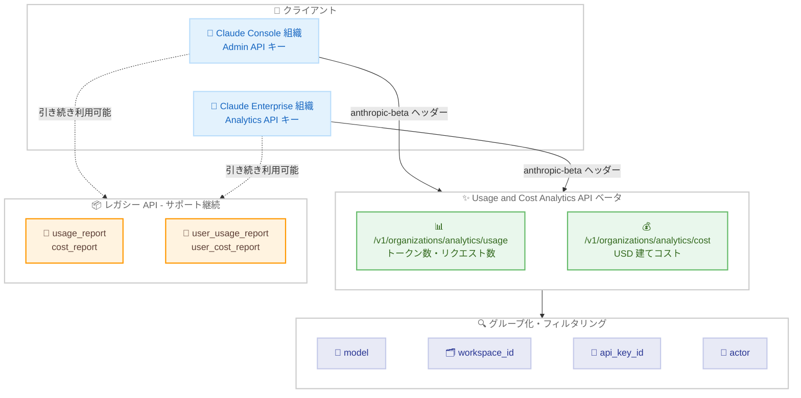

# Usage and Cost Analytics API がベータ版でリリース - 使用量とコストの分析が大幅に強化

## メタデータ

| 項目 | 内容 |
|------|------|
| 発表日 | 2026-10-29 |
| ソース | Claude Developer Platform Release Notes |
| カテゴリ | API アップデート |
| 公式リンク | https://platform.claude.com/docs/en/release-notes/overview |

## 概要

Anthropic は 2026 年 10 月 29 日、組織のトークン使用量とコストを詳細に分析できる **Usage and Cost Analytics API** をベータ版としてリリースした。新 API は `GET /v1/organizations/analytics/usage` と `GET /v1/organizations/analytics/cost` の 2 つのエンドポイントで構成され、モデル、ワークスペース、API キー、ユーザー / サービスアカウント (actor) など、豊富なディメンションでのフィルタリングとグループ化に対応する。利用には `anthropic-beta: analytics-usage-cost-2026-08-24` ベータヘッダーが必要となる。

あわせて、従来の Usage and Cost API (`/v1/organizations/usage_report/messages` と `/v1/organizations/cost_report`) および Claude Enterprise Analytics API の `usage_report`、`cost_report`、`user_usage_report`、`user_cost_report` エンドポイントはレガシー API に位置付けられた。これらのレガシー API は引き続きサポートされるが、新規のインテグレーションには新しい Usage and Cost Analytics API の利用が推奨される。

## 詳細

### 背景

これまで、組織の使用量とコストをプログラムから取得する手段は、組織の種類によって分かれていた。Claude Console (Claude Platform) の組織は Admin API の Usage and Cost API を、Claude Enterprise (claude.ai) の組織は Claude Enterprise Analytics API のレポートエンドポイントを使用する必要があり、それぞれレスポンス形式やグループ化の機能が異なっていた。

新しい Usage and Cost Analytics API は、同一のエンドポイント、パラメータ、レスポンスフィールドで Claude Console と Claude Enterprise の両方の組織に対応する統合 API として設計されており、1 つのインテグレーションで両方の組織タイプをカバーできる。Claude Platform on AWS や Claude Models on Google Cloud (Anthropic managed) 経由のアクセスにも対応する。

### 主な変更点

**1. Usage and Cost Analytics API のベータリリース**

公式ドキュメントによると、新 API の主な特徴は以下のとおり。

- **2 つのエンドポイント**: `/v1/organizations/analytics/usage` はトークン数とリクエスト数を、`/v1/organizations/analytics/cost` は USD 建てのコストを返す
- **ベータヘッダー**: すべてのリクエストに `anthropic-beta: analytics-usage-cost-2026-08-24` と `anthropic-version` ヘッダーが必要 (SDK と `ant` CLI は自動で付与)
- **豊富なディメンション**: `model`、`workspace_id`、`api_key_id`、`actor`、`actor_type`、`service_tier`、`context_window`、`inference_geo`、`speed`、`product` などで最大 5 つまでグループ化可能
- **actor ディメンション**: リクエストの帰属先 (ユーザー、サービスアカウント、フェデレーションされたクラウド ID、または API キー自体) を識別できる
- **柔軟なフィルタリング**: ブラケット記法 (`models[]=...` など) で各フィルタに最大 100 個の値を指定可能。同一フィルタ内は OR、異なるフィルタ間は AND で結合される
- **ランキングとタイムシリーズ**: `order_by` でトークン数、リクエスト数、コストなどのメトリクスによるランキングを取得でき、`time_bucket_width` (`1m`、`1h`、`1d`) と `order_by=time` の組み合わせで時系列データを構築できる

**2. 既存 API のレガシー化**

以下の API はレガシーとなったが、引き続きサポートは継続される。

- **Usage and Cost API** (Claude Console 組織向け): `/v1/organizations/usage_report/messages` と `/v1/organizations/cost_report`
- **Claude Enterprise Analytics API のレポートエンドポイント**: `/v1/organizations/analytics/` 配下の `usage_report`、`cost_report`、`user_usage_report`、`user_cost_report`

### 技術的な詳細

**認証**

| 組織タイプ | 認証方法 |
|-----------|---------|
| Claude Console | Admin API キー (`sk-ant-admin01-...`)、または `org:admin` スコープの OAuth トークン |
| Claude Enterprise | `read:analytics` スコープのキー (Analytics API キー) |
| Claude Platform on AWS | AWS IAM (`ListAccountUsage` / `ListAccountCost` アクション) |
| Claude Models on Google Cloud | Google Cloud 認証情報 (`usageAnalytics.list` / `costAnalytics.list` 権限) |

**Usage エンドポイントのレスポンス**

各行は `starting_at` / `ending_at` (期間)、`group` (ディメンション)、`usage` (メトリクス) で構成される。`usage` オブジェクトには以下が含まれる。

- `uncached_input_tokens`: キャッシュされていない入力トークン
- `cache_creation`: キャッシュ作成トークン (`ephemeral_1h_input_tokens`、`ephemeral_5m_input_tokens`)
- `cache_read_input_tokens`: キャッシュ読み取り入力トークン
- `output_tokens`: 出力トークン
- `total_tokens`: 合計トークン
- `server_tool_use`: サーバーツール使用量 (`web_search_requests` など)
- `requests`: リクエスト数

**Cost エンドポイントのレスポンス**

`cost` オブジェクトには `amount` (割引適用後・クレジット適用前のコスト)、`list_amount` (定価ベースのコスト)、`currency` (常に `"USD"`)、`requests` が含まれる。金額はセント単位の小数点以下 6 桁の 10 進文字列で表現される (例: `"41280.000000"` は 412.80 米ドル)。

Cost エンドポイント限定のディメンションとして `cost_type` (トークン、Web 検索、コード実行、セッション使用量) と `token_type` があり、これらは 5 ディメンション制限の対象外となる。

**日付範囲と時間バケット**

- タイムスタンプは RFC 3339 形式 (UTC)。`starting_at` は含み、`ending_at` は含まない
- `starting_at` は 2026 年 1 月 1 日以降かつ過去 365 日以内である必要がある
- 1 リクエストの範囲は最大 31 日間。`time_bucket_width=1m` の場合は最大 24 時間
- `time_bucket_width` を指定する場合は `ending_at` が必須

**データ鮮度**

レスポンスには `data_refreshed_at` タイムスタンプが含まれる。データは通常 4 時間以内に更新され、最大 24 時間かかる場合がある。遅延イベントの到着と照合処理により、暦月終了の約 7 日後まで値が修正される可能性がある。レガシー API (通常 5 分以内にデータ反映) と比較すると反映は遅くなる点に注意が必要である。

**ページネーション**

`limit` は 1 ページあたりの行数 (1〜1,000、デフォルト 20) を指定する。レスポンスの `has_more` が `true` の場合、`next_page` の値を使って次のページを取得する。ページネーションされたクエリのすべてのページは同一のデータスナップショットを読み取る。

## 開発者への影響

### 対象

- Admin API で使用量・コストデータを取得している Claude Console 組織の管理者
- Claude Enterprise Analytics API のレポートエンドポイントを使用している Claude Enterprise 組織の管理者
- コスト配賦、チャージバック、予算モニタリング、ダッシュボードなどのインテグレーションを構築する開発者
- Datadog、Grafana Cloud などのオブザーバビリティプラットフォームとの連携を管理する運用チーム

### 必要なアクション

- **新規インテグレーション**: Usage and Cost Analytics API (`/v1/organizations/analytics/usage` と `/v1/organizations/analytics/cost`) を使用する
- **既存インテグレーション**: レガシー API は引き続きサポートされるため、即時の移行は不要。ただし、より多くのグループ化 / フィルタリングディメンション (actor、product、cost_type、token_type など) が必要な場合は移行を検討する
- **ベータヘッダーの付与**: 直接 HTTP で呼び出す場合は `anthropic-beta: analytics-usage-cost-2026-08-24` ヘッダーを忘れずに付与する

### 移行ガイド (該当する場合)

公式ドキュメントの移行セクションによると、レガシー Usage and Cost API からの主な変更点は以下のとおり。

| レガシー Usage and Cost API | Usage and Cost Analytics API |
|---------------------------|------------------------------|
| ベータヘッダー不要 | `analytics-usage-cost-2026-08-24` ベータヘッダーが必須 |
| データは通常 5 分以内に反映 | 通常 4 時間以内、最大 24 時間 |
| `data` は時間バケットのリスト (空バケットを含む) | `data` は `order_by` でランク付けされた行のリスト (使用量のない組み合わせは行なし) |
| `bucket_width` (デフォルト `1d`) | `time_bucket_width` (デフォルトなし、省略時は全期間の合計) |
| `limit` はページあたりのバケット数 | `limit` はページあたりの行数 (1〜1,000、デフォルト 20) |
| 任意の日付範囲 | `starting_at` は 2026 年 1 月 1 日以降かつ過去 365 日以内、最大 31 日間 / リクエスト |
| `account_ids[]`、`group_by[]=account_id` など | `actor_ids[]`、`group_by[]=actor` または `actor_type` |
| `group_by[]=description` (コストレポート) | 構造化ディメンション (`model`、`cost_type`、`token_type` など) でグループ化 |
| デフォルトワークスペースは `workspace_id: null` | デフォルトワークスペースも実際の `workspace_id` を持つ |

Claude Enterprise のレポートエンドポイントからの移行では、キー、フィルタ / ディメンション名、メトリクスフィールド、カーソルのルールなどがそのまま引き継がれ、新たに必要なのはベータヘッダーのみである。`user_usage_report` / `user_cost_report` の代替は `group_by[]=actor&actor_types[]=user_actor` となる。

## コード例

モデル別の日次トークン使用量を取得する例。

```bash
curl --globoff "https://api.anthropic.com/v1/organizations/analytics/usage?\
starting_at=2026-09-01T00:00:00Z&\
ending_at=2026-09-08T00:00:00Z&\
time_bucket_width=1d&\
group_by[]=model&\
limit=10" \
  -H "anthropic-version: 2023-06-01" \
  -H "anthropic-beta: analytics-usage-cost-2026-08-24" \
  -H "x-api-key: $ANTHROPIC_API_KEY"
```

Python SDK を使用した例。

```python
client = anthropic.Anthropic()

rows = client.beta.organization.analytics.usage.list(
    starting_at="2026-09-01T00:00:00Z",
    ending_at="2026-09-08T00:00:00Z",
    time_bucket_width="1d",
    group_by=["model"],
    limit=10,
)

for row in rows:
    print(f"{row.starting_at} {row.group.model}: {row.usage.total_tokens}")
```

モデル、コストタイプ、トークンタイプ別のコストを取得する例。

```bash
curl --globoff "https://api.anthropic.com/v1/organizations/analytics/cost?\
starting_at=2026-09-01T00:00:00Z&\
ending_at=2026-10-01T00:00:00Z&\
group_by[]=model&\
group_by[]=cost_type&\
group_by[]=token_type" \
  -H "anthropic-version: 2023-06-01" \
  -H "anthropic-beta: analytics-usage-cost-2026-08-24" \
  -H "x-api-key: $ANTHROPIC_API_KEY"
```

## アーキテクチャ図 (該当する場合)



## 関連リンク

- [Claude Developer Platform Release Notes](https://platform.claude.com/docs/en/release-notes/overview)
- [Usage and Cost Analytics API ドキュメント](https://platform.claude.com/docs/en/manage-claude/usage-cost-analytics-api)
- [Usage and Cost API ドキュメント (レガシー)](https://platform.claude.com/docs/en/manage-claude/usage-cost-api)
- [Analytics APIs - 組織に必要な API とキータイプの選択](https://platform.claude.com/docs/en/manage-claude/analytics-api)
- [Usage API リファレンス](https://platform.claude.com/docs/en/api/beta/organization/analytics/usage/list)
- [Cost API リファレンス](https://platform.claude.com/docs/en/api/beta/organization/analytics/cost/list)
- [Admin API ドキュメント](https://platform.claude.com/docs/en/manage-claude/admin-api)
- [Claude Code Analytics API ドキュメント](https://platform.claude.com/docs/en/manage-claude/claude-code-analytics-api)

## まとめ

Usage and Cost Analytics API のベータリリースにより、Claude Console と Claude Enterprise の両組織が単一の API で使用量とコストを詳細に分析できるようになった。actor ディメンションによるユーザー / サービスアカウント単位の帰属、最大 5 ディメンションのグループ化、メトリクスによるランキングなど、従来の API より大幅に強化された分析機能を提供する。レガシー API は引き続きサポートされるため既存インテグレーションへの即時の影響はないが、新規開発では新 API の採用が推奨される。コスト配賦やチャージバック、ダッシュボード構築に取り組む組織にとって重要なアップデートである。
