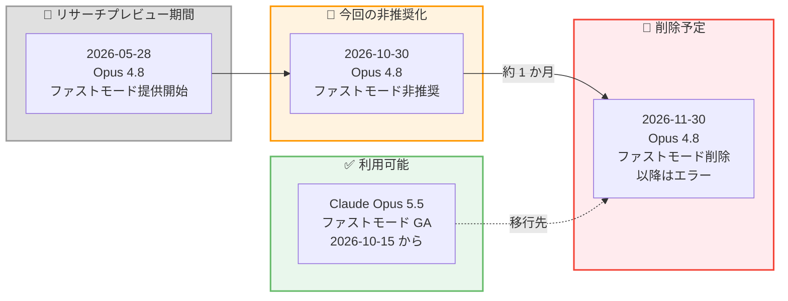
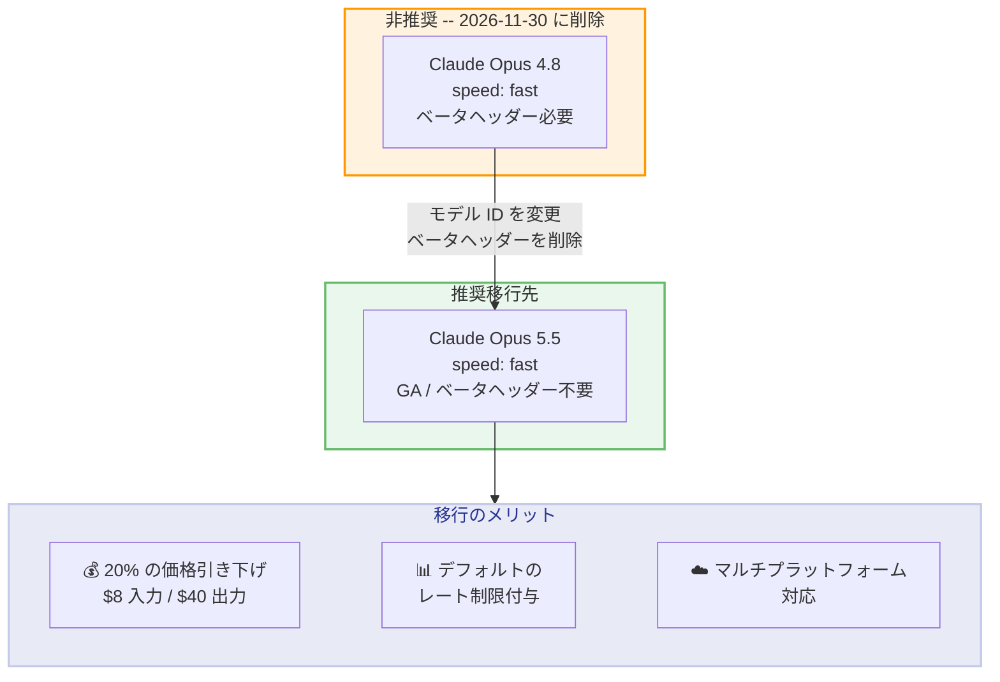

# Claude Opus 4.8 のファストモード非推奨化 -- 2026 年 11 月 30 日に削除、Opus 5.5 への移行が必要

## メタデータ

| 項目 | 内容 |
|------|------|
| 発表日 | 2026-10-30 |
| ソース | Claude API Release Notes |
| カテゴリ | API アップデート / 廃止予定 |
| 公式リンク | [Release Notes](https://platform.claude.com/docs/en/release-notes/overview) |

## 概要

2026 年 10 月 30 日、Anthropic は Claude Opus 4.8 (`claude-opus-4-8`) のファストモード (`speed: "fast"`) を非推奨 (deprecated) とすることを発表しました。削除予定日は **2026 年 11 月 30 日** です。

削除後、`claude-opus-4-8` に対して `speed: "fast"` パラメータを指定したリクエストは**エラーを返します**。Claude Opus 4.6 のときのような標準速度へのフォールバックは行われない点に注意が必要です。ファストモードの利用を継続する場合は、Claude Opus 5.5 (`claude-opus-5-5`) への移行が推奨されています。Opus 5.5 のファストモードは 2026 年 10 月 15 日にリサーチプレビューを終了し、一般提供 (GA) となっています。

## 詳細

### 背景

ファストモード (Fast Mode) は、同一モデルを高速な推論構成で実行する機能です。`speed: "fast"` パラメータを指定することで、標準速度と比較して**最大 2.5 倍の出力トークン毎秒 (OTPS)** が得られます。モデルの知能や機能に変更はなく、速度向上は TTFT (最初のトークンまでの時間) ではなく OTPS に焦点を当てたものです。

Opus 4.8 のファストモードは 2026 年 5 月 28 日にリサーチプレビューとして提供が開始されましたが、GA には至らないままリサーチプレビューの状態で非推奨化されました。一方、2026 年 9 月 22 日にリサーチプレビューとして登場した Opus 5.5 のファストモードは、約 3 週間で GA に到達しています。

#### ファストモード関連のタイムライン

| 日付 | イベント |
|------|---------|
| 2026 年 5 月 28 日 | Opus 4.8 のファストモードをリサーチプレビューとして提供開始 |
| 2026 年 9 月 22 日 | Opus 5.5 のファストモードをリサーチプレビューとして提供開始 |
| 2026 年 10 月 15 日 | Opus 5.5 のファストモードが GA (ベータヘッダー不要に) |
| 2026 年 10 月 22 日 | Opus 5.5 のファストモードが Google Cloud (Anthropic managed) でも利用可能に |
| **2026 年 10 月 30 日** | **Opus 4.8 のファストモード非推奨化 (本日)** |
| **2026 年 11 月 30 日** | **Opus 4.8 のファストモード削除予定** |

### 主な変更点

1. **Claude Opus 4.8 のファストモード非推奨化**: `claude-opus-4-8` に対する `speed: "fast"` パラメータが非推奨となりました
2. **約 1 か月の移行期間**: 2026 年 11 月 30 日まで引き続き動作しますが、早期の移行が推奨されます
3. **削除後はエラーを返す**: 削除日以降、該当リクエストはエラーになります。標準速度へのフォールバックは行われません
4. **推奨移行先は Claude Opus 5.5**: Opus 5.5 のファストモードは GA 済みで、ベータヘッダーなしで利用できます

### 技術的な詳細

#### 影響を受けるリクエスト

以下の条件を満たすリクエストが影響を受けます。

- モデル: `claude-opus-4-8` (エイリアスおよびスナップショット版)
- パラメータ: `speed: "fast"` を指定 (ベータヘッダー `fast-mode-2026-02-01` 付き)

#### Opus 4.8 と Opus 5.5 のファストモード比較

| 項目 | Claude Opus 4.8 | Claude Opus 5.5 |
|------|-----------------|-----------------|
| ステータス | リサーチプレビュー (非推奨、2026-11-30 削除) | GA |
| ベータヘッダー | `fast-mode-2026-02-01` が必要 | 不要 (送信しても動作に影響なし) |
| レート制限 | アクセス申請が必要 | Start / Build / Scale ティアにデフォルトで付与 |
| 価格 (入力) | $10 USD / MTok | $8 USD / MTok |
| 価格 (出力) | $50 USD / MTok | $40 USD / MTok |
| 対応プラットフォーム | Claude API のみ | Claude API、Google Cloud (Anthropic managed)、Microsoft Foundry |

Opus 5.5 のファストモードは価格面でも Opus 4.8 より 20% 安価であり、移行によりコスト削減も期待できます。

#### 削除後の挙動に関する注意

ファストモード非対応モデルへの `speed: "fast"` リクエストは、原則としてエラーを返します。Claude Opus 4.6 のみ例外的に標準速度で成功する挙動 (`usage.speed` は `"standard"`) ですが、**Opus 4.8 は削除後この例外に該当せず、エラーを返します**。エラーハンドリングを実装していないアプリケーションは、削除日以降にリクエストが失敗するリスクがあります。

## 開発者への影響

### 対象

以下の開発者が直接影響を受けます。

- `claude-opus-4-8` に対して `speed: "fast"` を指定しているすべてのアプリケーション
- ファストモードの高い OTPS に依存しているストリーミング / リアルタイムシステム
- ベータヘッダー `fast-mode-2026-02-01` を付与して Opus 4.8 のリサーチプレビューに参加していた開発者

### 必要なアクション

**2026 年 11 月 30 日までに移行が必要です。** 以下の対応を計画的に実施してください。

1. **影響範囲の特定**: コードベース内で `claude-opus-4-8` と `speed: "fast"` の組み合わせを使用している箇所を洗い出す
2. **モデル ID の更新**: `claude-opus-4-8` を `claude-opus-5-5` に変更
3. **ベータヘッダーの削除**: `fast-mode-2026-02-01` ヘッダーは Opus 5.5 では不要 (残しても動作はする)
4. **動作確認**: Opus 5.5 のファストモードで期待通りの動作と出力品質を確認
5. **レート制限の確認**: Start / Build / Scale ティアのデフォルトのファストモードレート制限が要件を満たすか、[Claude Console の Rate limits ページ](https://platform.claude.com/usage/limits)で確認
6. **コストの再見積もり**: ファストモード価格が $10 / $50 から $8 / $40 (入力 / 出力、MTok あたり) に下がるため、予算を再計算

### 移行ガイド

#### モデル ID の変更

| 変更前 | 変更後 |
|--------|--------|
| `claude-opus-4-8` | `claude-opus-5-5` |

#### 注意事項

- Opus 5.5 のファストモードは GA 済みのため、リサーチプレビュー時のようなアクセス申請は不要です。ただし Evaluation ティアの組織は Start / Build / Scale ティアへの移行後に利用可能になります
- `speed: "fast"` パラメータ自体の仕様変更はありません
- ファストモードは Batch API および Priority Tier では利用できません
- ファストモードから標準速度へフォールバックする実装では、プロンプトキャッシュがヒットしなくなる点に注意してください (速度設定が異なるリクエスト間ではキャッシュが共有されません)
- 詳細は公式の[移行ガイド](https://platform.claude.com/docs/en/models/opus-5-5/migration-guide#migrating-from-claude-opus-4-8)を参照してください

## コード例

### Python: Opus 4.8 から Opus 5.5 への移行

**変更前 (2026 年 11 月 30 日以降エラーが発生)**:

```python
import anthropic

client = anthropic.Anthropic()

# 2026 年 11 月 30 日以降、このリクエストはエラーを返します
response = client.messages.create(
    model="claude-opus-4-8",
    speed="fast",
    max_tokens=4096,
    extra_headers={"anthropic-beta": "fast-mode-2026-02-01"},
    messages=[
        {
            "role": "user",
            "content": "このモジュールを依存性注入を使うようにリファクタリングしてください。"
        }
    ]
)
```

**変更後 (推奨)**:

```python
import anthropic

client = anthropic.Anthropic()

# ベータヘッダーは不要になりました
response = client.messages.create(
    model="claude-opus-5-5",
    speed="fast",
    max_tokens=4096,
    messages=[
        {
            "role": "user",
            "content": "このモジュールを依存性注入を使うようにリファクタリングしてください。"
        }
    ]
)

# 実際に使用された速度を確認できます ("fast" または "standard")
print(response.usage.speed)
```

### curl: Opus 5.5 ファストモードへのリクエスト例

```bash
curl https://api.anthropic.com/v1/messages \
     --header "x-api-key: $ANTHROPIC_API_KEY" \
     --header "anthropic-version: 2023-06-01" \
     --header "content-type: application/json" \
     --data \
'{
    "model": "claude-opus-5-5",
    "speed": "fast",
    "max_tokens": 4096,
    "messages": [
        {
            "role": "user",
            "content": "このテキストを要約してください。"
        }
    ]
}'
```

## アーキテクチャ図

### ファストモード廃止タイムライン



### 移行パス



## 関連リンク

- [Claude Developer Platform Release Notes](https://platform.claude.com/docs/en/release-notes/overview)
- [Fast Mode Documentation](https://platform.claude.com/docs/en/build-with-claude/fast-mode)
- [Fast Mode - Supported Models](https://platform.claude.com/docs/en/build-with-claude/fast-mode#supported-models)
- [Migrating to Claude Opus 5.5 from Claude Opus 4.8](https://platform.claude.com/docs/en/models/opus-5-5/migration-guide#migrating-from-claude-opus-4-8)
- [Claude Opus 5.5 Overview](https://platform.claude.com/docs/en/models/opus-5-5/overview)
- [Fast Mode Pricing](https://platform.claude.com/docs/en/about-claude/pricing#fast-mode-pricing)

## まとめ

Claude Opus 4.8 (`claude-opus-4-8`) のファストモード (`speed: "fast"`) が 2026 年 10 月 30 日に非推奨化され、**2026 年 11 月 30 日に削除される**ことが発表されました。削除後は該当リクエストがエラーを返すため (標準速度へのフォールバックなし)、エラーハンドリングのないアプリケーションは特に注意が必要です。

推奨移行先の Claude Opus 5.5 ファストモードは 2026 年 10 月 15 日に GA となっており、ベータヘッダー `fast-mode-2026-02-01` が不要になったほか、Start / Build / Scale ティアにデフォルトのレート制限が付与され、価格も入力 $8 / 出力 $40 (MTok あたり) と Opus 4.8 比で 20% 引き下げられています。移行はモデル ID の変更とベータヘッダーの削除のみで完了するため、負担は小さいと言えます。

**残り約 1 か月の移行期間です。** 該当するアプリケーションを運用している開発者は、早急に移行計画を策定し、テスト環境での動作確認を開始してください。
