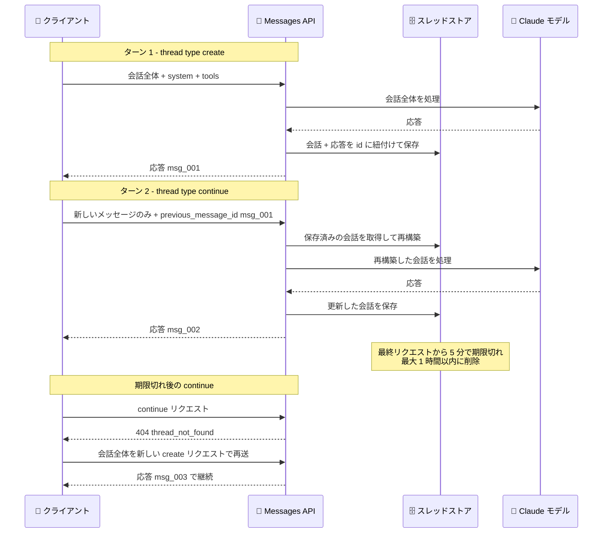

# Messages API にメッセージスレッド機能がベータ提供開始

## メタデータ

| 項目 | 内容 |
|------|------|
| 発表日 | 2026-11-02 |
| ソース | Claude API Release Notes |
| カテゴリ | Claude API |
| 公式リンク | https://platform.claude.com/docs/en/release-notes/overview |

## 概要

Anthropic は 2026 年 11 月 2 日、Messages API に「メッセージスレッド (Message Threads)」機能をベータ提供開始した。ベータヘッダー `message-threads-2026-08-12` を付与することで利用できる。

メッセージスレッドを使用すると、API が会話をサーバー側で短期間保持するため、2 回目以降のリクエストでは新しいメッセージのみを送信すればよくなる。これにより、長い会話やエージェントループにおいてリクエストサイズが小さくなり、最初のトークンまでの時間 (time to first token) が短縮・安定化される。Claude API に加え、Claude Platform on AWS、Google Cloud 上の Claude モデル (Anthropic 管理)、Microsoft Foundry でも利用できる。

## 詳細

### 背景

従来の Messages API はステートレスであり、会話を継続するには毎ターン会話履歴全体を送信する必要があった。会話が長くなるほどリクエストサイズが増大し、API 側での検証とトークン化の処理も会話全体に対して毎回実行されるため、最初のトークンまでの時間が徐々に悪化するという課題があった。特に多数のツール呼び出しを繰り返す長時間のエージェントループで、この影響が顕著だった。

メッセージスレッドはこの課題に対処する機能で、スレッドを使用すると検証やトークン化などの処理の大部分が新しいターンのみを対象とするようになる。

### 主な変更点

- **`thread` パラメータの追加**: Messages API リクエストに `thread` フィールドを 1 つ追加するだけで利用できる。レスポンスは通常のメッセージ形式のまま変わらない
- **スレッドの作成 (create)**: 初回リクエストで会話全体、`system`、`tools` を送信し、`"thread": {"type": "create"}` を追加する。API は Claude の応答を含む会話をレスポンスの `id` に紐付けて保存する
- **スレッドの継続 (continue)**: 2 回目以降は新しいメッセージのみを送信し、`"thread": {"type": "continue", "previous_message_id": "<前回の id>"}` を追加する。`system` と `tools` は省略する (スレッドが create リクエストの値を保持する)
- **有効期限**: スレッドは最後のリクエストから 5 分で期限切れとなり、最後の使用から最大 1 時間以内に削除される
- **リプレイ (再送)**: スレッドはベストエフォートであり、継続できない場合は 404 エラー (`thread_not_found`) が返る。その際はアプリケーション側が保持する会話全体を新しい create リクエストで再送信する
- **SDK スレッドヘルパー**: 各言語の SDK (Python、TypeScript、C#、Go、Java、PHP、Ruby) にスレッドヘルパーが用意されており、ベータヘッダーの付与、create / continue の切り替え、404 エラー時のリプレイを自動で処理する

### 技術的な詳細

**リクエストフィールドの扱い**

スレッド利用時、リクエストフィールドは 3 つのグループに分類される。

| グループ | フィールド | ルール |
|---------|-----------|--------|
| create 専用 | `system`、`tools` | create リクエストでのみ送信する。continue リクエストに含めると 400 エラー |
| 固定 | `model`、`tool_choice`、`thinking`、`context_management`、`output_config`、トップレベル `cache_control`、`anthropic-beta` 値のセットなど | 毎リクエストで create 時と同じ値を送信する。異なる値は 400 エラー (`thread_fingerprint_mismatch`) |
| 自由 | `max_tokens`、`stop_sequences`、`stream`、`metadata`、`service_tier` など | ターンごとに変更可能 |

**プロンプトキャッシュとの関係**

スレッドは自動でプロンプトをキャッシュしない。プロンプトキャッシュは従来どおり `cache_control` ブレークポイントで制御する。毎ターンキャッシュするには、トップレベル `cache_control` をスレッドの全リクエストで送信する。`thread` 付きリクエストで指定できる `cache_control` ブレークポイントは最大 4 個となる。

**エラー処理**

| ステータス | `error_code` | 意味 |
|-----------|--------------|------|
| 404 | `thread_not_found` | スレッドを継続できない。会話全体を新しい create リクエストで再送する |
| 400 | `thread_fingerprint_mismatch` | 固定フィールドの値が create 時と異なる |
| 400 | `thread_already_continued` | 各レスポンス `id` は 1 回しか継続できない |
| 400 | `thread_continue_in_flight` | 同じ `id` からの別の continue リクエストが実行中 |
| 400 | `thread_unsupported_request` | スレッドが対応していない機能や組織設定を使用している |

**サポートされない機能**

Message Batches、トークンカウント、コンパクション (compaction on demand)、コンテキスト編集 (一部を除く)、HIPAA readiness 有効組織、Inference hooks 有効組織では利用できない。また、スレッドの一覧取得・読み取り・削除用の API は提供されない。

**データ保持**

スレッドの内容 (会話、システムプロンプト、ツール) はメモリ上に保持され、サーバー管理キーで暗号化される。永続ストレージには書き込まれず、最後の使用から最大 1 時間以内に削除される。ZDR (ゼロデータ保持) の対象外だが、他の ZDR 対象機能の利用には影響しない。

**料金とレート制限**

スレッドの利用による料金やレート制限の変更はない。

## 開発者への影響

### 対象

- Messages API で長い会話やマルチターンのエージェントループを実装している開発者
- ツール呼び出しを多数繰り返すエージェントアプリケーションの開発者
- 最初のトークンまでの時間 (レイテンシ) やリクエストサイズの削減を求める開発者

### 必要なアクション

1. 全リクエストにベータヘッダー `message-threads-2026-08-12` を付与する (SDK ヘルパー利用時は自動付与)
2. 初回リクエストに `"thread": {"type": "create"}` を追加する
3. 以降のリクエストでは新しいメッセージのみを送信し、`"thread": {"type": "continue", "previous_message_id": ...}` を指定する
4. アプリケーション側で会話全体のコピーを必ず保持し、404 エラー (`thread_not_found`) 時に create リクエストで再送するリプレイ処理を最初から実装する
5. 毎ターンのキャッシュが必要な場合は、トップレベル `cache_control` を全リクエストで送信する

### 移行ガイド (該当する場合)

既存のステートレスな実装はそのまま動作するため、移行は必須ではない。スレッドを導入する場合でも、アプリケーションが会話の信頼できる情報源 (source of truth) であり続ける点に注意が必要である。スレッドの保存は保証されないため、会話のコピーを手元で管理し続ける設計を維持する。SDK のスレッドヘルパーや beta ツールランナー (デフォルトでスレッドを使用) を利用すると、リプレイ処理などを自動化できる。

## コード例

```python
import anthropic

client = anthropic.Anthropic()

# ターン 1: 会話全体を送信してスレッドを作成する
first = client.beta.messages.create(
    model="claude-opus-5-5",
    max_tokens=1024,
    cache_control={"type": "ephemeral"},
    system="You are a support agent for Acme. Keep replies short.",
    messages=[{"role": "user", "content": "Hi! I have a question about an order."}],
    thread={"type": "create"},
    betas=["message-threads-2026-08-12"],
)

# ターン 2: 新しいメッセージと前回レスポンスの id のみを送信する
# system と tools は省略する (スレッドが保持している)
second = client.beta.messages.create(
    model="claude-opus-5-5",
    max_tokens=1024,
    cache_control={"type": "ephemeral"},
    messages=[
        {"role": "user", "content": "How long does standard shipping usually take?"}
    ],
    thread={"type": "continue", "previous_message_id": first.id},
    betas=["message-threads-2026-08-12"],
)

for block in second.content:
    if block.type == "text":
        print(block.text)
```

## アーキテクチャ図 (該当する場合)



## 関連リンク

- [Claude API Release Notes](https://platform.claude.com/docs/en/release-notes/overview)
- [Message threads ドキュメント](https://platform.claude.com/docs/en/build-with-claude/message-threads)
- [Prompt caching](https://platform.claude.com/docs/en/build-with-claude/prompt-caching)
- [Streaming](https://platform.claude.com/docs/en/build-with-claude/streaming)
- [Claude Platform on AWS](https://platform.claude.com/docs/en/build-with-claude/claude-platform-on-aws)
- [Claude in Microsoft Foundry](https://platform.claude.com/docs/en/build-with-claude/claude-in-microsoft-foundry)

## まとめ

メッセージスレッドは、長い会話やエージェントループにおけるリクエストサイズとレイテンシの課題に対する実用的な解決策である。`thread` パラメータを 1 つ追加するだけで導入でき、料金やレート制限の変更もない。一方で、スレッドの保存はベストエフォートであり有効期限も 5 分と短いため、アプリケーション側で会話のコピーを保持し、リプレイ処理を実装することが前提となる。SDK のスレッドヘルパーを利用すれば、これらの処理の多くを自動化できる。長時間稼働するエージェントを構築する開発者にとって、導入を検討する価値の高い機能である。
