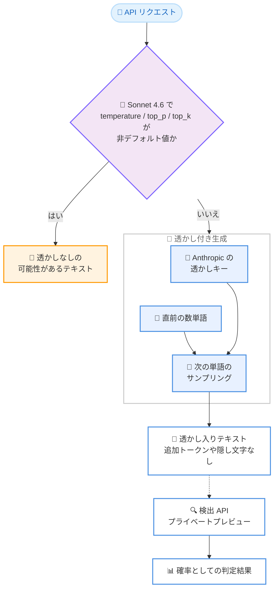

# Claude Mythos 5 / Opus 4.7 / Sonnet 4.6 の生成テキストに Anthropic のテキスト透かしを付与

## メタデータ

| 項目 | 内容 |
|------|------|
| 発表日 | 2026-11-03 |
| ソース | Claude API Release Notes |
| カテゴリ | Claude API / モデル |
| 公式リンク | https://platform.claude.com/docs/en/release-notes/overview |

## 概要

Anthropic は 2026 年 11 月 3 日、Claude Mythos 5、Claude Opus 4.7、Claude Sonnet 4.6 が生成するテキストに Anthropic のテキスト透かし (text watermark) が付与されることをリリースノートで発表した。透かしは対象プラットフォーム (サポート記事「How Claude marks AI-generated content」に記載) で適用される。

透かしは出力の意味、品質、可読性を変えず、トークンや隠し文字を追加せず、ユーザーや組織に関する情報も含まない。開発者側でリクエストやレスポンス処理を変更する必要はない。ただし Claude Sonnet 4.6 では、`temperature`、`top_p`、`top_k` を非デフォルト値に設定したリクエストで生成されたテキストに透かしが付与されないことがある。

## 詳細

### 背景

Anthropic は 2026 年 7 月、EU AI 法 (EU AI Act) 第 50 条 (2) に関する「AI 生成コンテンツの透明性に関する行動規範 (Code of Practice on Transparency of AI-Generated Content)」に署名した。これを受けて、Claude の生成コンテンツへのマーキングを段階的に導入している。地域ごとに適用範囲を限定する永続的な方法がないため、透かしは Claude が提供されるすべての地域でグローバルに適用される。

マーキングには 2 つの補完的な手法が使われる。

- **埋め込みテキスト透かし**: 生成テキスト自体に織り込まれる不可視のマーク。テキストをコピー & ペーストしても一緒に移動し、ある程度の編集後も残存する場合がある
- **Content Credentials (C2PA)**: 生成ファイル (PNG、JPEG など) に付与される署名付き来歴メタデータ。こちらは透かしではなくラベルであり、テキスト透かしとは別の仕組み

### 主な変更点

- **対象モデルの拡大**: Claude Mythos 5、Claude Opus 4.7、Claude Sonnet 4.6 が生成するテキストに Anthropic のテキスト透かしが付与される
- **対象プラットフォーム**: 透かしはモデルレベルで適用され、Claude Platform (API)、Claude アプリ、Claude Code などを対象とする。AWS、Google Cloud、Microsoft Foundry 経由で対象モデルにアクセスした場合も透かしが付与される。対象の詳細はサポート記事に記載されている
- **Sonnet 4.6 の例外**: Claude Sonnet 4.6 では、`temperature`、`top_p`、`top_k` のいずれかを非デフォルト値に設定したリクエストで生成されたテキストに透かしが付与されないことがある。透かしに依存する場合は、フレームワークやクライアントライブラリが自動設定する値を含め、3 つのパラメータすべてをリクエストから省略することが推奨される (Mythos 5 と Opus 4.7 についてはこの例外の記載はない)
- **開発者側の対応は不要**: 透かしのためにリクエストやレスポンス処理を変更する必要はない

### 技術的な詳細

**仕組み**

公式ブログ「How Claude's text watermark works」によると、この透かしは Google DeepMind の SynthID-Text (2024 年に Nature 誌で発表) をベースにした方式である。系譜としては Scott Aaronson 氏による 2022 年の提案にさかのぼる。

透かしは、意味に影響しない低リスクな単語選択の揺らぎを利用する。次の単語を選ぶ際のランダム性の由来を変えるもので、任意の乱数生成器の代わりに「透かしキーと直前の数単語」から導出した値を使用する。珍しい単語へ不自然に誘導するものではなく、Claude が通常使わない語彙を押し付けることはない。

**出力品質への影響**

- 読者にとって、透かし入りの応答と透かしなしの応答は区別できない
- 社内テストで内容、創造性、可読性への影響は確認されていない
- 隠し文字や追加トークンはなく、追加コストや意味のある速度低下もない
- 透かしにはユーザー、組織、特定のチャットをたどれる情報は一切含まれない

**検出**

- 検出には Anthropic の透かしキーが必要で、結果は確実な判定ではなく確率として返される
- 検出 API はプライベートプレビューとして、適格な組織 (規制当局、法執行機関、報道機関、ファクトチェッカー、研究者、教育機関、EU 市民社会組織) およびコンプライアンス上の必要がある企業に限定して提供されている。アクセスはフォーム経由で申請し、今後対象の拡大が予定されている
- ファイルの Content Credentials は、無料の Claude Content Checker で誰でも検証できる

**制限事項**

- **短いテキスト**: 検出が難しく、テキストが長いほど検出の信頼度が上がる
- **事実記述やコード**: 正確な出力が求められ単語選択の自由度が低いため、透かしが疎になる。コードでは透かしは主にコメント部分に乗る
- **編集**: 軽微な編集では透かしは完全には消えない可能性が高いが、すべての単語を置き換える全面的な書き直しでは消える
- **翻訳**: すべての単語を Claude が選択するため、翻訳結果には透かしが付与される
- **判定の限界**: 透かしの検出は「Claude が書いた」と「Claude が大幅に編集した」を区別できない。また、透かしがないことは人間が書いたことの証明にはならない (旧モデル、大幅な編集、ごく短い文章、非デフォルトのサンプリング設定などが原因で透かしが欠落し得る)
- **オプトアウト**: 公式ドキュメントにオプトアウトに関する記載はない。マーキングはモデルレベルで全サーフェスに適用される

## 開発者への影響

### 対象

- Claude API (および AWS、Google Cloud、Microsoft Foundry) で Claude Mythos 5、Claude Opus 4.7、Claude Sonnet 4.6 を利用するすべての開発者
- AI 生成コンテンツの透明性 (EU AI 法第 50 条など) への対応が必要な組織
- 生成テキストの透かし付与に依存するワークフローを構築する開発者

### 必要なアクション

1. **基本的に対応不要**: 透かしは出力の品質や形式を変えないため、既存のリクエストやレスポンス処理の変更は不要
2. **透かしに依存する場合**: Claude Sonnet 4.6 を使用するリクエストから `temperature`、`top_p`、`top_k` をすべて省略する。フレームワークやクライアントライブラリが暗黙的に設定する値にも注意する
3. **コンプライアンス確認**: Claude を組み込んだサービスを提供する事業者は、EU AI 法第 50 条に基づく自社の義務を独自に評価することが推奨されている (Anthropic は今後、追加の技術ガイダンスを公開予定)
4. **検出が必要な組織**: テキスト透かしの検出 API はプライベートプレビューのため、適格な組織はフォームからアクセスを申請する

### 移行ガイド (該当する場合)

既存のアプリケーションはそのまま動作するため、移行作業は不要である。透かしの有無を前提とした処理を新規に実装する場合のみ、Sonnet 4.6 のサンプリングパラメータに関する例外を考慮する。

## コード例

```python
import anthropic

client = anthropic.Anthropic()

# 透かしに依存する場合は temperature / top_p / top_k を
# 設定しない (デフォルト値のまま使用する)
message = client.messages.create(
    model="claude-sonnet-4-6",
    max_tokens=1024,
    messages=[
        {"role": "user", "content": "製品発表のお知らせ文を書いてください。"}
    ],
    # temperature=0.7,  # 非デフォルト値を設定すると
    # top_p=0.9,        # Sonnet 4.6 では透かしが
    # top_k=40,         # 付与されないことがある
)

print(message.content[0].text)
```

## アーキテクチャ図 (該当する場合)



## 関連リンク

- [Claude API Release Notes](https://platform.claude.com/docs/en/release-notes/overview)
- [Text watermark ドキュメント](https://platform.claude.com/docs/en/build-with-claude/text-watermark)
- [How Claude marks AI-generated content (サポート記事)](https://support.claude.com/en/articles/16266773-how-claude-marks-ai-generated-content)
- [How Claude's text watermark works (公式ブログ)](https://www.anthropic.com/news/claude-text-watermark)

## まとめ

Claude Mythos 5、Claude Opus 4.7、Claude Sonnet 4.6 の生成テキストに Anthropic のテキスト透かしが付与されるようになった。EU AI 法の透明性要件への対応を背景とした取り組みで、SynthID-Text ベースの方式により、出力の品質や可読性を変えず、追加トークンやコストも発生しないため、ほとんどの開発者にとって対応は不要である。一方、透かしの付与に依存する場合は、Sonnet 4.6 で `temperature`、`top_p`、`top_k` を非デフォルト値に設定すると透かしが付かないことがある点に注意が必要となる。検出 API は現時点でプライベートプレビューであり、一般の開発者が透かしを直接検証する手段は提供されていない。
