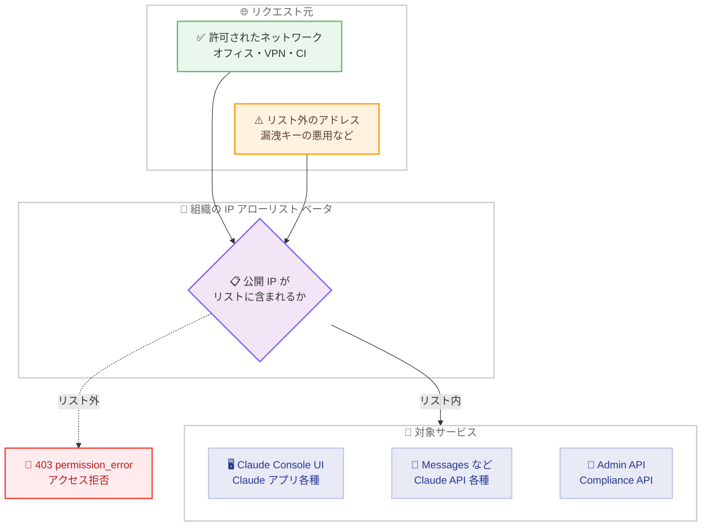
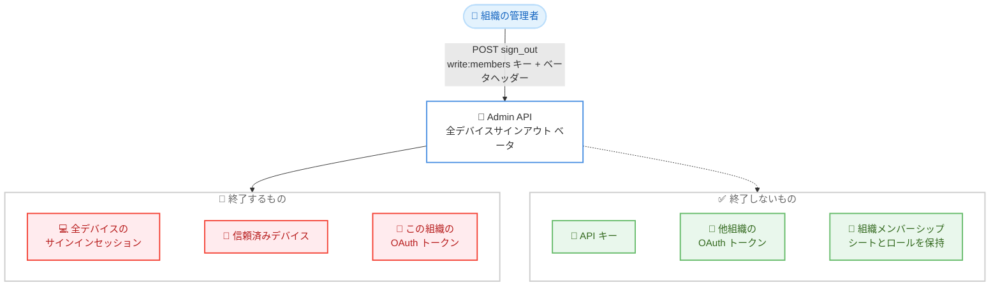

# IP アローリストと Admin API サインアウト機能がベータ提供開始 - 組織のセキュリティ管理を強化

## メタデータ

| 項目 | 内容 |
|------|------|
| 発表日 | 2026-11-05 |
| ソース | Claude Developer Platform Release Notes |
| カテゴリ | API / セキュリティ / 管理機能 |
| 公式リンク | https://platform.claude.com/docs/en/release-notes/overview |

## 概要

Anthropic は 2026 年 11 月 5 日、組織のセキュリティ管理を強化する 2 つの機能をベータとしてリリースした。1 つ目は **IP アローリスト**で、Claude Console から組織単位で信頼できる IP 範囲を設定し、リスト外のアドレスからの対象サービスへのリクエストを拒否できる。IPv4/IPv6 アドレスまたは CIDR 範囲を組織あたり最大 1,000 件登録でき、API キーが漏洩した場合でも悪用できる場所を大幅に制限できる。

2 つ目は **Admin API によるメンバーの全デバイス一斉サインアウト**で、Claude Enterprise (claude.ai) 組織のメンバーを、すべてのブラウザとデバイスから Claude からサインアウトさせることができる。メンバーは組織に残り、再サインインも可能であるため、デバイスの紛失・盗難やセキュリティインシデント時の初動対応として利用できる。

## 詳細

### 背景

API キーの漏洩やユーザーのサインイン情報の窃取は、データ漏洩や不正利用による課金につながるリスクがある。これまでキー漏洩への対策はキーの有効期限設定や Workload Identity Federation への移行が中心であったが、今回の IP アローリストにより「どこからキーやサインインを使えるか」をネットワークレベルで制限できるようになった。

また、デバイスの紛失・盗難時やインシデント調査時には、メンバーを組織から削除せずにセッションのみを無効化したいケースがある。従来は claude.ai の Members ページの UI 操作に限られていたが、Admin API から同じ操作をプログラムで実行できるようになり、インシデント対応の自動化が可能になった。

### 主な変更点

**1. 組織向け IP アローリスト (ベータ)**

公式ドキュメントによると、主な仕様は以下のとおり。

- **設定場所**: Claude Platform は Claude Console の Identity and access ページ、Claude Enterprise は claude.ai の Organization settings から、組織の管理者 (Enterprise ではオーナー / プライマリオーナー) が設定する
- **エントリ形式**: IPv4/IPv6 の単一アドレス (`203.0.113.5`) または CIDR 範囲 (`203.0.113.0/24`、`2001:db8::/32`)。範囲は IPv4 で `/8`、IPv6 で `/32` より広くできない。最大 1,000 エントリまで登録可能
- **動作**: 対象リクエストごとに公開 IP アドレスをリストと照合し、リスト外であれば拒否する。たとえば Messages API は 403 `permission_error` を返し、メッセージは `Your IP address isn't in this organization's allowed range.` となる
- **ユーザーへの表示**: ブロックされたユーザーには「Your current network can't access this organization」というページが表示される。別の組織や個人アカウントへのサインインは引き続き可能
- **反映時間**: 変更の適用には最大 15 分かかる
- **ロックアウト対策**: 「管理者 (Enterprise ではオーナー) が任意の IP からこの設定ページにアクセスできるようにする」チェックボックスを有効にすることが推奨されており、その場合でもアクセスできるのはアローリスト設定のみに限定される

**対象サービス (Claude Platform 組織)**

- Claude Console の UI アクセス
- Claude API の Messages、Message Batches、Token Counting、Models、Files、Skills の各エンドポイント (API キーまたは Workload Identity Federation トークン使用時)
- Claude Managed Agents の Agents、Sessions、Environments、Vaults、Memory stores の各エンドポイント
- Admin API と Compliance API (その組織のみを対象とするキー使用時)

**対象サービス (Claude Enterprise 組織)**

- ブラウザ版 Claude、デスクトップアプリ、モバイルアプリ
- Claude Code (Claude アカウントでサインインする場合)
- Claude in Chrome、Office アドイン、Cowork、Remote Tools
- Admin API と Compliance API (その組織のみを対象とするキー使用時)

**制限事項**

- Claude in Amazon Bedrock、Claude Platform on AWS、Claude Models on Google Cloud、Claude in Microsoft Foundry には適用されない
- Claude Managed Agents のランタイム内のネットワーク通信には適用されない (エンドポイントへのリクエストのみが対象)
- Claude Enterprise では Claude Design、Claude in Slack、Claude Academy は対象外。ユーザーがブロックされた時点でチャット内のタスクが実行中の場合、タスクは最大 24 時間継続しうる
- 登録するのは公開アドレスのみで、`10.0.0.0/8` のようなプライベート範囲は対象外。一部機能は `bridge.claudeusercontent.com` を経由するため、プロキシ構成によっては追加のアドレス登録が必要

**2. Admin API によるメンバーの全デバイスサインアウト (ベータ)**

公式ドキュメントによると、主な仕様は以下のとおり。

- **エンドポイント**: `POST /v1/organizations/users/{user_id}/sign_out` (リクエストボディなし)
- **ベータヘッダー**: `anthropic-beta: admin-user-sign-out-2026-10-08` が必須 (SDK と CLI は自動付与)
- **認証**: `write:members` スコープを持つ Admin API キーが必要。キーは作成された組織でのみ有効で、その組織のプライマリオーナーが作成する
- **対象組織**: Claude Enterprise (claude.ai) 組織向けのベータ機能
- **メンバーの状態**: メンバーは組織から削除されず、シートとロールを保持したまま。すぐに再サインインも可能。完全に締め出すにはメンバー削除、または SSO 必須組織であれば IdP 側でのアカウント無効化が必要

**サインアウトで終了するもの**

- 全ブラウザ・全デバイス上のサインインセッション
- 機微な操作用に登録された信頼済みデバイス (再登録が必要)
- この組織に発行された OAuth トークン (Claude Code やサードパーティアプリが保持するもの。ほぼ即時、最長 1 時間以内に失効)
- 二段階認証スキップの記録 (次回サインインで再度要求)
- プッシュ通知登録 (非同期で削除、通常 1 分以内)

セッション、信頼済みデバイス、プッシュ通知登録はアカウント単位であるため、他の組織や個人プランでの利用にも影響が及ぶ点に注意が必要である。

**サインアウトで終了しないもの**

- API キー (本人が作成した Admin API キーを含む)。停止するには claude.ai の Organization settings から削除する
- 他組織の OAuth トークン (各組織のキーで同じリクエストを送信する必要がある)
- Claude Code のクラウドセッションとルーチン (新しい認証情報を取得して継続する)
- Cowork にリンクされたコンピューター (リンクは維持される)
- 進行中のサインイン (リクエストから最大 5 分後まで完了しうるため、監査ログで確認して必要に応じて再送する)

### 技術的な詳細

**サインアウト API のレスポンス**

| ステータス | 意味 |
|-----------|------|
| 200 | 完了。リトライ安全で、2 回目の実行は初回以降に得た新セッションなども終了する |
| 400 `cannot_sign_out_primary_owner` | プライマリオーナーはサインアウト不可 |
| 400 `organization_not_enrolled_in_beta` | 組織でこのベータ機能が利用不可 |
| 401 | キーが欠落 / 無効、または親組織用キーで単一組織にバインドされていない |
| 403 | `write:members` スコープがない |
| 404 | 組織内にその ID のメンバーが存在しない |
| 429 | Admin API 共有レート制限 (100 リクエスト / 分) を超過 |
| 503 | 必要なサービスが一時的に利用不可。再送で残りを終了できる |

プライマリオーナーはサインアウトできない。それ以外のオーナー、オーナー管理権限を持つカスタムロール保持者、`membership_admin` はすべてサインアウト可能である。

**監査**

完了したサインアウトは `org_user_trusted_devices_revoked` イベントとして記録され、claude.ai の監査ログエクスポートに表示される。Compliance API を利用している組織では Activity Feed にも表示され、終了した信頼済みデバイスとセッションの件数も確認できる。IP アローリストの変更も、Compliance API の Activity Feed で監査できる。

**IP アローリストの運用上の注意**

- アローリストは「キーが使える場所」を制限するが「使える期間」は制限しない。公式ドキュメントは、短いキー有効期限の設定、または静的キーを使わない Workload Identity Federation への移行を併用することを推奨している
- 保存前にデータセンター、CI システム、オフィス、VPN、プロキシなど、すべてのネットワークの公開 IPv4/IPv6 アドレスをリストに含めること
- ロックアウトされた場合は、許可済みネットワークからの再接続、別の管理者 / オーナーによるアドレス追加、チェックボックス有効時の設定ページ経由の修正、または Anthropic サポートへの連絡で復旧できる

## 開発者への影響

### 対象

- API キーの漏洩対策を強化したい Claude Platform (Claude Console) 組織の管理者
- ユーザーアクセスを社内ネットワークや VPN に限定したい Claude Enterprise 組織のオーナー
- インシデント対応や退職前調査のワークフローを自動化したいセキュリティ / IT 管理チーム
- Admin API を使用したユーザー管理インテグレーションを構築する開発者

### 必要なアクション

- **IP アローリストの導入検討**: Claude Console の Identity and access ページ (Enterprise は claude.ai の Organization settings) で設定できる。有効化前に、サーバー、CI、ユーザーが接続するすべてのネットワークの公開アドレスを洗い出すこと
- **ロックアウト対策の確認**: 管理者 / オーナーが任意の IP から設定ページにアクセスできるチェックボックスを有効にしておくことが推奨される
- **トラフィックの監視**: 有効化後は 403 `permission_error` レスポンスを監視し、日次 / 週次でのみ実行されるジョブも含めて漏れたアドレスを追加する
- **サインアウト機能の組み込み**: Claude Enterprise 組織では、`write:members` スコープの Admin API キーを準備し、インシデント対応手順に全デバイスサインアウトを組み込むことを検討する。API キーの無効化は別途必要である点に注意する

## コード例

Admin API でメンバーを全デバイスからサインアウトさせる例。

```bash
curl -X POST "https://api.anthropic.com/v1/organizations/users/user_01AbCdEfGhIjKlMnOpQrSt/sign_out" \
  -H "x-api-key: $ANTHROPIC_API_KEY" \
  -H "anthropic-version: 2026-10-21" \
  -H "anthropic-beta: admin-user-sign-out-2026-10-08"
```

Python SDK を使用した例。

```python
client = anthropic.Anthropic()

user = client.beta.organization.users.sign_out("user_01AbCdEfGhIjKlMnOpQrSt")

print(f"id: {user.id}")
```

TypeScript SDK を使用した例。

```typescript
const client = new Anthropic();

const user = await client.beta.organization.users.signOut("user_01AbCdEfGhIjKlMnOpQrSt");

console.log(`id: ${user.id}`);
```

成功時の 200 レスポンスは、ロールなどのフィールドが変更されていないメンバーを返す。

```json
{
  "type": "user",
  "id": "user_01AbCdEfGhIjKlMnOpQrSt",
  "email": "jane@example.com",
  "name": "Jane Smith",
  "role": "user",
  "added_at": "2026-06-12T09:14:03Z"
}
```

## アーキテクチャ図

IP アローリストによるリクエスト制御の流れ。



Admin API による全デバイスサインアウトの範囲。



## 関連リンク

- [Claude Developer Platform Release Notes](https://platform.claude.com/docs/en/release-notes/overview)
- [IP allowlisting ドキュメント](https://platform.claude.com/docs/en/manage-claude/ip-allowlist)
- [User management - Sign a member out everywhere](https://platform.claude.com/docs/en/manage-claude/user-management#sign-a-member-out-everywhere)
- [Admin API リファレンス (ベータ)](https://platform.claude.com/docs/en/api/beta/organization)
- [Admin API ドキュメント](https://platform.claude.com/docs/en/manage-claude/admin-api)
- [Compliance API ドキュメント](https://platform.claude.com/docs/en/manage-claude/compliance-api)
- [Workload Identity Federation ドキュメント](https://platform.claude.com/docs/en/manage-claude/workload-identity-federation)

## まとめ

今回のアップデートにより、組織のセキュリティ管理が「予防」と「対応」の両面で強化された。IP アローリストは、API キー漏洩やサインイン情報窃取の被害をネットワークレベルで抑止する予防策として機能し、Claude Console と Claude Enterprise の両組織タイプに対応する。Admin API の全デバイスサインアウトは、デバイス紛失やインシデント発生時にメンバーを組織に残したままセッションを即座に無効化できる対応策であり、インシデント対応の自動化を可能にする。いずれもベータ提供のため仕様変更の可能性はあるが、エンタープライズ環境で Claude を運用する組織にとって重要なセキュリティ強化である。
