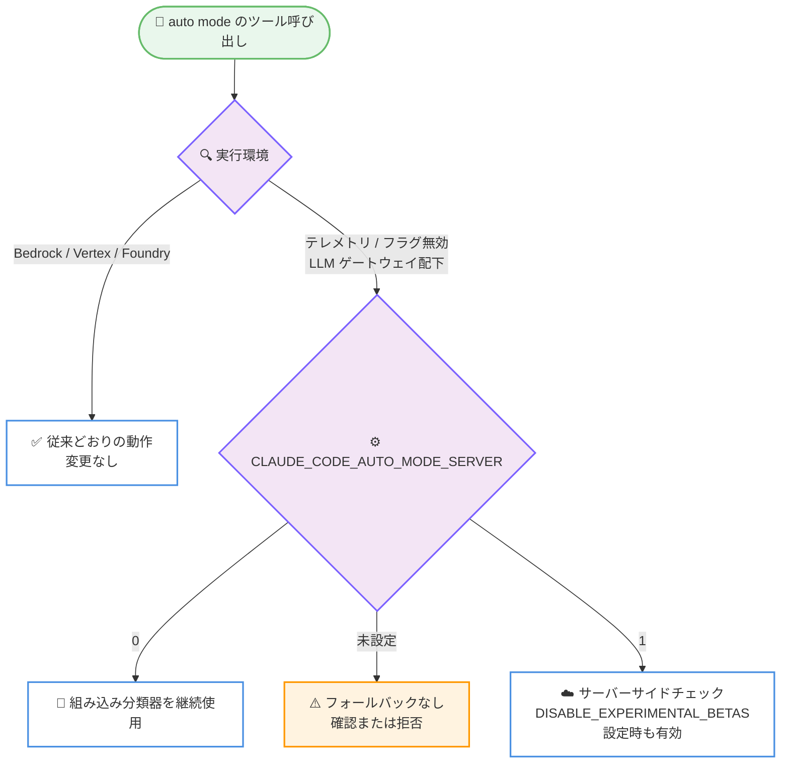

# Claude Code v2.1.319 リリース

## メタデータ

| 項目 | 内容 |
|------|------|
| 発表日 | 2026-11-06 |
| ソース | Claude Code Changelog |
| カテゴリ | Claude Code / CLI アップデート |
| 公式リンク | https://github.com/anthropics/claude-code/blob/main/CHANGELOG.md |

## 概要

Claude Code v2.1.319 がリリースされた。合計 146 件の変更を含む大型アップデートで、auto mode のサーバーサイドチェックの挙動変更、MCP タスクのバックグラウンド実行対応、権限制御の新設定が中心的なテーマとなっている。auto mode では、テレメトリやフィーチャーフラグが無効な環境 (LLM ゲートウェイ配下を含む) において、サーバーが確認できない呼び出しは確認または拒否されるようになり、組み込み分類器へのフォールバックは行われなくなった。新機能では、MCP サーバーがツール呼び出しをタスクとして実行する際に即座にバックグラウンドへ移動する MCP タスク対応、権限プロンプトで待機する代わりに拒否してターンを継続する `permissions.denyInsteadOfPrompting` 設定、Claude API コードのレイテンシ改善を支援する `/claude-api latency-optimize` コマンドなどが追加された。

修正面では、細工された環境変数プレフィックスによる Bash 権限バイパス、accept-edits / auto mode で `sed` コマンドが権限チェックをすり抜けるケース、worktree 作成時のサンドボックスエスケープといったセキュリティ関連の修正が複数含まれる。動作変更では、Monitor ツールの WebSocket 監視がすべての Bash コマンドのルールに従うようになった点や、プロジェクト外で無効化した auto mode のサーバーサイドチェックをプロジェクト設定やプラグインが再有効化できなくなった点が重要である。

## 詳細

### 主な変更点

#### ハイライト

- **auto mode のサーバーサイドチェック挙動変更**: テレメトリまたはフィーチャーフラグが無効な環境 (LLM ゲートウェイ配下を含む) では、サーバーが確認できない呼び出しは確認を求められるか拒否されるようになり、組み込み分類器へのフォールバックは行われなくなった。従来の動作を維持するには `CLAUDE_CODE_AUTO_MODE_SERVER=0` を設定する (Bedrock、Vertex、Foundry は変更なし)。また、LLM ゲートウェイ配下では `CLAUDE_CODE_AUTO_MODE_SERVER=1` により、`CLAUDE_CODE_DISABLE_EXPERIMENTAL_BETAS` が設定されていてもサーバーサイドチェックが有効になる。管理対象設定 (managed settings) で後者を設定している場合は、`1` も同時に設定する必要がある
- **MCP タスクのバックグラウンド実行**: MCP サーバーがツール呼び出しをタスクとして実行する場合、Claude Code は即座にそれをバックグラウンドへ移動し、完了時に結果を Claude に伝えるようになった。従来どおりツール呼び出し内で待機させるには `CLAUDE_CODE_DISABLE_MCP_TASK_BACKGROUND` を設定する。MCP タスクはフィーチャーフラグのフェッチなしでも動作する (Bedrock、Vertex、Foundry、LLM ゲートウェイ、`DISABLE_TELEMETRY` 環境を含む)。無効化するには `CLAUDE_CODE_DISABLE_MCP_TASKS=1` を設定する
- **`permissions.denyInsteadOfPrompting` 設定**: 権限プロンプトで待機することになるツール呼び出しを拒否し、ターンを継続する設定が追加された。ターミナルセッション、サブエージェント、teammates で有効であり、無人実行や長時間の自律タスクでプロンプト待ちによる停止を避けられる
- **`/claude-api latency-optimize`**: Claude API を利用するコードのどこでユーザーを待たせているかを特定し、より高速な設定を eval に対して試行するコマンドが追加された
- **`CLAUDE_CODE_DISABLE_FEATURE_FLAGS` 環境変数**: テレメトリを無効化することなくフィーチャーフラグのフェッチだけを停止できるようになった。すべてのフラグは組み込みのデフォルト値を使用する
- **セキュリティ修正**: 細工された環境変数プレフィックスによりコマンドの一部が権限チェックから隠される Bash 権限バイパス、accept-edits / auto mode で `sed` コマンドが権限チェックをすり抜けるケース、worktree 作成時のサンドボックスエスケープ、`/rewind` がディレクトリシンボリックリンク経由でファイルを復元・削除し得るケースが修正された

#### Added (新機能)

ハイライトで挙げた項目のほか、以下が追加された。

- `/usage` に本日・今週・今月の支出額を表示 (支出上限のない Claude apps gateway 配下の開発者向け、ゲートウェイが本バージョン以降の場合)
- Claude apps gateway に `admin.pooled_conflict_rule` と `admin.pooled_priority_order` を追加。複数グループに属する開発者について、どのプールグループ予算が先に支払うかを設定できる
- Claude apps gateway にオプションの `login_notice` 設定を追加。ゲートウェイのブラウザ検証ページと Claude Code のサインイン画面に、運用者が定義したメッセージを表示できる
- `CLAUDE_GATEWAY_LOG_FORMAT=json` を追加。運用ログ行が `severity`、`time`、`message` を持つ JSON になり、レベルをフィールドから読み取るログコレクターに対応する
- Claude apps gateway に、あるポリシーが名前で列挙するカスタムモデル ID を別ポリシーの `availableModels` も許可している場合の起動時警告を追加
- Claude Desktop の 11 月 10 日の変更に先立ち、`desktopHome` がないまま `coworkTabEnabled: false` や `chatSessionRetentionDays` に依存するポリシーへの起動時警告を追加
- claude.ai ログインの終了後に `ant auth login` のサインインで継続し、使用量が Claude Console 組織に課金される場合の警告と、課金先組織名を起動時に表示する行を追加
- `/tasks` に「Earlier in this session」行を追加。終了したサブエージェントが一覧され、リストから消えた後やセッション再起動後でも再度開いてメッセージを送れる
- クラウドセッションの `/loop` 確認に、タイマーはコンテナとともに停止する旨の注記と、存続するループの提案を追加

#### Fixed (修正)

MCP・ツール実行関連の修正。

- 古いハンドシェイクの MCP サーバーが、新しいサーバーでのみ使用する拡張の宣言により接続に失敗したり空の結果を返したりする問題を修正
- claude.ai コネクタ上の長時間実行 MCP ツール呼び出しが `--resume` 後に結果を報告しないことがある問題を修正
- `claude -p --resume` にプロンプトを渡した際、MCP サーバーが見つからないと保留中のツール呼び出しが失われる問題を修正。終了コード 1 で終了し、呼び出しを保持して以降の入力を拒否するようになった
- ほぼ即座に完了するバックグラウンド Bash コマンドが、完了と報告されながら出力を失う問題を修正
- Bash ツールの変更ファイル diff が、コマンド終了直前に書き込まれたファイルを見落とす問題を修正
- 権限プロンプト表示中にノートブックが変更された場合に `NotebookEdit` が誤ったセルを変更するケースを修正
- Write が上書き対象ファイルを読めない場合にターンを拒否として終了させる問題を修正
- プレーンな `timeout DURATION` でラップされた読み取り専用コマンド (例: `timeout 30 rg foo`) への不要な権限プロンプトを修正

auto mode・権限関連の修正。

- `claude -p` が auto mode で安全性チェック不能によりアクションを拒否された場合に終了コード 0 で終了する問題を修正。テキストおよび JSON 出力で終了コード 1 を返すようになった
- クライアントがモデル変更と auto mode のリクエストを連続して送信した場合に auto mode が誤って拒否されるケースを修正
- サーバーサイドレビューがセッションに届いていない場合 (例: それを落とす LLM ゲートウェイ配下) に `/status` が「Auto mode server: Enabled」と表示する問題を修正
- 権限ルールや `autoMode` 設定が非常に大きい場合に auto mode が理由を示さずアクションを拒否する問題を修正。理由を説明し、`autoMode` の deny ルールがなければターミナルで確認を求めるようになった
- 引用符付きの単語で書かれたコマンドを Bash の deny / ask ルールが見逃すケースを修正
- 管理対象設定の `CLAUDE_CODE_AUTO_MODE_SERVER=1` が、ゲートウェイ URL がそこにのみ設定されサーバー管理設定を取得できない場合に無視されるケースを修正

セッション・設定・UI 関連の修正。

- 先頭にスペース、タブ、改行があるスラッシュコマンドが実行されずプレーンテキストとして Claude に送信される問題を修正
- 401 で失敗し続けるリクエストがリトライのたびにログインをリフレッシュし、他のセッションで 401 を引き起こす問題を修正
- `/context` が以降のターンでフルのビジュアルグリッドを Claude に送信する問題を修正。Claude はテーブルのみを読むようになった
- NFS、SMB、Lustre などのネットワークファイルシステム上のプロジェクトで、Linux の起動時にすべてのプロジェクトファイルが列挙されるケースを修正
- Claude Code がファイルを書き込んだ直後数秒以内の設定ファイル編集が無視される問題を修正
- レガシー名のまま残った設定ファイルが警告なしに設定を隠す問題を修正。ホームに 2 つの設定ファイルがある場合、どちらが使用されているかを stderr で表示する
- 読み取り専用フォルダーやバインドマウントされたファイルへの保存中にディスクが満杯になると、`~/.claude.json`、設定、編集済みファイルが空または途中で切れた状態になる問題を修正
- `/diff` 関連の 3 件を修正。リポジトリ直上に `HEAD` という名前のファイルやフォルダーがある場合の「Diff unavailable」、claude.ai とモバイルアプリでの diff 読み込み失敗、64 ターン以上がファイルを編集したセッションで `/diff` ペインが空で開く問題
- `/rewind` が `/branch` 以前のチェックポイントへのコード復元時に「No files were restored」で失敗する問題を修正
- `/clear` が、実行を継続するバックグラウンドエージェント、teammates、ワークフローの実行中コマンドを終了させる問題を修正
- `opus-5-5` のようなモデル名の誤記に対し、意図したモデルを提案する代わりに Claude Code の更新を案内する問題を修正
- Monitor の WebSocket 監視が、`CLAUDE_CODE_PROXY_RESOLVES_HOSTS` 設定済みで DNS を持たないマシンのプロキシ配下で「could not resolve」により失敗する問題を修正
- サブエージェントのハンドバックレポートが、verbose モード以外で展開した際に内部マーカーと出所注記を表示する問題を修正
- Agent SDK ホストが、ディスク満杯時に失敗した実行自体のエラーメッセージではなく汎用の終了コードエラーを受け取るケースを修正
- OpenTelemetry の `claude_code.session.count` メトリクスが、要求されなかった Agent SDK の `prewarm()` プロセスをカウントする問題を修正。事前起動プロセスは要求された時点で 1 回カウントされる

クラウドセッション・リモート関連の修正。

- クラウドセッションがワーカー移動時に、PermissionRequest フックが追加したものなどセッションスコープの deny / ask 権限ルールを失う問題を修正
- クラウドセッションの `/permissions` が「利用できない」とだけ返答する問題を修正。セッションのルールの所在と変更方法を案内するようになった
- `/clear` 後も実行を続けるバックグラウンドタスクが、Claude Code on the web のタスクリストから消える問題を修正
- モバイルと web のクラウドセッションのスラッシュコマンドメニューに非表示コマンドが表示される問題を修正
- agents view が、権限プロンプト待ちのバックグラウンドセッションに返信を送信したように見える問題を修正。返信はボックスに留まり、セッションを開いて回答するよう促される
- セルフホストランナーセッションが、サーバーがモデルアクセスの更新を拒否し続けた際に説明なく失敗する問題を修正。より早くリトライし、セッションに警告を投稿するようになった
- Remote Control セッションが、セッション外で使用量上限が解除された後も他のデバイスで「Limit reached」と表示し続ける問題を修正
- `claude remote-control` が初回実行時の質問に回答がないまま終了コード 0 で静かに終了する問題と、改行なしのパイプされた `y` を無視する問題を修正

このほか、Claude in Chrome の接続断からの復帰時の動作、Ghostty + tmux での Cmd+クリック、`/rename` の保存失敗時の警告、`${CLAUDE_PLUGIN_ROOT}` の `subagentStatusLine` での置換、プラグイン更新時の依存関係インストール、スクリーンリーダーモードでの Ctrl+G、feedback 関連の表示、TLS 検査プロキシ配下の証明書エラー対応、WebFetch の claude.ai 共有チャットリンクへの応答など、多数の修正が含まれる。

#### Improved (改善)

- Windows での設定保存を改善。他のプログラムが開いているファイルをより長く待機し、保存中の強制終了で `~/.claude.json` が空になる可能性を低減
- `/model` ピッカーを改善。古いモデルは現行モデルの後に並ぶのではなく「More models」行の下にグループ化される
- ターミナルの `/context` を改善。Claude が読むテーブルを短く保ち、各リストは上位 10 行のみ、オンデマンドでロードされる MCP ツールは呼び出されるまでサーバーごとに 1 行を共有する
- ヒント、`/stats` / `/model` / `/sandbox` の詳細、拒否されたアクションのメッセージなど、薄いグレーのセカンダリテキストのコントラストを改善
- Claude in Chrome を改善。短時間の切断後はセッション自身のブラウザの復帰を最大 6 秒待機し、`javascript_tool` の結果は 60,000 文字までファイル保存ではなく会話に残る
- `claude purge` と古いセッションのクリーンアップを改善。完全に削除できなかったフォルダーをリトライし、残る場合はエラーとして報告する
- macOS / Windows で、作業ディレクトリ内のパスと大文字小文字のみが異なるパスの拒否メッセージが、その綴りを明示するようになった
- Claude apps gateway の改善。アップストリーム呼び出し失敗の警告がプロバイダー名ではなくアップストリーム名を示し、支出上限エラーは「spend limit reached · resets Dec 1」の形式で表示され `admin.blocked_message` が続く
- クラウドセッションの `/usage` が、プラン上限を表示できない場合に claude.ai の Settings → Usage へのリンクを示すようになった

#### Changed (動作変更)

- **Monitor ツールの権限ルール適用**: Monitor の WebSocket 監視がすべての Bash コマンドのルールに従うようになった。deny ルールは監視を拒否し、ask ルール下では Monitor への allow、bypass mode、auto mode のいずれもプロンプトをスキップしなくなった
- **auto mode 設定の保護**: プロジェクト外でサーバーサイドチェックを無効化した場合、プロジェクトの設定ファイルやプラグインがそれを再有効化できなくなった
- `CLAUDE_CODE_PROXY_RESOLVES_HOSTS` は、ホストがネットワークを管理する環境では設定ファイルから設定できなくなった。プロセス環境で設定する
- セッションの Bash / PowerShell の完全一致 ask ルールは、より広い deny ルールがコマンドをカバーする場合、確認ではなく拒否されるようになった
- Bash ツールが、参照・表示系以外のフラグ付き `which` の実行前に権限を求めるようになった
- `--add-dir` のディレクトリは、そのディレクトリ自身の信頼ダイアログが承認されて初めてプラグインマーケットプレイスを登録するようになった
- ネストされたスキルのロードを変更。Bash サンドボックス有効時、開始フォルダーより下の `.claude/skills` フォルダー内のスキルは、そこで Claude Code を開始するか `/cd` した場合のみロードされる
- 自己ペースの `/loop` は、再スケジュールなしにターンが終了した時点で終了するようになった (フォールバックの起床をスケジュールしない)。従来の動作は `CLAUDE_CODE_LOOP_KEEPALIVE=1` で維持できる
- PostToolUse フックが、新しいメッセージによるターン中断後に完了したツール呼び出しでも実行されるようになった (最大 10 秒)
- セーフガードがサブエージェントを停止した後、Claude は自分で作業する代わりに、より狭いプロンプトでのリトライまたはユーザーへの報告を指示されるようになった
- クラウドセッションは、deny / ask ルールをすべて維持できないワーカー移動時に、セッションスコープの allow ルールを破棄するようになった (再度確認される場合がある)
- TLS 検査プロキシ配下の自動証明書修復は、`ALL_PROXY` が唯一のプロキシ変数の場合は実行されなくなった。代わりに `HTTPS_PROXY` にプロキシの http:// URL を設定する
- アーティファクトデータベースの保存を変更。他者が書き込んだ可能性のある行の保存では各ファイルに隠しマーカーファイルが付与され、マーカーのない既存ファイル (旧バージョンのエクスポートを含む) は変更されず報告される
- `/claude-api managed-agents-onboard` のテンプレートを Claude Console に合わせて更新。Performance tuner を削除し、2 つを改名、プロンプトで使用しない 5 つで web 検索とフェッチを無効化した

#### Removed (削除)

- Claude Code 組み込みの Claude in Chrome ツールから、拡張機能に保存されたショートカットの一覧表示と起動を行う `shortcuts_list` と `shortcuts_execute` を削除

#### コンポーネント別の変更

**Gateway:**

- AWS GovCloud と他のアップストリームの混在、およびゲートウェイ環境のベース URL 変数に対する起動時警告を追加
- 管理対象設定がヘッダーで Amazon Bedrock ガードレールを指定しているが、ゲートウェイが転送せず、どの `bedrock` アップストリームも `guardrail` を設定していない場合の起動時ログ警告を追加
- すべてのアップストリームが Amazon Bedrock の場合に、Claude Desktop が常に失敗する web 検索ツールを提供する問題を修正

**セルフホストランナー:**

- `--use-anthropic-git-proxy` または `--configure-git` で開始したランナーが、起動チェックの失敗で終了する前に登録してしまう問題を修正。先に終了するようになった
- `CLAUDE_RUNNER_CHECKOUT_PATH` を変更。セッション内の各リポジトリが独自のフォルダーを持ち、名前が重複する場合は末尾に `-2`、`-3` などが付く
- セッション終了時のデバッグログアップロードを削除。失敗したセッションのログは、`--remove-session-state` を設定しない限りランナーホストに残る
- `--trust-workspace false` が、リポジトリの設定ファイルとスキル内のフックの実行も停止するようになった

**VSCode:**

- 50,000 文字を超えるプロンプトが警告なく切り捨てられる問題を修正。プロンプトは通知とともにチャットボックスに残り、上限超過のペーストは通知付きで拒否される
- ウィンドウのリロード後に未承認のプランを Claude が実行する問題を修正。plan mode で中断されたステップは、別の権限モードでセッションが戻ると通知とともに停止する
- アンケートや「Report a problem」ボタンのクリックが未完成のプロンプトを送信する問題、削除済みセッションのファイルがリネームで復活する問題、`claude-vscode.toggleDictation` が開いているすべての Claude ビューで音声入力を開始する問題などを修正
- 大規模ワークスペースの診断ツールを改善。問題のないファイルを省き、コンパクトな JSON を返し、オプションの最小重要度を受け付ける
- Claude のサインイン、コネクタ、API アドレスを指すリンクは、ブラウザで開く代わりにアドレス付きテキストとして表示されるようになった

**Cloud sessions / Code Review / Claude Tag:**

- スケジュールされたタスクが memory という名前のコネクタを静かに除外する問題を修正。実行はその名前に短いサフィックスを付けてマウントする
- クラウドセッションで待機中メッセージの Send now が実行中のバックグラウンドエージェントを終了させる問題を修正
- Code Review: GitHub 組織のリンク解除時に、その組織の All repositories 設定も無効化されるようになった。再リンク後も手動で戻すまで無効のまま
- Claude Tag: チャンネルリストの読み込み失敗がセットアップの起動をブロックする問題と、auto mode の allow ルール保存が別の管理者の変更を上書きする問題を修正。Enterprise 組織の Models 管理ページに Claude Tag 行を追加

### 技術的な詳細

#### auto mode サーバーサイドチェックの判定フロー

v2.1.319 では、サーバーサイドチェックが利用できない環境での auto mode の動作が明確化された。判定の流れは以下のとおりである。

- **MCP タスクの仕組み**: MCP サーバーがツール呼び出しをタスクとして実行すると、Claude Code は呼び出しを待たずに即座にバックグラウンドへ移動し、完了時に結果を Claude に通知する。長時間実行される MCP ツールでターンがブロックされなくなる。同期的な動作が必要な場合は `CLAUDE_CODE_DISABLE_MCP_TASK_BACKGROUND` を、機能自体を無効化する場合は `CLAUDE_CODE_DISABLE_MCP_TASKS=1` を設定する
- **`permissions.denyInsteadOfPrompting` の適用範囲**: ターミナルセッション、サブエージェント、teammates に適用される。権限プロンプトで停止する代わりにツール呼び出しが拒否され、Claude は別のアプローチでターンを継続できるため、無人実行での停止を防げる
- **フィーチャーフラグとテレメトリの分離**: 従来はテレメトリを無効化するとフィーチャーフラグのフェッチも止まっていたが、`CLAUDE_CODE_DISABLE_FEATURE_FLAGS` によりフラグのフェッチのみを停止できる。すべてのフラグは組み込みデフォルト値で動作する
- **Monitor ツールの権限整合性**: WebSocket 監視を含む Monitor の動作が Bash コマンドの権限ルールと一貫するようになり、ask ルールの対象コマンドは bypass mode や auto mode でもプロンプトが省略されない。監視経由での権限ルール迂回ができなくなった

## 開発者への影響

### 対象

- Claude Code CLI / VS Code 拡張機能のユーザー
- LLM ゲートウェイ、Bedrock、Vertex、Foundry など非標準経路で Claude Code を運用する組織
- auto mode や `claude -p` で無人実行・CI 連携を行う開発者
- MCP サーバー・コネクタを利用または開発する開発者
- Claude apps gateway、セルフホストランナー、クラウドセッションの管理者
- Claude in Chrome、Remote Control、Claude Tag、Code Review の利用者

### 必要なアクション

- **LLM ゲートウェイ配下やテレメトリ無効環境で auto mode を利用する組織**: サーバーが確認できない呼び出しがフォールバックなしで確認・拒否されるようになったため、挙動の変化を確認する。従来の組み込み分類器を使い続ける場合は `CLAUDE_CODE_AUTO_MODE_SERVER=0` を設定する。管理対象設定で `CLAUDE_CODE_DISABLE_EXPERIMENTAL_BETAS` を設定している場合、サーバーサイドチェックを使うには `CLAUDE_CODE_AUTO_MODE_SERVER=1` も併せて設定する
- **CI / 自動化環境**: `claude -p` が auto mode で安全性チェック不能により拒否された場合、終了コード 1 を返すようになった。終了コードを監視するスクリプトは、この変化を考慮する
- **無人実行で権限プロンプトによる停止を避けたい開発者**: `permissions.denyInsteadOfPrompting` 設定の利用を検討する
- **長時間実行の MCP ツールを持つ MCP サーバー開発者**: タスクとして実行される呼び出しが即座にバックグラウンドへ移動するようになった。同期動作が前提のクライアント統合は `CLAUDE_CODE_DISABLE_MCP_TASK_BACKGROUND` でオプトアウトできる
- **自己ペースの `/loop` を利用するユーザー**: 再スケジュールなしのターン終了でループが終わるようになった。従来のフォールバック起床を維持するには `CLAUDE_CODE_LOOP_KEEPALIVE=1` を設定する
- **Claude API のレイテンシに課題がある開発者**: `/claude-api latency-optimize` を実行し、待ち時間の発生箇所の特定と高速な設定の検証を行う
- **セルフホストランナーの運用者**: セッション終了時のデバッグログアップロードが削除されたため、失敗セッションのログはランナーホスト上で確認する。`CLAUDE_RUNNER_CHECKOUT_PATH` のフォルダー命名変更 (重複時の `-2`、`-3` サフィックス) に依存するスクリプトがあれば更新する

## 関連リンク

- [Claude Code Changelog](https://github.com/anthropics/claude-code/blob/main/CHANGELOG.md)
- [Claude Code リポジトリ](https://github.com/anthropics/claude-code)
- [Claude Code ドキュメント](https://code.claude.com/docs)

## まとめ

Claude Code v2.1.319 は 146 件の変更を含む大型リリースで、auto mode のサーバーサイドチェックの厳格化と MCP タスクのバックグラウンド実行対応が中心となっている。サーバーが確認できない呼び出しのフォールバック廃止は、LLM ゲートウェイ配下やテレメトリ無効環境で auto mode を使う組織に直接影響するため、`CLAUDE_CODE_AUTO_MODE_SERVER` の設定方針を決めておく必要がある。`permissions.denyInsteadOfPrompting` や `claude -p` の終了コード修正は無人実行の制御性を高め、Bash 権限バイパスやサンドボックスエスケープなどのセキュリティ修正、Monitor ツールの権限ルール適用により権限モデルの一貫性も強化された。`/claude-api latency-optimize` や `/tasks` の履歴行、`/model` ピッカーの整理など日常の開発体験の改善も幅広く、ほぼすべての利用者に関係するアップデートである。
