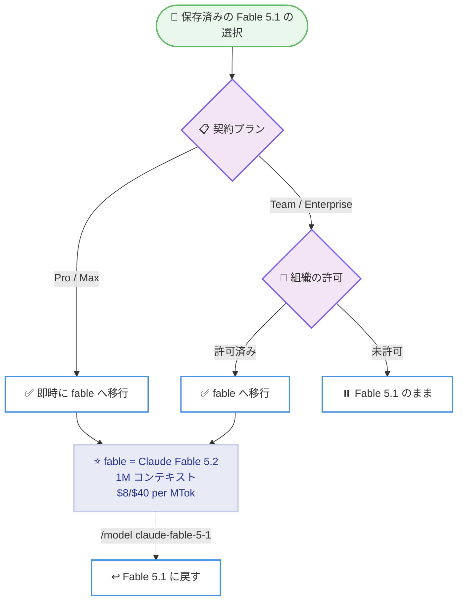

# Claude Code v2.1.321 リリース

## メタデータ

| 項目 | 内容 |
|------|------|
| 発表日 | 2026-11-09 |
| ソース | Claude Code Changelog |
| カテゴリ | Claude Code / CLI アップデート |
| 公式リンク | https://github.com/anthropics/claude-code/blob/main/CHANGELOG.md |

## 概要

Claude Code v2.1.321 がリリースされた。v2.1.320 は npm に公開されていないため、v2.1.319 (2026-11-06) からの直接のアップデートとなる。合計 118 件の変更を含む大型リリースで、最大のトピックは新モデル **Claude Fable 5.2** (`claude-fable-5-2`) の追加である。Fable 5.2 はデフォルトの Fable モデルとなり、1M コンテキスト、$8/$40 per MTok (入力 / 出力)、キャッシュ読み取り $0.20/MTok で提供される。あわせて、保存済みの Fable 5.1 のモデル選択は `fable` エイリアスへ移行される。

セキュリティ面では、MCP OAuth のリダイレクト先へリフレッシュトークンなどのシークレットが送信される問題、読み取り専用 Bash コマンドが権限プロンプトなしにサンドボックス外で実行されるケース、Bash 権限チェックがファイル書き込みを誤ったフォルダーで判定するケース、`cp` / `mv` によるディレクトリへの書き込みに deny ルールと保護ファイルのプロンプトが適用されない問題など、権限モデルに関わる修正が複数含まれる。新機能としては `claude remote-control` への `--settings <file>` オプションが追加された。このほか、mods の権限挙動の変更、フォールバックモデルや fast mode の信頼性改善、ネットワークパス上での Edit / NotebookEdit の修正など、幅広い領域の修正・改善が行われている。

## 詳細

### 主な変更点

#### ハイライト

- **Claude Fable 5.2 の追加**: `claude-fable-5-2` が追加され、デフォルトの Fable モデルとなった。1M コンテキストに対応し、料金は入力 $8/MTok、出力 $40/MTok、キャッシュ読み取りは $0.20/MTok
- **Fable 5.1 の選択の自動移行**: 保存済みの Fable 5.1 のモデル選択は `fable` エイリアスへ移行される。Pro / Max プランでは即時、Team / Enterprise プランでは組織が許可した時点で移行される。Fable 5.1 に戻すには `/model claude-fable-5-1` を使用する
- **`claude remote-control --settings <file>`**: `claude remote-control` が開始するすべてのセッションに設定ファイルを適用できるようになった。ファイルを変更した場合、`claude remote-control` を再起動するまで新しいセッションは開始されない
- **セキュリティ修正**: MCP OAuth リクエストがサーバーのリダイレクトにより別ホストへシークレット (リフレッシュトークンなど) を送信する問題、読み取り専用 Bash コマンドが権限プロンプトなしにサンドボックス外で実行されるケース、Bash 権限チェックがファイル書き込みを誤ったフォルダーで判定しプロンプトを出さないケース、`cp` / `mv` でディレクトリへ書き込まれるファイルに deny ルールと保護ファイルのプロンプトが適用されない問題が修正された
- **mods の権限挙動の変更**: Claude が作成する mods は auto mode / bypass mode では確認なしで有効になり (管理対象の `allowUnsandboxedCommands: false` や `allowManagedDomainsOnly` の下でも)、`dontAsk` モードではロードされなくなった。また、mods 自身のツール呼び出し (`$.tool.call`、`$.mcp.call`) は、ユーザー自身の ask ルールや `dontAsk`、`-p` 実行でも権限プロンプトを発生させなくなった。deny ルールと組織ポリシーは引き続き適用される

#### Added (新機能)

- Claude Fable 5.2 (`claude-fable-5-2`) を追加。デフォルトの Fable モデルとなり、1M コンテキスト、$8/$40 per MTok、キャッシュ読み取り $0.20/MTok で提供される
- `claude remote-control` に `--settings <file>` を追加。開始するすべてのセッションに設定ファイルを適用する

#### Fixed (修正)

セキュリティ・権限関連の修正。

- MCP OAuth リクエストが、サーバーのリダイレクトによりリフレッシュトークンなどのシークレットを別ホストへ送信する問題を修正
- 読み取り専用 Bash コマンドが権限プロンプトなしにサンドボックス外で実行されるケースを修正
- Bash の権限チェックがファイル書き込みを誤ったフォルダーで判定し、プロンプトを出さないケースを修正
- `cp` / `mv` でディレクトリへ書き込まれるファイルに、deny ルールと保護ファイルのプロンプトが適用されない問題を修正
- `grep -r foo "$PWD/src"` のような Bash の読み取りが、パスを直接書いた同じコマンドでは確認なしで実行されるのに権限を求める問題を修正
- クラウドセッションの `pkill`、`pgrep`、`pidwait` が、セッション自身の親プロセスにマッチする問題を修正
- 送信ファイルの名前にテキスト方向制御文字や制御文字が隠れていると Claude アプリで別名で表示される問題を修正。そのようなファイルの送信は拒否されるようになった
- 一部フォントで空白として描画される Bamum 文字を含むスキル名・コマンド名を拒否するようになった

フック関連の修正。

- 大きなフック出力が、同じツール呼び出しの別のフックの出力を保持するファイルを Claude に示す問題を修正
- Claude Code を組み込むアプリが、複数のフックが ask を返した場合に、自身の PreToolUse フックの ask 理由ではなく別のフックの理由を受け取る問題を修正
- あるフックの `defer` が先に完了して履行できなかった場合に、別の PreToolUse フックの `ask` が失われる問題を修正
- stdio / HTTP MCP サーバーの `PreToolUse` `mcp_tool` フックが、応答が 16 MiB を超えるとスキップされる問題を修正。ツール呼び出しは拒否されるようになった
- リモートセッションで `UserPromptSubmit` フックが再生された権限回答をブロックし、再起動後に応答がなくなる問題を修正。これらのフックは再生時には実行されなくなった

ツール実行・編集関連の修正。

- ネットワークパス (UNC 共有、WSL フォルダー、`/net` マウント) 上で、`NotebookEdit` がセル指定なしの呼び出しで最初のセルを削除・上書きする問題を修正
- 同じくネットワークパス上で、Edit が複数マッチの最初のみを変更する、空の `old_string` でファイル全体を置換する、ノートブックをテキストとして編集するといった問題を修正
- Claude が複数の Bash コマンドを一度に送信し、先行コマンドがフォルダーを変更した場合に、後続コマンドが誤ったフォルダーで実行されることがある問題を修正
- 権限プロンプトを開いている間にノートブックが変更されるなどで編集が失敗した場合に、NotebookEdit がフックとテレメトリに成功を報告する問題を修正
- `.zshrc` が `KSH_OPTION_PRINT` を設定している zsh ユーザーで Bash コマンドの結果が空になる問題を修正
- 大きなファイルから 1 行ずつ繰り返し読み取る長時間セッションでのメモリ使用量の増大を修正

モデル・リクエスト関連の修正。

- 最初のモデルが応答前にブロックされた場合に、フォールバックモデルがリクエストを拒否したり停止した応答に言及したりすることがある問題を修正
- fast mode が、高速サービングのレート制限・過負荷・障害時に応答を失う、モデルを切り替える、数分間リトライするといった問題を修正。まず同じモデルの標準速度を試すようになった
- 応答の途中で接続が切れた際にターンが「API Error: EPROTO: The TLS handshake failed」で終了する問題を修正。2.1.302 以前と同様に、部分的な応答を保持するかリクエストをリトライする
- 正確なトークン数が取得できない場合に、コンテキスト使用量の推定がツール定義を過大にカウントする問題を修正
- WebFetch が、ページを読むモデルがテキストを返さなかった場合に「No response from model」をページ内容として Claude に渡す問題を修正。明確なエラーで失敗するようになった
- モデルがツール呼び出しで応答した際に、プロンプト候補が余分な API リクエストを行う問題と、サブエージェントの進捗サマリーがリクエストを最後まで実行する問題を修正
- ネットワーク上の何かが接続を受け付けながら TLS ハンドシェイクに応答しない場合に、サインイン、トークンリフレッシュ、ログアウトが無期限に待機する問題を修正

セッション・クラウド・Remote Control 関連の修正。

- 会話が Claude の応答前にコンパクトされた場合に、auto mode がターンを開始したバックグラウンドサブエージェントのレポートを失う問題を修正
- Claude の停止中に複数のバックグラウンドエージェントレポートが待機していた場合に、1 つのリクエストが意図より多くのレポートを運ぶ問題を修正
- `git stash` などでフォルダーが削除されてセッション中に戻った場合や、worktree に入った後に、プロジェクトのスキル・コマンド・エージェントが見つからないままになる問題を修正。SDK / デスクトップセッションで worktree 進入後にメニューから消える問題も修正
- 再起動されたクラウドセッションが、大きな画像を含むメッセージを失う問題と、サブエージェントからメイン会話へのメッセージが未回答のままになる問題を修正
- Remote Control が、接続が維持されているのにデスクトップアプリで「login expired」とともにオフと表示される問題、接続が完全に閉じた後も接続中と表示される問題、「Queue for later」で送信したメッセージが実行中のターンの途中で Claude に届く問題を修正
- セッション開始時に Claude へ渡される git ステータスが、`git status` の失敗時にクリーンと読める問題 (利用不可と表示されるようになった) と、最初のファイルがステージされていないのにステージ済みと表示される問題を修正
- トランスクリプトの読み取り中にメモリが不足した場合に、新しいメッセージが保存されず、`claude -p`、SDK、VS Code セッションがハングする問題を修正
- `claude -p` が Linux で、NFS の容量やクォータの枯渇によりトランスクリプト行が失われた際に終了コード 0 で静かに終了する問題を修正。エラーを出力し、text / json 出力では終了コード 1 で終了する
- クラウドセッションで、サービスが中断しただけのバックグラウンドエージェントがユーザーによる停止と報告され、再開を拒否される問題を修正
- クラウドセッションが、許可されているホストへのプロキシ接続に失敗した際に、そのホストはおそらく許可されていないと Claude に伝える問題を修正
- ファイル送信が、プロキシからの HTTP 507 で即座に失敗する問題を修正。アップロードは再試行されるようになった

CLI・UI・その他の修正。

- `claude agents` が、`--verbose` などのフラグと併用した際に `agents` より前に入力された `--permission-mode`、`--dangerously-skip-permissions`、`--model`、`--effort`、`--agent` を無視する問題を修正
- `/config` が、新しいセッションが auto mode で開始されるのにデフォルトの権限モードを Manual と表示する問題を修正。「Auto (default)」で Space を押すと Plan ではなく Don't Ask が保存されるようになった
- `/compact` が web とモバイルの Remote Control に二重に表示される問題を修正
- `/desktop` が macOS で、`~/Applications` にある Claude Desktop をインストールされていないと表示する問題を修正
- プラグインの自動更新と `/plugin` マーケットプレイス更新が、リポジトリの worktree やフォルダーごとにプラグインを再ダウンロードする問題を修正
- Windows で、セッションの作業ディレクトリのドライブレターが小文字の場合に、最初のシェルコマンド以降 `watchPaths` で設定したパスの `FileChanged` フックが止まる問題を修正
- 再接続時やツールのロード中にセッションのディレクトリが変わった際に、MCP サーバーがツールなしで接続中と表示されることがある問題を修正
- Claude Desktop の Code タブセッションで、デスクトップアプリに同名の MCP サーバーや拡張機能がある場合に、プロジェクトの MCP サーバーが最初のメッセージ後に切断される問題を修正
- スクリーンリーダーモードの複数の問題 (起動時のプロンプト遅延、エージェントビューから戻った際のモード解除、y/n 質問が直前に入力されたテキスト末尾の「y」を回答として受け取る問題) を修正
- macOS で、有効な MDM プロファイルの読み取りが遅い場合に起動時に「Unable to read managed policy settings」となる問題を修正。読み取りは 1 回リトライされ、タイムアウトはタイムアウトとして報告される
- このほか、`/model` ピッカーや画面描画、Claude apps gateway、OpenTelemetry 属性、アーティファクト関連など多数の修正が含まれる

#### Improved (改善)

- `/model` ピッカーを改善。「More models」は番号なしの行として最下部に表示され、古いモデルを開いても他の行の番号が振り直されない
- `claude install` とインストールスクリプトが 2〜4 秒速く完了するようになった
- Windows の起動と最初のコマンドの実行が、ヘルパープロセスを起動せずに PATH 上のプログラムを見つけることで高速化された。標準的な Git for Windows 環境では、起動ごとの git.exe の確認も不要になった
- 信頼済み TLS 証明書の読み込み高速化により起動時間を改善
- ヘッドレスセッション、デスクトップアプリ、VS Code の auto mode を改善。同時に待機するバックグラウンドサブエージェントのレポートは、ターミナルと同様に 1 回のモデル呼び出しで回答される
- 1 リクエストに収まらない数の画像を持つセッションを改善。ドロップされた画像を既に見たかどうかが Claude に伝えられ、変更のない画像の再読み取りが制限される
- Claude apps gateway の改善。混雑したレプリカでの支出上限チェックのスキップ減少と記録の迅速化、支出上限エラーのリセット時刻のローカルタイム表示 (例: "resets 4pm (America/Los_Angeles)")、エラーメッセージからのユーザー名・パスワードの除去など
- `claude remote-control` の初回実行時の質問への未回答メッセージが、次に何をすべきかを示すようになった

#### Changed (動作変更)

- **Fable 5.1 の選択の移行**: 保存済みの Fable 5.1 のモデル選択は `fable` へ移行される。Pro / Max プランでは即時、Team / Enterprise プランでは組織が許可した時点で適用される。戻すには `/model claude-fable-5-1` を使用する
- **mods の権限挙動**: Claude が作成する mods は auto mode / bypass mode で確認なしに有効となり、`dontAsk` モードではロードされない。mods 自身のツール呼び出し (`$.tool.call`、`$.mcp.call`) は ask ルールや `dontAsk`、`-p` 実行でも権限プロンプトを発生させない。deny ルールと組織ポリシーは引き続き適用される
- **Remote Control セッションのフォルダー固定**: Remote Control セッションは開始時のフォルダーを維持し、接続クライアントがセッションを別フォルダーへ移動できなくなった
- **`cp` / `mv` のパス指定**: `/bin/cp` のようにパスで記述された `cp` / `mv` にも、`cp` / `mv` と同じパスチェックが適用されるようになった
- **ネストされたスキルのロード**: `~/.claude/plugins` 内の `.claude/skills` フォルダーは、Claude がそこでファイルを扱う際にもロードされなくなった
- **ヘッドレスセッションの mods リロード**: `.claude/skills` 内の mods は、ファイル変更時にリロードされるようになった。無効化するには `CLAUDE_CODE_PLUGIN_DIR_WATCH=0` を設定する
- **fast mode のラベル**: `/fast`、`/config`、`/model` の fast mode ラベルは、現在のモデルが fast mode をサポートする場合にそのモデル名を表示するようになり、VS Code の行から "(Opus only)" が削除された
- **管理対象 `extraKnownMarketplaces` の強化**: 宣言済みの名前は別ソースから追加できず、別ソース由来のエントリは非表示になり、宣言済みマーケットプレイスが列挙するプラグインはそこから再インストールされる。未宣言ソースからの引き継ぎでは、保存データは `cleanupPeriodDays` の間、オプションとシークレットは `claude plugin restore-set-aside` まで退避される
- **Claude in Chrome のポリシー適用**: Claude Code を実行するアプリ (Claude デスクトップアプリの Code タブなど) が提供する Claude in Chrome ツールは、組織の Claude in Chrome ポリシーに従うようになった
- **Claude apps gateway の `policy_mode: layered`**: 管理対象 MCP サーバーは、`match: {}` を含むすべての一致するポリシーにわたって加算されるようになった。既にこのモードのゲートウェイはアップグレード後により多くのサーバーを提供する
- **Gateway のアップストリーム**: Bedrock、Vertex、Foundry のアップストリームは、ゲートウェイ環境の `ANTHROPIC_*_BASE_URL` 変数を無視するようになった。別のエンドポイントを使用するにはアップストリームの `base_url` を設定する
- **Cowork クラウドセッション**: PostToolUse フックは AskUserQuestion の回答や ExitPlanMode の結果のプランを置き換えられなくなり、Claude はオリジナルを読む
- **`AskUserQuestion` の制限**: `claude -p` / SDK セッションで、未文書化の `afkTimeoutMs` 入力フィールドを設定するホストの権限回答は拒否されるようになった
- **コンテキスト節約**: バックグラウンドコマンドの通知と TaskStop の結果は、1,000 文字を超えるコマンドについて先頭と末尾のみを Claude に表示するようになった
- **アカウントメールのチェック**: ユーザーのメールアドレスを含み User-Agent を指定するシェルコマンドのみを確認なしで拒否するようになり、その他のコマンドやスケジュール実行がプロンプトで停止しなくなった
- Claude Desktop の Code タブセッションが、ユーザーの入力を待つまでに他のセッションへ送信できるメッセージ数が 10 から 20 に変更された
- セルフホストランナー: サーバーが不要と判断して拒否したオンデマンドランナー (セッション終了・一時停止、作業指示の置き換え) は、終了コード 1 ではなく 0 で終了するようになった
- Windows: Claude Code が自身で起動するプログラム (git など) の探索で、相対パス・UNC の PATH エントリとネットワーク共有へのリンクをスキップし、設定からの PATH 変更を反映するようになった

#### その他の更新

- セッションフィードバックのメッセージと `allowedProviders` 設定の説明が Pro / Max に加えて Ultra を記載するようになり、`forceLoginMethod` の説明がすべての有料 Claude プランをカバーするようになった。「Upgrade to Max」の選択肢は「Upgrade to Max or Ultra」に変更された
- バンドルされた dataviz スキルが、それぞれ上限を持つ複数の比率に対して 1 項目 1 行のメーターのリストを提案するようになった
- アーティファクトのデザインガイダンスが、Inter と Space Grotesk を適切なデフォルト書体として扱うようになった
- [VSCode] 認証トークンと API キーの両方が設定されている場合に、ターミナルの起動時警告と同様の警告をプロンプトボックス上部に表示するようになった
- [VSCode] 隠し文字を含む名前のプラグインの権限リクエストは「a plugin」と表示されるようになった

### 技術的な詳細

#### Fable モデルの移行フロー

v2.1.321 では Claude Fable 5.2 がデフォルトの Fable モデルとなり、保存済みの Fable 5.1 の選択は `fable` エイリアスへ移行される。



- **Claude Fable 5.2 の料金**: 入力 $8/MTok、出力 $40/MTok、キャッシュ読み取り $0.20/MTok。1M コンテキストに対応する
- **`claude remote-control --settings` の動作**: 指定した設定ファイルは `claude remote-control` が開始するすべてのセッションに適用される。ファイルが変更された場合、`claude remote-control` を再起動するまで新しいセッションは開始されない仕組みにより、意図しない設定でのセッション開始を防ぐ
- **fast mode のフォールバック**: 高速サービングがレート制限・過負荷・障害の状態にあるとき、従来は応答の喪失、モデルの切り替え、数分間のリトライが発生することがあった。v2.1.321 では、まず同じモデルの標準速度を試すようになり、モデルの一貫性と応答性が向上した
- **mods の権限モデル**: mods は auto / bypass モードで確認なしに有効化され、mods 自身のツール呼び出しは ask ルールの対象外となった。一方で deny ルールと組織ポリシーは引き続き適用されるため、禁止したい操作は deny ルールで明示的に制御する必要がある

## 開発者への影響

### 対象

- Claude Code CLI / VS Code 拡張機能のユーザー
- Fable モデル (Fable 5.1 / 5.2) を利用するすべての開発者と、モデル選択を管理する Team / Enterprise 組織の管理者
- `claude remote-control`、Remote Control、クラウドセッションの利用者
- MCP サーバー (特に OAuth 認証を使用するサーバー) の利用者・開発者
- mods、フック、権限ルールを運用する開発者・組織
- Claude apps gateway、セルフホストランナーの管理者
- ネットワークパス (UNC 共有、WSL、NFS) 上のプロジェクトで作業する開発者

### 必要なアクション

- **Fable モデルの利用者**: デフォルトの Fable モデルが Fable 5.2 になり、保存済みの Fable 5.1 の選択は `fable` へ移行される。Fable 5.1 を使い続ける場合は `/model claude-fable-5-1` で明示的に切り替える。Team / Enterprise の管理者は、組織として移行を許可するタイミングを検討する
- **MCP OAuth を使用する環境**: リダイレクト経由でシークレットが別ホストへ送信される問題が修正されたため、該当構成の環境は早期の更新を推奨する。サンドボックスや権限チェックのバイパス修正も含まれるため、権限制御に依存する運用では本バージョンへの更新が望ましい
- **mods を運用する組織**: mods が auto / bypass モードで確認なしに有効化され、mods のツール呼び出しが ask ルールの対象外となった。禁止したい操作は deny ルールまたは組織ポリシーで明示する
- **`claude remote-control` の利用者**: すべてのセッションに共通設定を適用したい場合は `--settings <file>` の利用を検討する。また、接続クライアントからセッションのフォルダーを移動できなくなった点に留意する
- **管理対象 `extraKnownMarketplaces` を設定する組織**: 宣言済みマーケットプレイスの名前の保護と、未宣言ソースからの引き継ぎ時のデータ退避の挙動変更を確認する。退避されたオプションとシークレットは `claude plugin restore-set-aside` で復元できる
- **Claude apps gateway の運用者**: `policy_mode: layered` では管理対象 MCP サーバーがすべての一致ポリシーで加算されるため、アップグレード後に提供されるサーバーが増える可能性がある。また、Bedrock / Vertex / Foundry アップストリームは環境変数 `ANTHROPIC_*_BASE_URL` を無視するようになったため、別エンドポイントはアップストリームの `base_url` で設定する

## コード例

```bash
# すべてのセッションに設定ファイルを適用して remote-control を開始
claude remote-control --settings ./team-settings.json

# デフォルトの Fable モデル (Fable 5.2) を使用
claude --model fable

# Fable 5.1 に戻す場合
# セッション内で /model claude-fable-5-1 を実行
```

## 関連リンク

- [Claude Code Changelog](https://github.com/anthropics/claude-code/blob/main/CHANGELOG.md)
- [Claude Code リポジトリ](https://github.com/anthropics/claude-code)
- [Claude Code ドキュメント](https://code.claude.com/docs)

## まとめ

Claude Code v2.1.321 は 118 件の変更を含む大型リリースで、Claude Fable 5.2 の追加とデフォルト化が最大のトピックである。1M コンテキストと $8/$40 per MTok、キャッシュ読み取り $0.20/MTok という構成に加え、保存済みの Fable 5.1 の選択が `fable` へ移行されるため、モデルを固定したい利用者や組織は移行方針を確認しておきたい。セキュリティ面では MCP OAuth のシークレット漏えい、サンドボックス外実行、`cp` / `mv` への deny ルール適用漏れなど権限モデルに関わる修正が複数含まれ、該当環境では早期の更新が推奨される。mods の権限挙動変更や Remote Control セッションのフォルダー固定といった動作変更、fast mode やフォールバックモデルの信頼性改善、ネットワークパス上の編集ツールの修正など、日常の開発体験と運用の双方に関わる改善が幅広く行われたアップデートである。
