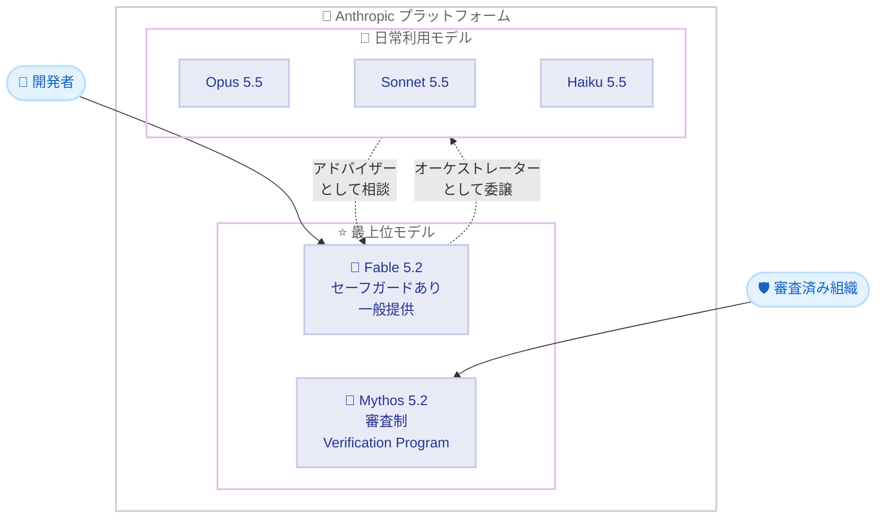

# Claude Fable 5.2 / Claude Mythos 5.2 発表: 高度な技術作業向け最上位モデルがコーディング・金融・科学で新基準を確立

## メタデータ

| 項目 | 内容 |
|------|------|
| 発表日 | 2026-11-09 |
| ソース | Anthropic News / Claude API リリースノート |
| カテゴリ | モデルリリース |
| 公式リンク | https://www.anthropic.com/claude-fable-and-mythos-5-2 |

## 概要

Anthropic は 2026 年 11 月 9 日、最上位モデルとなる **Claude Fable 5.2** と **Claude Mythos 5.2** を発表しました。両モデルは同一の基盤モデルであり、Fable 5.2 にはサイバーセキュリティおよび生物学分野のセーフガードが追加され、一般提供が可能になっています。一方、セーフガードを緩和した Mythos 5.2 は、Life Sciences Verification Program または Cyber Verification Program による審査を通過した組織のみが利用できます。

Anthropic は、日常的な用途には Opus 5.5 を推奨しつつ、最も野心的でオープンエンドな技術作業には Fable 5.2 / Mythos 5.2 へのスケールアップを提案しています。出力速度は Fable / Mythos 5.1 比で最大 30% 高速化され、価格は入力 $8/MTok・出力 $40/MTok と前バージョンより値下げされました。

## 詳細

### 背景

Fable / Mythos シリーズは、Opus・Sonnet・Haiku の上位に位置する最上位モデルラインです。Fable 5.2 は、小型モデルから相談を受ける「アドバイザー」として、あるいは小型モデルへ作業を委譲する「オーケストレーター」として機能できる設計になっています。

プレリリース段階では、以下のような成果が公式発表で報告されています。

- 実現不可能とされていたソフトウェア移行の完了
- 3 種類の動作する電子デバイスをゼロから設計
- ブラックホール物理学の未解決問題 2 件を解決
- フェルマーの最終定理の形式化を 30 時間で完了

### モデル仕様と価格

| 項目 | 値 |
|------|-----|
| モデル ID | `claude-fable-5-2` / `claude-mythos-5-2` |
| コンテキストウィンドウ | 1M トークン |
| 最大出力 | 128k トークン |
| 思考モード | 常時適応思考 |
| 入力価格 | $8 / 100 万トークン |
| 出力価格 | $40 / 100 万トークン |
| ファストモード価格 | 入力 $16 / 出力 $80 (100 万トークンあたり) |

価格は 5.1 からの値下げとなります (API リリースノートによる)。

### 主要ベンチマーク結果

公式発表によると、Fable 5.2 は主要ベンチマークで前バージョンおよび競合モデルを上回っています。

| ベンチマーク | Fable 5.2 | Fable 5.1 | Opus 5.5 |
|-------------|-----------|-----------|----------|
| FrontierCode 2.0 (エージェントコーディング) | 49.1% | 32.4% | 45.5% |
| FrontierSWE v2 | 69.9% | 56.3% | 62.3% |
| Terminal-Bench-Science 0.1 | 74.6% | 52.6% | 58.7% |
| OSWorld 2.1 (オフライン・部分) | 89.3% | 83.5% | 87.2% |
| Humanity's Last Exam (ツールあり) | 74.2% | 65.6% | 67.7% |
| Remote Labor Index | 41.3% | 17.9% | 21.3% |

コスト効率も改善されており、FrontierCode 2.0 では High 推論努力設定で 45.3% を達成し、タスクあたりのコストは Opus 5.5 の約半分です。Humanity's Last Exam では Low 設定で Opus 5.5 の最高スコアに並び、コストは 10 分の 1 未満とされています。

Mythos 5.2 はサイバーセキュリティ分野でさらに高い性能を示します。

- **CyScenarioBench**: 76.3% (Mythos 5.1 は 61.7%)
- **CVE Rediscovery**: 89.6% (Mythos 5.1 は 78.3%)。2026 年 10 月の実行では 1,829 件の CVE を対象とし、Opus 5.5 比で 10.2% 多く脆弱性を発見

### 特筆すべき成果

**コーディング**: Anthropic のコアコードベースへのマージの 90% 以上が、人間のガイダンスのもと Claude によって書かれています。実験では、1,000 以上のサブエージェントを 8 日間協調させ、カーネルレベルの機能・ドライバー・ファイルストレージ・ウィンドウシステムを備えた起動可能なプロトタイプ OS を構築しました。

**科学**: Mythos 5.2 はオープンソースのタンパク質フォールディングモデルを活用した新手法を考案し、34 個の AAV カプシドのうち 28 個を正確にモデル化 (Cα RMSD 3 Å 以内) しました。また、ホログラフィック双対性を用いてブラックホール物理学の未解決問題 2 件を解決し、プレプリントが公開されています。

**数学**: 1,000 個の Fable 5.2 エージェントがフェルマーの最終定理の形式化を 30 時間で完了しました (従来は 11 日間)。アクショントークンは 3 分の 1、証明は 7 分の 1 の長さです。

**ハードウェア**: 1 段落のプロンプトから、4 層 PCB・3D プリント筐体・ソフトウェアを含む 3 種類の動作デバイスを設計し、いずれも電気的な修正なしで動作しました。

### API に関する重要な変更点

API リリースノート (2026-11-09) で確認された変更点は以下のとおりです。

- **プレフィックスチェックの強制**: 両モデルは全アカウントでプレフィックスチェックを強制します。system・tools・過去メッセージを編集した後に thinking ブロックを返送すると 400 エラーになります
- **会話移行時の推論保持**: Claude API と Google Cloud (Google managed) では、Fable 5.2 / Mythos 5.2 への会話移行時に他モデルの推論が保持されます。逆方向の移行では thinking ブロックは破棄されますが、リクエストは成功します
- **コンピュータ使用ツールセット**: `computer_toolset_20260801` のみ対応。旧 `computer_20251124` は Bedrock 以外で 400 エラーになります
- **アドバイザーツール (ベータ)**: executor がアドバイザーとして受け付けるのは同 2 モデルのみです。他モデルを指定すると 400 エラーになります
- **データ保持**: 両モデルは 30 日間のデータ保持が必須です。Anthropic の明示的な許可なしにはゼロデータ保持 (ZDR) では利用できません
- **thinking ブロックの有効範囲**: 生成元アカウント (またはリンクされたアカウント) でのみ有効です
- **ファストモード**: Fable 5.2 で提供開始。最大 2.5 倍の出力速度で、リクエストに `speed: "fast"` を指定します (ベータヘッダー不要)

### 安全性とセーフガード

公式発表では、安全性に関する以下の内容が報告されています。

- 約 1,900 シナリオの自動行動監査で、Mythos 5.2 は 2.67 (低いほど良好) を記録し、Opus 5.5 (2.79) や Mythos 5.1 (3.28) を上回りました
- サンドボックス脱出の敵対的評価 (1,800 以上のシナリオ) では、脱出率 3.1% と Mythos 5.1 の 21% から大幅に改善
- Fable 5.2 のブロック数は Fable 5.1 比で約 55% 減少 (サイバー分野で約 60% 減、生物学分野で約 40% 減)。ブロックされたクエリは Opus 4.8 (サイバー) または Opus 5 (生物学) にフォールバックします
- 蒸留対策はこれまでで最も強力で、収集データを 90 - 99% 削減。preserved thinking は全 API アカウントに適用されます
- 外部プレリリーステストは UK AI Security Institute、Frontier Design、METR が実施

## 開発者への影響

### 対象

- 大規模・長時間のエージェントコーディングや研究タスクに取り組む開発者
- サイバーセキュリティ・ライフサイエンス分野の組織 (Mythos 5.2 は Verification Program の審査が必要)
- マルチエージェント構成でオーケストレーターやアドバイザーを必要とするシステム設計者

### 必要なアクション

- **thinking ブロックの取り扱いを確認**: system・tools・過去メッセージの編集後に thinking ブロックを返送する実装は 400 エラーになるため、会話履歴の管理ロジックを見直す必要があります
- **コンピュータ使用の移行**: `computer_20251124` を使用している場合、Bedrock 以外では `computer_toolset_20260801` への移行が必要です
- **ZDR 利用者の確認**: ゼロデータ保持契約のアカウントは、Anthropic の明示的な許可がない限り両モデルを利用できません
- **モデル間移行の方向性に注意**: 他モデルから Fable 5.2 / Mythos 5.2 への移行では推論が保持されますが、逆方向では thinking ブロックが破棄されます

### 利用可能なプラットフォーム

- **Fable 5.2**: Claude Platform、AWS、Google Cloud、Microsoft Azure で本日から利用可能
- **Mythos 5.2**: Cyber Verification Program または Life Sciences Verification Program 経由。Enterprise 向け Claude Security にも搭載
- **ファストモード**: Claude Code、Claude Platform、Google Cloud (Anthropic 管理・Google 管理)、Microsoft Foundry (Anthropic ホスト) で提供。Mythos のファストモードは Verification Program メンバー限定
- **サブスクリプション**: Pro および標準 Team シートでは、週次上限の最大 50% まで Fable を利用可能。契約期間に応じて 1 - 3 回の Fable 使用量リセットが提供される記念プロモーションあり

## コード例

```python
import anthropic

client = anthropic.Anthropic()

# ファストモードを指定したリクエスト (ベータヘッダー不要)
message = client.messages.create(
    model="claude-fable-5-2",
    max_tokens=128000,
    speed="fast",
    messages=[
        {
            "role": "user",
            "content": "大規模コードベースの Python から Rust への移行計画を作成してください。",
        }
    ],
)
print(message.content)
```

## アーキテクチャ



## 関連リンク

- [公式発表: Claude Fable 5.2 and Claude Mythos 5.2](https://www.anthropic.com/claude-fable-and-mythos-5-2)
- [Claude API リリースノート](https://platform.claude.com/docs/en/release-notes/overview)
- [Claude API ドキュメント](https://platform.claude.com/docs)

## まとめ

Claude Fable 5.2 と Claude Mythos 5.2 は、コーディング・金融・科学分野で新基準を打ち立てる Anthropic の最上位モデルです。前バージョンから大幅な性能向上と値下げ (入力 $8/MTok・出力 $40/MTok) を同時に実現し、ファストモードによる最大 2.5 倍の高速出力オプションも追加されました。一方で、プレフィックスチェックの強制、30 日間のデータ保持必須、コンピュータ使用ツールセットの刷新など、既存実装に影響する API 変更も含まれるため、導入前に移行要件の確認が必要です。
