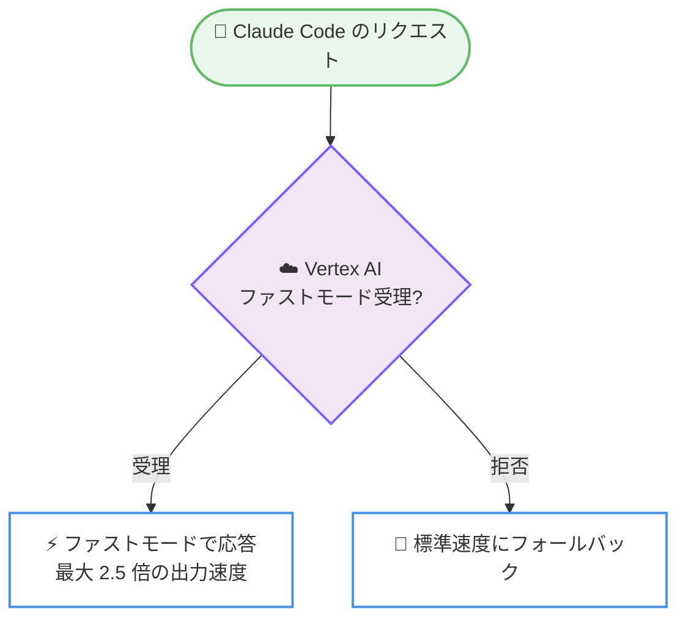

# Claude Code v2.1.322 リリース

## メタデータ

| 項目 | 内容 |
|------|------|
| 発表日 | 2026-11-10 |
| ソース | Claude Code Changelog |
| カテゴリ | Claude Code / CLI アップデート |
| 公式リンク | https://github.com/anthropics/claude-code/blob/main/CHANGELOG.md |

## 概要

Claude Code v2.1.322 がリリースされた。本リリースの変更は 1 件のみで、Google Cloud Vertex AI の global、us、eu の各リージョンでファストモードが利用できるようになった。Vertex 側がファストモードのリクエストを拒否した場合は、標準速度に自動的にフォールバックする。

## 詳細

### 背景

ファストモードは、2026-11-09 に提供が開始された Claude Fable 5.2 向けの高速推論オプションで、最大 2.5 倍の出力速度を実現する。料金は入力 $16/MTok、出力 $80/MTok である。これまでの提供経路に加え、本リリースにより Vertex AI 経由で Claude Code を利用する環境でもファストモードを選択できるようになった。

### 主な変更点

- **Vertex AI でのファストモード対応**: Vertex AI の global、us、eu リージョンでファストモードが追加された
- **自動フォールバック**: Vertex がファストモードを拒否した場合、リクエストは標準速度にフォールバックして処理が継続される

### 動作イメージ

## 開発者への影響

### 対象

- Vertex AI 経由で Claude Code を利用する開発者・組織
- 応答速度を重視するワークフロー (対話的なコーディングセッションなど) を運用するユーザー

### 必要なアクション

- Vertex AI の global、us、eu リージョンを利用している場合、ファストモードの利用を検討する
- Vertex が拒否した場合は標準速度に自動フォールバックするため、既存ワークフローへの破壊的な影響はない。ただし、ファストモードは標準より高い料金 (入力 $16/MTok、出力 $80/MTok) が適用されるため、コストへの影響を事前に確認する

## 関連リンク

- [Claude Code Changelog](https://github.com/anthropics/claude-code/blob/main/CHANGELOG.md)
- [Claude Code リポジトリ](https://github.com/anthropics/claude-code)
- [Claude Code ドキュメント](https://code.claude.com/docs)

## まとめ

Claude Code v2.1.322 は、Vertex AI の global、us、eu リージョンでファストモードを利用可能にする単一変更のリリースである。前日 (2026-11-09) に提供が開始された Claude Fable 5.2 のファストモード (最大 2.5 倍の出力速度) を Vertex AI 経由の環境にも広げるもので、拒否時には標準速度へ自動フォールバックするため安全に導入できる。Vertex AI 上で Claude Code を運用し、応答速度を改善したい組織に関係するアップデートである。
