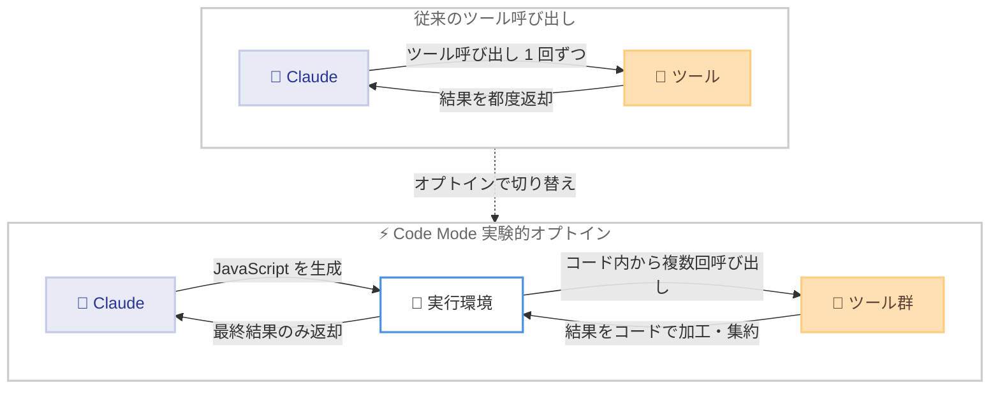

# Claude Code v2.1.323 リリース: 実験的機能 Code Mode の導入と大規模なセキュリティ強化

## メタデータ

| 項目 | 内容 |
|------|------|
| 発表日 | 2026-11-12 |
| ソース | Claude Code Changelog |
| カテゴリ | Claude Code / CLI アップデート |
| 公式リンク | https://github.com/anthropics/claude-code/blob/main/CHANGELOG.md |

## 概要

Claude Code v2.1.323 が 2026 年 11 月 12 日に npm で公開された。約 300 項目に及ぶ大型リリースであり、目玉は実験的なオプトイン機能である **Code Mode** の追加。Code Mode を有効にすると、Claude が JavaScript コードを書いてツールを呼び出すようになり、複数のツール呼び出しをプログラムとして組み合わせられる。

このほか、プラグインエコシステムの強化 (`plugin.json` の `engines["claude-code"]` によるバージョン範囲指定、`claude plugin validate` の TypeScript フック型チェック)、Bash 権限チェックやサンドボックスに関する多数のセキュリティ修正、認証・サインイン周りの安定性改善が含まれる。日常的に Claude Code を利用する開発者だけでなく、プラグイン開発者や組織の管理者にも影響の大きいリリースとなっている。

## 詳細

### 背景

Claude Code は近年、プラグイン、サンドボックス、Remote Control、クラウドセッションなど実行環境が多様化しており、それに伴い権限チェックや認証まわりの堅牢性が重要になっている。v2.1.323 はこうした基盤部分の修正を大量に取り込みつつ、ツール呼び出しの新しいパラダイムである Code Mode を実験的に導入するリリースである。

### 主な変更点

#### 1. 新機能: Code Mode (実験的・オプトイン)

Claude が JavaScript を書いてツールを呼び出す実験的機能が追加された。従来はツールを 1 回ずつ個別に呼び出していたが、Code Mode ではループや条件分岐を含むコードとして複数のツール呼び出しをまとめて記述・実行できる。有効化の手順、および組織単位で無効化する方法は公式ドキュメント (https://code.claude.com/docs/en/code-mode) に記載されている。

#### 2. プラグイン開発者向けの機能強化

- **`engines["claude-code"]` の追加**: `plugin.json` で対応する Claude Code のバージョン範囲を宣言できる。範囲外のプラグインはインストール・更新・ロードされず、インストールと更新は範囲に収まる最新バージョンを選択する
- **TypeScript フックの型チェック**: `claude plugin validate` がプラグインの TypeScript フックモジュールを型チェックする。各検出結果は警告として報告され、`--strict` 指定時は失敗扱いになる
- **mod の `engine.create` フック検証**: フックが追加・差し替え・保留する `$` ノウンの検証が `claude plugin validate` に追加された。また、`engine.create` を `*` や名前空間、否定でフックした場合は観測のみとなり、`$` ノウンを操作するには名前でフックする必要がある
- `claude plugin install --json` の結果に未設定の `userConfig` オプション数を示す `unsetOptionCount` が追加された
- プラグインの `agent` 設定が非推奨になった (引き続き適用されるが、起動時や `claude plugin validate` で警告が表示される)

#### 3. セキュリティ・権限関連の修正

Bash 権限チェックとサンドボックスに関して、権限プロンプトの迂回を防ぐ修正が多数含まれる。

- `Bash(ls*)` のような接尾ワイルドカード付き allow ルールが一部のケースで権限プロンプトを省略していた問題を修正。変数名を含む `Bash(NODE_ENV*)` のようなルールは確認を求めるようになった
- `sudo` や `env` などのラッパー経由で実行されるコマンドを deny / ask ルールが見逃す問題を修正
- Bash 権限チェックがコマンドの一部を見逃すケース、誤ったフォルダを基準に `rm` を判定して危険な削除のプロンプトを省略するケースを修正
- Write / Edit ツールが `Read` の deny ルールの対象パスへ書き込めるケースを修正
- セッション中に Bash サンドボックスが無効化され得るケース、`sandbox.excludedCommands` が名指ししていないコマンドをサンドボックス外で実行させ得るケースを修正
- サンドボックス化されたコマンドが Claude Code のファイルチェックポイントコピーを読み取れた問題を修正
- macOS / Linux / WSL のサンドボックスで、書き込み可能フォルダ内のシンボリックリンク経由で別の場所への書き込み権限が付与される挙動を無効化 (実パスへの付与が必要になった)
- 「今後確認しない」で保存されるルールのうち、シークレットを含むように見えるもの、または git 管理下の `settings.local.json` に保存されるものは、セッション限りとなり保存されなくなった
- `plansDirectory` 設定時にプランファイルがプロジェクト外へ書き込まれることがあった問題を修正。プロジェクト内に留まると確認できない書き込みは拒否される
- `--permission-mode auto` が利用不可時に、より多くを許可し得るモードで開始していた問題を修正 (現在は確認を求める Manual モードで開始)

#### 4. 認証・サインイン関連の修正

バックグラウンドセッションやマルチプロファイル環境でのサインイン混在を防ぐ修正が多数含まれる。

- 名前付き Anthropic プロファイル上のセッションが `/fork` や `--bg` でバックグラウンド継続された際に別のサインインへ移る問題を修正
- プロファイルが欠落・変更・上書きされた状態のバックグラウンドセッションが別のサインインで会話を送信する問題を修正 (現在は停止してその旨を表示)
- バックグラウンドセッションのサインインが前のアカウントの資格情報を残す問題を修正
- MCP ツール呼び出しが `TOKEN_EXPIRED` などのエラーで終了する代わりに、再サインインを求めるようになった
- macOS でキーチェーンの応答が遅い場合に、`/login` 成功直後に「Not logged in」が再表示される問題を修正
- `/login` と `claude setup-token` のサインインエラーが、何が起きたか・何を確認すべきかを示すようになった

#### 5. 安定性・パフォーマンスの改善

- 非常に大きなファイルの変更後、次のプロンプトでメモリが急増する問題を修正
- Edit / Bash が特定の `/proc` ファイルやデバイス、名前付きパイプでメモリ不足やハングを起こす問題を修正
- `/compact` の再実行時に、Claude が未応答のメッセージが要約で失われる問題を修正
- 多数のサブエージェント使用時のメモリ使用量を改善 (完了したサブエージェントのトランスクリプトを早期に解放)
- WebFetch の速度とメモリ使用量を深い入れ子構造のページで改善

#### 6. 挙動の変更 (注意が必要なもの)

- 未知のモデル ID に対して想定するコンテキストウィンドウが 200K から 1M に変更された。200K を維持するには `CLAUDE_CODE_DISABLE_1M_CONTEXT=1` を設定する
- `/security-review` の実行前に確認を求めるようになった
- 同一マシン上のセッション間で送信できるメッセージ数の上限が約 20 から 100,000 に拡大された
- v1 MCP クライアントが削除され、`MCP_SDK_GENERATION=v1` は v2 クライアントの互換モードとして動作する
- Claude Code 自身の ripgrep と内部 git コマンドの多くが、サインイントークンや API キーなしで実行されるようになった (資格情報ヘルパーやフックからの漏えいを防止)

### 技術的な詳細

#### Code Mode の仕組み

従来のツール呼び出しでは、Claude がツールを 1 回呼び出すたびにモデルとの往復が発生する。Code Mode では Claude が JavaScript コードを生成し、そのコード内から複数のツールを呼び出すため、ループ処理や中間結果の加工をコード側で完結できる。



#### plugin.json のバージョン範囲指定

プラグインが対応する Claude Code のバージョン範囲を `engines["claude-code"]` で宣言できる。

```json
{
  "name": "my-plugin",
  "version": "1.2.0",
  "engines": {
    "claude-code": ">=2.1.323"
  }
}
```

範囲外の環境ではプラグインはインストール・更新・ロードされず、インストールと更新は範囲に収まる最新バージョンを自動的に選択する。npm の `engines` フィールドに似たセマンティクスで、プラグインの互換性を宣言的に管理できる。

## 開発者への影響

### 対象

- **Claude Code を日常利用する開発者**: Code Mode の試用、権限プロンプト挙動の変化
- **プラグイン開発者**: `engines` フィールドの宣言、TypeScript フックの型チェック、`agent` 設定の非推奨化への対応
- **組織の管理者**: Code Mode の組織単位での有効化・無効化、セキュリティ修正の適用
- **他ベンダーモデルや API ゲートウェイの利用者**: コンテキストウィンドウの既定値変更

### 必要なアクション

1. **アップデートの適用**: セキュリティ修正が多数含まれるため、早期の更新を推奨
2. **Code Mode の検討**: 試す場合は公式ドキュメント (https://code.claude.com/docs/en/code-mode) で有効化手順を確認する。組織で無効化したい場合の手順も同ドキュメントに記載されている
3. **プラグインの対応**: `plugin.json` に `engines["claude-code"]` を追加して互換範囲を宣言し、`claude plugin validate --strict` で TypeScript フックの型エラーを確認する
4. **権限ルールの見直し**: `Bash(ls*)` のような接尾ワイルドカードや変数名を含む allow ルールの挙動が変わったため、保存済みルールが期待どおりに動作するか確認する
5. **小さいコンテキストウィンドウのモデル利用時**: 他ベンダーのモデルなど、1M 未満のウィンドウを持つ未知のモデル ID を使う場合は `CLAUDE_CODE_DISABLE_1M_CONTEXT=1` の設定を検討する

### 移行ガイド (該当する場合)

- **v1 MCP クライアント利用者**: v1 クライアントは削除された。`MCP_SDK_GENERATION=v1` は v2 クライアントの互換モード (早期ハンドシェイク、緩和された OAuth チェック) として動作するため、動作確認のうえ通常の v2 への移行を推奨
- **プラグインの `agent` 設定利用者**: 非推奨となり警告が表示される。引き続き適用はされるが、将来の削除に備えて移行を検討する
- **`subagentStatusLine` 設定の利用者**: 設定は削除された。キーが残っていてもエラーにはならず、サブエージェント行は既定の表示になる

## 関連リンク

- [Claude Code Changelog](https://github.com/anthropics/claude-code/blob/main/CHANGELOG.md)
- [Code Mode ドキュメント](https://code.claude.com/docs/en/code-mode)
- [Claude Code 公式ドキュメント](https://code.claude.com/docs)
- [claude-code リポジトリ](https://github.com/anthropics/claude-code)

## まとめ

Claude Code v2.1.323 は、ツール呼び出しの新パラダイムとなり得る Code Mode を実験的に導入しつつ、Bash 権限チェック・サンドボックス・認証まわりの大量の堅牢化を取り込んだ大型リリースである。プラグイン開発者には `engines` によるバージョン範囲指定と TypeScript フックの型チェックという実用的なツールが提供された。セキュリティ修正の比重が大きいため、すべての利用者に早期のアップデートを推奨する。Code Mode はオプトインの実験的機能であり、挙動の詳細は公式ドキュメントで確認したうえで試すことが望ましい。
