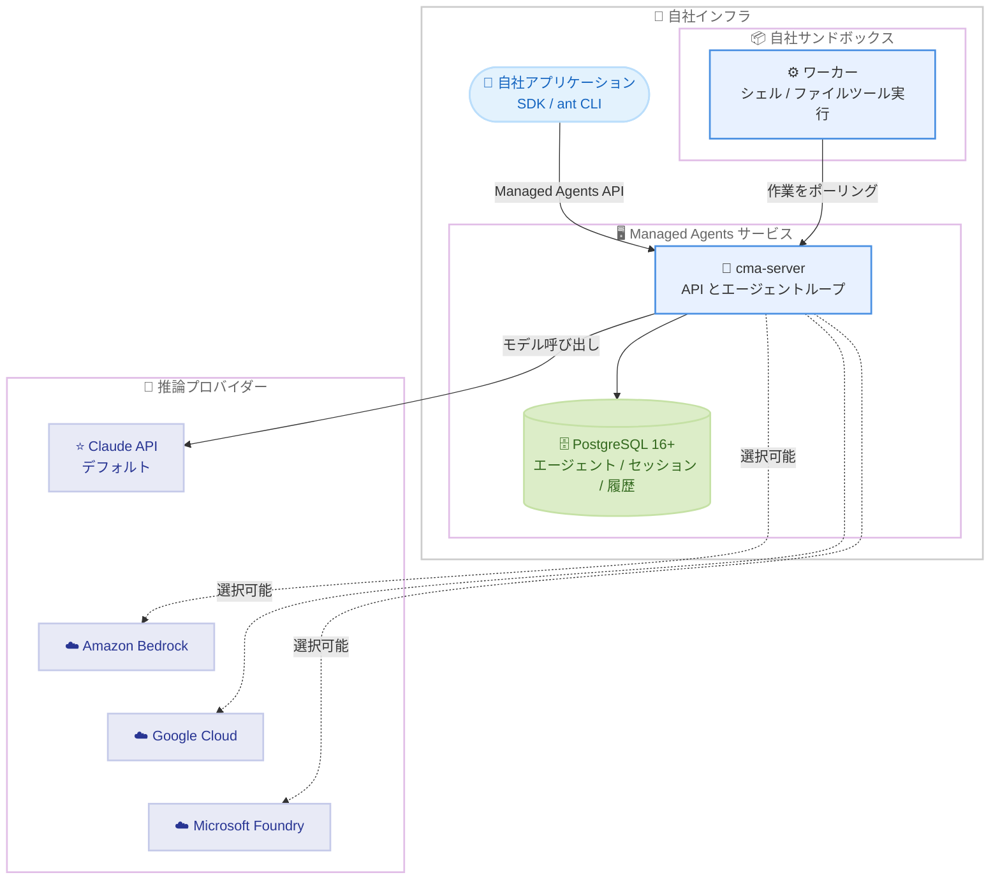

# セルフホスト型 Claude Managed Agents の提供開始

## メタデータ

| 項目 | 内容 |
|------|------|
| 発表日 | 2026-11-12 |
| ソース | Claude API リリースノート |
| カテゴリ | API / エージェント / エンタープライズ |
| 公式リンク | https://platform.claude.com/docs/en/release-notes/overview |

## 概要

Anthropic は、セルフホスト型 Claude Managed Agents の提供を開始した。これまでのセルフホスト型サンドボックス (ツール実行環境のみを自社ホスト) から拡張され、Managed Agents サービス全体 (API、エージェントループ、エージェント・セッション・セッション履歴の保存) を自社インフラ (クラウドアカウントまたはオンプレミスのデータセンター) で実行できるようになった。

モデルリクエストの送信先となる推論プロバイダーは選択可能で、デフォルトは Anthropic (Claude API) である。利用にはアクセス申請が必要で、Anthropic のアカウントチームへの連絡が求められる。

## 詳細

### 背景

Claude Managed Agents は、Claude を自律エージェントとして実行するサービスである。エージェントを定義し、セッションを開始し、エージェントの作業中にイベントをやり取りする仕組みを提供する。

ホスティングの選択肢は段階的に拡大してきた。公式ドキュメントによると、各オプションの構成は以下のとおり。

| オプション | サンドボックス | サービス | モデル |
|-----------|--------------|---------|--------|
| クラウドサンドボックス (デフォルト) | Anthropic | Anthropic | Anthropic |
| セルフホスト型サンドボックス | 自社 | Anthropic | Anthropic |
| セルフホスト型 Managed Agents | 自社 | 自社 | Anthropic または選択したプロバイダー |

今回の発表は、「サンドボックスのみ」のセルフホストから「サービス全体」のセルフホストへの拡張という位置づけである。

### 主な変更点

- **サービス全体の自社ホスト**: API、エージェントループ、エージェント・セッション・セッション履歴のストレージを自社インフラで実行できる
- **推論プロバイダーの選択**: モデル呼び出しの送信先として、Claude API (デフォルト) のほか、Amazon Bedrock、Claude Models on Google Cloud、Microsoft Foundry、自社のモデルゲートウェイを選択できる
- **既存の API との互換性**: 自社サーバーはホステッドサービスと同じ API を持つため、SDK と `ant` CLI がそのまま利用できる (一部の機能差分は公式ドキュメントの「Differences from the hosted service」に記載)
- **アクセス申請制**: ダウンロードへのアクセスには Anthropic アカウントチームへの連絡が必要

### 技術的な詳細

1 つのデプロイメントは、1 台以上のサーバー、そのデータベース、自社のサンドボックスで構成される。公式ドキュメントに記載されている主なコンポーネントは以下のとおり。

- **サーバー (`cma-server`)**: API の提供、エージェントループの実行、エージェント・セッション・履歴の保存を担う。エージェントがモデルを必要とするたびに、設定された推論プロバイダーを呼び出す。サーバー自体はエージェントのシェルツールやファイルツールを実行しない
- **データベース**: PostgreSQL 16 以降。データベースなしの場合、サーバーはデータをメモリ上に保持し、再起動でデータは消去される
- **ワーカー**: サーバーから作業を取得し、エージェントのシェルツールとファイルツールを自社サンドボックス内で実行するプログラム。`ant beta:worker` コマンドまたは SDK ワーカーとして動作する
- **コンソール**: サーバーのアドレスで提供される Web ページ。自社の ID プロバイダー経由でサインインし、エージェントの作成やセッションの実行ができる
- **管理 CLI (`cma-server-admin`)**: 環境と環境キーを作成する。Linux (x86-64 および Arm) と Apple シリコン搭載 macOS で動作する

認証には 3 種類のクレデンシャルが使用される。

| クレデンシャル | 保持者 | 認証対象 |
|--------------|--------|---------|
| サーバー API キー | 自社アプリケーション、`ant` CLI、管理 CLI | 自社サーバーへのリクエスト |
| 推論クレデンシャル | サーバー | 推論プロバイダーへのモデル呼び出し |
| 環境キー | サーバーをポーリングするワーカー | 環境の作業キューとセッション |

**ネットワーク外に出るデータ**: モデル呼び出しごとに、サーバーはツール入力・ツール結果を含むそれまでの会話を推論プロバイダーに送信する。Claude API への呼び出しには、セッション、エージェント、環境の ID も含まれる。

**セキュリティ上の注意**: エージェントの `bash` ツールはワーカープロセスの権限とネットワークアクセスを持つ実際のシェルであり、ワーカー自体はシェルを分離しない。分離は実行環境 (コンテナや VM) に依存する。ホステッドサービスで Anthropic が担っていたサーバーの保護、メモリストアのホスティング、異常利用の検知などは、自社の責任範囲となる。

## 開発者への影響

### 対象

- エージェント、セッション、セッション履歴を自社インフラに保存する必要がある組織
- モデル呼び出しを Amazon Bedrock、Claude Models on Google Cloud、Microsoft Foundry、自社モデルゲートウェイに送信する必要がある組織
- オンプレミスやデータレジデンシーの要件を持つエンタープライズ

一方、ツール実行のみを自社インフラで行いたい場合は、Anthropic がサービスを運用するセルフホスト型サンドボックスが引き続き推奨される。

### 必要なアクション

1. **アクセス申請**: Anthropic アカウントチームに連絡し、ダウンロードへのアクセスを申請する
2. **クイックスタートの実施**: 公式の「Get started with self-hosted Claude Managed Agents」に従ってサーバーを起動し、最初のセッションを実行する
3. **運用体制の整備**: サーバー、データベース (PostgreSQL 16 以降)、サンドボックスの運用とセキュリティ確保、各リリースのインストールを自社で行う
4. **機能差分の確認**: 一部の機能はホステッドサービスのみで提供されるため、導入前に「Differences from the hosted service」を確認する
5. **ライセンスの確認**: サーバーソフトウェアは「Software License Agreement: Claude Managed Agents Server」に基づいてライセンスされる

### 移行ガイド (該当する場合)

自社サーバーはホステッドサービスと同じ API を持つため、既存の SDK や `ant` CLI を使用するコードは自社サーバーに対してもそのまま動作する。なお、各リリースのアーカイブにはそのバージョンのオペレーターガイド (`operator-guide.md`) が含まれており、サーバーの設定・運用や接続コードの作成に Claude を活用できるとされている。

## アーキテクチャ図

## 関連リンク

- [Claude API リリースノート (出典)](https://platform.claude.com/docs/en/release-notes/overview)
- [Self-hosted Claude Managed Agents](https://platform.claude.com/docs/en/managed-agents/self-hosted)
- [Self-hosted sandboxes](https://platform.claude.com/docs/en/managed-agents/self-hosted-sandboxes)
- [Get started with self-hosted Claude Managed Agents](https://platform.claude.com/docs/en/managed-agents/self-hosted/quickstart)
- [Inference provider](https://platform.claude.com/docs/en/managed-agents/self-hosted/inference-provider)
- [Differences from the hosted service](https://platform.claude.com/docs/en/managed-agents/self-hosted/differences)
- [Data and access in self-hosted Claude Managed Agents](https://platform.claude.com/docs/en/managed-agents/self-hosted-data-and-access)
- [Software License Agreement: Claude Managed Agents Server](https://www.anthropic.com/legal/self-hosted-managed-agents-license)

## まとめ

セルフホスト型 Claude Managed Agents の提供開始により、Managed Agents のホスティング選択肢は「クラウドサンドボックス」「セルフホスト型サンドボックス」に加えて「サービス全体のセルフホスト」まで拡大した。エージェントデータの自社保存や推論プロバイダーの選択 (Amazon Bedrock、Google Cloud、Microsoft Foundry、自社ゲートウェイ) が可能になり、データレジデンシーやコンプライアンス要件の厳しいエンタープライズでも Managed Agents を採用しやすくなった。一方で、サーバー・データベース・サンドボックスの運用とセキュリティは自社の責任となるため、導入時にはホステッドサービスとの機能差分と運用体制の確認が重要である。利用を希望する場合は、Anthropic アカウントチームへの連絡が必要となる。
