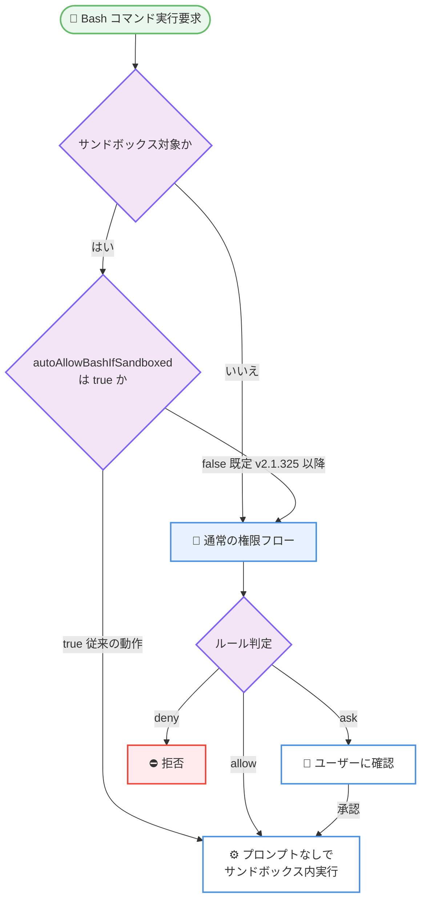

# Claude Code v2.1.325 リリース: サンドボックス動作の既定値変更を含む大規模メンテナンスリリース

## メタデータ

| 項目 | 内容 |
|------|------|
| 発表日 | 2026-11-13 |
| ソース | Claude Code Changelog |
| カテゴリ | Claude Code / CLI アップデート |
| 公式リンク | https://github.com/anthropics/claude-code/blob/main/CHANGELOG.md |

## 概要

Claude Code v2.1.325 が 2026 年 11 月 13 日に公開された。約 140 項目に及ぶ大規模なメンテナンスリリースであり、新機能の追加よりもセキュリティ修正と挙動の堅牢化に重点が置かれている。

特に注目すべきは**サンドボックス化された Bash コマンドの既定動作の変更**である。これまでサンドボックス内のコマンドはプロンプトなしで実行されていたが、本バージョンからは既定で通常の権限フローに従うようになった。従来の動作を維持するには `sandbox.autoAllowBashIfSandboxed: true` の設定が必要になる。このほか、zstd 圧縮レスポンスのデコードに関するセキュリティ修正、Bash 権限チェックのギャップ修正、MCP タスク・バックグラウンドタスクの多数の改善、VS Code 拡張へのプロンプトサジェスト追加などが含まれる。

## 詳細

### 背景

Claude Code はサンドボックス、プラグイン、バックグラウンドタスク、クラウドセッションなど実行形態が多様化しており、それぞれの境界での権限チェックや資格情報の扱いが安全性の要になっている。v2.1.325 は、こうした境界部分で見つかった権限プロンプトの迂回経路やサンドボックス保護の抜けを広範に修正するとともに、サンドボックスと権限フローの関係を「サンドボックス内でも既定では確認する」という、より保守的な方針へ変更するリリースである。

### 主な変更点

#### 1. セキュリティ修正

権限チェックとサンドボックス保護に関する修正が多数含まれる。

- **zstd 圧縮レスポンスのデコード**: zstd 圧縮されたレスポンスのデコード方法に関するセキュリティ問題を修正
- **Bash 権限チェックのギャップ**: 一部の複合コマンドが確認なしで実行され得たギャップを修正 (現在は権限を確認する)。また、Bash の allow ルールがルールの指す名前とは別のプログラムを実行し得たケースも修正
- **deny / ask ルールの適用漏れ**: 相対パスの deny / ask ルール (例: `Read(./.env)`) が `cd` 後にプロジェクトをカバーしなくなる問題、`mcp__plugin_*_` で始まるルールが大文字小文字の違いで一致しない問題、再起動後に届いた承認へ deny ルールが適用されない問題などを修正
- **サンドボックス保護の強化**: サンドボックス化されたコマンドがネイティブアップデーターのダウンロードフォルダへ書き込めたケース、Bash サンドボックスがワークツリーの設定・フック、およびリンクされたワークツリーの共有 git フォルダを完全に保護していなかったケースを修正
- **資格情報の分離**: サンドボックスが自身のために起動するプログラム (ネットワークブリッジなど) を、サインイントークンや API キーを環境に含めずに実行するよう変更。ripgrep やローカル git コマンドも mTLS クライアントキーのパスフレーズなしで実行される
- **設定ファイルの扱い**: リポジトリの特定サブフォルダで起動した際に、コミット済みの `.claude/settings.local.json` がユーザー自身のものとして扱われ得たケースを修正

#### 2. サンドボックス動作の変更 (重要)

本リリース最大の挙動変更として、**サンドボックス化された Bash コマンドが既定で通常の権限フローに従う**ようになった。

- プロンプトなしの実行を維持したい場合は `sandbox.autoAllowBashIfSandboxed: true` を設定する
- 管理対象設定 (managed settings) でサンドボックスを有効にしている組織は、最上位の管理ソースに同設定を追加する必要がある
- サンドボックスは、追加ディレクトリ内の `.claude` 配下 (設定、スキル、エージェント、コマンド、フック) へのサンドボックス内書き込みも、起動フォルダと同様に拒否するようになった
- クラウドセッション (Claude Code on the web、クラウドスケジュールタスク、Cowork) は `sandbox.failIfUnavailable` が設定されていても起動するようになった (ホストされたコンテナにはコマンドサンドボックスがないため)

#### 3. 権限・信頼まわりの変更

- **読み取り専用 git コマンド**: プロジェクト外の信頼していないリポジトリでは、読み取り専用の git コマンドでも確認を求めるようになった。プロンプトなしで実行するには `additionalDirectories` 設定ではなく `--add-dir` で指定する
- **スケジュールタスクと `/loop`**: `allowed-tools` やフックを宣言するスキルを実行する前に確認を求めるようになった。無人実行には `permissions.allow` に `Skill(name)` を追加する
- **「Always allow」の変更**: Desktop / IDE / SDK ホストでは、ルールの保存がそのコマンドの再実行を許可する場合にのみルール単体の選択肢が提示される
- **スラッシュコマンドの `allowed-tools`**: その許可がターン中・ターン後に起動したバックグラウンドエージェントへ波及していた問題を修正
- **アーティファクト関連**: 組織外に公開されるアーティファクトへの変更・アップロード・公開時に確認がスキップされ得た複数のケースを修正

#### 4. MCP タスク・バックグラウンドタスクの改善

- タスクがユーザーの回答待ちであることが Claude に伝わるようになり、`/tasks` へ誘導できるようになった
- バックグラウンド MCP タスクの質問に Esc を押すと「後で回答」となり、サーバーには何も送信されず質問は `/tasks` に残る
- 入力中のメッセージの上に質問が開かないようになった (送信またはクリアまで待機し、スピナーとターンタイマーは動き続ける)
- 質問を閉じた後にタスクがスタックする問題、同一サーバーへの別の呼び出しで接続が失われた後に更新が止まる問題を修正
- claude.ai ログインで開始したバックグラウンドセッションが、バックグラウンドサービスを起動したシェルの API キーやトークンを使用 (課金) していた問題を修正
- バックグラウンドでセッションが別のサインインへ移るケースがさらに修正され、こうした移動は拒否されるようになった

#### 5. プラグイン関連の変更

- プラグインの MCP バンドル (`.mcpb`、`.dxt`) はプラグインフォルダ内の `.mcpb-cache` ではなくプラグインディレクトリ配下に展開されるようになり、読み取り専用のプラグインフォルダでもロードできる
- 管理対象設定が `prependPlugins` / `appendPlugins` で宣言・有効化するリモートマーケットプレースのプラグインは組織のものとして扱われる。`pluginDigests` は非推奨となり無視される
- プラグインフォルダ内の一部の安全でないパスやリンクはロード時にスキップされ、`claude plugin validate` が報告する
- マーケットプレースの `ref` がブランチ・タグ上の任意のコミットの完全 ID を受け付けるようになった (旧バージョンのクライアントではこの形式のピンはロードできない)
- マーケットプレース追加の確認やプラグインインストールの警告が、プラグインはファイルとシェルへアクセスしてコードを実行できる旨を明示するようになった

#### 6. VS Code 拡張の改善

- **プロンプトサジェスト**: ターミナルと同様のプロンプトサジェストが追加され、Tab キーで次のプロンプト候補を受け入れられる。無効化は settings.json の `promptSuggestionEnabled: false`
- **API キーを作成しない Console サインイン**: キーレスの Console サインインが追加された
- SSH / WSL / コンテナウィンドウで MCP サーバーへサインインする際に、リダイレクト URL を貼り付けるフィールドが追加された
- モデルピッカーのチェックマークが古いモデルに残る問題、組織の effort 上限を超えるレベルが選択肢に出る問題、`allowedProviders` が拒否するサインインが表示される問題を修正

#### 7. そのほかの修正と改善

- サードパーティゲートウェイや Foundry 上のセッションが、コンパクションせずに毎ターンコンテキスト長エラーで停止する問題を修正
- 正常終了しなかったセッションを再開した際に直近のターンが失われることがある問題を修正
- 保存済みの `sonnet[1m]` モデル設定が、新規インストール時に API が拒否するモデル ID へ書き換えられる問題を修正
- Code Mode スクリプトが `EnterWorktree` で入ったワークツリーを無視する問題など、Code Mode 関連の複数の修正
- 出力トークン上限で打ち切られたサブエージェントは、末尾だけを返す代わりに、より簡潔に全体の回答を再度求められるようになった
- OpenTelemetry の `user_prompt` イベントの欠落・不完全なケースを修正 (ツール実行中に送られたメッセージは `delivery.mode: "mid_turn"` を持つ)
- Windows でのスタートアップの停滞、`/resume` のドライブレター大文字小文字の問題などプラットフォーム固有の修正

### 技術的な詳細

#### サンドボックスと権限フローの関係の変更

従来はサンドボックス内のコマンドは「サンドボックスで隔離されているため安全」とみなされ、権限プロンプトなしで実行されていた。v2.1.325 からは、サンドボックス化の有無にかかわらず通常の権限フロー (allow / ask / deny ルールと確認プロンプト) が適用されるのが既定となる。



#### 従来の動作を維持する設定例

サンドボックス内のコマンドをプロンプトなしで実行し続けたい場合は、settings.json に以下を追加する。管理対象設定でサンドボックスを有効化している組織では、最上位の管理ソースに設定する必要がある。

```json
{
  "sandbox": {
    "autoAllowBashIfSandboxed": true
  }
}
```

## 開発者への影響

### 対象

- **サンドボックスを有効にしている開発者・組織**: サンドボックス内コマンドが権限プロンプトを出すようになるため、既定動作の変更に直接影響を受ける
- **スケジュールタスクや `/loop` で自動実行している利用者**: スキル実行前の確認が追加されたため、無人実行には許可ルールの追加が必要
- **プラグイン開発者・マーケットプレース運営者**: `.mcpb` の展開先変更、`pluginDigests` の非推奨化、`ref` のコミット ID ピン指定への対応
- **VS Code 拡張の利用者**: プロンプトサジェストとキーレス Console サインインの追加
- **すべての利用者**: zstd デコードや Bash 権限チェックなどのセキュリティ修正

### 必要なアクション

1. **アップデートの適用**: セキュリティ修正が多数含まれるため、早期の更新を推奨
2. **サンドボックス設定の確認**: サンドボックス利用中に権限プロンプトが増えた場合、ワークフローを確認のうえ必要に応じて `sandbox.autoAllowBashIfSandboxed: true` を設定する。管理対象設定でサンドボックスを有効化している組織は、最上位の管理ソースへの設定追加を検討する
3. **自動実行タスクの見直し**: スケジュールタスクや `/loop` が `allowed-tools` やフック付きのスキルを使っている場合、`permissions.allow` に `Skill(name)` を追加して無人実行を維持する
4. **プロジェクト外リポジトリの指定方法の変更**: 信頼していないリポジトリで読み取り専用 git コマンドをプロンプトなしで実行するには、`additionalDirectories` 設定ではなく `--add-dir` で指定する
5. **Remote Control をサービスとして運用している場合**: `claude remote-control` の終了ステータスが変更された (自律停止で 4、登録不可で 69) ため、サービスマネージャーの再起動条件を確認する

### 移行ガイド (該当する場合)

- **`pluginDigests` 利用組織**: 非推奨となり無視される。`prependPlugins` / `appendPlugins` で宣言したリモートマーケットプレースのプラグインは組織のものとして扱われるため、そちらへ移行する
- **マーケットプレースをコミット ID でピンする場合**: v2.1.325 より前のクライアントではその形式のピンをクローンできず、マーケットプレースがロードされなくなる点に注意する
- **`--plugin-dir` プラグイン内の `.claude/skills` 利用者**: 上位ディレクトリで開始したセッションからはロードされなくなった。プラグインフォルダ内で Claude Code を起動する

## 関連リンク

- [Claude Code Changelog](https://github.com/anthropics/claude-code/blob/main/CHANGELOG.md)
- [v2.1.325 リリースページ](https://github.com/anthropics/claude-code/releases/tag/v2.1.325)
- [Claude Code 公式ドキュメント](https://code.claude.com/docs)
- [claude-code リポジトリ](https://github.com/anthropics/claude-code)

## まとめ

Claude Code v2.1.325 は、新機能よりも堅牢化に軸足を置いた大規模メンテナンスリリースである。最大の変更点はサンドボックス化された Bash コマンドが既定で通常の権限フローに従うようになったことで、サンドボックスを「権限確認の代替」ではなく「権限確認に加えた防御層」として扱う方針が明確になった。zstd デコードのセキュリティ修正や Bash 権限チェックのギャップ修正も含まれるため、すべての利用者に早期のアップデートを推奨する。サンドボックスや自動実行タスクを活用している環境では、プロンプト動作の変化に合わせた設定の見直しが必要になる。
