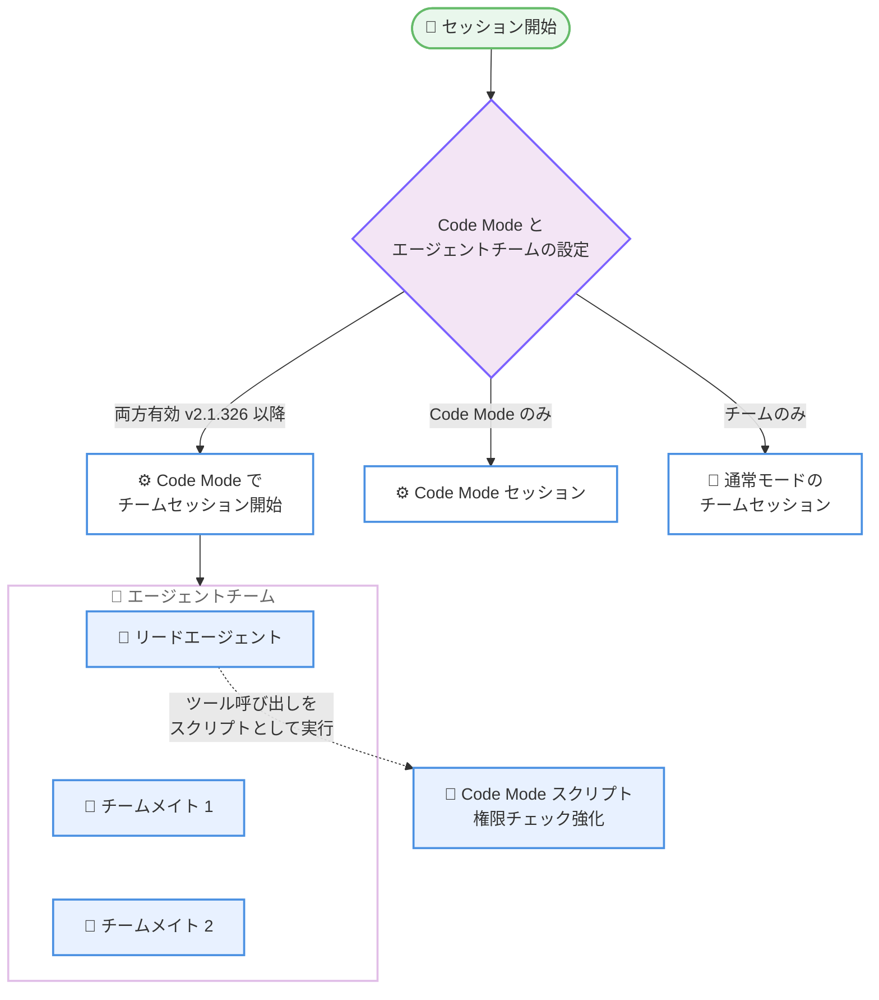

# Claude Code v2.1.326 リリース: Code Mode とエージェントチームの併用対応を含む約 370 項目の大規模アップデート

## メタデータ

| 項目 | 内容 |
|------|------|
| 発表日 | 2026-11-16 |
| ソース | Claude Code Changelog |
| カテゴリ | Claude Code / CLI アップデート |
| 公式リンク | https://github.com/anthropics/claude-code/blob/main/CHANGELOG.md |

## 概要

Claude Code v2.1.326 が 2026 年 11 月 16 日 (18:43 UTC) に npm で公開された。約 370 項目に及ぶ大規模リリースであり、新機能の追加、広範なバグ修正、権限・サンドボックスまわりの挙動変更が含まれる。

最大の新機能は **Code Mode とエージェントチームの併用対応**である。これまで両機能は同時に有効化できなかったが、本バージョンからエージェントチームを有効にしたまま Code Mode をオンにでき、すでに Code Mode を有効化済みの場合はチーム有効のセッションも Code Mode で開始されるようになった。このほか、`--allowedTools` などの不完全なルール値に対する起動時警告、プロバイダーや環境変数による機能無効化を表示する `/status` の新しい行、OpenTelemetry のホスト属性を追加する `OTEL_RESOURCE_INCLUDE_HOST`、Bash サンドボックス保護の強化 (macOS / Linux / WSL)、Monitor ツールの改善などが含まれる。また、組織ポリシー未ロード時や HIPAA 構成の組織でセッションが auto モードで開始されるようになるなど、既定動作の変更も多い。

## 詳細

### 背景

v2.1.325 ではサンドボックス化された Bash コマンドが既定で通常の権限フローに従うという大きな方針転換が行われた。v2.1.326 はその方向性を引き継ぎ、サンドボックスの書き込み範囲の縮小、サインイン資格情報ファイルの保護、bypass permissions モードでも確認を求めるケースの追加など、防御層をさらに厚くしている。同時に、Code Mode とエージェントチームという 2 つの主要機能の併用を解禁し、ターミナル UI・サインインフロー・MCP・バックグラウンドセッションにまたがる大量の品質改善を実施した。

### 主な変更点

#### 1. Code Mode とエージェントチームの併用 (新機能)

本リリースの目玉となる追加機能。

- エージェントチームを有効にしたまま Code Mode をオンにできるようになった
- すでに Code Mode を有効化済みのユーザーは、チーム有効のセッションが Code Mode で開始される
- 関連する修正も多数含まれる。auto モード下の Code Mode でインライン `!` コマンドが承認を要する場合にスキルやスラッシュコマンドのロードが失敗する問題、Code Mode で開始したバックグラウンドサブエージェントが `!` コマンド付きスキルのプリロードに失敗する問題、mod が `$.tool.call` / `$.tool.check` 経由で Bash や Read などのツールを使えない問題などが修正された
- Code Mode の権限チェックも強化され、サンドボックス化されたコマンドのうち確認または拒否されるものが増えた。Code Mode を有効化できない場合のメッセージも、対処方法を示すよう改善された
- Code Mode の `$` シェルヘルパーは一部の値をエラーで拒否するようになった (何も実行されない)

#### 2. 起動時・診断まわりの新機能

- **不完全なツールルールの警告**: `--allowedTools`、`--disallowedTools`、`--tools` の値に完全なルールに見えないエントリがある場合、起動時に警告が表示される
- **`/status` の機能無効化表示**: プロバイダーや `DISABLE_TELEMETRY` などの環境変数が機能をオフにしている場合、その旨を示す行が `/status` に追加された。オフになっているコマンドも「Unknown command」ではなく理由を表示するようになった
- **Ctrl+O で非表示の起動通知を表示**: 隠れていたスタートアップ通知を Ctrl+O で確認できる
- **`managed-mcp.json` の説明メッセージ**: セッション中に管理者が `managed-mcp.json` を追加した際、MCP サーバーのロードが停止する理由が説明されるようになった
- **`/doctor` の逐次報告**: 完全なレポートまで沈黙する代わりに、作業しながら所見を共有するようになった

#### 3. OpenTelemetry と mod の拡張

- **`OTEL_RESOURCE_INCLUDE_HOST`**: OpenTelemetry のリソース属性に `host.name` と `host.id` を含める環境変数が追加された (既定はオフ)
- **mod の表示制御**: mod の `Box` に `overflowX="scroll"`、`Text` に `maxLines` と `wrap="clip"` が追加された
- PreToolUse フックが直接のツール呼び出しを拒否した際に OpenTelemetry の `tool_decision` イベントや `permission_denials` エントリが残らない問題も修正された

#### 4. サンドボックスと権限の強化 (重要な挙動変更)

v2.1.325 に続き、サンドボックスと権限チェックが広範に強化された。

- **Bash サンドボックス保護の強化**: macOS / Linux / WSL でサンドボックス保護が改善された。サンドボックス化されたコマンドは一部の機密性の高いホームフォルダへ既定で書き込めなくなった (必要なものは `sandbox.filesystem.allowWrite` で許可可能)
- **サインイン資格情報の保護**: Claude のファイルツールは `.credentials.json` などのサインインファイルへの書き込みを拒否するようになり、Bash 権限チェックもサインインファイルに到達するコマンドをより多く確認するようになった
- **bypass permissions モードの制限**: bypass permissions モードでも一部のツール呼び出しは承認を求める、または誰も回答できない場面では拒否されるようになった
- **Bash / PowerShell の確認強化**: 一部のコマンドが実行前に確認を求める、または拒否されるようになった。非常に長い値を持ちチェックを完了できないコマンドや、一部の `cp` / `mv` コマンドも確認対象になった
- **環境変数設定行の確認**: auto-allow がオフの場合、環境変数を設定する一部の行の前にサンドボックスが確認を求めるようになった (無人実行では拒否され得る)
- **auto モードのワイルドカードルール**: プログラム名を含まない、または `$HOME` で始まるワイルドカード形式のシェル allow ルールは無視され、安全性チェックが判断するようになった
- **サンドボックス状態の保持**: Bash サンドボックスはセッション中、`/sandbox` または `/cd` を実行するまで状態を保持する場合があるようになった

#### 5. auto モードの既定値変更

- Claude Code + Cowork の HIPAA 構成を持つ組織では、ターミナルと VS Code のセッションが既定で auto モードで開始されるようになった (`disableAutoMode` でオフにできる)
- 組織ポリシーがロードされていない状態でモード未設定のセッションは、Manual モードではなく auto モードで開始されるようになった
- 既定で auto モードで開始したセッションは、設定ロード後にサーバー管理の `defaultMode` に従う

#### 6. Monitor ツールとバックグラウンド実行の改善

- **Monitor の改善**: 監視 (watch) がイベントなしで期限切れになった際、コマンドが stderr に出力していた場合はその旨と出力を保持するファイルが Claude に伝えられるようになった
- バックグラウンドセッションが、シェルのエクスポートした LLM ゲートウェイをクラッシュ後や別フォルダからの再オープン後に失う問題を修正 (現在はモデルリクエスト前に停止する)
- バックグラウンドサービスが、リスト上のプロセス番号を別ユーザーのプロセスが再利用した際に SSH ログインなど自身のプロセスを終了させてしまう問題を修正
- 20 を超えるサブエージェント実行時の CPU 使用率を改善 (トランスクリプトを開いていないバックグラウンドエージェントのトークンカウントは 5 秒ごとに更新)
- プロンプト下のエージェント行が、ターン終了後もビジー表示になる問題や、停止・失敗したエージェントが実行中に見える問題を修正

#### 7. カテゴリ別の修正の要約

修正は約 220 項目に及ぶ。主なカテゴリは以下のとおり。

- **権限・ルール関連**: `Edit` の deny ルールがソース側のみをカバーする場合に `cp` が拒否される問題、ファイルを削除・上書きする Bash コマンド (`find -delete`、`cat a > b`、`sort -o`) がトランスクリプトで検索や読み取りとして要約される問題、設定ファイルへ書き込めない場合にルールが保存されたように見える問題 (警告とファイル名を表示するようになった) など
- **サインイン・認証**: `/login` で Console サインインが Claude サブスクリプションのログインを置き換える問題、承認済み `ANTHROPIC_API_KEY` が使われ続けているのに「Login successful」で終わる問題、貼り付けたサインインコードが表示されない問題など多数。サインイン画面全体も、コード入力フィールドの改善や拒否理由の表示など大幅に改善された
- **MCP 関連**: 2 つの長い結果が同一ミリ秒に到着した際に並列 MCP ツール呼び出しが別の呼び出しの保存結果を読む競合、ツール検索が正確な名前指定で別サーバーのツールをロードする問題、類似名のサーバーが 2 つあると MCP プロンプトが消える問題、ローカル stdio サーバーの起動失敗理由が `/mcp` に表示されない問題など
- **セッション・会話の復元**: クラッシュ後の再開で直近ターンが失われる問題、メモリ不足時に過去の会話履歴が失われる問題、Bedrock / Vertex / Foundry でのコンパクションが要約の代わりに返信してしまう問題、画像の多いセッションが Vertex AI の 30 MB 制限の 400 エラーでスタックする問題 (コンパクションして再試行するようになった) など
- **Remote Control・クラウドセッション**: サーバーが一時的に利用不能なときにセッションが応答途中で切断される問題、短いターミナルで QR コードが切れる問題、プロキシが独自の HTTP 502 / 504 / 520 - 524 を返した際のファイルアップロード失敗 (再試行するようになった) など。`claude remote-control` などからの応答は、書かれると同時にスマートフォンやブラウザへストリーミングされるようになった
- **ターミナル UI・描画**: ストリーミング中の行落ちや画面ジャンプ、フルスクリーンモードの空白化・フリーズ、狭いターミナルでの表示崩れ、日本語・中国語・韓国語の返信で句読点に接する太字が生の `**` で表示される問題、絵文字やインド系文字での描画ずれなど非常に多数
- **プラットフォーム固有**: Linux でホームディレクトリが `/net` へのシンボリックリンク経由の場合にサンドボックスコマンドが起動に失敗する問題、Windows パスのバックスラッシュが応答から失われる問題、tmux 3.7 での全ペイン再描画など

#### 8. パフォーマンス改善

- 長いセッションでの入力・ストリーミング・リサイズの応答性を改善
- ファイルの読み取り・編集後の応答時間を改善 (特に Windows で顕著)
- アイドル時の CPU 使用率を改善 (アイドルセッションがマシンを起こす頻度が減少)
- Windows でセッション最初の Bash コマンドが約 1 秒高速化
- git リポジトリでの `/compact` 後の最初のメッセージの応答時間を改善
- `/update-config` のコンテキスト使用量を約 93,000 トークンから約 13,000 トークンへ削減

#### 9. VS Code 拡張の更新

- プロンプトサジェストをオフにする `claudeCode.promptSuggestions` 設定が追加された
- フォークした会話での「Rewind code to here」が 1 ターン余分に取り消し、そのターンで作成されたファイルを削除することがある問題を修正
- サンドボックスがオフの状態でサンドボックスダイアログがホームディレクトリやプロジェクトの `.git` フォルダに空のファイル・フォルダを作成する問題を修正
- 一部のネットワークで保存済みサインインが失われる問題、検証コードや別のサインイン試行のコードを貼り付けるとサインインが終了する問題を修正
- Edit / Write の速度を改善 (タブで開いていないファイルについて新しい problems を待たない)

### 技術的な詳細

#### Code Mode とエージェントチームの併用

Code Mode は Claude がツール呼び出しをスクリプトとして記述・実行するモードであり、エージェントチームは複数のエージェントが協調して作業する機能である。v2.1.326 からは両者を同時に有効化でき、チームの各セッションも Code Mode で動作する。



#### サンドボックスの書き込み許可設定

サンドボックス化されたコマンドは一部の機密性の高いホームフォルダへ既定で書き込めなくなった。必要なフォルダはユーザー設定または管理対象設定の `sandbox.filesystem.allowWrite` で許可できる。

```json
{
  "sandbox": {
    "filesystem": {
      "allowWrite": [
        "~/.cache/my-tool"
      ]
    }
  }
}
```

#### OpenTelemetry のホスト属性

複数マシンでのテレメトリー集計時にホストを識別したい場合、以下の環境変数を設定する。

```bash
export OTEL_RESOURCE_INCLUDE_HOST=1
```

これにより `host.name` と `host.id` がリソース属性に含まれる (既定はオフ)。

## 開発者への影響

### 対象

- **Code Mode とエージェントチームの利用者**: 併用が可能になり、Code Mode 有効化済みの場合はチームセッションの動作が変わる
- **サンドボックス・権限設定を運用する組織**: 書き込み可能フォルダの縮小、bypass permissions モードでの確認追加、PowerShell の確認強化など、無人実行に影響し得る変更が多数ある
- **HIPAA 構成の組織・ポリシー未ロード環境の利用者**: セッションが既定で auto モードで開始されるようになった
- **OpenTelemetry でモニタリングしている組織**: `OTEL_RESOURCE_INCLUDE_HOST` の追加、Cowork クラウドセッションのエクスポート保留により `claude_code.session.count` が減少し得る点に注意
- **mod・プラグイン開発者**: `Box` / `Text` の新プロパティ、プラグインアンインストール時の MCP バンドル展開ファイル削除、malformed な `plugin.json` 表示フィールドを持つプラグインがロードされるようになった変更
- **すべての利用者**: 大量のバグ修正とパフォーマンス改善

### 必要なアクション

1. **アップデートの適用**: 安定性・セキュリティに関わる修正が多数含まれるため、早期の更新を推奨
2. **無人実行・CI の確認**: bypass permissions モードや auto モードでも確認・拒否されるコマンドが増えたため、スケジュールタスクや自動化ワークフローの動作を確認する。環境変数を設定する行が拒否される場合はサンドボックスの auto-allow 設定を見直す
3. **サンドボックスの書き込み先の確認**: サンドボックス内コマンドが書き込みに失敗するようになった場合、`sandbox.filesystem.allowWrite` で必要なフォルダを許可する
4. **auto モード既定化の確認**: HIPAA 構成の組織は、auto モードを望まない場合 `disableAutoMode` を設定する
5. **ワイルドカード allow ルールの見直し**: プログラム名を含まない、または `$HOME` で始まるシェル allow ルールは auto モードで無視されるようになったため、明示的なルールへ書き換える
6. **ツールルールの書式確認**: `--allowedTools` などに不完全なルールがあると起動時に警告されるため、指摘された場合は書式を修正する

### 移行ガイド (該当する場合)

- **管理対象設定の `autoMode.environment` を使う組織**: `"$defaults"` を含まないリストは Claude Desktop と Agent SDK アプリでもすべての組み込みエントリを置き換えるようになった。`"$defaults"` を追加するか、機密ターゲットのエントリをコピーする
- **セルフホストランナーの運用者**: `--trust-workspace false` 下ではより多くのリポジトリ設定が無視されるため、必要な値はユーザー設定または管理対象設定に移す。また Linux / macOS で `gh` がない場合、Anthropic 経由の組み込み `gh api` が既定で提供される (`--use-anthropic-gh false` でオフ)
- **plan モードでコンパクションを使う利用者**: 自動コンパクションが応答中のモデル (`opusplan` なら Opus) を使うようになったため、コストが増える可能性がある
- **worktree で git フィルターやヘルパーを使う利用者**: worktree 作成・`/teleport`・IDE チェックアウトはより厳格な `PATH` で git を実行するため、フルパスの指定が必要になる場合がある

## 関連リンク

- [Claude Code Changelog](https://github.com/anthropics/claude-code/blob/main/CHANGELOG.md)
- [v2.1.326 リリースページ](https://github.com/anthropics/claude-code/releases/tag/v2.1.326)
- [Claude Code 公式ドキュメント](https://code.claude.com/docs)
- [claude-code リポジトリ](https://github.com/anthropics/claude-code)

## まとめ

Claude Code v2.1.326 は、Code Mode とエージェントチームの併用解禁という機能面の前進と、v2.1.325 から続くサンドボックス・権限の堅牢化を両立させた約 370 項目の大規模リリースである。修正の大半はサインイン、MCP、バックグラウンドセッション、ターミナル描画といった日常的な利用品質に関わるもので、入力応答性や CPU 使用率などのパフォーマンス改善も幅広い。一方で、auto モードの既定化、bypass permissions モードでの確認追加、サンドボックスの書き込み範囲縮小など無人実行に影響する挙動変更も多いため、自動化ワークフローを運用している環境では更新後の動作確認と設定の見直しを推奨する。
