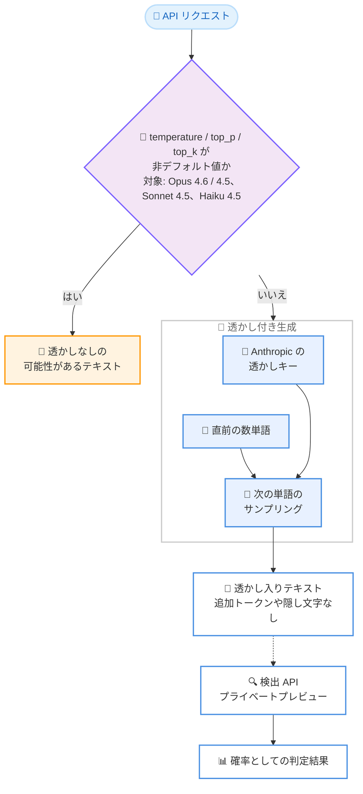

# テキスト透かしの対象モデル拡大: Claude Opus 4.6 / Opus 4.5 / Sonnet 4.5 / Haiku 4.5 に適用

## メタデータ

| 項目 | 内容 |
|------|------|
| 発表日 | 2026-11-16 |
| ソース | Claude API Release Notes |
| カテゴリ | Claude API / モデル |
| 公式リンク | https://platform.claude.com/docs/en/release-notes/overview |

## 概要

Anthropic は 2026 年 11 月 16 日、Claude Opus 4.6、Claude Opus 4.5、Claude Sonnet 4.5、Claude Haiku 4.5 が生成するテキストに、対応プラットフォーム上で Anthropic のテキスト透かし (text watermark) が付与されることをリリースノートで発表した。対応プラットフォームの一覧はサポート記事「How Claude marks AI-generated content」に記載されている。

2026 年 11 月 3 日に Claude Mythos 5、Claude Opus 4.7、Claude Sonnet 4.6 へ導入されたテキスト透かしを、より古い世代のモデルへ拡大するものである。透かしは出力の意味、品質、可読性を変えず、トークンや隠し文字を追加せず、ユーザーや組織に関する情報も含まないため、開発者側でリクエストやレスポンス処理を変更する必要はない。ただし今回の対象 4 モデルでは、`temperature`、`top_p`、`top_k` のいずれかを非デフォルト値に設定したリクエストで生成されたテキストに透かしが付与されない場合がある。

## 詳細

### 背景

Anthropic は 2026 年 7 月、EU AI 法 (EU AI Act) 第 50 条 (2) に関する「AI 生成コンテンツの透明性に関する行動規範 (Code of Practice on Transparency of AI-Generated Content)」に署名し、Claude の生成コンテンツへのマーキングを段階的に導入している。地域ごとに適用範囲を限定する永続的な方法がないため、透かしは Claude が提供されるすべての地域でグローバルに適用される。

導入の経緯は以下のとおり。

- **2026-11-03**: Claude Mythos 5、Claude Opus 4.7、Claude Sonnet 4.6 (最新世代) に透かしを導入。サンプリングパラメータによる例外は Sonnet 4.6 のみ
- **2026-11-16 (今回)**: Claude Opus 4.6、Claude Opus 4.5、Claude Sonnet 4.5、Claude Haiku 4.5 (旧世代) に対象を拡大。サンプリングパラメータによる例外は対象 4 モデルすべてに適用

### 主な変更点

- **対象モデルの拡大**: Claude Opus 4.6、Claude Opus 4.5、Claude Sonnet 4.5、Claude Haiku 4.5 が生成するテキストに Anthropic のテキスト透かしが付与される
- **対象プラットフォーム**: 透かしはモデルレベルで適用され、対応プラットフォームの一覧はサポート記事「How Claude marks AI-generated content」に記載されている
- **サンプリングパラメータの例外**: 対象 4 モデルのいずれかへのリクエストで `temperature`、`top_p`、`top_k` のいずれかを非デフォルト値に設定した場合、生成テキストに透かしが付与されないことがある。前回 (11 月 3 日) の発表では例外が Sonnet 4.6 のみだったのに対し、今回は対象モデルすべてに適用される点が異なる
- **開発者側の対応は不要**: 透かしのためにリクエストやレスポンス処理を変更する必要はない

### 技術的な詳細

**仕組み**

公式ブログ「How Claude's text watermark works」によると、この透かしは Google DeepMind の SynthID-Text (2024 年に Nature 誌で発表) をベースにした方式である。意味に影響しない低リスクな単語選択の揺らぎを利用し、次の単語を選ぶ際のランダム性の由来として「透かしキーと直前の数単語」から導出した値を使用する。珍しい単語へ不自然に誘導するものではなく、出力品質への影響は確認されていない。

**サンプリングパラメータの例外の適用範囲**

公式ドキュメント「Text watermark」の「Sampling settings」セクションによると、この例外は以下のモデルに適用される。

- Claude Opus 4.6
- Claude Sonnet 4.6
- Claude Opus 4.5
- Claude Sonnet 4.5
- Claude Haiku 4.5
- Claude Opus 3 (モデルアクセスはリクエスト制)

ドキュメントには「If you need your output to carry the watermark, omit `temperature`, `top_p`, and `top_k` from your requests.」と記載されており、透かしに依存する場合は 3 つのパラメータすべてをリクエストから省略することが推奨される。フレームワークやクライアントライブラリが自動的にこれらのパラメータを設定する場合があるため、送信されるリクエストボディの確認も推奨されている。なお、Claude Mythos 5 と Claude Opus 4.7 はこの一覧に含まれておらず、例外の対象外である。

**検出と制限事項 (前回発表時点からの共通事項)**

- 検出には Anthropic の透かしキーが必要で、結果は確率として返される。検出 API はプライベートプレビューとして適格な組織に限定提供されている
- 短いテキストや、単語選択の自由度が低い事実記述・コードでは検出が難しくなる
- 軽微な編集では透かしは残存し得るが、全面的な書き直しでは消える
- 透かしがないことは人間が書いたことの証明にはならない (旧モデル、非デフォルトのサンプリング設定などで透かしが欠落し得る)

## 開発者への影響

### 対象

- Claude API および対応プラットフォームで Claude Opus 4.6、Claude Opus 4.5、Claude Sonnet 4.5、Claude Haiku 4.5 を利用するすべての開発者
- AI 生成コンテンツの透明性 (EU AI 法第 50 条など) への対応が必要な組織
- 生成テキストの透かし付与に依存するワークフローを構築する開発者

### 必要なアクション

1. **基本的に対応不要**: 透かしは出力の品質や形式を変えないため、既存のリクエストやレスポンス処理の変更は不要
2. **透かしに依存する場合**: 対象モデルへのリクエストから `temperature`、`top_p`、`top_k` をすべて省略する。フレームワークやクライアントライブラリが暗黙的に設定する値にも注意し、実際に送信されるリクエストボディを確認する
3. **検出ロジックを持つ場合の注意**: 「透かしがない = 旧世代モデルの出力」という前提で判定している場合、今回の拡大により前提が変わるため、判定ロジックの見直しが必要
4. **コンプライアンス確認**: Claude を組み込んだサービスを提供する事業者は、EU AI 法第 50 条に基づく自社の義務を独自に評価することが推奨されている

### 移行ガイド (該当する場合)

既存のアプリケーションはそのまま動作するため、移行作業は不要である。透かしの有無を前提とした処理を実装している場合のみ、対象 4 モデルすべてにサンプリングパラメータの例外が適用される点を考慮する。

## コード例

```python
import anthropic

client = anthropic.Anthropic()

# 透かしに依存する場合は temperature / top_p / top_k を
# 設定しない (デフォルト値のまま使用する)
message = client.messages.create(
    model="claude-haiku-4-5",
    max_tokens=1024,
    messages=[
        {"role": "user", "content": "製品発表のお知らせ文を書いてください。"}
    ],
    # temperature=0.7,  # 非デフォルト値を設定すると
    # top_p=0.9,        # 対象 4 モデルでは透かしが
    # top_k=40,         # 付与されないことがある
)

print(message.content[0].text)
```

## アーキテクチャ図 (該当する場合)



## 関連リンク

- [Claude API Release Notes](https://platform.claude.com/docs/en/release-notes/overview)
- [Text watermark ドキュメント](https://platform.claude.com/docs/en/build-with-claude/text-watermark)
- [How Claude marks AI-generated content (サポート記事)](https://support.claude.com/en/articles/16266773-how-claude-marks-ai-generated-content)
- [How Claude's text watermark works (公式ブログ)](https://www.anthropic.com/news/claude-text-watermark)
- [前回レポート: 2026-11-03 テキスト透かしの導入](./2026-11-03-text-watermarking-claude-models.md)

## まとめ

2026 年 11 月 3 日に最新世代モデル (Claude Mythos 5、Opus 4.7、Sonnet 4.6) へ導入された Anthropic のテキスト透かしが、旧世代の Claude Opus 4.6、Opus 4.5、Sonnet 4.5、Haiku 4.5 にも拡大された。EU AI 法の透明性要件への対応を背景とした段階的な展開であり、出力の品質や可読性への影響はなく、ほとんどの開発者にとって対応は不要である。一方、前回は Sonnet 4.6 のみだったサンプリングパラメータの例外が今回の対象 4 モデルすべてに適用されるため、透かしの付与に依存する場合は `temperature`、`top_p`、`top_k` をリクエストから省略する必要がある点に注意が必要となる。
