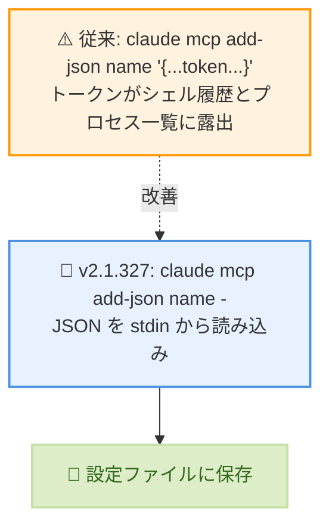

# Claude Code v2.1.327 リリース: stdin からの MCP 登録と `/status` 診断強化を含む約 175 項目のアップデート

## メタデータ

| 項目 | 内容 |
|------|------|
| 発表日 | 2026-11-17 |
| ソース | Claude Code Changelog |
| カテゴリ | Claude Code / CLI アップデート |
| 公式リンク | https://github.com/anthropics/claude-code/blob/main/CHANGELOG.md |

## 概要

Claude Code v2.1.327 が 2026 年 11 月 17 日 (20:33 UTC) に npm で公開された。約 175 項目からなるリリースであり、セキュリティと診断性を高める新機能、約 100 項目のバグ修正、権限まわりの挙動変更、VS Code 拡張の改善が含まれる。

新機能では、**`claude mcp add-json <name> -` による stdin からの MCP サーバー登録**が追加され、トークンなどの秘密情報をコマンドラインに残さずにサーバーを追加できるようになった。また **`/status` に破損した設定ファイルの一覧表示**が追加され、エージェント・スキル・コマンド・出力スタイルの破損ファイル、キーバインドエラー、利用できないサンドボックス、無視された権限設定、一致しないフックマッチャーをまとめて確認できる。このほか、`/install-github-app` がリポジトリを変更する前の確認ダイアログ、非フルスクリーンレンダラーの新名称 `/tui classic` などが追加された。

修正面では、Remote Control の worktree モード停止時に実行中セッションの `.env` などの git-ignored ファイルが削除される問題、`/export` が既存ファイルを確認なしで上書きする問題、`claude mcp add` / `remove` が `.mcp.json` の他のトップレベルキーを削除する問題など、データ消失につながる不具合が多数解消された。

## 詳細

### 背景

v2.1.325 以降、Claude Code はサンドボックスと権限チェックの堅牢化を段階的に進めている。v2.1.327 はその流れを引き継ぎ、シンボリックリンクの拒否や作業ディレクトリ判定の厳格化などの権限変更を加えつつ、セッション復元時のメッセージ消失、設定ファイルの意図しない削除・上書きといった信頼性の問題の解消に重点を置いたリリースとなっている。

### 主な変更点

#### 1. stdin からの MCP サーバー登録 (新機能)

`claude mcp add-json <name> -` という形式で、サーバーの JSON 定義を stdin から読み込めるようになった。API トークンなどの秘密情報をコマンドライン引数として渡す必要がなくなり、シェル履歴やプロセス一覧への露出を防げる。なお、Claude Code セッション内では利用できない。

#### 2. `/status` の破損ファイル一覧 (新機能)

`/status` に以下を一覧表示するセクションが追加され、設定の問題を 1 か所で診断できるようになった。

- 破損したエージェント・スキル・コマンド・出力スタイルのファイル
- キーバインドのエラー
- 利用できないサンドボックス
- 無視された権限設定
- 一度も一致しないフックマッチャー

あわせて `/config` には、他の設定が行を上書きしている場合にその旨を示す注記が追加された。

#### 3. そのほかの新機能

- **`/install-github-app` の確認ダイアログ**: リポジトリを変更する前に確認を求めるようになった。UI も標準のリストとキー操作に統一され、スピナーと明確なエラー表示が加わった
- **`/tui classic`**: 非フルスクリーンレンダラーの名称として追加された (`/tui default` も引き続き利用可能)
- **再開セッションの注意表示**: 再開したセッションの過去メッセージをロードできない場合、その旨を示す行が表示されるようになった
- **ゲートウェイ関連**: ゲートウェイヒントヘッダーに `x-claude-code-managed-settings-checksum` が追加された。また、`attributionProject` 設定でセッションの課金グループに名前を付けられるようになった (Claude apps ゲートウェイで `admin.billing_group_tag` を設定している場合)

#### 4. データ消失につながる不具合の修正 (重要)

本リリースで特に重要なのが、ファイルやメッセージの消失を防ぐ修正群である。

- **Remote Control**: worktree モードでサーバーを停止すると、実行中セッションの `.env` などの git-ignored ファイルが削除される問題を修正
- **`.mcp.json` の保護**: project スコープの `claude mcp add` / `claude mcp remove` が、`$schema` や他ツールの `servers` など、他のトップレベルキーを削除する問題を修正。また `claude mcp add --scope project` は、`.mcp.json` が `mcpServers` キーなしでサーバーを列挙している場合、ファイルを上書きせず停止するようになった
- **`/export` の上書き確認**: 既存ファイルを確認なしで上書きする問題を修正。ダイアログは確認を求め、`/export <name>` は既存ファイルを保持して `/export` の実行を案内する
- **セルフホストランナー**: `--use-anthropic-git-proxy` 使用時に、`GIT_CONFIG_GLOBAL` が指す空でないディレクトリを起動時に削除する問題を修正 (ディレクトリを保持し、変数を無視して警告する)
- **セッション復元**: headless セッションの再開時に保存済みメッセージが失われる問題、`/clear` 後に作成したタスクが失われ消去済みタスクが復活する問題、出力トークン制限で切れた返信直後のコンパクションがツール呼び出しと結果を失う問題、Stop 押下後のメッセージをリモートセッションが忘れる問題などを修正

#### 5. 安定性・ハング対策の修正

- `claude -p` がモデル設定の取得停滞 (プロキシなど) で最初のリクエスト前にハングする問題を修正 (10 秒後に設定なしで続行)
- `https_proxy` / `HTTPS_PROXY` が `host:port` 形式のとき、デスクトップアプリ・SDK・cron などの非ターミナル環境で起動を拒否する問題を修正
- WebFetch は 2,000 文字を超える URL を権限プロンプトの前に拒否するようになり、数千の未クローズタグを含むコンパクション応答でのストールも修正された
- 数千の `@` メンションを含むメッセージのストールを修正 (ファイルとして解決されるのは先頭 100 件のみ)
- リモート MCP サーバーが VPN 切断などの長い障害後に切断されたままになる問題を修正 (ホスト名 + https で到達するサーバーは約 1 日バックグラウンドで再試行)
- コンパクション後に未変更ファイルへの Edit が "File has not been read yet" で拒否される問題を修正
- Grep の `head_limit` と `offset` によるページングで結果が重複・欠落する問題を修正 (結果はファイルパス順にソート)

#### 6. サブエージェント・バックグラウンドエージェントの修正

- リードと異なるモデルのチームメイトが、リードのコンテキスト制限と誤ったモデルでコンパクションする問題を修正 (自身の制限とモデルを使用)
- 終了済みサブエージェントが、メッセージを送った兄弟サブエージェントのモデルと effort で再開される問題を修正
- バックグラウンドエージェントの完了がメインの会話に通知されないケース、permission プロンプトで 30 秒以上待機したエージェントが実行中と報告されるケースを修正
- モデル未指定で起動したサブエージェントは、`/model` 実行後を含め、再開時も開始時のモデルを維持するようになった

#### 7. 権限・セキュリティの挙動変更

- **パスチェックの厳格化**: 一部のシンボリックリンクを拒否するようになった。また作業ディレクトリ内と見なす範囲が変わり、一部のパスで権限確認が発生するようになった
- **`permissions.blockReadsOutsideWorkingDirectories`**: bypass / auto モードでより多くの Bash コマンドを確認し、auto モードでは一部を拒否するようになった。Read / Edit の deny ルール下のパスを指すコマンドはより多く拒否される
- **auto モードの allow ルール**: `Bash(pnpm dlx *)` のような任意パッケージを実行するルールや、パス・バージョン形式のルールを無視し、安全性チェックに判断を委ねるようになった
- **PowerShell ツール**: ルールで許可されていても、さらに 1 種類のコマンドで実行前に確認を求めるようになった
- **`ExitWorktree`**: 未保存の作業を含む可能性のある worktree を削除する前に確認を求めるようになった
- **変数展開の制限**: 変数が非常に長いテキストに展開される Bash コマンドは拒否され、短い値またはファイルの使用を促すメッセージが表示される
- **Claude in Chrome**: 一部の資格情報ファイルのアップロードを拒否するようになった
- 兄弟からのメッセージで再開されたサブエージェントは、セッションの権限設定に従うようになった (確認が発生、または回答者不在時は拒否され得る)

#### 8. パフォーマンス・使い勝手の改善

- **最初の Bash コマンドの高速化**: シェルの起動ファイルを承認前に実行できるようになった (`CLAUDE_CODE_DISABLE_SHELL_HEAD_START=1` で無効化可能)
- **コミットの安全性**: 新しいモデルと PowerShell で、秘密情報を含む可能性が高いファイルをコミットしないよう Claude に指示されるようになった
- **長い応答の継続**: 未認識モデルで 32,000 出力トークンで切れた返信は、128,000 トークンの制限で継続されるようになった
- **Windows の高速化**: Git Bash と `pwsh` がない環境での起動時間、PowerShell ツールの速度 (コマンドあたり最大約 0.5 秒)、Git for Windows 経由の git 起動などを改善
- **Bedrock / Vertex / Foundry**: ターミナルセッションのサブエージェント進捗サマリーが、会話全体ではなく短いメモから生成されるようになり、トークン消費が大幅に減少
- トランスクリプト検索が編集内容と書き込んだファイルの中のテキストも対象にするようになった
- 狭いターミナルでのレイアウトが改善され、`/model` と `/effort` は約 40 桁でも表示できるようになった
- このほか、ターミナル描画 (Ghostty、tmux、kitty、iTerm2、Windows Terminal)、`/resume` や `/mcp` などの UI、キー操作に関する多数の修正が含まれる

#### 9. VS Code 拡張の更新

- **"Claude Code: Add to Chat"**: エクスプローラーの右クリックメニューに追加され、選択したファイルやフォルダをチャットで @ メンションできるようになった
- PreToolUse フックが確認を求める際の理由が権限プロンプトに表示されない問題を修正 (anthropics/claude-code#85950)
- Escape がダイアログやメニューを閉じる際に Claude の応答まで停止してしまう問題を修正
- 連続する編集の速度を改善 (キューされた編集が新しい problems の待機を共有)
- `rg` が PATH にある場合の大規模ワークスペースでの @ メンションファイル検索を高速化
- 未使用の IDE 接続ツール (openFile、saveDocument、getOpenEditors など) を削除

### 技術的な詳細

#### stdin からの MCP サーバー登録

トークンを含む MCP サーバー定義を、コマンドライン引数に露出させずに登録できる。

```bash
# JSON を stdin 経由で渡す (トークンがシェル履歴に残らない)
cat server.json | claude mcp add-json my-server -

# もしくはヒアドキュメントで渡す
claude mcp add-json my-server - <<'EOF'
{
  "type": "http",
  "url": "https://example.com/mcp",
  "headers": {
    "Authorization": "Bearer ${MY_TOKEN}"
  }
}
EOF
```



#### ゲートウェイ・課金グループの設定

Claude apps ゲートウェイで `admin.billing_group_tag` を設定している環境では、`attributionProject` 設定でセッションの課金グループに名前を付けられる。また、管理対象設定で `CLAUDE_CODE_GATEWAY_HINT_HEADERS=1` を設定している環境では、ヒントヘッダーに `x-claude-code-managed-settings-checksum` が追加送信される。

## 開発者への影響

### 対象

- **MCP サーバーを CLI で登録する利用者**: stdin 経由の登録で秘密情報の露出を防げる。`.mcp.json` の他キー削除・上書きの問題も解消された
- **Remote Control・セルフホストランナーの利用者**: `.env` などの削除、`GIT_CONFIG_GLOBAL` ディレクトリの削除といった破壊的な不具合が修正されたため、早期の更新を推奨
- **auto / bypass モードで自動化を運用する組織**: パスチェックの厳格化、`blockReadsOutsideWorkingDirectories` の強化、パッケージ実行系 allow ルールの無視拡大など、無人実行に影響し得る変更がある
- **サブエージェント・エージェントチームの利用者**: コンパクションのモデル・制限、再開時のモデル維持、完了通知など複数の挙動が改善・変更された
- **VS Code 拡張の利用者**: 右クリックからの Add to Chat、フック理由の表示、編集速度の改善など

### 必要なアクション

1. **アップデートの適用**: データ消失やハングに関わる修正が多いため、早期の更新を推奨
2. **MCP 登録スクリプトの見直し**: トークンを引数で渡している場合は `claude mcp add-json <name> -` への移行を検討する
3. **`/status` での設定診断**: 更新後に `/status` を実行し、破損ファイル・無視された権限設定・一致しないフックマッチャーが報告されないか確認する
4. **自動化ワークフローの確認**: シンボリックリンクの拒否、作業ディレクトリ判定の変更、PowerShell の確認追加などにより、権限プロンプトや拒否が増える可能性がある。auto モードで `Bash(pnpm dlx *)` のようなルールに依存している場合は明示的なルールへ書き換える
5. **auto モードのクラシファイア通知の確認**: 課金対象クラシファイアリクエストへのフォールバックは今後のリリースで削除され、該当アクションは確認または拒否されるようになると告知されている

### 移行ガイド (該当する場合)

- **ネストした `claude` 実行で独自トークンを使う利用者**: セッションのトークンを受け取らないコマンドには `CLAUDE_CODE_OAUTH_SCOPES` が渡されなくなったため、必要なコマンドには明示的に設定する
- **シェル起動ファイルの先行実行を避けたい環境**: `CLAUDE_CODE_DISABLE_SHELL_HEAD_START=1` を設定すると、最初の Bash コマンド承認前の起動ファイル実行を無効化できる
- **mod 開発者**: `$.model.complete` / `$.model.classify` が使用上限に達した場合、API のエラーが即座に返されるようになったため、mod 側でエラーを処理する
- **Anthropic ホストのクラウドセッション**: リポジトリのフラグ・プラグイン配信設定はさらに多くが無視され、`CLAUDE_CODE_DISABLE_NONESSENTIAL_TRAFFIC` は最大でも `DISABLE_TELEMETRY` として扱われる

## 関連リンク

- [Claude Code Changelog](https://github.com/anthropics/claude-code/blob/main/CHANGELOG.md)
- [v2.1.327 リリースページ](https://github.com/anthropics/claude-code/releases/tag/v2.1.327)
- [Claude Code 公式ドキュメント](https://code.claude.com/docs)
- [claude-code リポジトリ](https://github.com/anthropics/claude-code)

## まとめ

Claude Code v2.1.327 は、stdin からの MCP サーバー登録や `/status` の破損ファイル一覧といった運用性を高める新機能に加え、`.env` や `.mcp.json` の意図しない削除・上書き、セッション復元時のメッセージ消失など、データ保全に関わる重要な修正を多数含むリリースである。権限面ではシンボリックリンクの拒否や auto モードの allow ルール無視の拡大など厳格化が続いており、自動化ワークフローを運用する環境では更新後の動作確認を推奨する。VS Code 拡張もエクスプローラーからの Add to Chat 追加や編集速度の改善など、着実な進化を見せている。
