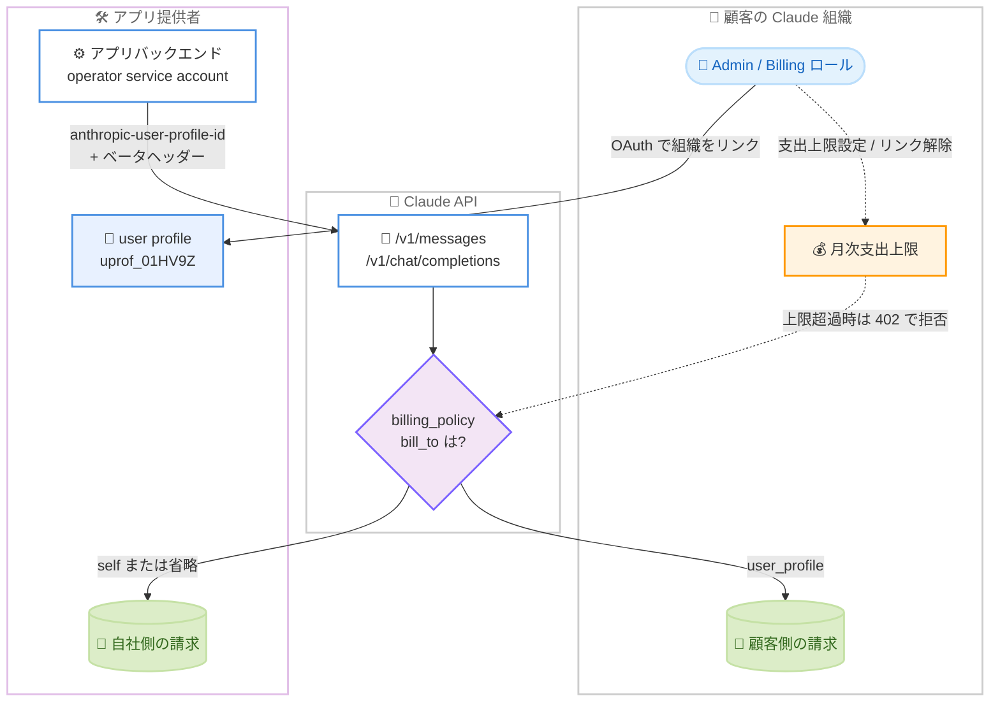
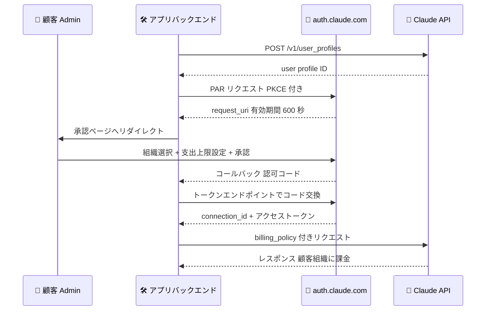

# Linked billing をベータ提供開始 - 顧客の Claude 組織によるアプリ API 使用料の支払いが可能に

## メタデータ

| 項目 | 内容 |
|------|------|
| 発表日 | 2026-11-17 |
| ソース | Claude Developer Platform Release Notes |
| カテゴリ | Claude API |
| 公式リンク | https://platform.claude.com/docs/en/release-notes/overview |

## 概要

Anthropic は 2026 年 11 月 17 日、Linked billing (リンク請求) をベータで提供開始しました。ベータヘッダー `user-profiles-billing-2026-10-01` を使用することで、アプリの顧客が自身の Claude 組織を OAuth でリンクし、アプリ内での Claude API 使用料を顧客自身の組織に課金できるようになります。

リンク完了後は、`/v1/messages` または `/v1/chat/completions` の各リクエストで `billing_policy` を設定し、「顧客払い」か「自社払い」かをリクエスト単位で選択できます。顧客は Claude Console からアプリに対する月次支出上限 (spend cap) の設定やリンク解除をいつでも実行できます。

## 詳細

### 背景

従来、Claude API を組み込んだアプリケーションを提供する事業者は、顧客の利用分も含めてすべての API 使用料を自社で負担し、別途顧客に請求する仕組みを独自に構築する必要がありました。Linked billing により、顧客の Claude 組織に使用料を直接課金できるようになり、API コストの転嫁や従量課金の精算にかかる運用負担を軽減できます。

### 主な変更点

1. **組織の課金リンク**: 顧客が OAuth フローで自身の Claude 組織をアプリにリンクすると、以降のリクエストを顧客組織に課金可能になります。リンク (API 上は connection と呼ばれます) は顧客ごとに 1 回行えば継続します
2. **`billing_policy` パラメータの追加**: `/v1/messages` と `/v1/chat/completions` のリクエストボディで支払者を選択できます。省略時は自社払いです
3. **顧客側の管理機能**: 顧客は Claude Console で月次支出上限の設定やアプリのリンク解除を実行できます
4. **課金不能時の保護**: 顧客に課金できないリクエストは、アプリ提供者に課金されるのではなく API 側で拒否されます (403 / 402 エラー)

### 技術的な詳細

#### `billing_policy` の指定方法

```json
{ "billing_policy": { "type": "billing_policy", "bill_to": "user_profile" } }
```

| `bill_to` の値 | 支払者 |
|---------------|--------|
| `user_profile` | リンクされた顧客の Claude 組織 |
| `self` | アプリ提供者の組織 (省略時のデフォルト) |

#### 必要なヘッダー

| ヘッダー | 用途 |
|---------|------|
| `anthropic-user-profile-id` | リンク顧客向けのすべての呼び出しで必須。対象の user profile ID (例: `uprof_01HV9Z`) を指定 |
| `anthropic-beta: user-profiles-billing-2026-10-01` | `billing_policy` を設定する場合に必須 |

#### エンドポイントごとの対応状況

| エンドポイント | 対応 |
|--------------|------|
| `/v1/messages` | 対応。ただし `bill_to: "user_profile"` では課金型コード実行機能は使用不可 (400 エラー) |
| `/v1/chat/completions` | 対応 |
| `/v1/messages/count_tokens` | `billing_policy` を受け付けるが課金には影響しない |
| `/v1/messages/batches` | 顧客課金は非対応。`bill_to: "user_profile"` を含む個別リクエストはエラーになる |

#### 利用条件と制約

- **対象顧客**: Anthropic に API 使用料を直接支払っている Claude Platform 組織のみ。AWS / Google Cloud / Azure のマーケットプレイス経由の組織や、Claude サブスクリプションプランのみの組織は `403 user_profile_not_billable` で拒否されます
- **実行環境はアプリ提供者側**: リクエストはアプリ提供者の組織内で実行されるため、レート制限、モデルアクセス、サービスティア、データ保持、暗号鍵はアプリ提供者側の設定が適用されます。顧客側の ZDR / BAA / CMEK は適用されないため、HIPAA / FERPA / CMEK が必要な顧客はリンクすべきではありません
- **使用できないクレジット**: Max / Ultra / Team プランの月次 API クレジットや、パートナー / スタートアップ・プログラムのクレジットは支払いに使用できません。支払い不能時は 402 エラーで拒否されます (クレジット不足と支出上限のどちらが原因かは応答から区別できません)
- **課金対象の原則**: `bill_to: "user_profile"` は顧客が指示した使用にのみ設定すべきです。テストや評価、他顧客向けの作業に顧客課金を設定してはなりません

#### セットアップの流れ

初回のみ、Claude Console で OAuth アプリを作成し (「Bill and link to organizations」を選択)、`private_key_jwt` 方式のクライアント認証と operator service account を設定します。クライアントシークレットは発行されず、Workload Identity Federation によるサービスアカウント認証を使用します。

顧客ごとのリンクは以下の流れで行います。

1. `/v1/user_profiles` で顧客用の user profile を作成し、返却された ID を保存
2. PAR (Pushed Authorization Request) を `https://auth.claude.com/v1/oauth/par` に送信 (scope は `billing:attribution`、PKCE 必須)
3. 顧客を承認ページへリダイレクト。承認には顧客組織の Admin または Billing ロールが必要
4. 顧客が組織を選択し、月次支出上限を設定して「Link and authorize」を承認
5. コールバックで認可コードを受け取り、トークンエンドポイントで `connection_id` とアクセストークンに交換

リンクは承認した個人ではなく組織に帰属するため、承認者が退職しても接続は維持されます。

#### リンク解除

顧客組織またはアプリ提供者組織の管理者がいつでも解除できます。Console の User profiles ページのほか、revocation エンドポイント (`https://auth.claude.com/v1/oauth/revoke`) に `connection_id` を送信してバックエンドから解除することも可能です。解除後は同じ user profile を再リンクできます。

## アーキテクチャ図

### 支払いフロー



### 顧客リンクの OAuth フロー



## コード例

### Python SDK - 顧客払いリクエスト

```python
import anthropic

BILLING_BETA = "user-profiles-billing-2026-10-01"

client = anthropic.Anthropic()

response = client.beta.messages.create(
    model="claude-opus-5-5",
    max_tokens=1024,
    messages=[{"role": "user", "content": "Hello, Claude"}],
    betas=[BILLING_BETA],
    extra_headers={"anthropic-user-profile-id": "uprof_01HV9Z"},
    extra_body={
        "billing_policy": {"type": "billing_policy", "bill_to": "user_profile"}
    },
)
```

### curl - 顧客払いリクエスト

```bash
curl https://api.anthropic.com/v1/messages \
  -H "Authorization: Bearer $ACCESS_TOKEN" \
  -H "anthropic-version: 2026-10-21" \
  -H "anthropic-beta: user-profiles-billing-2026-10-01" \
  -H "anthropic-user-profile-id: uprof_01HV9Z" \
  -H "content-type: application/json" \
  -d '{
    "model": "claude-sonnet-5-5",
    "max_tokens": 1024,
    "messages": [{"role": "user", "content": "Hello, Claude"}],
    "billing_policy": {"type": "billing_policy", "bill_to": "user_profile"}
  }'
```

### 主なエラーと対処

| エラー | 意味 |
|--------|------|
| `403 user_profile_not_billable` | 顧客が課金不適格 (マーケットプレイス経由課金、サブスクリプションのみの組織など) |
| `402` | クレジット不足または支出上限到達 (応答からは区別不可) |
| `400` | 顧客課金リクエストでの課金型コード実行機能の使用など |
| `401 authentication_error` | トークンの失効・置換、または接続の終了 |

## 開発者への影響

### 対象

- Claude API を組み込んだ SaaS / アプリケーションを提供し、API コストを顧客に転嫁したい事業者
- エージェント製品やプラットフォームで、顧客ごとの従量課金を精算する仕組みを独自に構築している開発者
- 顧客側では、Anthropic に直接支払いを行う Claude Platform 組織の管理者

### 必要なアクション

- **ベータヘッダーの追加**: `billing_policy` を設定するリクエストには `anthropic-beta: user-profiles-billing-2026-10-01` ヘッダーが必要です
- **OAuth アプリのセットアップ**: Claude Console で OAuth アプリを作成し、operator service account と `private_key_jwt` 方式のクライアント認証を設定してください
- **user profile 運用の設計**: 顧客組織と user profile は 1 対 1 で接続されます。顧客ごとに profile ID を保存し、顧客払いリクエストに必ず正しい ID を設定してください。誤った profile ID を設定すると別の顧客組織に課金され、エラーは発生しません
- **エラーハンドリングの実装**: 402 / 403 エラーを適切に処理し、顧客への案内 (クレジット追加、支出上限の見直し、再リンクなど) に接続してください
- **コンプライアンス要件の確認**: リクエストはアプリ提供者の組織設定で実行されるため、ZDR / BAA / CMEK が必要な顧客にはリンクを案内しないでください

### 移行ガイド

既存の API 呼び出しに影響はありません。`billing_policy` を省略した場合は従来どおり自社払いとなり、ベータヘッダーも不要です。顧客課金を導入する場合のみ、OAuth アプリのセットアップと顧客リンクフローの実装が必要です。

なお、本機能はベータ提供であり、エンドポイント、パラメータ、挙動はベータ期間中に変更される可能性があります。

## 関連リンク

- [Linked billing (Organization billing connections)](https://platform.claude.com/docs/en/manage-claude/oauth-apps/organization-billing-connections)
- [Claude Developer Platform Release Notes](https://platform.claude.com/docs/en/release-notes/overview)

## まとめ

Linked billing のベータ提供により、アプリの顧客が自身の Claude 組織を OAuth でリンクし、アプリ内の API 使用料を顧客組織に直接課金できるようになりました。アプリ提供者は `/v1/messages` や `/v1/chat/completions` のリクエストごとに `billing_policy` で支払者を選択でき、顧客は Claude Console から支出上限の設定やリンク解除を自律的に管理できます。

API コストの転嫁を独自の請求システムなしで実現できる一方、リクエストはアプリ提供者の組織設定で実行される点や、マーケットプレイス経由の組織は対象外である点など、導入前に確認すべき制約もあります。ベータ機能のため、本番導入にあたっては仕様変更の可能性を考慮してください。
