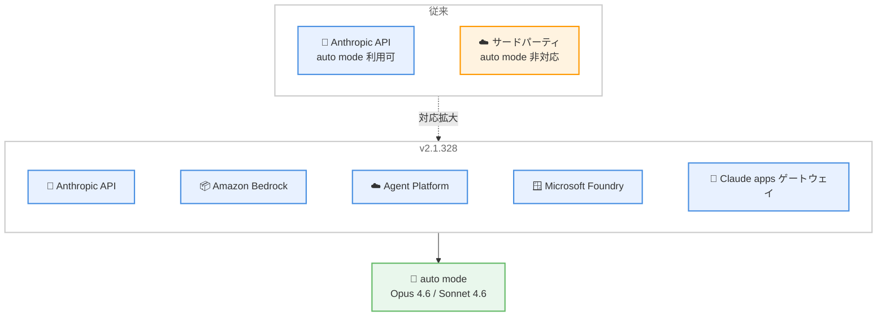

# Claude Code v2.1.328 リリース: auto mode のサードパーティプロバイダー対応と Code Mode の大規模修正を含む約 145 項目のアップデート

## メタデータ

| 項目 | 内容 |
|------|------|
| 発表日 | 2026-11-19 |
| ソース | Claude Code Changelog |
| カテゴリ | Claude Code / CLI アップデート |
| 公式リンク | https://github.com/anthropics/claude-code/blob/main/CHANGELOG.md |

## 概要

Claude Code v2.1.328 がリリースされた。約 145 項目からなるリリースであり、新機能 13 項目、バグ修正約 90 項目、改善約 20 項目、挙動変更約 20 項目、VS Code 拡張の更新 3 項目が含まれる。

最大のトピックは、**Claude Opus 4.6 と Sonnet 4.6 の auto mode が Amazon Bedrock、Google Cloud の Agent Platform、Microsoft Foundry、Claude apps ゲートウェイで利用可能になった**ことである。permission mode を指定しない対話セッションは auto mode で開始されるようになり、plan mode と Bash プロンプトもサードパーティプロバイダー上の両モデルで auto mode を使用・提案するよう変更された。

このほか、`mcp_tool` フックへの `"onFailure": "block"` の追加、Self-hosted runner の多数の機能追加と修正、Code Mode に関する 20 項目超の修正・改善が含まれており、エンタープライズ環境と自動化ワークフローの信頼性を高めるリリースとなっている。

## 詳細

### 背景

v2.1.327 では権限チェックの厳格化とデータ保全に関わる修正が中心だった。v2.1.328 はその流れを引き継ぎつつ、これまで Anthropic API 中心だった auto mode をサードパーティプロバイダーへ広げ、あわせて Code Mode・Self-hosted runner・Remote Control といった比較的新しい実行基盤の不具合を集中的に解消している。

### 主な変更点

#### 1. auto mode のサードパーティプロバイダー対応 (新機能・重要)

Claude Opus 4.6 と Sonnet 4.6 の auto mode が、以下のプロバイダーで利用できるようになった。

- Amazon Bedrock
- Google Cloud の Agent Platform
- Microsoft Foundry
- Claude apps ゲートウェイ

permission mode を指定していない対話セッションは auto mode で開始される。あわせて、plan mode と Bash プロンプトもサードパーティプロバイダー上の Opus 4.6 / Sonnet 4.6 で auto mode を使用・提案するよう変更された (新しいモデルと同様の挙動)。auto mode を使いたくない場合は `disableAutoMode` で両方を無効化できる。

関連する修正として、`CLAUDE_CODE_DISABLE_EXPERIMENTAL_BETAS` を設定し、beta を拒否するゲートウェイの背後にある環境 (Bedrock、Agent Platform、Foundry、Claude apps ゲートウェイ) で、Claude Desktop 以外の auto mode が毎ターン失敗する問題も解消されている。



#### 2. `mcp_tool` フックの `"onFailure": "block"` (新機能)

command フックと HTTP フックに続き、`mcp_tool` フックでも `"onFailure": "block"` を指定できるようになった。フックの呼び出し自体が失敗した場合に、対象のアクションをブロックできる。セキュリティチェックやポリシー適用を MCP ツール経由のフックで行う場合、フック障害時に処理を通過させない「フェイルクローズド」の構成が可能になる。

#### 3. Self-hosted runner の強化 (新機能・修正多数)

Self-hosted runner には 6 つの新機能と 10 項目超の修正・変更が含まれる。

**新機能:**

- **`--repository-folder`**: `--capacity 1` のとき、セッションがリポジトリに使うフォルダーの名前を指定できる。base フォルダー配下のパス (シンボリックリンク不可) に代わるもの
- **`--hook-label`**: `claude self-hosted-runner orchestrator` に追加され、選択したセッションラベルを `spawn-runner` フックに渡せる
- **`--metadata key=value`**: `claude --environment` に追加され、`spawn-runner` フック向けにセッションへラベルを付けられる
- **新メトリクス**: orchestrator の `/metrics` に `claude_code_self_hosted_orchestrator_session_queue_wait_by_reason_seconds` (再オープンされたセッションと新規セッションの待機を区別) と `claude_code_self_hosted_orchestrator_sessions_given_up_total` (runner の起動を断念した回数を原因別にカウント) が追加された
- **起動時警告**: ホストの settings.json がセッションに無視されるデフォルト permission mode を設定している場合に警告が表示される

**主な修正:**

- プロキシや Web フィルターがポーリングに HTTP 200 と `{}` のようなボディで応答した際、実行中の全セッションが停止する問題を修正 (再試行するようになった)
- 一時的なディスクエラー後に、保持していたクローンのオブジェクト・参照や、そこにしか存在しないコミットが削除される問題を修正 (起動が失敗するようになった)
- ホストの時計が遅れている・巻き戻された環境で、トークン失効により runner が停止する問題を修正
- Anthropic 管理の git を使うセッションで、スクリプトやフックが `claude` を再実行した後に GitHub への git アクセスを失う問題を修正
- 破損した `.claude.json` を持つセッションが `--trust-workspace false` 下で以後の起動に失敗し続ける問題を修正 (デフォルト設定で起動し、MCP サーバーは無効化)
- 登録後にセットアップが失敗した runner がサーバーに通知せず終了する問題を修正 (理由付きで登録解除し、オンデマンド runner は起動失敗を報告)

**挙動変更:**

- settings が Claude の GitHub ツールを名前でガードしている場合、組み込みの `gh api` がデフォルトで無効になった (`--use-anthropic-gh true` で有効化)
- `CLAUDE_RUNNER_SESSION_UUID` と `CLAUDE_CODE_REMOTE_SESSION_UUID` の両方が、セッションと `checkout` / `post-session` / `spawn-runner` フックに設定されるようになった
- `--capacity 1` のとき、プッシュ先リポジトリのパスがシンボリックリンクの場合はより早い段階でセッションを拒否するようになった

#### 4. Code Mode の大規模修正・改善 (重要)

Code Mode に関して 13 項目の修正と 8 項目の改善・変更が含まれる。

**主な修正:**

- auto / bypass 以外のモードで権限プロンプト・プラン承認・質問が 10 分間開いたままのとき、スクリプトが停止する問題を修正
- 前のスクリプト実行中に接続した MCP サーバーを、auto / bypass-permissions モードのスクリプトが呼び出せない問題を修正
- `claude --resume` のピッカーで選んだセッションで、auto / bypass permissions モードのスクリプトがバックグラウンド実行されない問題を修正
- 1 つの返信で複数スクリプトを実行したセッションの再開時に、ロード済みスキル・フックコンテキスト・権限承認時に入力したメモが失われる問題を修正
- 先に失敗したスクリプトが設定しなかったトップレベル変数に、暗黙に `undefined` が使われる問題を修正
- `{` ブロックで始まる有効なスクリプト、トップレベルの `await` と `return` を併用するスクリプトが拒否される問題を修正
- 読み取り専用サブエージェントに、呼び出せない `write()` と `edit()` が提示される問題を修正

**改善・変更:**

- auto / bypass-permissions モードで、ほとんどのスクリプト後の 0.75 秒の待機を削除し高速化
- ツール説明を短縮しトークン使用量を削減。MCP サーバーがある新規 Code Mode セッションのプロンプトキャッシュも改善
- スクリプトが実行中のコマンドとその出力を、実行中に表示するようになった
- 何も変更しない編集がスクリプトを停止しなくなり、失敗した編集については一致箇所・最も近い箇所が Claude に伝えられるようになった
- **UserPromptSubmit フックの変更**: Code Mode はスクリプトの出力に対して UserPromptSubmit フック (管理対象含む) を実行しなくなった。出力の秘匿化が必要な場合は、`updatedToolOutput` を使う PostToolUse フックを使用する

#### 5. そのほかの新機能

- **メッセージ保留の警告**: 権限プロンプトをスキップするセッションからのメッセージが、クラウドセッションで保留・破棄され得る場合に警告が表示される。`claude -p` のテキスト出力でも stderr で通知され、許可方法が案内される
- **OpenTelemetry の診断**: exporter にエンドポイントがなくデータが失われる可能性が高い場合、`/status` と `claude doctor` に通知が表示される
- **`CLAUDE_CODE_DISABLE_DEFERRED_TOOL_RESUME`**: ホストが `claude -p --resume` と `--continue` に対して、フックが保留したツール呼び出しの実行を止められる
- **`allowManagedModsOnly`**: Claude Code を組み込むアプリが policy プラグインのこのオプションを有効化できるようになった (管理者の managed settings が優先)
- **effort レベルの検証**: policy の `maxEffortLevel` が有効な effort レベルでない場合、Claude apps ゲートウェイに起動時警告が表示される

#### 6. 注目のバグ修正

- **zsh の Bash コマンド**: `echo ====` や `[ a == b ]` のように `=` で始まる語で "not found" エラーになる問題を修正 (`=cmd` がコマンドパスに展開されなくなった)
- **自動コンパクション**: `/compact` と同様にシステムプロンプトを再構築するのではなく、セッションの古いシステムプロンプトを再利用していた問題を修正
- **スケジュールタスクの保護**: タスクファイルが読めないときに保存するとプロジェクトの他のタスクが消える問題、タイポのあるタスクが次回保存時に削除される問題を修正
- **トークンカウント**: スピナーとサブエージェントのトークン数が、再試行された応答を二重に数える・ストリーミングされない応答を見逃す・思考中に止まる問題を修正
- **MCP スキーマ**: 入力スキーマが `anyOf` / `oneOf` / `allOf` で始まる MCP ツールが消える問題、無効な入力スキーマを持つツールがリクエストを失敗させる問題を修正 (無効なツールは除外され、理由が Claude に伝えられる)
- **ストリーム接続**: `CLAUDE_STREAM_IDLE_TIMEOUT_MS` がゲートウェイ・カスタムベース URL・クラウドプロバイダーで 5 分の接続制限を延長できない問題を修正
- **"Prompt is too long" の恒久的な停止**: サードパーティプロバイダー上の一部の Claude Desktop セッションが、大きなツール結果の後に終了してしまう問題を修正 (最大の結果が除外される)
- **effort の退行修正**: Bedrock / Agent Platform / Foundry がサブエージェントの進捗サマリーの effort 設定を拒否した場合に、そのモデルの effort がセッション全体で無効になる問題を修正 (v2.1.327 の退行)
- **Remote Control / クラウドセッション**: 切断メッセージの重複、rewind と `/clear` 後に消去済みの会話が復活する問題、runner 喪失時のツール呼び出し・結果の消失、`/diff` が別リポジトリへ移動したコマンド後のコミット済み作業を表示しない問題などを修正
- **ターミナル関連**: Esc 直後の入力でキーが失われる問題、低速接続でペーストが分断されてプロンプトに入力される問題、GNU screen 内での色の異常、Linux での Ctrl+V によるクリップボード画像の取りこぼし、Ctrl+Z サスペンド中に他アプリのペーストがフリーズする問題などを修正
- **クラッシュ対策**: `FORCE_COLOR` が負の数のときの起動時クラッシュ、メモリ逼迫時のシークレットマスキングのクラッシュを修正

#### 7. 挙動変更 (抜粋)

- **`/code-review` の整理**: ほとんどのモデルでバグと CLAUDE.md 違反のみを報告するようになった。再利用・簡素化・効率のクリーンアップは `/simplify` を実行する。各指摘には Important / Pre-existing / Nit のマークが付き、サマリーの末尾に修正案が提示される
- **managed `PostToolUse` フック**: 実行前に拒否された呼び出しに対しては発火しなくなった (ログ・書き換え・ブロック・停止なし)。`PostToolBatch` はほとんどを受け取るが、拒否のマークは付かない
- **`deniedMcpServers`**: `claude.ai <name>` 形式のエントリが、クラウドセッションと self-hosted runner セッションのコネクタにも適用されるようになった
- **サブエージェントの待機**: `CLAUDE_CODE_FORK_SUBAGENT=0` 設定時、`claude -p` / Agent SDK / デスクトップ / VS Code のサブエージェントは、デフォルトで自身のサブエージェントを待つようになった。バックグラウンドサブエージェントとその待機対象は 1 つの 10 分待機にまとめてカウントされる (`CLAUDE_CODE_PRINT_BG_WAIT_CEILING_MS` で延長可能)
- **サンドボックス**: PermissionRequest フックがサンドボックス除外コマンドに書き換えたシェルコマンドは、サンドボックス外で実行される。起動できないサンドボックスは、次のサンドボックス対象 Bash コマンドを拒否してセッション中のサンドボックス無効を通知する (`sandbox.failIfUnavailable` 未設定時)
- **`/bug` の確認**: 送信前に Yes / No を確認するようになり、Enter の連打でレポート送信や GitHub が開くことがなくなった
- **ペーストの明示**: サードパーティプロバイダー、またはテレメトリ・機能フラグ無効時に、ペーストされたテキストがペーストとして Claude にマークされるようになった

#### 8. 改善 (抜粋)

- 大きなセッションの再開時間、多数の画像を含むセッション再開時のメモリ使用量を改善
- 遅いコマンドやツールを実行する長時間の SDK / デスクトップセッションのメモリ使用量と応答時間を改善
- 複数の in-process チームメイトの同時起動時に "Lock file is already being held" で失敗するケースを大幅に削減
- Anthropic API 上のターミナルセッションで、サブエージェントの進捗サマリーがデフォルトの小型高速モデルにより短いメモから生成されるようになり、トークン消費が大幅に減少 (テレメトリ無効時も適用)
- computer use の承認ダイアログが、各アプリのアクセスレベルとより平易な警告を表示するようになった

#### 9. VS Code 拡張の更新

- 別セッションからのメッセージが保留されたときの通知が追加され、許可できる設定ファイルへのリンクが表示される
- パネルが低い、またはコマンド・URL・説明が長い場合に、権限プロンプトの No ボタン・返信フィールド・タイトルが切れる問題を修正
- 失敗・ブロックされたツール呼び出しが理由を表示しない、または途中で切れる問題と、Glob / Grep がエラーを結果として数える問題を修正

### 技術的な詳細

#### `mcp_tool` フックの `onFailure: block` 設定

フック呼び出しの失敗時にアクションをブロックする設定は、settings.json のフック定義で指定する。

```json
{
  "hooks": {
    "PreToolUse": [
      {
        "matcher": "Bash",
        "hooks": [
          {
            "type": "mcp_tool",
            "tool": "mcp__security__check_command",
            "onFailure": "block"
          }
        ]
      }
    ]
  }
}
```

#### Self-hosted runner のセッションラベル付け

`spawn-runner` フックにセッションのメタデータを渡せるようになり、runner の割り当てロジックをセッション属性に基づいて制御できる。

```bash
# セッションにメタデータを付与して環境を作成
claude --environment --metadata team=platform --metadata priority=high

# orchestrator 側で選択したラベルを spawn-runner フックに渡す
claude self-hosted-runner orchestrator --hook-label team --hook-label priority
```

## 開発者への影響

### 対象

- **Bedrock / Agent Platform / Foundry / Claude apps ゲートウェイの利用者**: Opus 4.6 / Sonnet 4.6 で auto mode が利用可能になり、permission mode 未指定の対話セッションは auto mode で開始される。従来の挙動を維持したい場合は `disableAutoMode` を設定する
- **フックでポリシーを適用する組織**: `mcp_tool` フックの `"onFailure": "block"` でフェイルクローズドな構成が可能になった。一方、Code Mode のスクリプト出力には UserPromptSubmit フックが実行されなくなったため、出力の秘匿化は PostToolUse フックへ移行が必要
- **Self-hosted runner の運用者**: プロキシ応答による全セッション停止、クローンデータの消失、トークン失効による停止など運用に関わる修正が多いため、早期の更新を推奨。新メトリクスによる監視強化も可能
- **Code Mode の利用者**: スクリプトの停止・拒否・状態消失に関する多数の修正と、速度・トークン使用量の改善が含まれる
- **`/code-review` の利用者**: レビューの対象がバグと CLAUDE.md 違反に絞られた。品質面のクリーンアップには `/simplify` を使用する

### 必要なアクション

1. **アップデートの適用**: Code Mode・Self-hosted runner・Remote Control の信頼性に関わる修正が多いため、これらの機能を使う環境では早期の更新を推奨する
2. **auto mode の方針確認**: サードパーティプロバイダーで permission mode を指定していない場合、セッションが auto mode で開始されるようになる。組織のポリシーに合わない場合は `disableAutoMode` または明示的な permission mode の指定を検討する
3. **Code Mode の出力秘匿化の移行**: スクリプト出力の秘匿化を UserPromptSubmit フックに依存している場合は、`updatedToolOutput` を使う PostToolUse フックへ書き換える
4. **Self-hosted runner の GitHub ツール設定の確認**: settings で GitHub ツールを名前でガードしている場合、組み込みの `gh api` がデフォルトで無効になった。必要であれば `--use-anthropic-gh true` を指定する
5. **OpenTelemetry 設定の確認**: 更新後に `/status` または `claude doctor` を実行し、エンドポイント未設定の exporter が報告されないか確認する

### 移行ガイド (該当する場合)

- **`CLAUDE_CODE_FORK_SUBAGENT=0` を使う SDK / headless 環境**: サブエージェントが自身のサブエージェントをデフォルトで待つようになり、待機は 1 つの 10 分制限にまとめられる。長いチェーンには `CLAUDE_CODE_PRINT_BG_WAIT_CEILING_MS` を引き上げる
- **フックが保留したツール呼び出しの再開を制御したいホスト**: `CLAUDE_CODE_DISABLE_DEFERRED_TOOL_RESUME` を設定すると、`claude -p --resume` / `--continue` での実行を止められる
- **managed `PostToolUse` フックに依存する監査基盤**: 実行前に拒否された呼び出しではフックが発火しなくなった。拒否も含めて把握する必要がある場合は `PostToolBatch` の利用を検討する (拒否のマークは付かない点に注意)

## 関連リンク

- [Claude Code Changelog](https://github.com/anthropics/claude-code/blob/main/CHANGELOG.md)
- [v2.1.328 リリースページ](https://github.com/anthropics/claude-code/releases/tag/v2.1.328)
- [Claude Code 公式ドキュメント](https://code.claude.com/docs)
- [claude-code リポジトリ](https://github.com/anthropics/claude-code)

## まとめ

Claude Code v2.1.328 は、Opus 4.6 / Sonnet 4.6 の auto mode を Amazon Bedrock、Google Cloud の Agent Platform、Microsoft Foundry、Claude apps ゲートウェイへ拡大し、エンタープライズ環境での利用体験を Anthropic API に近づけるリリースである。`mcp_tool` フックの `"onFailure": "block"` によりフェイルクローズドなポリシー適用が可能になり、Self-hosted runner はメタデータによるセッションラベル付けや新メトリクスなど運用面の強化が進んだ。Code Mode はスクリプトの停止・拒否・状態消失に関する 20 項目超の修正・改善により大きく安定化しており、これらの機能を運用する環境では早期の更新を推奨する。
