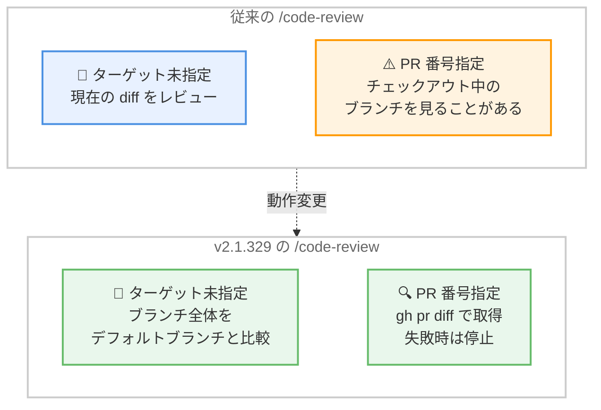

# Claude Code v2.1.329 リリース: /code-review のブランチ全体レビュー化と Code Mode の安定化を中心とした 130 項目のアップデート

## メタデータ

| 項目 | 内容 |
|------|------|
| 発表日 | 2026-11-20 |
| ソース | Claude Code Changelog |
| カテゴリ | Claude Code / CLI アップデート |
| 公式リンク | https://github.com/anthropics/claude-code/blob/main/CHANGELOG.md |

## 概要

Claude Code v2.1.329 がリリースされた。130 項目からなるリリースであり、新機能 7 項目、バグ修正 91 項目、改善 10 項目、挙動変更・削除 22 項目が含まれる (このうち VS Code 拡張の更新は 17 項目)。

最大のトピックは 2 つある。1 つは **`/code-review` の動作変更**で、ターゲット未指定時にブランチ全体をデフォルトブランチと比較してレビューするようになり、PR 番号指定時は `gh pr diff` で確実に対象の pull request を読むようになった。もう 1 つは **Code Mode に関する 20 項目超の修正・変更**で、メモリの暴走や長大ファイルの保持といったメモリ問題の解消に加え、テレメトリや機能フラグが無効な環境でも Code Mode が起動するようになるなど、適用範囲が広がっている。

このほか、macOS Keychain 起因の繰り返しサインアウトの修正、長時間セッションやバックグラウンド処理のメモリ使用量の大幅な改善、`/tasks` へのスケジュールタスク・`/loop`・フォークの統合表示、Self-hosted runner の Git LFS / SSH エイリアス対応など、日常利用の安定性に関わる修正が幅広く含まれている。

## 詳細

### 背景

v2.1.328 では auto mode のサードパーティプロバイダー対応と Code Mode の大規模修正が中心だった。v2.1.329 はその安定化の流れを継続し、Code Mode のメモリ・実行制御の問題を集中的に解消するとともに、`/code-review` のレビュー対象決定ロジックを見直している。また、ここ数バージョンで報告が続いていた macOS Keychain まわりの認証問題と、長時間セッションのメモリ使用量にも本格的に対処したリリースである。

### 主な変更点

#### 1. `/code-review` の動作変更 (重要)

`/code-review` のレビュー対象の決め方が大きく変わった。

- **ターゲット未指定時はブランチ全体をレビュー**: ほとんどのモデルで、現在のブランチ全体をデフォルトブランチと比較してレビューするようになった。あわせて、複数コミットのブランチで diff を見失う問題も修正された
- **PR 番号指定時は `gh pr diff` を使用**: `/code-review <pr number>` が、何も告げずにチェックアウト中のブランチをレビューしてしまうことがある問題を修正。pull request は `gh pr diff` で読み取り、読めない場合はその旨を report する
- **失敗時は安全に停止**: `/code-review <pr number> --fix` と pull request URL 指定時は、`gh pr diff` が拒否・失敗した場合にレビューせず停止するようになった
- **権限プロンプトの解消**: 存在しない `~/.claude/CLAUDE.md` を探して権限プロンプトで止まる問題を修正
- **表示の修正**: medium で実行したレビューの findings カードが "high" と表示されることが多い問題を修正



#### 2. Code Mode の修正と動作変更 (重要)

Code Mode には 11 項目の修正、2 項目の改善、6 項目の動作変更と 1 項目の新機能が含まれる。

**メモリと安定性の修正:**

- スクリプトの暴走ループがマシンのメモリを使い尽くす問題を修正 (上限で停止するようになった)
- コードが読んだ大きなテキストファイルをすべてメモリに保持し続ける問題と、バックグラウンドサブエージェントが起こされるたびにメモリが増える問題を修正
- 数千回のツール呼び出し後にターミナルがフリーズする時間を大幅に短縮

**スクリプト実行の修正:**

- Esc 後にスクリプトの完了済み編集と停止したコマンドが隠れ、終了時に失われる問題を修正
- MCP フォームや常に確認するプロンプトが回答待ちの間に、スクリプトが 10 分制限で停止してしまう問題を修正
- 2 分を超える MCP 呼び出しの多くで、スクリプトが "moved to the background" メッセージをデータとして受け取る問題を修正 (最大 10 分待機し、その後はエラーになる)
- `let x;` が前のスクリプトで `x` に与えた値を保持してしまう問題を修正
- 引数不要のツールを引数なしで呼ぶとパラメータ不足エラーになる問題を修正
- 4,096 を超えるツールがあるセッションで `tools` 経由のアクセスを失う問題を修正
- 一部のツールのみを列挙する mod が Code Mode を黙って無効化する問題を修正 (無効化したい場合は managed settings を使用する)

**動作変更:**

- **フックのフェイルオープン化**: エラーになった PreToolUse フックが、Code Mode 外と同様にスクリプトのツール呼び出しを拒否しなくなった。失敗時に必ず拒否すべきフックには `"onFailure": "block"` を設定する
- **起動条件の緩和**: テレメトリ・非必須トラフィック・機能フラグが無効でも Code Mode が起動するようになった。無効化したい管理者は managed settings で制御する
- **巨大読み取りの拒否**: 256 MiB を超える行範囲の読み取りを拒否するようになった (ギガバイト単位のメモリを使う可能性があったため)。非常に長い行の読み取りがタイムアウトする問題も修正
- 自前の `log`、`preview`、`sleep` を宣言するスクリプトを拒否せず実行するようになった
- MCP ツールのターン終了要求を、Claude が待機するスクリプトからの呼び出しでも尊重するようになった

**新機能:**

- OpenTelemetry のイベント・メトリクスが有効な状態でも Code Mode を有効化できるようになった。スクリプトの各ツール呼び出しがイベントを送信する (トレーシング有効時は引き続き無効)

#### 3. macOS Keychain 関連の修正

- **繰り返しサインアウトの修正**: Keychain の読み取りはできるが保存ができない場合に、macOS で繰り返しサインアウトされる問題を修正。該当セッションは有効期限で停止して理由を表示し、他のセッションはサインインを維持する
- **ログイン更新の検証方法の変更**: ログイン更新時に `Claude Code-write-check` アイテムで Keychain への書き込み可否をテストするようになった
- `claude doctor` が、ロック解除しても意味のない macOS サンドボックス内で Keychain のロック解除を勧める問題を修正
- あわせて、`/tui` などのインプレース再起動がログイン更新を短時間待つようになり、再起動によるサインアウトが起きにくくなった

#### 4. メモリ使用量の改善 (重要)

メモリに関する修正・改善が多数含まれる。

- 終端なく出力し続ける status line スクリプトがプロンプトをフリーズさせ、ギガバイト単位のメモリを使う問題を修正
- バックグラウンドシェルコマンドが、終了するまで以前の会話のメモリを保持する問題を修正
- Claude Desktop・IDE・SDK が実行するセッションで、コンパクションや `/clear` の後も Remote Control が以前の会話のメモリを保持する問題を修正
- 多くのファイルを編集する長時間セッションと、大きな MCP ツール結果を多数持つ macOS / Linux の長時間 Claude Desktop セッションのメモリ使用量を改善
- 長いターンの後のアイドル状態の Claude Desktop / SDK セッションと、スクリーンショットや大きなツール結果を持つセッションの `--resume` / `--continue` 後のメモリ使用量を改善
- メモリ逼迫時に画面更新がスキップされることがある問題を修正

#### 5. `/tasks` とスケジュールタスクの強化

- **`/tasks` の統合表示**: このセッションのスケジュールタスク、`/loop` のウェイクアップ、ゴール、この会話のフォークが `/tasks` に表示されるようになった。x キーで確認のうえ個別に停止できる
- **カウントの一本化**: `/tasks` のヘッダーとフッターのバックグラウンドカウントが、シェル・モニター・MCP 呼び出し・エージェント・ワークフロー・スケジュールタスクを合算した 1 つの数字になった
- **'Exit and stop tasks' の変更**: このセッションのスケジュールタスクも終了し、resume 時に再実行されないようになった (Claude の応答中に終了した場合を除く)
- **保存済みタスクの再スケジュールが必要 (注意)**: 以前のバージョンで保存されたスケジュールタスクの多くは、新しいサインイン済みセッションでは再スケジュールが必要になった。元のセッション自体の `--resume` では引き続き実行される
- Stop / SubagentStop フックの `background_tasks` で、Monitor のスクリプトが `shell` ではなく `monitor` として列挙されるようになった

#### 6. Self-hosted runner の修正と変更

- **Git LFS 対応**: Anthropic 管理の git でクローンした Git LFS リポジトリでセットアップが失敗する問題を修正。セッションはポインターファイルで開始し、`git lfs pull` で内容を取得する
- **SSH 設定への対応**: SSH ホストエイリアス、GitHub SSH 証明書、GHE.com の SSH ユーザーを使う git remote からセッションが開始できない問題を修正。未解決エイリアスのエラーには対処用の git コマンドが 2 つ示される
- **ブランチ削除の修正**: `--push-outcome-on-release` がセッションのブランチを git ホスト上から削除してしまうことがある問題を修正
- リモート MCP サーバーがタイムアウトやネットワークエラーの後にツールなし・切断のままになる問題と、起動中のセッションが応答停止と表示される問題を修正
- **クローン配置の変更**: 同じ owner/name の 2 つ目のホスト名のクローンは base フォルダーの `_repos/clones/<host>/` 配下に作成されるようになった (既存クローンの移動はなし)。アドレスパスに特殊な文字を含むリポジトリは新しいフォルダーにクローンし直される
- **`--repository-folder` の拡張**: `--capacity 1` のとき、base フォルダー内のほとんどのフォルダーを指定できるようになった (capacity が 1 を超える場合、base フォルダー内の指定は起動を停止する)

#### 7. VS Code 拡張の更新 (17 項目)

- **trust プロンプトの再表示**: trust プロンプトを辞退した後、メッセージボックス上部の Review trust からウィンドウを再読み込みせずに再表示できるようになった
- **全ウィンドウサインアウトの修正**: サインインサーバーがトークン更新に 10〜30 秒かかると、すべてのウィンドウとターミナルでサインアウトされる問題を修正
- **IME 関連の修正**: IME の変換中のキー入力が権限プロンプトのフォーカス移動・辞退、メニュー実行、ダイアログを閉じる操作を引き起こす問題、変換中テキストに Up キーで過去メッセージが重なる問題、IME の Enter がプランコメント送信やセッションリネーム終了を引き起こす問題を修正
- **権限プロンプトの改善**: Bash / Edit / Write などの組み込みツールで安全性チェックが確認を求める理由が表示されるようになった。Down キーは Yes に戻らず最後の項目で停止するようになった
- **表示・操作の修正**: パネル端で切れたツール入出力がエディタータブで開けるようになった、接続切断後も Accept ボタンが残る diff タブの修正、Explorer フォルダーのドロップが機能しない問題の修正、`3~5` のようなチルダ範囲が打ち消し線になる問題の修正など
- **コマンド出力の変更**: 隠し文字とプレーンな色以外の制御シーケンスを記号として表示するようになった。このため、ペルシア語・クメール語・ラオ語・シンハラ語・マラヤーラム語のテキストが崩れて見えることがある

#### 8. そのほかの新機能

- **フックの透明性向上**: trust ダイアログに、フォルダーのフックがどこで宣言されているかを示す警告が追加された。Claude Desktop などの非対話ホストでは、managed settings のフックが読み込めなかった場合に会話内で警告される
- **`/mcp` の "Server message" 行**: 接続を拒否するリモート HTTP MCP サーバーの JSON-RPC エラーメッセージが、サーバーのページに表示されるようになった
- **`/status` の "Marketplace auto-update" 行**: 自動更新されない managed マーケットプレイスと、その理由が表示されるようになった

#### 9. 注目のバグ修正 (抜粋)

- **`~/.claude.json` の保全**: ネットワークの停滞やファイルロックで読み取れない状態のまま保存が走ると、設定がデフォルトにリセットされることがある問題を修正
- **`/terminal-setup` の安全化**: ブロックコメント付近で VS Code の settings や keybindings ファイルを破損する問題と、keybindings.json に閉じられていない文字列がある場合に Shift+Enter バインドを失いながら成功と報告する問題を修正
- **IDE diff の保全**: VS Code で diff を保存して編集を受け入れた際に、末尾の改行が失われる・BOM が失われる問題を修正
- **`/teleport` の挙動**: クラウドセッションを選ぶと開いている会話が置き換えられる問題を修正。`/clear` と同様に新しいセッションを開始し、`/resume` で元の会話に戻れる
- **使用状況まわり**: `/usage` が使用クレジットの枯渇・月間上限到達を「オフ」と表示する問題、`/usage-credits` が Pro / Max ユーザーに再ログインを求める問題、`/model` が上限によるブロックを伝えない問題を修正
- **MCP のファイル種別**: MCP サーバーや Web サイトが `application/octet-stream` として送る PDF・画像・Office ファイルが .bin として保存され、Claude が読めなくなる問題を修正
- **auto mode**: 作業ディレクトリ外や自分自身を指すシンボリックリンクの `rm` に手動承認を求める問題を修正
- **Opus 4.8 / Opus 5**: ファイル送信が初回に失敗することがある問題を修正

#### 10. そのほかの挙動変更と削除

- **auto mode の `git status` 削減**: 実行頻度を下げ、大規模リポジトリでほとんどのリクエストの待ち時間を短縮した。変更を破棄する git コマンドは、ワーキングツリーの確認までブロックされることがある
- **チームメイトペイン**: 一部が /bin/sh 経由で起動するようになり、シェルのスタートアップファイルを読まないことがある
- **macOS の computer use**: 新しい安全ルールに更新され、一部のアクションが拒否され、一部のアプリへのアクセスが制限された。30 秒で完了しないアプリ起動は打ち切られる
- **Gateway の警告強化**: `access_control.allow_cidrs` が空の間の起動時警告が、毎回の起動時の通知に変更された (ゲートウェイをパブリックインターネットに公開しないこと)
- **`max_tokens` エラーの自動リトライ削除**: v2.1.326 で導入された、`max_tokens` エラーに記載された上限での自動リトライが削除された。出力トークンが少ないモデルを使うゲートウェイの背後では、`CLAUDE_CODE_MAX_OUTPUT_TOKENS` をその上限に設定する

### 技術的な詳細

#### Code Mode のフック動作変更への対応

エラーになった PreToolUse フックは、Code Mode のスクリプトのツール呼び出しを拒否しなくなった。フックの失敗時に必ずブロックすべきセキュリティ用途のフックには、`"onFailure": "block"` を明示する。

```json
{
  "hooks": {
    "PreToolUse": [
      {
        "matcher": "Bash",
        "hooks": [
          {
            "type": "command",
            "command": "/usr/local/bin/security-check.sh",
            "onFailure": "block"
          }
        ]
      }
    ]
  }
}
```

#### `max_tokens` エラーの自動リトライ削除への対応

出力トークン上限が小さいモデルをゲートウェイ経由で使っている場合は、環境変数で上限を明示する。

```bash
# ゲートウェイのモデルの出力上限に合わせて設定
export CLAUDE_CODE_MAX_OUTPUT_TOKENS=8192
```

## 開発者への影響

### 対象

- **`/code-review` の利用者**: ターゲット未指定時の対象が「現在の diff」から「ブランチ全体とデフォルトブランチの比較」に変わった。PR レビューは `gh pr diff` 経由となるため、`gh` CLI が利用できない環境では停止する
- **Code Mode の利用者**: メモリ問題と実行制御の多数の修正に加え、テレメトリ・機能フラグ無効の環境でも起動するようになった。組織で無効化したい場合は managed settings での制御が必要になる
- **macOS ユーザー**: Keychain への書き込み不可による繰り返しサインアウトが解消された。`Claude Code-write-check` という Keychain アイテムが作られるようになる点に留意する
- **スケジュールタスクの利用者**: 以前のバージョンで保存したタスクの多くは、新しいセッションで再スケジュールが必要になる
- **Self-hosted runner の運用者**: Git LFS・SSH エイリアス・ブランチ削除など運用に関わる修正が多い。複数ホストのクローン配置と `--repository-folder` の挙動変更にも注意が必要
- **VS Code 拡張の利用者**: IME・権限プロンプト・サインアウトなど日常操作に関わる修正が多数含まれる

### 必要なアクション

1. **アップデートの適用**: メモリ使用量・認証・Code Mode の安定性に関わる修正が多いため、早期の更新を推奨する
2. **スケジュールタスクの再登録**: 以前のバージョンで保存したスケジュールタスクが新しいセッションで動かない場合は、再スケジュールする
3. **Code Mode のフック構成の確認**: フック失敗時に拒否が必要な command / HTTP / MCP ツールフックには `"onFailure": "block"` を設定する。また、Code Mode を組織で無効にしている前提が「テレメトリ無効」などに依存していた場合は、managed settings での明示的な無効化に切り替える
4. **`/code-review` の運用確認**: CI やレビューフローで `/code-review` を使っている場合、レビュー対象がブランチ全体に変わったことと、`gh pr diff` が失敗すると停止することを確認する
5. **ゲートウェイ利用者の設定確認**: `max_tokens` エラーの自動リトライが削除されたため、必要に応じて `CLAUDE_CODE_MAX_OUTPUT_TOKENS` を設定する。また、`access_control.allow_cidrs` が空のゲートウェイは毎回起動時に通知が出る

### 移行ガイド (該当する場合)

- **一部のツールのみを列挙する mod で Code Mode を無効化していた場合**: この方法では Code Mode が無効にならなくなった。managed settings で無効化する
- **チームメイトペインでシェルのスタートアップファイルに依存していた場合**: 一部のペインが /bin/sh 経由で起動するため、環境変数や PATH の設定が読まれないことがある。必要な設定はセッション側で明示する

## 関連リンク

- [Claude Code Changelog](https://github.com/anthropics/claude-code/blob/main/CHANGELOG.md)
- [v2.1.329 リリースページ](https://github.com/anthropics/claude-code/releases/tag/v2.1.329)
- [Claude Code 公式ドキュメント](https://code.claude.com/docs)
- [claude-code リポジトリ](https://github.com/anthropics/claude-code)

## まとめ

Claude Code v2.1.329 は、`/code-review` をブランチ全体レビューと `gh pr diff` による確実な PR 取得へと刷新し、Code Mode のメモリ暴走・実行制御の問題を集中的に解消したリリースである。macOS Keychain 起因の繰り返しサインアウトの修正、status line スクリプトやバックグラウンド処理によるメモリ肥大の解消、`/tasks` へのスケジュールタスク・`/loop`・フォークの統合など、日常利用の信頼性を底上げする修正が 130 項目にわたって含まれる。Code Mode の起動条件緩和とフックのフェイルオープン化は組織のポリシー運用に影響するため、managed settings と `"onFailure": "block"` による明示的な制御への移行を推奨する。
