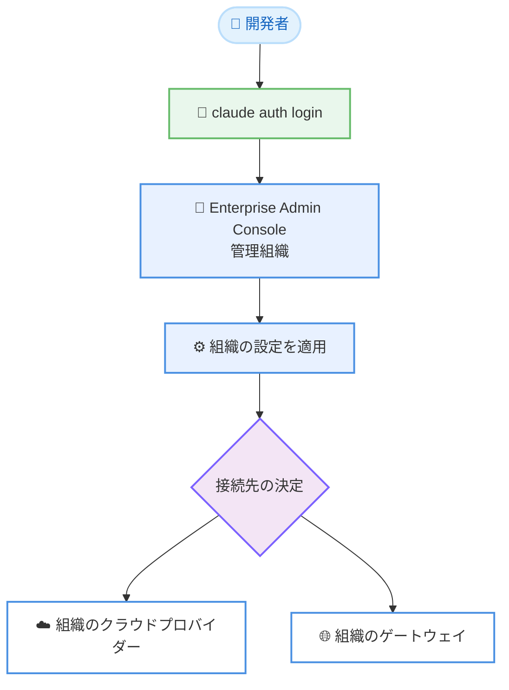

# Claude Code v2.1.330 リリース: Enterprise Admin Console 管理組織へのサインイン対応とチャート描画 mod「easel」を含む 142 項目のアップデート

## メタデータ

| 項目 | 内容 |
|------|------|
| 発表日 | 2026-11-21 (npm 公開: 2026-11-20 UTC) |
| ソース | Claude Code Changelog |
| カテゴリ | Claude Code / CLI アップデート |
| 公式リンク | https://github.com/anthropics/claude-code/blob/main/CHANGELOG.md |

## 概要

Claude Code v2.1.330 がリリースされた。142 項目からなる大規模リリースであり、新機能 16 項目、バグ修正 98 項目、改善 14 項目、挙動変更 13 項目、取り消し (revert) 1 項目が含まれる (このうち VS Code 拡張の更新は 28 項目)。

最大のトピックは 2 つある。1 つは **Enterprise Admin Console 管理組織へのサインイン対応**で、`claude auth login` の後に組織の設定が適用され、組織のクラウドプロバイダーまたはゲートウェイが使用されるようになった。もう 1 つは **チャート描画の組み込み mod「easel」の追加**で、依頼時や MCP メトリクス結果の下にチャートを描画できるようになった。

このほか、非常に長い会話のコンパクト直後に数分間フリーズする問題や WebFetch がセッションを数分間フリーズさせる問題の修正といった安定性改善、Self-hosted runner に関する 20 項目超の追加・修正、スケジュールタスクと `/loop` の実行期間の 7 日から 30 日への延長、Code Mode の修正・改善などが幅広く含まれている。また、v2.1.329 で削除された `max_tokens` エラー時の自動リトライが本バージョンで復活した点にも注意が必要である。

## 詳細

### 背景

v2.1.329 では `/code-review` のブランチ全体レビュー化と Code Mode の安定化が中心だった。v2.1.330 はエンタープライズ向けの管理機能を大きく前進させるリリースであり、Enterprise Admin Console で管理される組織の設定・クラウドプロバイダー・ゲートウェイがサインインだけで適用されるようになった。同時に、長い会話のコンパクト後のフリーズや WebFetch のフリーズなど、日常利用で体感しやすい安定性の問題にも集中的に対処している。

### 主な変更点

#### 1. Enterprise Admin Console 管理組織へのサインイン対応 (重要)

Anthropic の Enterprise Admin Console で管理されている組織へのサインインに対応した。`claude auth login` の後、Claude Code は組織の設定を適用し、組織のクラウドプロバイダーまたはゲートウェイを使用する。

これにより、エンタープライズ環境では各開発者のローカル設定に頼らず、組織側で一元管理された設定・接続先を Claude Code に適用できるようになった。



あわせてサインイン体験も改善されている。

- **サインインリンクの短縮**: `/login`、`claude auth login`、`claude setup-token` が表示する claude.ai のサインインリンクが大幅に短くなった
- **`CLAUDE_CODE_FULL_SIGN_IN_LINK=1` の追加**: 短いリンクがエラーになる場合や、スクリプトがリンクから値を読み取る場合に、完全なサインインリンクを表示できる
- **`forceLoginOrgUUID` の修正**: 一時的なサーバーエラーや接続断が 1 回起きただけで起動が拒否される問題を修正

#### 2. easel: チャート描画の組み込み mod (新機能)

チャートを描画する組み込み mod「easel」が追加された。

- **動作**: チャートの作成を依頼したときと、MCP メトリクス結果の下に、チャートを描画する
- **対象プラン**: Pro、Max、および利用可能な場合は Team / Enterprise
- **対象プラットフォーム**: macOS / Linux
- **設定**: 自動チャート描画は `/config` でオフにできる

関連する修正・注意点もある。

- Code Mode で組み込みチャートツールの呼び出しが失敗する問題が修正された
- MCP の許可リスト / 拒否リストが組み込みチャートツールを除外している場合、起動のたびに "MCP server blocked by enterprise policy: easel" という警告が表示される問題が修正された (ツール自体はブロックされたまま)

#### 3. 安定性の改善: フリーズと同時実行の修正 (重要)

日常利用で体感しやすいフリーズ・データ消失の修正が多数含まれる。

**フリーズの修正:**

- **コンパクト後のフリーズ**: 非常に長い会話をコンパクトした直後に、Claude Code が最大数分間フリーズする問題を修正
- **WebFetch のフリーズ**: 一部のページで WebFetch がセッションを数分間フリーズさせる問題と、別の一部のページで空の結果を返す問題を修正
- **スリープ復帰後の待機**: Linux と WSL で、2 分以上のスリープ後の最初のプロンプトが、切断済みのコネクションを 3 分間待つ問題を修正
- **Linux の Bash 遅延**: `node_modules` のような大きな ignore 対象フォルダーを持つ遅いリポジトリで、Bash コマンドが数秒待たされ、セッションの残りでファイル diff が表示されない問題を修正
- **Windows の Bash 遅延**: Git Bash の起動に 10〜60 秒かかった後、セッションの残りで Bash コマンドが遅くなる問題を修正

**同時実行によるデータ消失の修正:**

- 複数の Claude Code プロセスが同時に保存した際に、ユーザー設定の変更が失われる問題を修正
- 複数の `claude plugin` コマンドが同時に実行された際に、インストール済みリストからプラグインが消える問題を修正
- 複数のタスク更新が同時に実行された際に、タスクの依存関係とメタデータが失われる問題を修正
- `ExitWorktree` とワークツリー終了ダイアログが、別の実行中セッションが作業している worktree を削除してしまう問題を修正

**そのほかの重要な修正:**

- 多数の MCP ツールが API に拒否される入力スキーマを持つ場合に、ターンが "JSON schema is invalid" で失敗し、セッションファイルが数メガバイト単位で肥大化する問題を修正
- ディスクが満杯のときに `~/.claude.json` の不完全なバックアップが保持され、正常なバックアップを押しのける問題を修正
- 最後に保存されたメッセージのタイムスタンプが欠落・不正な場合に、`--continue` と `--resume` が空のセッションを開くか失敗する問題を修正

#### 4. スケジュールタスクと /loop の実行期間を 30 日に延長

定期的なスケジュールタスクと `/loop` が、セッションが動き続けている間、従来の 7 日ではなく最大 30 日まで実行されるようになった。終了時にはその旨が通知される。

**注意**: このリリースより前に作成されたタスクは、引き続き 7 日で終了する。30 日の実行期間が必要な場合は、タスクを作成し直す。

#### 5. Code Mode の修正と改善

- **大量読み取り後の停止の修正**: パススコープのルールや Read の拒否ルールを持つプロジェクトで、数百のファイルを読むコードの後に長い停止が発生する問題を修正
- **ターン終了要求の尊重**: auto モードと bypass permissions モードで、スクリプトからの MCP ツールのターン終了要求を無視する問題を修正
- **プロンプトキャッシュの保全**: auto モードで、スクリプトがスキルを読み込んだ後に mod がノートを追加すると、以前の思考が失われてプロンプトキャッシュが書き直される問題を修正
- **ファイル復元の修正**: Esc と `/compact` の後に、スクリプトが読んだファイルが復元されない問題を修正
- **`/context` の修正**: Claude の最初の応答前に、Code Mode のシステムツールが過少にカウントされる問題を修正
- **画像・PDF の扱いの改善**: 画像や PDF の見方が Claude に伝えられるようになった
- **中断表示の改善**: Esc の後、停止したコマンドの下に赤いエラーではなく "Interrupted" と表示されるようになった
- **フリーズ時間の短縮**: サブエージェントのスクリプトが数千回のツール呼び出しを行った後の、ターミナルのフリーズ時間が大幅に短縮された

#### 6. Self-hosted runner の追加・修正・変更

Self-hosted runner には新機能 4 項目を含む 20 項目超の更新が含まれる。

**新機能:**

- **`--start-dir` / `SELF_HOSTED_RUNNER_START_DIR`**: リポジトリ内の指定フォルダーから Claude が作業を開始できるようになった (設定とフックの読み込みは従来どおり)
- **メトリクスの追加**: `/metrics` に、作業指示の発行から登録受理までの秒数 (`claude_code_self_hosted_runner_order_to_registered_seconds`) と、作業指示から最初のセッション引き渡しまでの秒数 (`claude_code_self_hosted_runner_order_to_first_session_seconds`) が追加された
- **プラグインに関する通知**: クラウド / Self-hosted runner セッションで、プラグインマーケットプレイスのリポジトリがセッションのリポジトリに含まれないため取得できない場合に通知が表示される。Anthropic 管理の git がプラグイン自身のリポジトリを拒否した場合も、プラグイン名と対処法を含む通知が表示される

**運用に関わる修正:**

- 失敗レポートが失われた後や、セッションが同じランナーに戻された後に、ランナーが終了までそのセッションを無視する問題を修正
- 再起動で準備できなかったリポジトリのリストが変わると、プロンプトキャッシュと以前の思考が失われる問題を修正
- テレメトリ無効のセッションで、新しいランナーが権限プロンプトを引き継いだ際に、プロンプト待ちのツール呼び出しが結果なしで消える問題を修正
- `--push-outcome-on-release` 設定時に、大きなリポジトリで再開セッションがプッシュ済みの作業なしで開始される問題を修正
- Linux で `pkill -f` が自分自身のシェルを終了コード 144 で終了させる、またはランナー自体を終了させる問題を修正 (`--ignore-ancestors` に対応した `pkill` が必要)
- ディスク満杯の状態で起動したランナーがセッションを受け取って失敗させる問題を修正 (空き容量を待ち、作業指示からの起動でなければ 1 分後に終了コード 1 で終了する)
- IP 許可リストなどによる 403 が不正なシークレット / トークンとして記録される問題を修正。該当するログ行の多くはサーバー側の理由から始まるようになったため、**旧文言にマッチするログアラートは更新が必要**
- リポジトリ設定の warn モードが、ほとんどの種類で最初の検出で停止する問題を修正 (セッションあたり最大 50 件まで継続する)

**挙動変更:**

- `spawn-runner` フックが、先行フックの実行中にも開始されるようになった (オーケストレーターあたり `--hook-concurrency`、デフォルト 4 まで並行)。並行実行できないフックは 1 に設定する
- 不要な場合は Bash コマンドのファイル diff を省略するようになった。すべての diff が必要な場合は managed settings で `bashEditDiffEnabled` を true に設定する
- チェックアウトフックが終了コード 108 で終了した場合、他のランナーを試さずにセッションの開始を即座に停止するようになった

#### 7. そのほかの新機能と改善

- **`claude plugin install --json` の拡張**: プラグインのインストールコマンドが stderr に出力した場合に true になる `commandPrinted` と、エラー終了・強制終了・タイムアウトした場合の `commandFailed` が結果に追加された
- **`/config` 検索の改善**: 入力した文字で始まる設定が先頭に来るようになり、"effort" で Model が、"dark" や "light" で Theme が見つかるようになった
- **`/resume` の改善**: `/model` などの画面を開いて離れただけのセッションが一覧に表示されなくなった
- **Windows の検索速度改善**: ローカルパスでの組み込み ripgrep 検索ごとにコンソールホストを起動しなくなり、Grep と Glob が高速化した。ファイル diff の速度も改善された
- **`/ultrareview` のコスト確認の改善**: Team / Enterprise プランで、月間支出上限の残りがレビューの通常コストより少ない場合に、残額が表示されるようになった

#### 8. VS Code 拡張の更新 (28 項目)

- **`/fork` の追加**: 最後の応答の後で会話をフォークできるようになった
- **`/workflows` の追加**: 実行中のワークフローを含むエージェントマップを開けるようになった
- **設定の追加**: Escape で Claude を停止させない `claudeCode.escapeStopsClaude`、メッセージのピン留めを解除する `claudeCode.pinPrompt`、コンテキストインジケーターの表示タイミングを制御する `claudeCode.contextUsageThreshold` が追加された
- **誤操作の防止**: `/rewind` での Enter 長押しによるファイル復元や、Remove / Delete のダブルクリックによるメモリ・MCP サーバー・マーケットプレイスの削除が、確認なしで実行される問題を修正。Enter 長押しが書きかけのメッセージを送信する問題も修正
- **macOS のキー操作の修正**: リネームボックスとダイアログで Cmd+A / C / V / X / Z が効かない問題、メッセージボックスで Ctrl+F / Ctrl+P がキャレットを動かさない問題を修正
- **diff 操作の修正**: 新しいウィンドウに移動した提案 diff で Accept / Reject ボタンが機能しない問題と、Accept / Reject ボタンがチャットやターミナルタブなど無関係な画面に表示される問題を修正
- **フォークの修正**: パネルでフォークした会話が、ウィンドウ再読み込み後に古い未回答プロンプトを勝手に再実行する問題と、元の会話の `/loop` スケジュールを二重に実行する問題を修正
- **コードブロックコピーの修正**: コードブロックのコピーで末尾に改行が付き、ペースト時にコマンドが実行されてしまう問題を修正

#### 9. 注目のバグ修正 (抜粋)

- **`/rewind` の復元ミス**: ファイルを変更したターンの直後に、キューされた 2 つのプロンプトやスタックされたスキルが一緒に実行されると、古いバージョンのファイルが復元されることがある問題を修正
- **サブエージェントの MCP サーバー**: サブエージェントが宣言した MCP サーバーが、1 つのサブエージェントの終了時に、他のサブエージェントやセッションが使用中でもシャットダウンされる問題を修正
- **Amazon Bedrock のモデル選択**: モデル未選択で開始したターミナルセッションが、ピン留めされた Opus モデルを無視し、フォールバックを告げた後も利用できないデフォルトモデルを呼び続ける問題を修正
- **`claude -p` の終了コード**: ディスク満杯でファイルへの出力が失敗した際に、メッセージなしで 0 で終了する問題を修正 (エラーを表示して 1 で終了する)
- **`/stats` のタイムゾーン**: 新しいアクティビティが UTC の日付でカウントされる問題を修正 (ローカルタイムゾーンでカウントされる)
- **claude.ai コネクタ**: サーバー URL を共有する別名のコネクタが削除される問題 (anthropics/claude-code#101856) と、@ メンションされたコネクタ / プラグインサーバーの MCP リソースが添付されない問題を修正
- **Claude in Chrome**: 一時的な接続問題の後、Chrome が開いていてサインイン済みでも「未接続」のままになる問題を修正
- **`/mcp` の分類**: プラグインの MCP サーバーが組み込みとして表示される問題を修正 ("Plugin MCPs" の下に表示され、サーバーのページに所属プラグイン名が示される)

#### 10. そのほかの挙動変更と取り消し

- **`max_tokens` 自動リトライの復活 (重要)**: v2.1.329 で削除された、モデルやゲートウェイの上限を超えた場合の自動リトライが復活した。前リリースで `CLAUDE_CODE_MAX_OUTPUT_TOKENS` の設定を案内されていたユーザーは、自動リトライに戻ったことを把握しておく
- **`rm` コマンドの承認強化**: ルート、ホーム、トップレベルフォルダー、作業フォルダーを対象とする、より多くの `rm` コマンドが承認を求めるようになった。誰も回答できない環境では拒否される
- **`deniedMcpServers` の変更**: 名前エントリは指定された claude.ai コネクタのみを隠すようになった (同じ URL の他のコネクタは隠さない)。URL のすべてのコネクタをブロックするには、正確な URL を拒否する
- **`claude --teleport` の変更**: 一部の環境では、ブランチ切り替えの git コマンドを実行する代わりに表示するようになった。`-p` では切り替えるまで終了コード 1 で終了する
- **システムプロンプトの変更**: "sonnet" や "haiku" を含む未認識のモデル名が、他の未認識の名前と同様に短いシステムプロンプトを使うようになった。`CLAUDE_CODE_SIMPLE_SYSTEM_PROMPT=0` ですべてのモデルに完全なプロンプトを与えられる
- **スキルとモデルの関係の変更**: `model` 設定付きで実行されるスキル (`context: fork` スキルを除く) は、サブエージェント・フォーク・コンパクション・`/recap` をセッションのモデルに残すようになった。また、サブエージェントのモデルフォールバックが引き継がれるようになった
- **プロンプトフックの拡張**: `model` フィールドで `haiku` や `sonnet` などのモデルエイリアスを受け付けるようになった
- **トークン使用量の削減**: Claude apps ゲートウェイにサインインしたターミナルセッションで、サブエージェントの進捗サマリーが会話全体ではなく短いノートから書かれるようになり、使用トークンが大幅に減った

### 技術的な詳細

#### Self-hosted runner の開始フォルダー指定

リポジトリ内の特定フォルダー (モノレポのサブプロジェクトなど) から作業を開始させる場合は、`--start-dir` または環境変数を使用する。設定とフックの読み込みは指定なしの場合と同じである。

```bash
# コマンドラインオプションで指定
claude self-hosted-runner --start-dir packages/web-app

# 環境変数で指定
export SELF_HOSTED_RUNNER_START_DIR=packages/web-app
```

#### 完全なサインインリンクの表示

短縮されたサインインリンクがエラーになる場合や、スクリプトがリンクから値を読み取る場合は、環境変数で完全なリンクを表示する。

```bash
CLAUDE_CODE_FULL_SIGN_IN_LINK=1 claude auth login
```

#### Self-hosted runner のファイル diff を常に取得する

v2.1.330 から、不要な場合は Bash コマンドのファイル diff が省略され、トランスクリプトに diff が含まれないことがある。監査などですべての diff が必要な場合は、managed settings で明示する。

```json
{
  "bashEditDiffEnabled": true
}
```

## 開発者への影響

### 対象

- **Enterprise Admin Console で管理される組織のユーザー**: `claude auth login` だけで組織の設定とクラウドプロバイダー / ゲートウェイが適用されるようになった。組織管理者は Admin Console 側の設定が開発者の Claude Code に反映されることを把握しておく
- **Pro / Max / Team / Enterprise の macOS / Linux ユーザー**: チャート描画 mod「easel」が利用可能になった。自動チャートが不要な場合は `/config` でオフにする
- **長い会話・WebFetch の利用者**: コンパクト後のフリーズや WebFetch のフリーズが解消されるため、早期の更新による恩恵が大きい
- **スケジュールタスク / `/loop` の利用者**: 実行期間が最大 30 日に延長された。ただし旧バージョンで作成したタスクは 7 日のままのため、必要に応じて作成し直す
- **Self-hosted runner の運用者**: `--start-dir` の追加、新メトリクス、403 ログの文言変更、`spawn-runner` フックの並行実行化、ファイル diff の省略など、運用設定とログアラートの見直しが必要な変更が多い
- **ゲートウェイ利用者**: v2.1.329 で削除された `max_tokens` エラー時の自動リトライが復活した
- **VS Code 拡張の利用者**: `/fork`・`/workflows` の追加、新しい設定 3 種、誤操作防止など日常操作に関わる更新が 28 項目含まれる

### 必要なアクション

1. **アップデートの適用**: コンパクト後・WebFetch のフリーズ修正、同時実行によるデータ消失の修正など、安定性に関わる修正が多いため早期の更新を推奨する
2. **スケジュールタスクの再作成**: 30 日の実行期間が必要な既存タスクは、このリリース以降に作成し直す
3. **Self-hosted runner のログアラートの更新**: 403 エラーのログ行がサーバー側の理由から始まるようになったため、旧文言にマッチするアラートを更新する
4. **Self-hosted runner のフック・diff 設定の確認**: 並行実行できない `spawn-runner` フックには `--hook-concurrency 1` を設定する。すべての Bash diff が必要な場合は managed settings で `bashEditDiffEnabled` を true にする
5. **ゲートウェイ利用者の設定確認**: `max_tokens` の自動リトライが復活したため、v2.1.329 対応として `CLAUDE_CODE_MAX_OUTPUT_TOKENS` を設定した場合は必要性を再確認する
6. **`deniedMcpServers` の確認**: 名前指定が同一 URL の他コネクタを隠さなくなったため、URL 単位でブロックしたい場合は正確な URL を拒否するよう設定を見直す

### 移行ガイド (該当する場合)

- **未認識モデル名で "sonnet" / "haiku" を含む名前を使っている場合**: 短いシステムプロンプトが使われるようになった。完全なシステムプロンプトが必要な場合は `CLAUDE_CODE_SIMPLE_SYSTEM_PROMPT=0` を設定する
- **スキルの `model` 設定に依存した運用をしている場合**: `context: fork` 以外のスキルでは、サブエージェント・フォーク・コンパクション・`/recap` がセッションのモデルで実行されるようになったため、モデルの使い分けを確認する

## 関連リンク

- [Claude Code Changelog](https://github.com/anthropics/claude-code/blob/main/CHANGELOG.md)
- [v2.1.330 リリースページ](https://github.com/anthropics/claude-code/releases/tag/v2.1.330)
- [Claude Code 公式ドキュメント](https://code.claude.com/docs)
- [claude-code リポジトリ](https://github.com/anthropics/claude-code)

## まとめ

Claude Code v2.1.330 は、Enterprise Admin Console 管理組織へのサインイン対応によりエンタープライズでの一元管理を前進させ、チャート描画 mod「easel」で可視化機能を組み込みで提供するリリースである。コンパクト後や WebFetch のフリーズ、複数プロセスの同時保存によるデータ消失といった日常利用の安定性問題を集中的に解消し、スケジュールタスクと `/loop` の実行期間を 30 日に延長した。Self-hosted runner は `--start-dir` や新メトリクスの追加に加え、ログ文言やフックの並行実行など運用に関わる変更が多いため、運用者は設定とアラートの見直しを推奨する。また、v2.1.329 で削除された `max_tokens` エラー時の自動リトライが復活している点にも留意が必要である。
