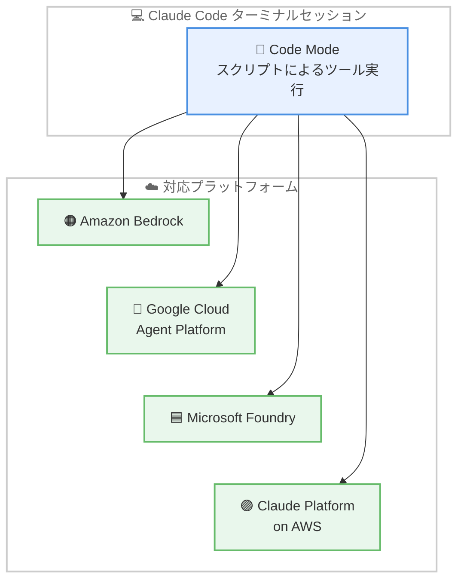

# Claude Code v2.1.331 リリース: 主要クラウドプラットフォームでの Code Mode 対応とプラグイン optionalDependencies を含む 134 項目のアップデート

## メタデータ

| 項目 | 内容 |
|------|------|
| 発表日 | 2026-11-23 |
| ソース | Claude Code Changelog |
| カテゴリ | Claude Code / CLI アップデート |
| 公式リンク | https://github.com/anthropics/claude-code/blob/main/CHANGELOG.md |

## 概要

Claude Code v2.1.331 がリリースされた (npm registry の公開日時 2026-11-23 で確認)。134 項目からなるリリースであり、新機能 14 項目、バグ修正 94 項目、改善 18 項目、挙動変更 8 項目が含まれる (このうち VS Code 拡張の更新は 78 項目)。

最大のトピックは **Code Mode の対応プラットフォーム拡大**で、Amazon Bedrock、Google Cloud の Agent Platform、Microsoft Foundry、Claude Platform on AWS のターミナルセッションでも Code Mode が利用できるようになった。あわせて、プラグインマニフェストへの **`optionalDependencies`** の追加、`claude doctor` への **API 接続性セクション**の追加、Claude apps gateway の **`oidc.groups_jsonpath`** 対応など、エンタープライズと運用まわりの機能強化が目立つ。修正面では、ローカル / WebSocket MCP サーバーの不正な応答で **MCP ツール呼び出しが最長 30 分ハングする問題**の解消をはじめ、CLI・VS Code 拡張ともに日常利用の安定性に関わる修正が幅広く含まれている。

## 詳細

### 背景

v2.1.329 では `/code-review` の動作変更と Code Mode のメモリ・実行制御の安定化が中心だった。v2.1.331 はその流れを引き継ぎつつ、これまで一部環境に限られていた Code Mode をサードパーティクラウドプラットフォームのターミナルセッションへ展開した。また、ゲートウェイの OIDC 設定や OpenTelemetry のトレース属性など、組織導入時に求められていた機能の追加が進んでいる。VS Code 拡張は 78 項目と大規模な更新で、エディター統合の新機能とパフォーマンス改善が集中的に投入された。

### 主な変更点

#### 1. Code Mode の対応プラットフォーム拡大 (重要)

Amazon Bedrock、Google Cloud の Agent Platform、Microsoft Foundry、Claude Platform on AWS のターミナルセッションで Code Mode がサポートされた。これまで利用できなかったサードパーティプロバイダー経由の環境でも、スクリプトによるツール呼び出しの集約が可能になる。



Code Mode 関連ではこのほか、次の修正・改善も含まれる。

- `--resume` / `--continue` で別の権限モードから再開したセッションが、thinking とプロンプトキャッシュを失う問題を修正。確認を求めるモードで開始したセッションは、そのモードのスクリプト制限を維持する
- 長いスクリプト出力の中間部分が失われる問題を修正。切り詰められていないテキストへのパスが Claude に渡されるようになった
- `--bare` 使用時に、スクリプトが呼び出せる対象が Claude に伝えられない問題を修正
- スクリプト実行中に `!` やスラッシュコマンドを入力すると、約 1 秒ごとにリクエストが送信される問題を修正
- Code Mode のツール検索が、MCP ツールの説明 (制限、フォーマット、デフォルト値) をより多く表示するよう改善された

#### 2. プラグインマニフェストの `optionalDependencies` (新機能)

プラグインマニフェストに `optionalDependencies` が追加された。これを列挙したプラグインと一緒にインストールされるが、単独で無効化・アンインストールできる。必須の依存関係と異なり、ユーザーが不要な付属プラグインを外せるようになる。

プラグイン関連ではあわせて、次の修正・改善が含まれる。

- 中断・失敗したプラグイン更新が不完全なフォルダーを残し、後からスキルなどのコンポーネントが欠けた状態で読み込まれる問題を修正
- `claude plugin install` や `marketplace add` などのコマンドが、managed settings の承認を求められない状況で出力なしにハングする問題を修正
- プラグイン自動更新の通知が、依存関係として新規インストールされたプラグインを更新分と分けて表示するよう改善された

#### 3. `claude doctor` の API 接続性セクション (新機能)

`claude doctor` に API 接続性セクションが追加された。API に到達できるかどうかを HTTP ステータスまたはエラーとともに報告し、テストされなかった場合はその理由を表示する。プロキシやファイアウォール起因の接続問題の切り分けが容易になる。

#### 4. ゲートウェイとエンタープライズ機能の強化

- **`oidc.groups_jsonpath` の追加**: Claude apps gateway で、JSONPath (RFC 9535) の小さなサブセットを使い、オブジェクトのリストの一致エントリからグループを読み取れるようになった
- **`CLAUDE_GATEWAY_IDP_CONNECT_BY_HOSTNAME=1` の追加**: `oidc.use_proxy: true` のとき、`NO_PROXY` が設定されていても、サインインリクエストが https の IdP のホスト名をプロキシに渡すようになる
- **`CLAUDE_CODE_DISABLE_RESPONSE_COMPRESSION` の追加**: 圧縮レスポンスを切断するプロキシの背後で、非圧縮のモデルレスポンスを要求できる (Self-hosted runner と Remote Control ではまだ非推奨)
- **OpenTelemetry トレース属性の追加**: `claude_code.llm_request` トレーススパンに `gen_ai.usage.*`、`gen_ai.response.model`、`gen_ai.operation.name` が追加された。`gen_ai.usage.input_tokens` にはプロンプトキャッシュトークンが含まれる

#### 5. MCP とツール呼び出しの修正 (重要)

- **MCP ツール呼び出しのハング修正**: ローカルまたは WebSocket サーバーの不正な応答で、MCP ツール呼び出しが最長 30 分ハングする問題を修正
- カスタム API エンドポイントがツール名のないツール呼び出しを返すとクラッシュする問題を修正。呼び出しはエラーとなり、セッションは継続する
- 思考中に応答が途絶えた場合に、クラウドセッションでターンやサブエージェントが失敗する、または長い応答でタイムアウトする問題を修正。リクエストが 1 回再試行されるようになった
- Workflow エージェントのバックグラウンドシェルと MCP サーバーが、レポート返却後も実行されたままになることがある問題を修正

#### 6. Windows 関連の修正

- レジストリの managed settings に日本語などの非 ASCII 文字が含まれると Claude Code が起動しない問題を修正 (anthropics/claude-code#93280)
- FAT32 / exFAT ドライブへのファイル書き込みが、一部のプラグインセッションで毎回権限を求める問題を修正
- メモリがほぼ枯渇したマシンでクラッシュする可能性を修正
- `/desktop` が古い Claude Desktop インストーラーをダウンロードする問題を修正
- **起動時の注意 (挙動変更)**: レジストリに managed settings がある場合、`HKLM` ポリシーは `managed-settings.json` より優先され、壊れた値は起動を停止させることがある。アップグレード前に確認すること

#### 7. VS Code 拡張の更新 (78 項目)

**エディター統合の新機能:**

- **"Fix with Claude Code"**: エラー・警告のクイックフィックスと、テストピーク / Test Results ビューの失敗テストに追加され、問題をチャットボックスに投入できる
- **"Resolve Merge Conflicts"**: マージコンフリクトのあるファイルのエディタータイトルと、Source Control の Merge Changes グループに追加された
- **"Add Cell to Chat"**: ノートブックのセルメニューから、出力やエラー付きでセルを添付できる
- **"Add to Chat"**: Source Control ビューの変更ファイルの右クリックメニューに追加された
- 非常に大きな選択範囲や添付テキストファイルの送信前に通知が表示され、"Prompt is too long" の下に大きい部分と対処方法が示されるようになった

**パフォーマンス改善:**

- 長いチャットでの応答性が改善された。返信のストリーミング中もスムーズな入力と大きなファイル書き込みが可能になり、権限プロンプトの表示が高速化した
- パネルと新しいチャットタブが速く開き、リモートウィンドウ (SSH、WSL、コンテナー) でもパネル起動・返信表示・セッション再開が高速化した
- 長い会話のフォークや巻き戻しのたびにメモリが増え続ける問題を修正

**注目の修正と変更:**

- 提案された diff の保存は、提案側 (右側) をクリックまたは入力した後にのみ受け入れられるようになった。保存が拒否された場合は通知が表示される
- フォークした会話が元の会話のプランファイルを上書きする問題を修正
- `allowManagedPermissionRulesOnly` 設定時、許可ルールを提示する権限カードは Yes と No のみを表示するようになった
- Claude やフック、MCP サーバーから Electron アプリや拡張テストが起動しない問題を修正。VS Code を Node として実行するラッパーやフックは `ELECTRON_RUN_AS_NODE=1` の設定が必要になった
- `files.encoding` が UTF-8 以外のとき、提案 diff が文字化けして保存される問題や、ヘブライ語・アラビア語・ペルシア語の行で右から左へのマークが `\u200F` というリテラルのエスケープ文字列として保存される問題を修正

#### 8. そのほかの新機能と改善

- **音声入力の通知**: タップモードの音声入力が、認識できる音声なしで 15 秒経過または 2 分の上限で自動停止した際に通知が表示されるようになった
- **起動時間の改善**: 直前のセッションの直後に開始したセッションはモデルリストを待たず、git リポジトリ外で `.claude/settings.local.json` がない場合は git を待たなくなった
- **スクリーンリーダーモードの入力速度改善**: 特に長いセッションで入力が高速化した
- `/login` と `claude auth login --console` が表示する Console サインインリンクが大幅に短くなった
- `@file#10-12` 形式の @ メンションが、指定行ではなくファイル全体を添付する問題を修正
- `/compact` と自動コンパクションが、特定の XML タグを引用した要約の一部を失うことがある問題を修正
- 復元失敗後の巻き戻しがファイルを削除する問題を修正

#### 9. 今後の変更予告 (注意)

**2026 年 11 月 30 日以降のリリース**で、managed `extraKnownMarketplaces` に含まれるプラグインマーケットプレイスがデフォルトで自動更新されるようになる。オプトアウトするには、該当エントリに `"autoUpdate": false` を設定する。

### 技術的な詳細

#### プラグインマニフェストの `optionalDependencies`

付属プラグインを単独で無効化・アンインストール可能にするには、`dependencies` ではなく `optionalDependencies` に列挙する。

```json
{
  "name": "my-plugin",
  "version": "1.0.0",
  "optionalDependencies": {
    "helper-plugin": ">=1.0.0"
  }
}
```

#### プロキシ環境での非圧縮レスポンス要求

圧縮レスポンスを途中で切断するプロキシの背後では、環境変数で非圧縮レスポンスを要求できる。

```bash
# プロキシが圧縮レスポンスを切断する場合に設定
# Self-hosted runner と Remote Control ではまだ非推奨
export CLAUDE_CODE_DISABLE_RESPONSE_COMPRESSION=1
```

#### マーケットプレイス自動更新のオプトアウト

2026 年 11 月 30 日以降の自動更新デフォルト化に備え、自動更新を避けたいマーケットプレイスには設定を追加する。

```json
{
  "extraKnownMarketplaces": {
    "internal-marketplace": {
      "source": {
        "source": "github",
        "repo": "my-org/claude-plugins"
      },
      "autoUpdate": false
    }
  }
}
```

## 開発者への影響

### 対象

- **Bedrock / Google Cloud / Microsoft Foundry / Claude Platform on AWS の利用者**: ターミナルセッションで Code Mode が利用可能になった。組織で Code Mode を制御している場合は、これらの環境にも適用範囲が広がる点に留意する
- **プラグイン作者**: `optionalDependencies` により、ユーザーが個別に無効化・削除できる付属プラグインを定義できるようになった
- **ゲートウェイ運用者**: `oidc.groups_jsonpath` と `CLAUDE_GATEWAY_IDP_CONNECT_BY_HOSTNAME` により、OIDC グループの読み取りとプロキシ経由のサインインの構成の柔軟性が向上した
- **MCP サーバーの利用者**: 不正な応答による最長 30 分のハングが解消され、ローカル / WebSocket サーバーの信頼性が向上した
- **Windows ユーザー**: レジストリの managed settings に非 ASCII 文字が含まれる環境での起動不能が修正された。一方で `HKLM` ポリシーの優先順位に関する注意が追加された
- **VS Code 拡張の利用者**: "Fix with Claude Code" などのエディター統合の新機能に加え、長いチャットの応答性やリモートウィンドウでの速度が大きく改善された

### 必要なアクション

1. **アップデートの適用**: MCP ハングや CLI フリーズなど安定性に関わる修正が多いため、早期の更新を推奨する
2. **マーケットプレイス設定の確認**: managed `extraKnownMarketplaces` を使っている場合、2026 年 11 月 30 日以降の自動更新デフォルト化に備え、必要なら `"autoUpdate": false` を設定する
3. **Windows の managed settings の確認**: レジストリにポリシーを配布している場合、アップグレード前に `HKLM` の値が正しいか確認する。壊れた値は起動を停止させることがある
4. **VS Code で Electron アプリを起動するフックの確認**: VS Code を Node として実行するラッパー・フック・MCP サーバーは `ELECTRON_RUN_AS_NODE=1` の設定が必要になった
5. **接続問題の診断**: API への接続に問題がある場合は、`claude doctor` の API 接続性セクションで HTTP ステータスやエラーを確認する

### 移行ガイド (該当する場合)

- **提案 diff の保存で編集を受け入れていた場合 (VS Code)**: 保存だけでは受け入れられなくなった。提案側 (右側) をクリックまたは入力してから保存するか、Accept ボタンを使用する
- **圧縮レスポンスを切断するプロキシの背後で応答が途切れる場合**: `CLAUDE_CODE_DISABLE_RESPONSE_COMPRESSION` の設定を検討する (Self-hosted runner と Remote Control では非推奨)

## 関連リンク

- [Claude Code Changelog](https://github.com/anthropics/claude-code/blob/main/CHANGELOG.md)
- [v2.1.331 リリースページ](https://github.com/anthropics/claude-code/releases/tag/v2.1.331)
- [Claude Code 公式ドキュメント](https://code.claude.com/docs)
- [claude-code リポジトリ](https://github.com/anthropics/claude-code)

## まとめ

Claude Code v2.1.331 は、Code Mode を Amazon Bedrock、Google Cloud の Agent Platform、Microsoft Foundry、Claude Platform on AWS のターミナルセッションへ拡大し、プラグインの `optionalDependencies`、`claude doctor` の API 接続性診断、ゲートウェイの `oidc.groups_jsonpath` といったエンタープライズ向け機能を加えたリリースである。MCP ツール呼び出しの最長 30 分のハング解消や Windows の非 ASCII managed settings 対応など、安定性の修正も幅広い。VS Code 拡張は "Fix with Claude Code" や "Resolve Merge Conflicts" などのエディター統合と大規模なパフォーマンス改善を含む 78 項目の更新となった。managed マーケットプレイスの自動更新が 2026 年 11 月 30 日以降デフォルト化される予告が含まれるため、該当する組織は事前の設定確認を推奨する。
