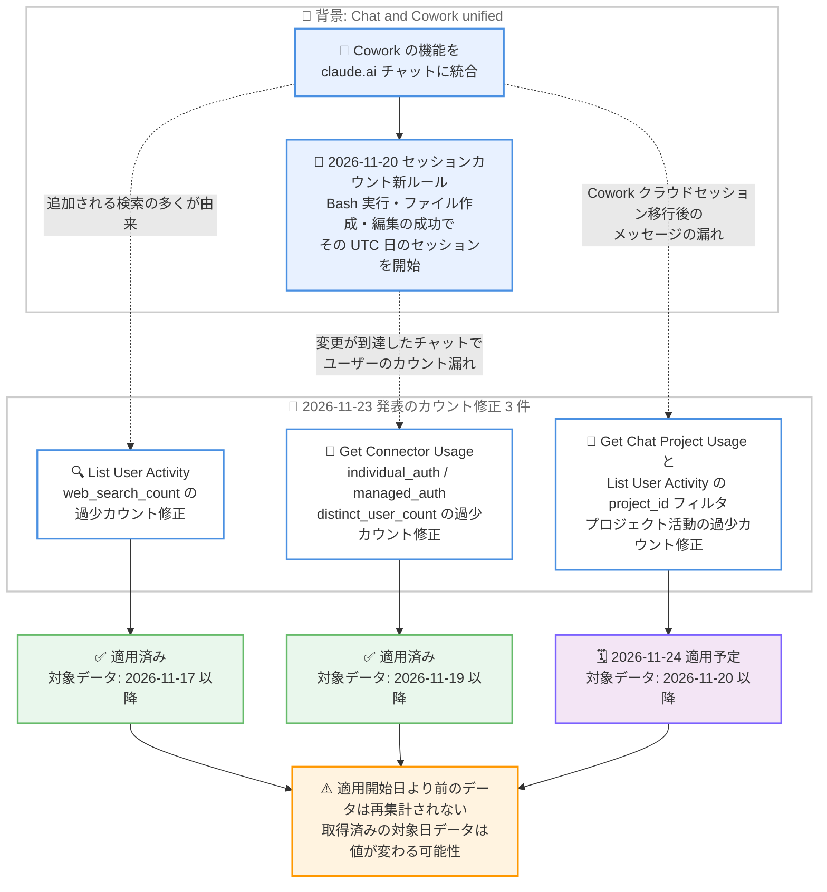

# Claude Enterprise Analytics API のカウント修正 3 件: Web 検索数、コネクタ利用ユーザー数、プロジェクト活動

## メタデータ

| 項目 | 内容 |
|------|------|
| 発表日 | 2026-11-23 |
| ソース | Claude API Release Notes |
| カテゴリ | API |
| 公式リンク | https://platform.claude.com/docs/en/release-notes/overview |

## 概要

Anthropic は 2026 年 11 月 23 日、Claude API リリースノートで Claude Enterprise Analytics API のカウント修正 3 件を発表しました。いずれも実際の利用より少なく集計される過少カウント (undercount) の修正です。

1 件目は List User Activity エンドポイントのトップレベル `web_search_count` の修正で、チャットで Claude が使用する一部の検索ツールがカウントされていなかった問題が解消されました (適用済み)。2 件目は Get Connector Usage エンドポイントの `individual_auth_distinct_user_count` と `managed_auth_distinct_user_count` の修正で、コネクタを使用したユーザーの一部がカウントから漏れていた問題が解消されました (適用済み)。3 件目はプロジェクト活動の過少カウント修正で、Get Chat Project Usage エンドポイントと、`project_id` でフィルタした List User Activity エンドポイントが対象です (2026 年 11 月 24 日に適用予定として告知)。

各修正はそれぞれ異なる適用開始日 (UTC 基準で 2026 年 11 月 17 日、19 日、20 日) 以降のデータにのみ適用され、それより前の日付のデータは再集計されません。

## 詳細

### 背景

Claude Enterprise Analytics API は、Claude Enterprise 組織向けに組織全体のエンゲージメント・導入状況・コストデータ (ユーザー活動、プロジェクト・スキル・コネクタの利用状況など) を提供する API です。claude.ai で作成する `read:analytics` スコープ付きの Analytics API キーを使用し、エンドポイントは `https://api.anthropic.com/v1/organizations/analytics/` 配下に提供されます。

今回の修正の背景には、2026 年 11 月 20 日のリリースノートで発表された「Chat and Cowork unified」のセッションカウント新ルールがあります。Chat and Cowork unified は Cowork の機能を claude.ai のチャットに統合したもので、新ルールでは、UTC 日の中で Claude が Bash コマンドの実行、ファイルの作成、ファイルの編集のいずれかに最初に成功した時点でセッションが開始し、その日の終わりに終了するとカウントされます (旧ルールでは、チャットが Cowork クラウドセッションに移行した後はその後の日も含めてセッションとしてカウント)。この変更は段階的にチャットへ展開されています。

11 月 23 日発表の 3 件のうち、コネクタ利用ユーザー数の修正はこのセッションカウント変更が到達したチャットで発生していたカウント漏れを是正するものであると明記されています。また、Web 検索数の修正で追加される検索の多くは Chat and Cowork unified に由来し、プロジェクト活動の修正もチャットが Cowork クラウドセッションへ移行した後のメッセージの漏れを例に挙げており、いずれも Chat and Cowork unified への移行に関連しています。

### 1. List User Activity の web_search_count の過少カウント修正 (適用済み)

List User Activity エンドポイントのトップレベル `web_search_count` が、チャットで Claude が使用するすべての検索ツールをカウントしておらず、一部の検索が漏れていました。修正によりこれらが含まれるようになったため、値は従来より大きくなる可能性があります。追加される検索の多くは Chat and Cowork unified に由来します。

| 項目 | 内容 |
|------|------|
| 対象エンドポイント | List User Activity |
| 対象フィールド | `web_search_count` (トップレベル) |
| 変化の方向 | 値が大きくなる可能性がある |
| 適用期間 | 2026 年 11 月 17 日 (UTC) 以降のデータ |

適用開始日以降の日付について取得済みのカウントは変わる可能性があります。それより前の日付は再集計されません。

### 2. Get Connector Usage の distinct_user_count の過少カウント修正 (適用済み)

Get Connector Usage エンドポイントで、セッションカウント変更が到達したチャットにおいて、`individual_auth_distinct_user_count` と `managed_auth_distinct_user_count` がコネクタを使用したユーザーの一部をカウントから漏らしていました。修正により、ほとんどの組織ではこれらのユーザーの大部分がカウントに含まれるようになります。値は大きくなる可能性があり、従来 `null` だった箇所に数値が表示されるようになる場合もあります。

| 項目 | 内容 |
|------|------|
| 対象エンドポイント | Get Connector Usage |
| 対象フィールド | `individual_auth_distinct_user_count`、`managed_auth_distinct_user_count` |
| 変化の方向 | 値が大きくなる可能性がある。`null` が数値になる場合もある |
| 適用期間 | 2026 年 11 月 19 日 (UTC) 以降のデータ |

適用開始日以降の日付について取得済みのカウントは変わる可能性があります。それより前の日付は再集計されません。

### 3. プロジェクト活動の過少カウント修正 (2026-11-24 適用予定)

2026 年 11 月 24 日に、プロジェクト活動の過少カウント修正が適用される予定であることが告知されました。

**Get Chat Project Usage エンドポイント**: プロジェクトチャット内の一部のメッセージ (例: チャットが Cowork クラウドセッションに移行した後に送信されたメッセージ) がカウントから漏れています。修正後はこれらのメッセージの大部分がカウントされるため、`message_count`、`distinct_conversation_count`、`distinct_user_count` が大きくなる可能性があり、結果に表示されるプロジェクトが増える場合があります。

**List User Activity エンドポイント (`project_id` フィルタ使用時)**: 同様の変更が適用されます。`message_count` と `distinct_conversation_count` が大きくなり、`last_activity_date` がより新しい日付になり、結果に表示されるユーザーが増える可能性があります。

なお、`project_id` フィルタを使用しない場合、これらのメッセージの一部は `chat_cowork_unified_metrics.sessions.message_count` にカウントされます。そのため、同じユーザーのチャットの `message_count` が、フィルタありの場合にフィルタなしの場合より大きくなることがあります。

| 項目 | 内容 |
|------|------|
| 対象エンドポイント | Get Chat Project Usage、List User Activity (`project_id` フィルタ時) |
| 対象フィールド | `message_count`、`distinct_conversation_count`、`distinct_user_count`、`last_activity_date` |
| 変化の方向 | 値が大きくなる可能性がある。表示されるプロジェクト・ユーザーが増える場合もある |
| 適用期間 | 2026 年 11 月 20 日 (UTC) 以降のデータ |

適用開始日以降の日付について取得済みのカウントは変わる可能性があります。それより前の日付は再集計されません。

### 技術的な詳細

3 件の修正の適用状況と適用期間は以下のとおりです。

| 修正 | 発表時の状態 | 適用開始日 (データの対象日、UTC) |
|------|------------|--------------------------------|
| Web 検索数 (`web_search_count`) | 適用済み | 2026-11-17 以降 |
| コネクタ利用ユーザー数 | 適用済み | 2026-11-19 以降 |
| プロジェクト活動 | 2026-11-24 適用予定 | 2026-11-20 以降 |

共通する重要な性質は以下のとおりです。

- **再集計なし**: いずれの修正も、適用開始日より前のデータは再集計しません。適用開始日をまたぐ期間の時系列比較では、集計方法の違いによる不連続が生じます
- **取得済みデータの変化**: 適用開始日以降の日付について、修正前に取得したカウントは修正後の再取得で値が変わる可能性があります
- **過少カウントの是正**: いずれも値が大きくなる方向の修正です

また、List User Activity の API リファレンスによると、データは通常 1 日遅れで利用可能になり、その後数日間は数パーセント程度改定される場合があります。`project_id` フィルタを使用した行では、`chat_cowork_unified_metrics.sessions` のカウントはすべて 0 になります (セッションはプロジェクト単位で計測されないため)。

## アーキテクチャ図



## コード例

### List User Activity で指定日のユーザー活動を取得 (curl)

Analytics API キー (`read:analytics` スコープ) を `x-api-key` ヘッダーで渡します。トップレベルの `web_search_count` が今回の修正対象です。

```bash
# 指定日のユーザー活動を取得 (web_search_count は 2026-11-17 以降の日付で修正後の値になる)
curl "https://api.anthropic.com/v1/organizations/analytics/users?date=2026-11-21" \
  -H "anthropic-version: 2026-10-21" \
  -H "x-api-key: $ANTHROPIC_ANALYTICS_KEY"
```

### project_id フィルタで特定プロジェクトの活動を取得 (curl)

`project_id` フィルタを使用した行は、2026 年 11 月 24 日のプロジェクト活動修正の対象です。

```bash
# 特定プロジェクトに絞ったユーザー活動を取得
curl "https://api.anthropic.com/v1/organizations/analytics/users?date=2026-11-21&filter[]=project_id:claude_proj_XXXX" \
  -H "anthropic-version: 2026-10-21" \
  -H "x-api-key: $ANTHROPIC_ANALYTICS_KEY"
```

## 開発者への影響

### 対象

- Claude Enterprise Analytics API の List User Activity、Get Connector Usage、Get Chat Project Usage エンドポイントを利用している Claude Enterprise 組織
- これらのエンドポイントのデータを BI ツールやダッシュボードに取り込み、利用状況レポートを作成している管理者・分析チーム

### 必要なアクション

- **取得済みデータの再取得**: 適用開始日以降の日付 (Web 検索数は 2026-11-17 以降、コネクタは 2026-11-19 以降、プロジェクト活動は 2026-11-20 以降) について修正前に取得したデータは、過少カウントの可能性があります。正確な値が必要な場合は再取得してください
- **時系列比較の注意**: 適用開始日より前のデータは再集計されないため、適用開始日をまたぐ期間の推移分析では、カウント方法の違いによる見かけ上の増加が起こり得ます。レポートに注記を加えることを検討してください
- **null ハンドリングの確認**: Get Connector Usage の `individual_auth_distinct_user_count` と `managed_auth_distinct_user_count` は、従来 `null` だった箇所に数値が表示されるようになる場合があります。`null` を前提とした処理がある場合は動作を確認してください
- **2026-11-24 の適用に備える**: プロジェクト活動の修正適用後は、Get Chat Project Usage の結果に表示されるプロジェクトや、`project_id` フィルタ時の List User Activity に表示されるユーザーが増える可能性があります。また、フィルタありの `message_count` がフィルタなしより大きくなるケースがある点に留意してください

## 関連リンク

- [Claude API Release Notes](https://platform.claude.com/docs/en/release-notes/overview)
- [Analytics APIs (概要とアクセス方法)](https://platform.claude.com/docs/en/manage-claude/analytics-api)
- [How metrics are defined (Chat and Cowork unified の定義)](https://platform.claude.com/docs/en/manage-claude/analytics-api#how-metrics-are-defined)
- [List User Activity API リファレンス](https://platform.claude.com/docs/en/api/beta/organization/analytics/users/list)
- [Get Connector Usage API リファレンス](https://platform.claude.com/docs/en/api/beta/organization/analytics/connectors/list)
- [Get Chat Project Usage API リファレンス](https://platform.claude.com/docs/en/api/beta/organization/analytics/apps/chat/projects/list)

## まとめ

2026 年 11 月 23 日の Claude API リリースノートでは、Claude Enterprise Analytics API の過少カウント修正 3 件が発表されました。List User Activity の `web_search_count` (2026-11-17 以降のデータに適用済み)、Get Connector Usage のコネクタ利用ユーザー数 (2026-11-19 以降のデータに適用済み)、そして Get Chat Project Usage と `project_id` フィルタ時の List User Activity におけるプロジェクト活動 (2026-11-20 以降のデータを対象に 2026-11-24 適用予定) です。

これらの修正は、2026 年 11 月 20 日に発表された Chat and Cowork unified のセッションカウント新ルールの展開に関連しており、いずれも値が大きくなる方向の是正です。適用開始日より前のデータは再集計されないため、分析チームは対象期間のデータ再取得と、適用開始日をまたぐ時系列比較における不連続への注意が必要です。
