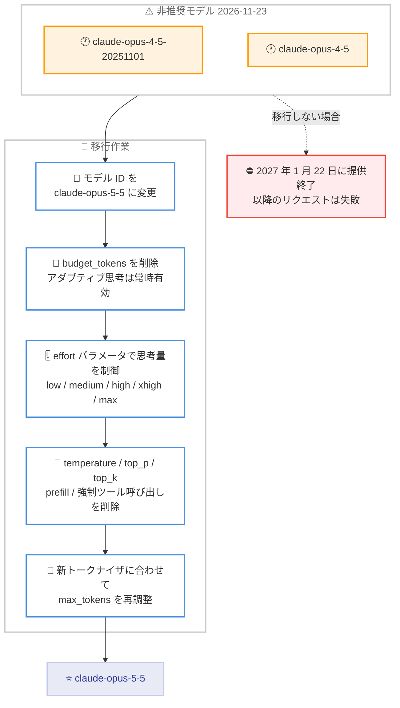
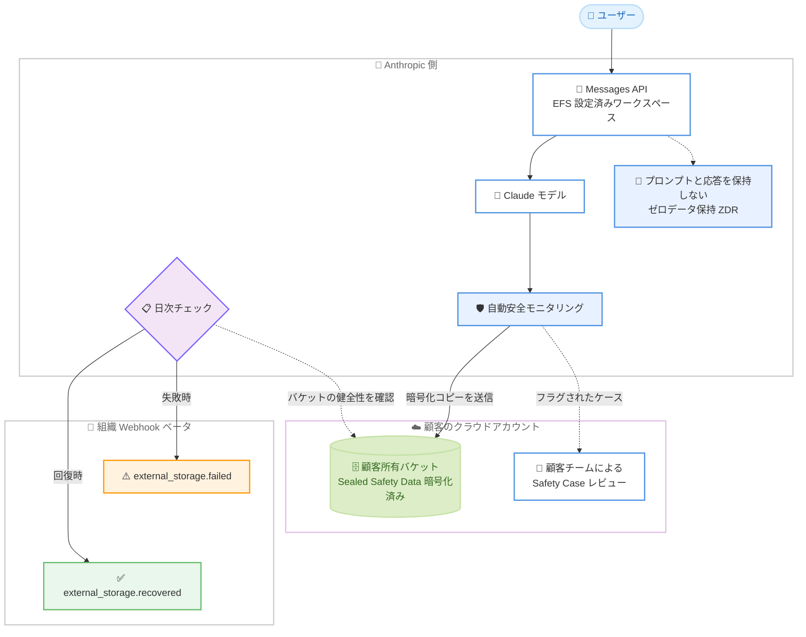

# Claude Opus 4.5 の非推奨化、Enterprise Frontier Safeguards ベータ提供開始、組織 Webhook のイベント追加

## メタデータ

| 項目 | 内容 |
|------|------|
| 発表日 | 2026-11-23 |
| ソース | Claude API Release Notes |
| カテゴリ | API |
| 公式リンク | https://platform.claude.com/docs/en/release-notes/overview |

## 概要

Anthropic は 2026 年 11 月 23 日、Claude API リリースノートで 3 件の更新を発表しました。まず、Claude Opus 4.5 (`claude-opus-4-5-20251101` および `claude-opus-4-5`) の非推奨化が告知され、Claude API での提供終了 (retirement) は 2027 年 1 月 22 日に予定されています。推奨される移行先は Claude Opus 5.5 です。

次に、Enterprise Frontier Safeguards (EFS) がベータで提供開始されました。EFS は対象組織向けのゼロデータ保持 (ZDR) であり、Anthropic はプロンプトと応答を保持せず、暗号化されたコピーである Sealed Safety Data は顧客自身のクラウドアカウント内のバケットに保存されます。あわせて、組織 Webhook (ベータ) に顧客所有ストレージ関連の 2 つのイベントタイプ `external_storage.failed` と `external_storage.recovered` が追加されました。

## 詳細

### 背景

Anthropic は新モデルのリリースに向けた提供能力を確保するため、古いモデルを定期的に非推奨化・提供終了しています。モデル非推奨化ページによると、非推奨 (Deprecated) のモデルは引き続き動作するものの推奨されず、提供終了日が設定されます。提供終了 (Retired) になると、そのモデルへのリクエストは失敗します。公開済みモデルについては、提供終了の少なくとも 60 日前に通知が行われます。

また、EFS と組織 Webhook の更新は、エンタープライズ組織向けのデータガバナンス強化の流れに位置付けられます。従来、最上位モデルの利用にはデータ保持要件が伴いましたが、EFS により対象組織は安全性データを自社のクラウドアカウントに保持したままゼロデータ保持を実現できます。Webhook のイベント追加は、この顧客所有ストレージの健全性を監視するための仕組みです。

### 1. Claude Opus 4.5 の非推奨化

2026 年 11 月 23 日付で、以下のモデルが非推奨化されました。

| 提供終了日 | 非推奨モデル | 推奨される移行先 |
|-----------|-------------|----------------|
| 2027 年 1 月 22 日 | `claude-opus-4-5-20251101` | `claude-opus-5-5` |

日付なしのモデル ID `claude-opus-4-5` も同じモデルを指すため、この提供終了に含まれます。

この日付は Anthropic が運営するプラットフォーム (Claude API、Claude Platform on AWS、Claude Models on Google Cloud の Anthropic マネージド、Microsoft Foundry) に適用されます。パートナーが運営する Amazon Bedrock や Google マネージドの Google Cloud は独自の提供終了スケジュールを設定するため、状態と日付が異なる場合があります。Claude Code は Claude API を使用するため (Claude プランでのサインインを含む)、同じ日付が適用されます。

#### Opus 5.5 への移行における主な変更点

Opus 5.5 移行ガイドによると、Opus 4.5 から直接移行する場合は以下の対応が必要です。

- **モデル ID**: `claude-opus-5-5` は日付サフィックスのない固定 ID です
- **アダプティブ思考への移行 (必須)**: `thinking: {"type": "enabled", "budget_tokens": N}` は 400 エラーになります。`thinking` フィールドを省略するか `{"type": "adaptive"}` を指定します。思考量は `effort` パラメータ (`low` / `medium` / `high` / `xhigh` / `max`、デフォルトは `medium`) で制御します
- **サンプリングパラメータの削除**: `temperature`、`top_p`、`top_k` は使用できません。モデルの挙動はプロンプトで誘導します
- **prefill の削除**: アシスタントメッセージの prefill は 400 エラーになります。構造化出力またはシステムプロンプトで代替します
- **強制ツール呼び出しの削除**: `tool_choice` の `{"type": "any"}` や `{"type": "tool", "name": "..."}` は拒否されます。`auto` または `none` を使用します
- **トークンカウントの更新**: Opus 4.7 以降の新しいトークナイザにより、テキスト処理で従来比約 1 倍から 1.35 倍のトークンを使用する場合があります。`max_tokens` の見直しと、クライアント側でトークンを見積もるコードの再テストが推奨されます
- **ベータヘッダーの削除**: `effort-2025-11-24`、`fine-grained-tool-streaming-2025-05-14`、`interleaved-thinking-2025-05-14` の各ベータヘッダーは不要になったため削除します
- **構造化出力の移行**: `output_format={...}` は非推奨のため、`output_config={"format": {...}}` に更新します

なお、1M トークンのコンテキストウィンドウがデフォルトになるため、旧モデル向けのコンテキストウィンドウ用ベータヘッダーは効果がありません。

#### 非推奨モデルの利用状況の確認

Claude Console の [Usage](https://platform.claude.com/usage) ページから **Export** で CSV をダウンロードすると、API キーおよびモデル別の使用状況を確認でき、非推奨モデルを使用している箇所の特定に役立ちます。

### 2. Enterprise Frontier Safeguards のベータ提供開始

Enterprise Frontier Safeguards (EFS) が、Claude Platform、Claude Platform on AWS、Claude Models on Google Cloud (Anthropic マネージド) でベータ提供を開始しました。

EFS は、Claude の最上位モデルを使用する対象組織向けのゼロデータ保持 (ZDR) です。主な特徴は以下のとおりです。

- **ゼロデータ保持**: Anthropic はプロンプトと応答を保持しません
- **Sealed Safety Data**: プロンプト、応答、モデルの推論内容を Anthropic の形式で暗号化したコピーが、顧客自身のクラウドアカウント内のバケット (顧客所有ストレージ) に書き込まれます。顧客チームも自身のバケット内の Sealed Safety Data を読むことはできません
- **顧客チームによる Safety Case レビュー**: Anthropic Human Review は常にオフとなり、自動安全モニタリングがフラグしたケースは顧客自身のチームがレビューします
- **自社バケットが必須**: Anthropic マネージドストレージ上のワークスペースは、Anthropic がそのワークスペースの Sealed Safety Data を保存するため、EFS の対象にはなりません

EFS は無料で、モデルの挙動、API 料金、レート制限を変更しません。ただし、バケットへの読み書きやデータ転送などのストレージ費用は、クラウドプロバイダーから通常どおり課金されます。

#### 適用範囲

Claude Platform では、EFS はワークスペース全体に適用されます。EFS が有効になると、データ保持を必要としないモデルを含め、そのワークスペースのすべてのモデルへのすべてのリクエストが対象になります。一部のトラフィックのみ EFS を使用したい場合は、ワークスペースを分離します。

EFS は EFS 設定済みワークスペースの Messages API リクエストを対象とします。ただし、コード実行コンテナ、Files API のアップロード、Batch API の結果、Claude Managed Agents のセッションなど、Claude Platform の機能が自身の用途で保存するデータは対象外です。

また、Claude Platform で EFS と Enterprise Data Controls の規約に同意すると両方が有効になり、顧客管理キー (CMEK) の使用や、Anthropic マネージドストレージでの Anthropic Human Review の無効化が可能になります。いずれかを使用すると、組織で Access Transparency が有効になります。

### 3. 組織 Webhook に 2 つのイベントタイプを追加

ベータ提供中の組織 Webhook (ベータヘッダー `webhooks-2026-10-07`、Admin API の `/v1/organizations/webhooks` で管理) に、顧客所有ストレージに関する 2 つのイベントタイプが追加されました。

| イベント | トリガー |
|---------|---------|
| `external_storage.failed` | 顧客所有ストレージとして使用しているバケットが Anthropic の日次チェックに失敗したとき |
| `external_storage.recovered` | `external_storage.failed` の送信後、バケットが再びチェックに合格したとき |

イベントのペイロード例は以下のとおりです。`data.id` は `estrg_` で始まるバケットの ID です。

```json
{
  "type": "event",
  "id": "whe_2b7e9d4c1a6f8035e2d9b6c3a0f51e84",
  "created_at": "2026-12-02T06:41:19.305127Z",
  "data": {
    "type": "external_storage.failed",
    "id": "estrg_01SDCCSbTxrXDpWc1phhtcfK",
    "organization_id": "org_011CZkZBj9RsYd3wNcHvKq6t"
  }
}
```

#### イベント受信時の対応

ドキュメントでは、イベント受信後に `anthropic-beta: efs-2026-10-01` ヘッダー付きで `GET /v1/organizations/external_storage/{external_storage_id}` を呼び出し、`status.healthy` と `status.last_checked_at` を確認する手順が示されています。`status.healthy` が `false` の場合は、バケットに届かない Sealed Safety Data が失われる可能性があるため、直ちに Anthropic アカウントチームへ連絡することが推奨されています。

#### 配信タイミングと注意点

- チェックは 1 日 1 回のため、バケット側の変化からイベント到達まで 1 日以上かかることがあります。`external_storage.failed` は通常、失敗したチェックの約 15 分後に届き、失敗が続いても再送はされません。`external_storage.recovered` は通常、次に合格した日次チェックから数分以内に届きます
- 2 回のチェックの間に失敗と回復が完結した場合など、どちらのイベントも届かないケースがあります。イベントを唯一のシグナルにせず、リクエスト送信中にバケットへのオブジェクト到着を監視し、定期的に取りこぼしを確認することが推奨されています
- バケットの失敗・回復時には、暗号化キーを管理できるロールを持つ組織メンバーへ通常メールも送信されます

## アーキテクチャ図

### Opus 4.5 から Opus 5.5 への移行フロー



### EFS のデータ保存構成と Webhook 監視



## コード例

### Opus 4.5 から Opus 5.5 への移行 (Python SDK)

```python
import anthropic

client = anthropic.Anthropic()

# Before: Claude Opus 4.5 (2027 年 1 月 22 日に提供終了)
# response = client.beta.messages.create(
#     model="claude-opus-4-5",
#     max_tokens=4096,
#     thinking={"type": "enabled", "budget_tokens": 8000},  # 400 エラーになる
#     temperature=0.7,                                      # 400 エラーになる
#     messages=[{"role": "user", "content": "..."}],
# )

# After: Claude Opus 5.5
response = client.messages.create(
    model="claude-opus-5-5",
    max_tokens=4096,
    messages=[{"role": "user", "content": "..."}],
    output_config={"effort": "medium"},  # 思考量は effort で制御
)

# thinking ブロックが先頭に来るため、type で text ブロックを特定する
for block in response.content:
    if block.type == "text":
        print(block.text)
```

### 組織 Webhook エンドポイントへのストレージイベントの追加 (curl)

```bash
curl "https://api.anthropic.com/v1/organizations/webhooks" \
  -H "x-api-key: $ANTHROPIC_ADMIN_KEY" \
  -H "anthropic-version: 2026-10-21" \
  -H "anthropic-beta: webhooks-2026-10-07" \
  -H "content-type: application/json" \
  -d '{
    "url": "https://example.com/anthropic-webhooks",
    "name": "Customer-owned storage health",
    "enabled_events": [
      "external_storage.failed",
      "external_storage.recovered"
    ]
  }'
```

## 開発者への影響

### 対象

- `claude-opus-4-5-20251101` または `claude-opus-4-5` を使用しているすべての開発者 (Claude Code で同モデルを指定している場合を含む)
- Claude の最上位モデルを利用しつつ、プロンプトと応答のゼロデータ保持を必要とするエンタープライズ組織
- EFS の顧客所有ストレージを運用する組織の管理者・プラットフォームチーム

### 必要なアクション

- **Opus 4.5 からの移行**: 2027 年 1 月 22 日の提供終了までに `claude-opus-5-5` へ移行してください。Claude Console の Usage ページの CSV エクスポートで、非推奨モデルを使用している API キーを特定できます。移行時は `budget_tokens` 付き `thinking`、サンプリングパラメータ、prefill、強制ツール呼び出しの削除と、`effort` パラメータへの切り替えが必要です
- **トークン使用量の再評価**: 新しいトークナイザにより、テキスト処理のトークン数が最大約 35% 増える場合があります。`max_tokens` の調整と、クライアント側のトークン見積もりロジックの再テストを行ってください
- **EFS の導入検討**: Sealed Safety Data を自社クラウドアカウントに保持したい対象組織は、セットアップガイドに従ってアクセスを申請してください。EFS はワークスペース全体に適用されるため、一部のトラフィックのみに適用する場合はワークスペースの分離が必要です。コード実行コンテナや Files API など対象外のデータがある点にも注意してください
- **ストレージ監視の整備**: 顧客所有ストレージを使用する組織は、Webhook エンドポイントに `external_storage.failed` と `external_storage.recovered` を登録し、受信時にバケットの状態確認と Anthropic アカウントチームへの連絡を行うフローを整備してください。イベントは取りこぼしの可能性があるため、定期的な状態確認も併用してください

### 移行ガイド

Opus 4.5 からの移行手順は [Migrating from Claude Opus 4.5 or earlier](https://platform.claude.com/docs/en/models/opus-5-5/migration-guide#migrating-from-claude-opus-45) を参照してください。移行ガイドのページを先頭から順に適用する構成になっており、Opus 4.6 からの破壊的変更 (アダプティブ思考、サンプリングパラメータ削除、トークナイザ更新など) に加えて、Opus 4.5 以前に固有の変更 (prefill 削除、ツール引数の JSON エスケープの違い、不要になったベータヘッダーの削除、`output_config.format` への移行) が含まれます。

Claude Code を使用している場合は、先に Claude Code 自体を更新してから、使用中のモデルを確認し、サブエージェント定義を含むすべてのモデル指定箇所を更新してください。

## 関連リンク

- [Claude API Release Notes](https://platform.claude.com/docs/en/release-notes/overview)
- [Model deprecations (モデル非推奨化)](https://platform.claude.com/docs/en/about-claude/model-deprecations)
- [Claude Opus 5.5 移行ガイド](https://platform.claude.com/docs/en/models/opus-5-5/migration-guide#migrating-from-claude-opus-45)
- [Enterprise Frontier Safeguards 概要](https://platform.claude.com/docs/en/manage-claude/enterprise-frontier-safeguards/overview)
- [EFS セットアップガイド](https://platform.claude.com/docs/en/manage-claude/enterprise-frontier-safeguards/setup-console)
- [Customer-owned storage](https://platform.claude.com/docs/en/manage-claude/enterprise-frontier-safeguards/customer-owned-storage)
- [Organization webhooks (顧客所有ストレージイベント)](https://platform.claude.com/docs/en/manage-claude/organization-webhooks#customer-owned-storage-events)
- [モデル別データ保持要件](https://platform.claude.com/docs/en/manage-claude/api-and-data-retention#model-specific-data-retention-requirements)

## まとめ

2026 年 11 月 23 日の Claude API リリースノートでは、Claude Opus 4.5 の非推奨化 (提供終了は 2027 年 1 月 22 日、移行先は Claude Opus 5.5)、エンタープライズ向けゼロデータ保持機能 Enterprise Frontier Safeguards のベータ提供開始、顧客所有ストレージの健全性を通知する組織 Webhook イベントの追加という 3 件の更新が発表されました。

Opus 4.5 の利用者は約 2 か月の移行期間内に、モデル ID の変更に加えてアダプティブ思考への移行やサンプリングパラメータの削除などの対応が必要です。EFS は、最上位モデルの利用とデータ主権の両立を求めるエンタープライズ組織にとって重要な選択肢となり、Webhook のイベント追加により顧客所有ストレージの運用監視を自動化できるようになりました。いずれもベータ機能を含むため、導入時は仕様変更の可能性に留意してください。
