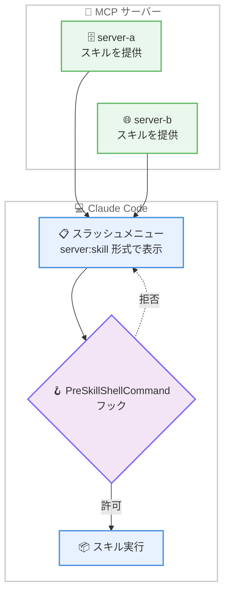

# Claude Code v2.1.332 リリース: MCP サーバー由来のスキル (ベータ) と大規模なフリーズ修正を含む 150 項目のアップデート

## メタデータ

| 項目 | 内容 |
|------|------|
| 発表日 | 2026-11-24 |
| ソース | Claude Code Changelog |
| カテゴリ | Claude Code / CLI アップデート |
| 公式リンク | https://github.com/anthropics/claude-code/blob/main/CHANGELOG.md |

## 概要

Claude Code v2.1.332 がリリースされた (npm registry の公開日時 2026-11-24 で確認)。150 項目からなるリリースであり、新機能 11 項目、バグ修正 93 項目、改善 19 項目、挙動変更 27 項目が含まれる (このうち VS Code 拡張の更新は 30 項目)。

新機能の中心は **MCP サーバー由来のスキル (ベータ)** で、MCP サーバーが提供するスキルがスラッシュメニューに `server:skill` 形式で表示されるようになった。あわせて、スキル読み込み時のインラインシェルコマンドを拒否できる **`PreSkillShellCommand` フックイベント**や、OpenTelemetry の **`assistant_response` イベント**が追加された。修正面では、名前付きパイプや無限出力のフック、MCP サーバーの標準出力フラッドなどに起因する**フリーズ・ハングの解消が多数**含まれるほか、Bedrock・Google Cloud・Microsoft Foundry での**モデルエイリアスとフォールバック動作の大幅な見直し**が行われている。特に Microsoft Foundry のデフォルトモデルが Sonnet 5.5 に変更され、Foundry と Google Cloud の Agent Platform では `sonnet` / `opus` エイリアスの指す先が更新されている点は、サードパーティプロバイダー利用者に影響が大きい。

## 詳細

### 背景

v2.1.331 では Code Mode の対応プラットフォーム拡大とエンタープライズ機能の強化が中心だった。v2.1.332 はスキルエコシステムの拡張 (MCP サーバー由来のスキル、スキル用フック) と、日常利用の安定性 (フリーズ・ハング・メモリの修正) に重点を置いたリリースとなっている。また、Sonnet 5.5 / Opus 5.5 世代への移行を反映して、サードパーティクラウドプロバイダーにおけるモデルエイリアス・デフォルトモデル・フォールバック順序の整理が進められた。

### 主な変更点

#### 1. MCP サーバー由来のスキル (ベータ、新機能)

MCP サーバーが提供するスキルを利用できるようになった (ベータ)。これらのスキルはスラッシュメニューに `server:skill` 形式で表示され、それ以外のスキルは従来どおりの名前を保つ。MCP サーバーがツールだけでなく、パッケージ化された手順 (スキル) も配布できるようになり、エコシステムの拡張点が増えた。



#### 2. `PreSkillShellCommand` フックイベント (新機能)

スキルやコマンドの読み込み時に実行されるインラインシェルコマンドを、読み込みの時点で拒否できる `PreSkillShellCommand` フックイベントが追加された。スキルが読み込み時に実行するシェルコマンドをポリシーで制御できるようになり、組織でのスキル利用のガバナンスが強化される。

なお、v2.1.331 以前のバージョンでは、このイベントを記述した設定ファイルがあると起動時にダイアログが開く点に注意が必要である。

あわせて、Mac で computer use を有効にしている場合、`computer-use` が**予約スキル名**となった。同名の自作スキルやコマンドは読み込まれなくなり、起動時に名前の変更を促す通知が表示される。

#### 3. フリーズ・ハング関連の大規模な修正 (重要)

今回のリリースでは、CLI のフリーズやハングに関する修正が特に多い。主なものは次のとおり。

- **名前付きパイプの読み取り**: 書き込み側のいない名前付きパイプ (ロックされたシークレットマネージャーがマウントした `.env` など) で Read・@ メンション・コンパクションがハングする問題を修正。読み取りは 20 秒後に失敗するようになった
- **フックの暴走出力**: フックが際限なく出力を続ける際のフリーズとメモリの暴走を、ほとんどのケースで修正。また、フックが非常に大きなログとともにブロック・失敗した際のフリーズとコンテキストあふれも修正され、約 50,000 文字を超えるテキストは短縮されるようになった
- **権限ルールの照合**: 複数のワイルドカードを含む権限ルールやフック条件を長いコマンドと照合する際のフリーズを修正
- **MCP サーバーの出力フラッド**: ローカル MCP サーバーが標準出力をフラッドさせた際に、ターミナルがフリーズし Ctrl+C も効かなくなる問題を修正
- **長い未分割文字列**: プロンプトやパイプ入力に `@` と非常に長い未分割文字列 (フォントを埋め込んだミニファイ済み CSS など) が続く場合のフリーズを修正
- **巻き戻しと /stats**: 大きな追跡ファイルの書き換え後に rewind ポイントを開く際の長いフリーズや、破損行の多いトランスクリプトでのセッション再開・`/stats` のフリーズ、`/stats` が大きなトランスクリプトを読む間のキー入力の遅延を修正

このほか、コンテキスト管理まわりでも、自動コンパクションの連続失敗後にターンが "Prompt is too long" で終了する問題や、要約が出力上限を超え続けてコンパクションが失敗する問題 (3 回の切断後に短い要約を要求するようになった) が修正された。

#### 4. クラウドプロバイダーのモデルエイリアスとフォールバックの変更 (重要)

Sonnet 5.5 / Opus 5.5 世代への移行にともない、サードパーティプロバイダーのモデル解決が大きく見直された。

**エイリアスとデフォルトモデルの変更:**

- **Google Cloud の Agent Platform と Microsoft Foundry**: `sonnet` エイリアスが Sonnet 5.5 を指すようになった。Foundry の `opus` エイリアスは Opus 5.5 を指す。**Amazon Bedrock の `sonnet` は Sonnet 4.5 のまま**
- **Microsoft Foundry のデフォルトモデル**: Sonnet 5.5 に変更された。`claude-sonnet-5-5` をデプロイするか、`ANTHROPIC_DEFAULT_SONNET_MODEL` にデプロイ済みモデルを設定する
- **Bedrock Mantle**: `sonnet` エイリアスが Haiku 4.5 に解決される問題が修正され、Sonnet 5 を意味するようになった (Sonnet 5.5 ではない)。Sonnet 5 が無効なアカウントではエラーになるため、先に有効化が必要
- **Agent Platform のリージョン変数**: `sonnet` とバックグラウンドリクエストが `VERTEX_REGION_CLAUDE_5_5_SONNET` を読むようになった。`4_5` 変数のみ設定されている場合は `CLOUD_ML_REGION` または `us-east5` に送られる
- **Foundry のモデル引退**: Claude Sonnet 4、Opus 4、Opus 4.1 が引退扱いとなり、ステップダウンはそれらより上で停止し、これらへのピン止めは引退済みの警告を出す

**フォールバック動作の修正:**

- `--fallback-model` に `sonnet` などのファミリー名を指定した際、`availableModels` が古いバージョンしか許可していないと指定が失われる問題を修正
- Bedrock・Agent Platform・Foundry で、ゲートウェイが独自の文言でモデルを拒否した場合に `opus` が失敗する問題を修正。応答する古いモデルへステップダウンするようになった
- 強制される古いモデルのリストが Agent Platform と Foundry で先頭を拒否された際に失敗する問題を修正。新しい順に並んでいれば同ファミリーの次のモデルへ下がる
- Bedrock のサブエージェントが、親のリージョンにモデルのプロファイルがない場合に失敗する問題を修正。モデル自身のプロファイル (リージョン外も可) を使うようになった
- `--model default` や Default 選択は、そのモデルが利用できない場合にエラーで停止せず、古いモデルへ移動するようになった

また、Bedrock Mantle・Agent Platform・Foundry で Sonnet 5 / 5.5 に移行したターミナル・VS Code セッションは、モードが未設定なら auto モードで開始するようになった。止めるには `disableAutoMode` を `"disable"` に設定する。

#### 5. OpenTelemetry と監視まわりの変更

- **`assistant_response` イベントの追加 (新機能)**: レスポンスロギングが有効な場合、SendUserMessage や Cowork のメッセージツールを通じて Claude が送るテキストに対して `assistant_response` イベントが記録される
- **`tool_input` の変更**: SendUserMessage / Cowork のメッセージツールで送られるテキストは、レスポンスロギング (`OTEL_LOG_ASSISTANT_RESPONSES=1`) が無効な場合、長さのみが記録されるようになった
- **`service.name` の変更**: デスクトップの Code タブセッションのデフォルト `service.name` が `claude-code-desktop` に変更された。`claude-code` をキーにしたフィルターは更新するか、`OTEL_SERVICE_NAME` で旧名を維持する
- アカウントで有効化されていない組み込みサーバーについて、起動のたびに失敗した `mcp_server_connection` イベントが報告される問題を修正

#### 6. MCP サーバーと Code Mode の修正

**MCP サーバー関連:**

- SSE MCP サーバーのイベントストリームが切断され、別エンドポイントで再開した (または再開しなかった) 後、手動で再接続するまでハングまたは全ツール呼び出しを拒否する問題を修正
- サーバーのタスク ID が 128 文字を超えると "malformed task handle" で失敗する問題を修正。1,024 文字までの ID が使えるようになった
- Remote Control セッションのプロセス再起動後に、ローカル MCP サーバーが新しいセッション ID を見る問題を修正
- MCP サーバーが多数のツールをリストする場合の起動時メモリ使用量が改善された

**Code Mode 関連:**

- 4,096 項目を超えるリストを入力に持つツール呼び出しが黙ってスキップされる問題と、非常に大きな型付き配列でフリーズする問題を修正 (後者は拒否されるようになった)
- スクリプトが 10 分を超えて実行された際に、サブエージェントが "Agent stalled" で失敗しコマンドを失う問題を修正
- すでに停止したコマンドを数分間待ち続けることがある問題や、一時停止したワークフローの再開が他のバックグラウンド作業の実行中に数分待たされる問題を修正
- セッション再開時に、以前のスクリプト変数が失われていることを Claude に前もって伝えるよう改善された
- worktree の変更を破棄する前に確認し、アーティファクトは公開前にファイルを読み、既存のアーティファクトを更新するよう改善された

#### 7. 音声入力 (タップモード) の挙動変更

タップモードの音声入力が、マイクを長く保持するようになった。認識できる音声なしで 60 秒、または上限 10 分まで (従来は 15 秒と 2 分) マイクを維持し、停止後もテキストは未送信のまま保持され、次のタップで追記できる。また、プロンプトの送信で停止し、編集した場合・パネルで覆われた場合・接続や別の録音プログラムが失われた場合には理由を表示して停止するようになった。VS Code 拡張の音声入力も同様に 60 秒 / 10 分へ延長された。

あわせて、10,000 文字を超える音声入力テキストが失われる問題も修正されている。

#### 8. VS Code 拡張の更新 (30 項目)

**新機能:**

- 提案 diff を閉じて編集が未適用のまま残る場合の通知が拡充され、回答済み diff の分割コピーに対する通知は停止された
- サイドバーの `/rewind` で会話を復元するとセルフペースの `/loop` が止まる場合の警告が追加された
- Manage plugins の各行にインストール済みバージョンが表示されるようになった

**注目の修正:**

- Windows 11 24H2 以降の VS Code 1.101 / 1.102 で、NTFS ドライブ上の会話のフォーク・メモリの保存・プロジェクト出力スタイルの作成が失敗する問題を修正
- コンパクション後の会話をリロード・再開・フォークすると、コンパクション要約が自分のプロンプトとして表示される問題を修正
- 長い返信のストリーミング中のパフォーマンス、パネルと長いセッションを開く時間、非常に大きなワークスペースでの診断情報の読み取り速度が改善された
- バックグラウンドのコマンド・エージェント・ワークフロー・モニターがアイドル中に完了しても、チャットに通知が出ない問題を修正
- diff ビューの "Copy deleted line" / "Copy changed line" が表示と異なる行をコピーする問題を修正
- スクリーンリーダーがモデルピッカーのハイライト、セッションのステータス、開いているセッション、折りたたまれたグループを読み上げない問題を修正
- IME の変換中の単語にメッセージボックスが下線を引かない問題や、ヘブライ語・アラビア語の質問が順序どおりに読めない問題など、国際化関連の修正

#### 9. そのほかの注目点

- **`claude auth login` の修正**: claude.ai ログインを保存できなかった場合に `Login successful.` と報告する問題を修正。終了コード 1 で終了し、ロックファイルの残存やディスクフルなど確認すべき点を表示する
- **PreToolUse フックの理由表示**: フックが確認を求める理由が、ターミナルの Read・Grep・Glob・Edit・Write プロンプトに表示されない問題を修正 (anthropics/claude-code#102892、anthropics/claude-code#105343)
- **CLAUDE.md の二重送信**: EnterWorktree で `.claude/worktrees` 配下の worktree に移動した後や、そこで再開した後に、CLAUDE.md とルールファイルがモデルに二重送信される問題を、ほとんどのケースで修正
- **使用量上限の報告**: リセット済みの使用量上限が Remote Control・IDE・SDK クライアントに到達済みとして報告される問題を修正
- **OAuth トークンのプレフィックス変更 (Self-hosted runner)**: `CLAUDE_CODE_OAUTH_TOKEN` のプレフィックスが `oat01-` に加えて `oat02-` でも終わるようになった。`oat01-` に一致させているプロキシルールやログスクラバーは更新し、値全体をマスクすること
- **`/permissions` の改善**: ツール名のない `rm -rf` のような、次回起動時にスキップされるルールを理由とともに拒否するようになった
- **プロキシ環境の改善**: リクエストサイズ制限のあるプロキシやゲートウェイの背後で、すべてのメッセージと `/compact` が 413 で失敗する長い会話の回復が改善された。また、圧縮レスポンスが切断・破損した場合のエラーが、生の "ZlibError fetching" ではなく平易な文言になった
- **macOS の computer use**: 新しい安全ルールに更新され、一部のアクションは拒否され、入力が遅くなることがある。また、Screen Recording の権限プロンプトから Claude Code を再起動してチャットを再開できるようになった

### 技術的な詳細

#### `PreSkillShellCommand` フックの導入時の注意

`PreSkillShellCommand` は v2.1.332 で追加されたフックイベントである。v2.1.331 以前のバージョンでは、このイベントを記述した設定ファイルがあると起動時にダイアログが開くため、バージョンを混在させて運用している組織では展開順序に注意する。

#### Microsoft Foundry のデフォルトモデル変更への対応

Foundry のデフォルトモデルが Sonnet 5.5 になったため、未デプロイの場合は次のいずれかの対応が必要になる。

```bash
# 方法 1: claude-sonnet-5-5 を Foundry にデプロイする

# 方法 2: デプロイ済みのモデルを環境変数で指定する
export ANTHROPIC_DEFAULT_SONNET_MODEL=<デプロイ済みのモデル名>
```

#### Agent Platform のリージョン変数

Google Cloud の Agent Platform では、`sonnet` とバックグラウンドリクエストが新しいリージョン変数を参照する。

```bash
# Sonnet 5.5 用のリージョン変数を設定する
export VERTEX_REGION_CLAUDE_5_5_SONNET=us-east5

# 4_5 変数のみ設定されている場合、リクエストは
# CLOUD_ML_REGION または us-east5 に送られる
```

#### 自動モード開始のオプトアウト

Bedrock Mantle・Agent Platform・Foundry で Sonnet 5 / 5.5 に移行したセッションは auto モードで開始するようになった。従来の動作を維持する場合は設定を追加する。

```json
{
  "disableAutoMode": "disable"
}
```

## 開発者への影響

### 対象

- **MCP サーバーの開発者・利用者**: MCP サーバーがスキルを配布できるようになった (ベータ)。利用側はスラッシュメニューの `server:skill` 形式の項目として確認できる。SSE サーバーの再接続やタスク ID 長の修正により信頼性も向上した
- **組織の管理者・セキュリティ担当者**: `PreSkillShellCommand` フックで、スキル読み込み時のインラインシェルコマンドをポリシーで拒否できるようになった
- **Microsoft Foundry の利用者**: デフォルトモデルが Sonnet 5.5 に変更され、Sonnet 4 / Opus 4 / Opus 4.1 が引退扱いになった。`sonnet` / `opus` エイリアスの指す先も更新されている
- **Google Cloud Agent Platform の利用者**: `sonnet` エイリアスが Sonnet 5.5 を指すようになり、リージョン変数 `VERTEX_REGION_CLAUDE_5_5_SONNET` が参照される
- **Bedrock の利用者**: `sonnet` エイリアスは Sonnet 4.5 のまま変更なし。Bedrock Mantle では `sonnet` が Sonnet 5 を意味するようになった。サブエージェントのプロファイル解決も改善された
- **OpenTelemetry で監視している組織**: デスクトップ Code タブの `service.name` が `claude-code-desktop` に変わるため、フィルターの更新が必要になる場合がある
- **Self-hosted runner の運用者**: OAuth トークンのプレフィックスに `oat02-` が追加されたため、プロキシルールやログスクラバーの更新が必要になる場合がある
- **フック・権限ルールを多用する利用者**: フックの大量出力やワイルドカード照合によるフリーズが解消され、フックが確認を求める理由も表示されるようになった

### 必要なアクション

1. **アップデートの適用**: フリーズ・ハング・メモリに関わる修正が非常に多いため、早期の更新を推奨する
2. **Foundry のモデルデプロイ確認**: デフォルトモデルが Sonnet 5.5 になったため、`claude-sonnet-5-5` のデプロイまたは `ANTHROPIC_DEFAULT_SONNET_MODEL` の設定を行う。Sonnet 4 / Opus 4 / Opus 4.1 へのピン止めは見直す
3. **Agent Platform のリージョン変数確認**: `VERTEX_REGION_CLAUDE_4_5_SONNET` のみ設定している場合、`VERTEX_REGION_CLAUDE_5_5_SONNET` の追加を検討する
4. **OpenTelemetry フィルターの更新**: `service.name` を `claude-code` で絞り込んでいる場合、`claude-code-desktop` を追加するか `OTEL_SERVICE_NAME` を設定する
5. **トークンマスキングルールの更新 (Self-hosted runner)**: `oat01-` 固定のマッチングを使っている場合、`oat02-` にも対応させ、値全体をマスクする
6. **`computer-use` という名前のスキル・コマンドの確認**: Mac で computer use を使っている場合、同名の自作スキル・コマンドは読み込まれなくなるため、名前を変更する

### 移行ガイド (該当する場合)

- **auto モードで開始させたくない場合**: Bedrock Mantle・Agent Platform・Foundry で Sonnet 5 / 5.5 に移行したセッションは auto モードで開始する。`disableAutoMode` を `"disable"` に設定して無効化できる
- **バージョン混在環境で `PreSkillShellCommand` を導入する場合**: v2.1.331 以前では設定ファイルにこのイベントがあると起動時にダイアログが開くため、クライアントの更新を先行させる
- **SDK / `claude -p` でテキストを中継している場合**: feature flags が取得されない環境 (クラウドやテレメトリ無効時) では、Opus 4.8 以降、ミッドターンのメッセージがユーザーのものとして扱われる。中継テキストには `isSynthetic: true` を付ける

## 関連リンク

- [Claude Code Changelog](https://github.com/anthropics/claude-code/blob/main/CHANGELOG.md)
- [v2.1.332 リリースページ](https://github.com/anthropics/claude-code/releases/tag/v2.1.332)
- [Claude Code 公式ドキュメント](https://code.claude.com/docs)
- [claude-code リポジトリ](https://github.com/anthropics/claude-code)

## まとめ

Claude Code v2.1.332 は、MCP サーバー由来のスキル (ベータ) と `PreSkillShellCommand` フックによってスキルエコシステムを拡張し、名前付きパイプ・フックの暴走出力・MCP サーバーの出力フラッドなどに起因する多数のフリーズ・ハングを解消した安定性重視のリリースである。Sonnet 5.5 / Opus 5.5 世代への移行を反映し、Microsoft Foundry のデフォルトモデル変更と旧モデルの引退、Google Cloud Agent Platform のエイリアス更新、Bedrock のフォールバック改善など、サードパーティプロバイダーのモデル解決も大きく整理された。OpenTelemetry の `service.name` 変更や OAuth トークンプレフィックスの追加など、監視・運用設定の更新が必要になる変更も含まれるため、該当する組織は事前の確認を推奨する。
